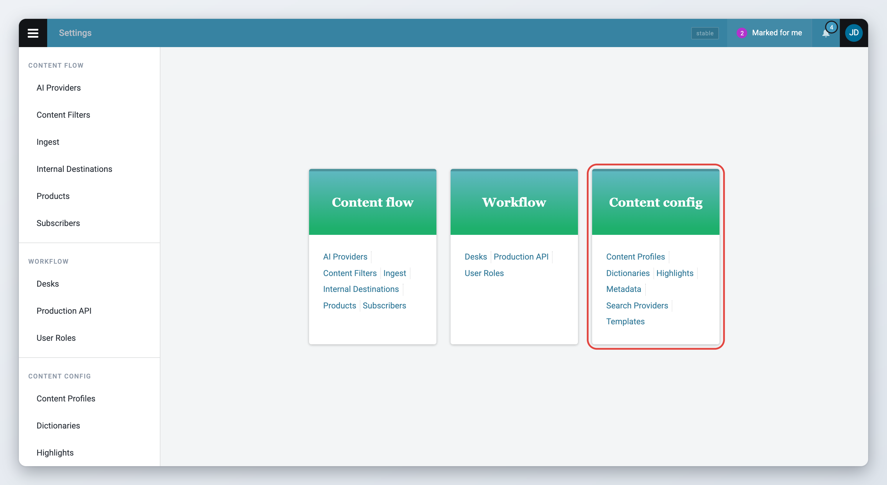

# Content Configuration

Content configuration decides what a news item looks like in Superdesk: which fields it has, which of them are required, which lists of values users pick from, which templates they start from and which dictionaries check their spelling.

This section is for administrators. You find all of these settings in the **Main menu** under **Settings**, in the **Content config** group:

* **Content Profiles**: the fields of text, picture, video and audio items. See [Content profiles](content-profiles.md).
* **Metadata**: controlled vocabularies, custom fields and custom blocks. See [Metadata and custom fields](metadata-and-custom-fields.md).
* **Templates**: prefilled starting points for new items, including scheduled items. See [Templates, macros and dictionaries](templates-macros-and-dictionaries.md).
* **Dictionaries**: spell check dictionaries and abbreviations. See [Dictionaries and spell checking](templates-macros-and-dictionaries.md#dictionaries-and-spell-checking).
* **Highlights**: highlight lists, described on the [Highlights](../../workspace-and-search/highlights.md) page.
* **Search Providers**: external sources users can search. See [Search providers](#search-providers) below.


You only see a settings page if your user role has the matching privilege. See [For administrators](#for-administrators) at the end of this page for the list.


<figure><figcaption>
The Content config group on the Settings page
</figcaption></figure>

The other groups on the Settings page are described in [Desk Creation and Desk Management](../desk-creation-and-desk-management.md), [User Management and User Roles](../user-management-and-user-roles.md) and [Defining Publishing in Superdesk](../defining-publishing-in-superdesk/README.md).

## Highlights

Highlight lists collect items for top stories, summaries or digests. You set them up in **Settings** > **Highlights**. How to configure and use them is described on the [Highlights](../../workspace-and-search/highlights.md) page. The template that formats a generated highlight item is a [highlights template](templates-macros-and-dictionaries.md#highlights-templates).

## Search providers

Search providers connect Superdesk to external archives and photo services, so users can search them from the Search view and add their content to items. Go to **Settings** > **Search Providers** and click **Add New** to add one.

* **Provider Type**: the kind of service. The types available depend on what is installed on your server.
* **Name**, **Source** and **URL**, or **Username** and **Password** for providers that need a login.
* **Status**: turn it off to close the provider without deleting it.
* **Is Default**: makes this provider the one selected first in Search.
* **Open advanced search panel by default** and **Default view**: how the provider's results open.

Once a user has fetched an item from a provider into a desk, you can no longer remove the provider, only close it by turning off **Status**. How users search providers is described in [Searching Content in Superdesk](../../workspace-and-search/searching-content-in-superdesk.md).

## For administrators

### Privileges

These privileges control the settings in this section. Set them in **Settings** > **User Roles**, see [User Management and User Roles](../user-management-and-user-roles.md).

| Privilege (as shown in User Roles) | What it unlocks |
|---|---|
| **Content Profile** | **Settings** > **Content Profiles** |
| **Vocabularies Management** | **Settings** > **Metadata**, including uploading config files |
| **Templates** | Creating desk templates and making templates public. Any user can open **Settings** > **Templates** to manage their own personal templates. |
| **Manage other user personal template** | Seeing and editing other users' personal templates (the **Private** filter) |
| **Dictionaries List Management** | **Settings** > **Dictionaries**. Creating global dictionaries also needs an administrator account. |
| **Highlights/Summary List Management** | **Settings** > **Highlights** |
| **Manage Search Providers** | **Settings** > **Search Providers** |

### Optional modules

* **Predefined text fields** are the `predefinedTextField` client extension. It is not loaded by the default build. Its placeholders are set with the extension's `placeholderMapping` configuration.
* The **Datetime** field type comes from the `datetimeField` client extension, which the default build loads.

### Client configuration

These keys go in the client configuration (`superdesk.config.js`):

* `authoring.customEditorFeatures`: the custom editor tags (`inlineStyles`) and character buttons (`characterInsertions`), each with an `id`, `label`, `icon`, optional `tooltip` and optional `shortcut`. They appear as formatting options in content profiles.
* `spellchecking.spellcheckersByLanguage`: which spellchecker each language uses, for example `{"en": {"spellcheckerId": "languagetool"}}`. The built-in defaults are `grammalecte` for `fr` and `leuven_dutch` for `nl`.
* `spellchecking.defaultRunningMode`: `remember-user-preference` (default) or `initially-disabled`, to start the editor with spell checking off. It can also be set per language in `spellcheckersByLanguage`.
* `spellchecking.shortcut`: the shortcut that turns the spell checker on and off (Alt+S by default).
* `features.useTansaProofing`: use Tansa instead of the built-in spell checking.

### Server configuration

* External spellcheckers register themselves when they are configured: `LANGUAGETOOL_API_URL` (and optionally `LANGUAGETOOL_API_KEY`) for LanguageTool, `GRAMMALECTE_URL` or `GRAMMALECTE_CLI` for Grammalecte, and `LEUVEN_DUTCH_API_KEY` for the Leuven spellchecker. Each can be set in the server settings or as an environment variable.
* `MACROS_MODULE` is the Python module the server loads macros from (`superdesk.macros` by default). A macro's `desks` attribute limits it to the listed desks.
