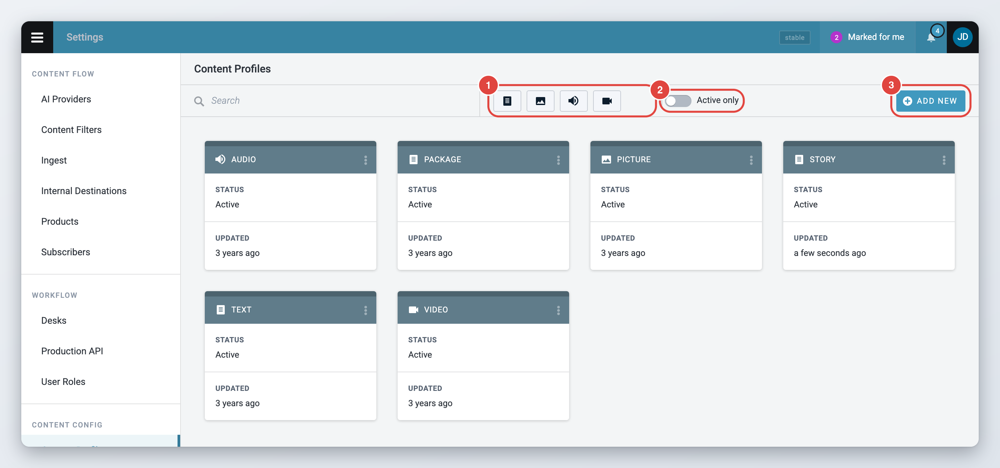
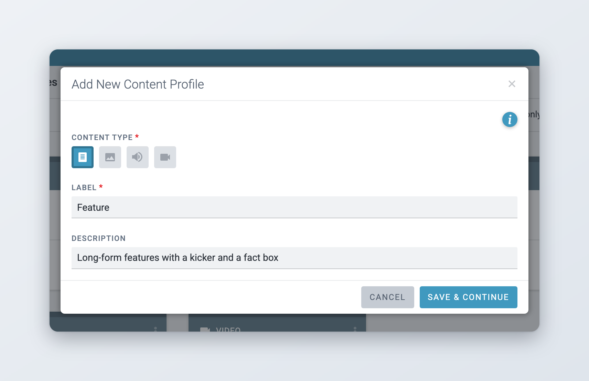
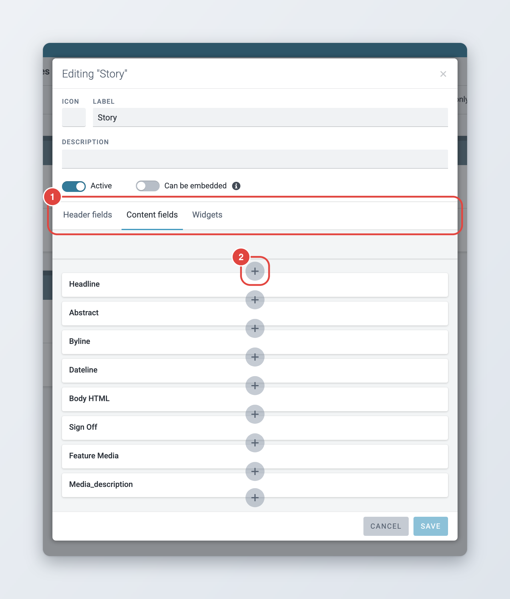
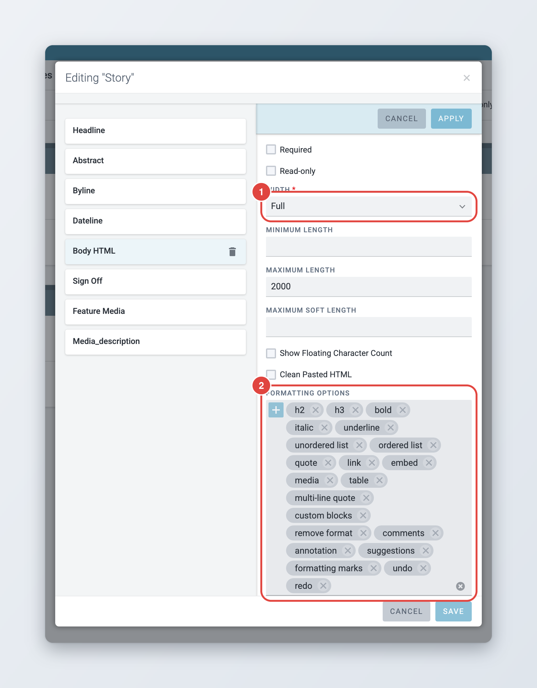

# Content profiles

A content profile is the schema of an item. It lists the fields an item has, in which order, how wide each field is and which fields must be filled in before the item can be published.

Users do not choose a profile directly. They create items from templates, and every template points to a profile. When you create a text profile, Superdesk also creates a public template with the same name, so the new profile is ready to use. See [Templates](templates-macros-and-dictionaries.md#templates).

To manage profiles, go to **Settings** > **Content Profiles**.

## The profile list

Each profile is shown as a card with its name, its icon, its status (**Active** or **Inactive**) and when it was last updated. Inactive profiles are greyed out.

Above the cards you can:

* search by name,
* show only one content type with the type buttons (text, picture, audio, video),
* turn on **Active only** to hide inactive profiles.

<figure><figcaption>
Content profiles, with the type filters and the Active only switch
</figcaption></figure>

## Creating a content profile



### Start a new profile

Click **Add New** at the top right. The **Add New Content Profile** dialog opens.



### Choose the content type

Under **Content Type**, click the icon of the type you need: text, picture, audio or video. You can have many text profiles, but only one profile for each of the other types. A type button is disabled when that type already has a profile.



### Name the profile

Enter a **Label** (at most 40 characters) and, optionally, a **Description**. The label must be unique.



### Save and continue

Click **Save & Continue**. The profile is saved and opens for editing.



### Activate the profile

A new profile is inactive. Turn on **Active**, set up the fields as described below and click **Save**. Only active profiles can be used for new items and templates.



<figure><figcaption>
Creating a content profile
</figcaption></figure>

## Editing a content profile

Open the actions menu (three dots) on the profile card and choose **Edit**. The top of the edit dialog has the general settings of the profile:

* **Icon**: the icon shown for items with this profile in lists and in the editor (since Superdesk 2.8). Click the icon to pick another one.
* **Label** and **Description**.
* **Active**: whether the profile can be used.
* **Can be embedded**: lets users embed articles that use this profile in the body of other articles (since Superdesk 2.7). The receiving field needs the **embed articles** formatting option, see [Formatting options](#formatting-options).

Below them are three tabs: **Header fields**, **Content fields** and **Widgets**. Click **Save** at the bottom of the dialog to keep your changes.

<figure><figcaption>
The profile editor: general settings at the top, then the field tabs
</figcaption></figure>

## Header fields and content fields

The two field tabs follow the layout of the editor:

* **Header fields** appear in the item header, above the text. They hold metadata such as category, subject, genre, urgency, priority, place, keywords, authors, language and editorial notes.
* **Content fields** make up the body of the item: headline, abstract, byline, dateline, body, feature media, footer and similar fields.

Some fields can only go in one tab. Vocabularies and the standard metadata fields belong in the header. Embed, related content and URL fields belong in the content. Slugline, custom text fields, custom date fields and the field types under **Other fields** can go in either.

To work with the fields of a tab:

* **Add a field**: click the round **+** button (**Add new field**) above or below an existing field, then pick the field from the list. Custom fields show their type in brackets, for example "Kicker (text)". The field is inserted at that position and its options open.
* **Change a field**: click the field to open its options, change them and click **Apply**.
* **Reorder fields**: drag a field up or down.
* **Remove a field**: click the trash icon on the field.

Fields marked as required show a red **required** label in the list.

If you remove a field from a profile, Superdesk also removes the prefilled value of that field from the templates that use the profile.

## Field options

The options you see depend on the field. Every field has **Required**, **Read-only** and **Width**.

| Option | What it does |
|---|---|
| **Required** | The item cannot be published while the field is empty. Users get an error naming the field. |
| **Read-only** | Users can see the field but not change it. Useful together with a template that prefills the value. |
| **Width** | How much of the row the field takes: **Full**, **Half**, **Third** or **Quarter**. |
| **Minimum length** / **Maximum length** | Text fields only. The item cannot be published when the text is shorter or longer. |
| **Maximum soft length** | Text fields only (since Superdesk 3.1). Characters past this length are highlighted as a warning, but the item can still be published. |
| **Show Floating Character Count** | Fields with formatting options (since Superdesk 3.5). Shows a character counter under the toolbar while the user types. |
| **Clean Pasted HTML** | Standard text fields. Removes the formatting from text pasted into the field. |
| **Formatting options** | Fields with a toolbar, such as headline, abstract, body, footer and custom text fields. See below. |
| **Hide Date** | Dateline only (since Superdesk 2.7). Hides the month and day of the dateline in the editor, so users only set the place. |
| **Show Crops** | Feature media only. Shows the crops of the feature picture in the editor. |
| **Show Image Title** | Media fields and fields with the **media** formatting option. Shows the title of attached pictures in the editor. |
| **Show in preview** | Vocabulary fields only. Shows the field in the item preview. Other fields are always shown in the preview when they have a value. |
| **Prefill the field with text from:** | SMS field only. Fills the field with the **Abstract** or the **Headline**. |

<figure><figcaption>
Field options for the body field
</figcaption></figure>

## Formatting options

**Formatting options** decide which buttons the field's toolbar has and which formatting users can apply. The headline only offers **uppercase** and **lowercase**. Rich text fields (abstract, body, footer and custom text fields) offer:

* text styles: **bold**, **italic**, **underline**, **strikethrough**, **superscript**, **subscript**, **uppercase**, **lowercase**,
* structure: **h1** to **h6**, **unordered list**, **ordered list**, **quote**, **pre**, **table**, **multi-line quote**,
* inserts: **link**, **media**, **embed**, **embed articles**, **custom blocks**,
* editing tools: **remove format**, **remove all format**, **formatting marks**, **tab**, **tab as space**, **undo**, **redo**,
* collaboration: **comments**, **suggestions**, **annotation**.

Some installations rename **multi-line quote**, for example to "Pullquote". **embed articles** works together with the **Can be embedded** profile setting, and **custom blocks** with the blocks you define in [Custom blocks](metadata-and-custom-fields.md#custom-blocks). How users work with these buttons is described in [Writing and formatting](../../content-management/creating-and-editing-content-items/writing-and-formatting.md).

## Custom editor tags

*Available since Superdesk 3.5.*

Your Superdesk can have extra editor controls that are set up in the client configuration: custom tags that mark and style a word or phrase (for example a person or company name), and buttons that insert a special character (for example an en dash or a thin space). Each one can have its own keyboard shortcut.

When such controls exist, they appear in the **Formatting options** list of rich text fields under the label given in the configuration. Add them to a field the same way as any other formatting option. The controls available, their names and shortcuts differ between installations. See [For administrators](README.md#for-administrators).

## Widgets

The **Widgets** tab lists the widgets of the widget bar, such as comments, versions or macros. Clear the checkbox of a widget to hide it for items that use this profile.

## Profiles for pictures, video and audio

*Available since Superdesk 2.7.*

Picture, video and audio items have their own content profiles, one for each type. You edit them the same way as text profiles. The fields you add to the profile, and mark as required, are the ones users see and must fill in when they upload media and when they edit the metadata of a media item. See [Edit Media Items](../../content-management/creating-and-editing-content-items/edit-media-items.md).

Media profiles are not used by templates. Templates always use a text profile.

Planning items, events and coverages have their own profiles, set up in the Planning component. See [Planning administration](../../superdesk-planning-component/planning-administration.md).

## Deactivating and removing a profile

To stop users from creating new items with a profile, edit it and turn off **Active**. Items that already use the profile keep it.

You cannot deactivate a profile while a template uses it or a desk has it as its **Default Content Profile**. Superdesk shows an error that names the templates, and the profile stays active. Change those templates and desk settings first.

To delete a profile, choose **Remove** in the card's actions menu and confirm. **Remove** is disabled once any item has been created with the profile ("Sorry, but profile is in use."). When you remove a profile, templates and desks that pointed to it lose that setting.
