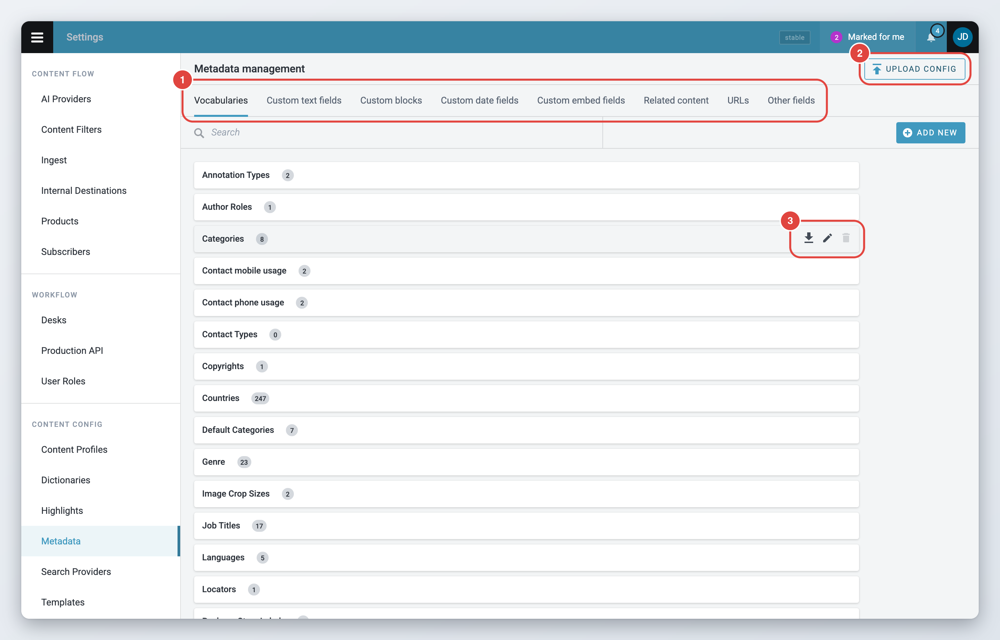
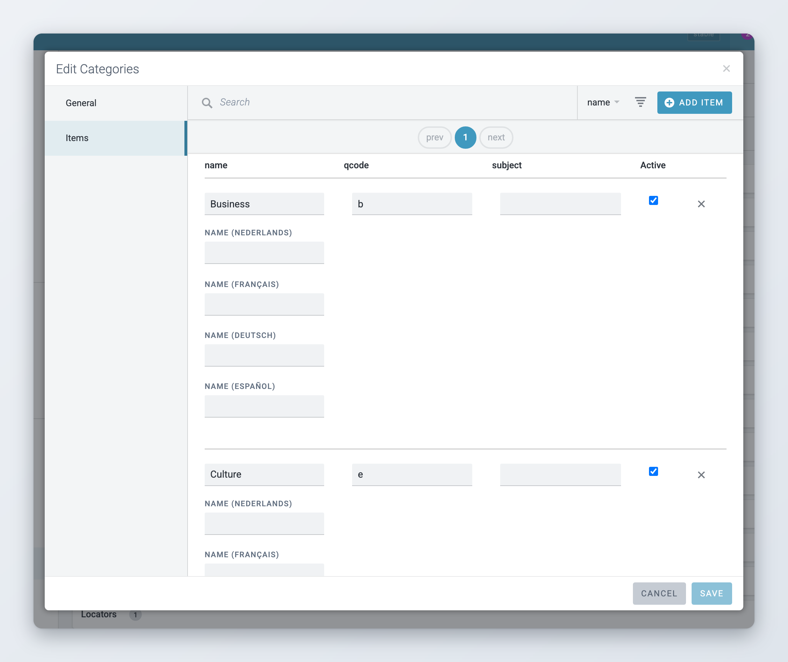
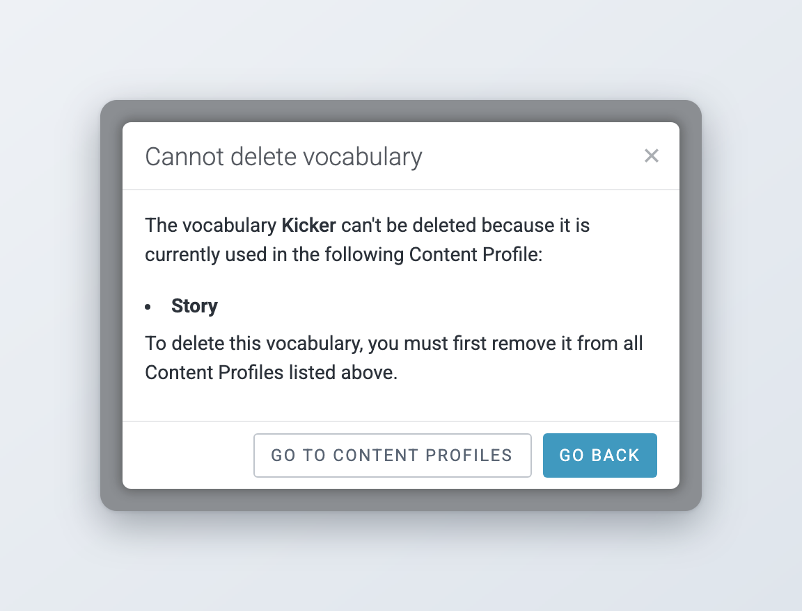
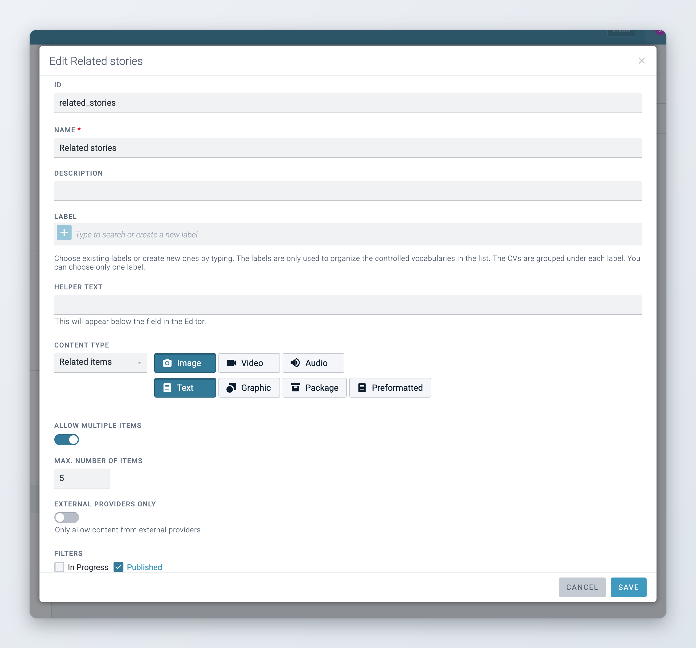
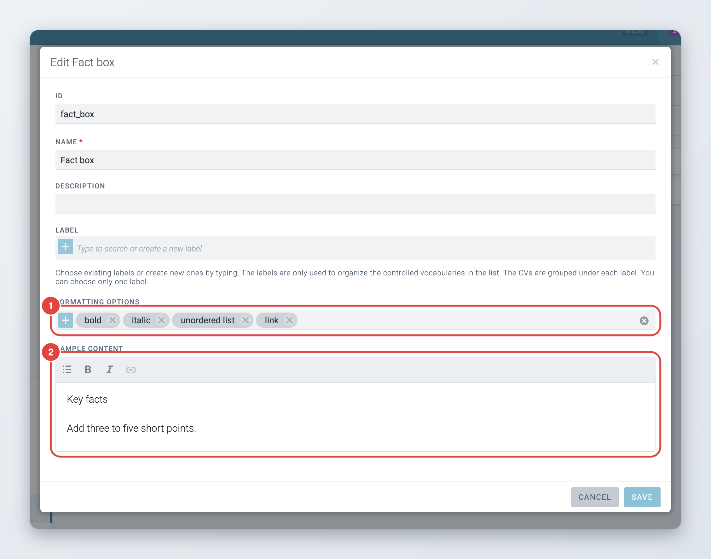

# Metadata and custom fields

**Settings** > **Metadata** opens **Metadata management**. This is where you define the lists of values users pick from (vocabularies) and the extra fields you can add to content profiles (custom fields). A new vocabulary or custom field does nothing on its own: add it to a content profile to make it appear in items.

The page has one tab per kind of field:

| Tab | What it holds | Where it can go in a profile |
|---|---|---|
| **Vocabularies** | Controlled vocabularies: lists of values such as categories, genres or regions | Header |
| **Custom text fields** | Extra text fields with their own formatting options | Header or content |
| **Custom blocks** | Reusable formatted snippets for the body | Inserted in rich text fields |
| **Custom date fields** | A date picker with shortcuts | Header or content |
| **Custom embed fields** | An embed code (for example a video player) with a description | Content |
| **Related content** | Links to other items or media | Content |
| **URLs** | A list of links | Content |
| **Other fields** | Field types added by extensions, such as a date and time field | Header or content |

Each tab lists its entries with a search box and an **Add New** button. Hover an entry to see its actions: **Download config**, **Edit** and **Delete**. On the **Vocabularies** tab, the grey number next to a name is the number of items in the vocabulary.

<figure><figcaption>
Metadata management, Vocabularies tab
</figcaption></figure>

## Vocabularies

A vocabulary (also called a controlled vocabulary, or CV) is a list of values that users choose from in the item header. Superdesk ships with several, such as Categories, Genre, Urgency, Priority, Languages and Regions. You can edit their items and add your own vocabularies.



### Create the vocabulary

On the **Vocabularies** tab, click **Add New**. The **Create** dialog opens on its **General** tab.



### Fill in the general settings

* **ID** (required): the internal name. Use only letters, digits, `-` and `_`. You cannot change it later, and it must not clash with a system field.
* **Name** (required): the field name users see in the editor and in content profiles.
* **Description**: shown next to the name in the Metadata list.
* **Label**: a group for the Metadata list, see [Labels](#labels).
* **Width of the popup window (in pixels)**: the width of the selection pop-up in the item header, at least 200.
* **Helper text**: up to 120 characters, shown below the field in the editor.
* **Show to users as**: **Single selection**, **Multi selection** or **Do not show**. A vocabulary set to **Do not show** is not offered as a content profile field.
* **Disable selection of an entire category**: for vocabularies with parent and child items. Users can then pick only individual items, not a whole parent at once.
* **Available in user/desk preferences**: lets users and desks mark preferred values from this vocabulary, which are then offered first. See [Preferred vocabulary values](../desk-creation-and-desk-management.md#preferred-vocabulary-values).



### Add the items

Switch to the **Items** tab and add the values, see below.



### Save

Click **Save**. Then add the vocabulary to a content profile on the **Header fields** tab.



### Editing vocabulary items

To change the values of a vocabulary, hover it, click **Edit** and open the **Items** tab. Items are shown in a table with search, sorting and pages.

* Click **Add Item** to add a row.
* Fill in the columns. By default these are `name`, `qcode` (the code stored with the item) and `parent` (the qcode of the parent item, for hierarchies). Some vocabularies have other columns, such as a colour or a short name.
* Clear the **Active** checkbox to retire an item. Inactive items are no longer offered to users.
* Remove an item with the trash icon at the end of its row.

If your Superdesk has more than one language set up, each item has an extra **Name (*language*)** input per language, so users see the value in the language of the item (since Superdesk 2.1).

Some vocabularies require a column to hold unique values. Superdesk then shows "The values should be unique for ..." and does not save until you fix it.

The columns themselves come from the vocabulary's schema, which you cannot change in the dialog. To add a column, download the vocabulary's config, add the column to its `schema` and upload it again, see [Uploading and downloading configuration](#uploading-and-downloading-configuration).

<figure><figcaption>
Editing the items of a vocabulary
</figcaption></figure>

### Labels

The **Label** of a vocabulary only organises the Metadata list. Vocabularies with the same label are listed together under it. Type to pick an existing label or to create a new one. Each vocabulary can have one label. Once any label exists, vocabularies without one are listed under **Other**.

### Deleting a vocabulary

*Available since Superdesk 3.4.*

Hover the vocabulary and click the trash icon. The same works for custom fields and custom blocks on the other tabs.

* If no content profile uses the vocabulary, the **Delete vocabulary?** dialog asks you to confirm. Deleting cannot be undone.
* If one or more profiles use it, the **Cannot delete vocabulary** dialog lists those profiles. Remove the field from them first. **Go to content profiles** takes you there.

The vocabularies that ship with Superdesk cannot be deleted. Their trash icon is disabled.

<figure><figcaption>
A vocabulary that is still used by a content profile cannot be deleted
</figcaption></figure>

### Uploading and downloading configuration

*Available since Superdesk 2.5.*

You can move vocabularies and custom blocks between Superdesk instances, or edit them in bulk, as JSON files.

* **Download config** on an entry saves it as a JSON file.
* **Upload Config** at the top of the **Vocabularies** and **Custom blocks** tabs opens the **Upload config** dialog. Drop one or more JSON files on it, or click **Select Files**, then click **Apply config**.


Uploading a config file overwrites the existing configuration of the vocabularies it contains.


## Custom fields

Custom fields add fields that Superdesk does not have by default. You create them on the matching tab of Metadata management with **Add New**, then add them to a content profile. All custom fields have an **ID**, a **Name**, a **Description**, a **Label** and a **Helper text**, as described for vocabularies.

### Custom text fields

A text field with its own toolbar. Turn on **Single line** for a one-line field, for example a kicker or a subtitle. In the content profile you set its length limits and formatting options like for any other text field.

### Custom date fields

A date picker. Under **Shortcuts** you define quick-pick buttons, each with a **Label**, a **Value** and a unit (**days**, **weeks**, **months** or **years**), for example "In two weeks".

### Custom embed fields

A field where users paste an embed code or a URL, with a **Description** line below it. Users can generate the embed from a URL and preview it in the editor.

### Related content

A field that links other items to the article. Settings:

* **Content Type**: **Media gallery** for a gallery of pictures, video or audio, or **Related items** to link any kind of item.
* The allowed item types: **Image**, **Video** and **Audio**, plus **Text**, **Graphic**, **Package** and **Preformatted** for related items. Pick at least one.
* **Allow Multiple Items**, and **Max. number of items** (from 2 to 99).
* **Filters**: **In Progress** and **Published**. Only items with the selected statuses can be added.
* **External Providers Only**: for related items, only allows content from external providers (since Superdesk 2.11).

<figure><figcaption>
Settings of a related content field
</figcaption></figure>

### URLs

A field where users add one or more links. It has no extra settings.

### Other fields

This tab holds field types that come from Superdesk extensions. After **Name**, choose the **Field type**. Each type then shows its own settings, and every type has **Required** and **Read-only**.

The default build includes **Datetime**, a date and time picker. You can set the **Initial time offset** (in minutes) used when a template fills in the value, and the **Time increment steps** offered to users.

### Predefined text fields

*Available since Superdesk 2.5.*


This is an optional module. If you do not see it, ask your administrator.


A predefined text field lets users pick a text from a list you prepare, for example standard disclaimers or boilerplate paragraphs. Create it on the **Other fields** tab with the field type **Predefined text field**.

Under **Configure predefined values**, add one entry per text, each with a **Title** (what users pick) and a **Definition** (the text that is inserted). Turn on **Allow switching to free text input** if users may also type their own text. Your Superdesk may also offer placeholders that are replaced by item data when the text is inserted. They are listed above the values.

## Custom blocks

*Available since Superdesk 2.8.*

A custom block is a formatted snippet that users insert into the body as one unit, for example a fact box, a list of key points or a pull quote. You define the block once, with its own formatting options and sample content.



### Create the block

On the **Custom blocks** tab, click **Add New**. Enter an **ID** and a **Name**.



### Choose its formatting

Under **Formatting Options**, choose the formatting users can use inside the block, for example **h2**, **bold** and **unordered list**.



### Write the sample content

Under **Sample content**, write the text the block starts with when it is inserted, and format it with the toolbar.



### Save and enable it in a profile

Click **Save**. Then edit the content profile, open the body field and add **custom blocks** to its **Formatting options**. Users can now insert the block from the toolbar of that field.



<figure><figcaption>
Defining a custom block
</figcaption></figure>

## Languages

The languages users can set on an item, and translate items into, come from the **Languages** vocabulary on the **Vocabularies** tab. To offer a new language, add it there with its language code as the qcode. Translation is described in [Translating content](../../content-management/translating-content.md).
