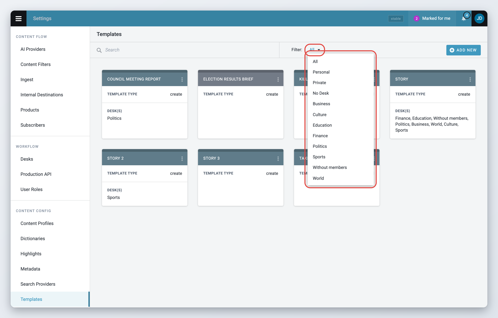
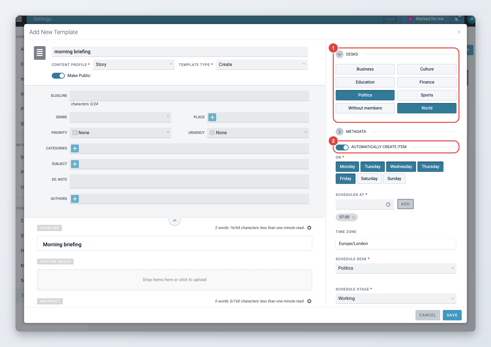
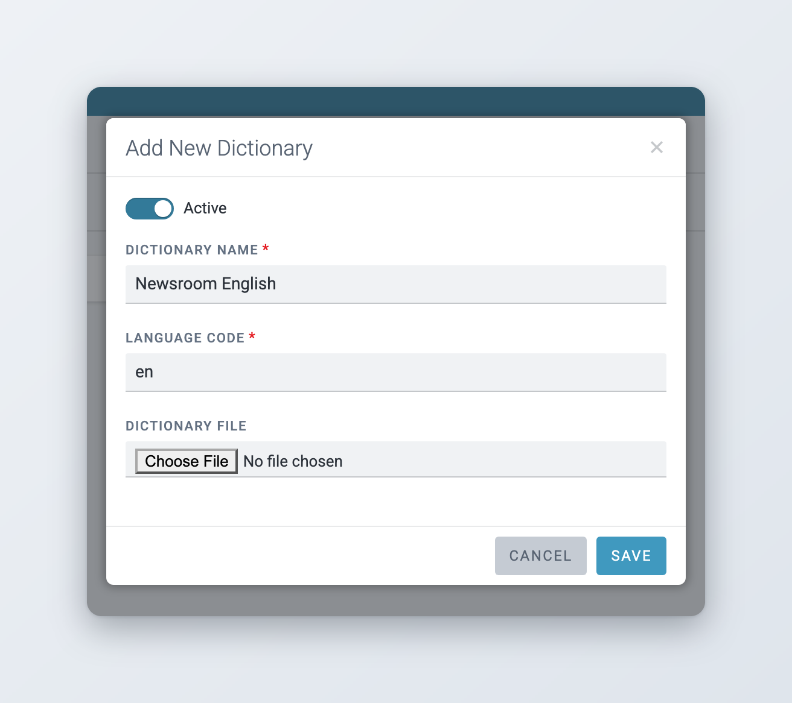

# Templates, macros and dictionaries

Templates give new items a prefilled starting point, macros change items automatically, and dictionaries hold the words that spell checking accepts. This page explains how administrators set up all three.

## Templates

A template is a content profile with some fields already filled in. Users pick a template when they create an item, and the item starts with the template's values. Templates save time on recurring stories, and they can create items on a schedule.

Go to **Settings** > **Templates** to manage them. Each template is shown as a card with its type, its desks and, for scheduled templates, the days and times it creates items. Superdesk saves template names in lower case.

There are three template types:

* **Create**: the usual template for new items.
* **Highlights**: formats the item generated from a highlight list. See [Highlights templates](#highlights-templates).
* **Kill**: the text sent to subscribers when an item is killed or taken down. See [Kill templates](#kill-templates).

### Desk templates and personal templates

* A **desk template** is public. It is available to the members of the desks you assign it to.
* A **personal template** is private. Only the user who created it can use it.

Every user can create personal templates. To create desk templates, or make a template public, you need the **Templates** privilege. Users with the **Manage other user personal template** privilege can also see and manage other users' personal templates.

Use the **Filter** menu above the cards to show **All** templates, your **Personal** templates, other users' **Private** templates, templates with **No Desk**, or the templates of one desk.

<figure><figcaption>
The template list
</figcaption></figure>

### Highlights templates

A highlights template formats the item that Superdesk generates from a highlight list. You choose it in the highlight list configuration. A highlights template can be assigned to one desk only. See [Highlights](../../workspace-and-search/highlights.md).

### Kill templates

Kill templates hold the text sent to subscribers when an item is killed or taken down. Superdesk comes with them already set up. You can edit their text, but you cannot rename or remove them, and you cannot create new ones. See [Kill and takedown templates](../../content-management/updates-corrections-kills-and-takedowns/README.md#kill-and-takedown-templates).

## Creating a template



### Start a new template

Click **Add New**. The **Add New Template** editor opens.



### Name it and choose the profile

Enter the **Template name** (at most 40 characters). Choose the **Content Profile**. Only active text profiles are listed. The fields of the editor follow the profile you choose.



### Choose the type and visibility

Choose the **Template Type**: **Create** or **Highlights**. Turn on **Make Public** to make it a desk template. Leave it off for a personal template.



### Fill in the fields

Fill in the fields you want every new item to start with, such as slugline, category, byline or a standard body text. Fields you leave empty stay empty in new items.



### Assign desks

For a public **Create** template, select the desks under **Desks** on the right. For a **Highlights** template, choose one **Desk**.



### Set the metadata

Open the **Metadata** panel to set **Not For Publication**, **Legal**, **Usage terms**, **Language** and **Target Subscribers** for new items.



### Save

Click **Save**. The template appears in the list and, for desk templates, in the create menu of the assigned desks.



Users find desk templates in the create menu of the Monitoring view, under **More templates...**. Each desk can also have a **Default Content Template**, which is offered first in the desk's create menu. It is set on the desk's **General** tab, see [Desk Creation and Desk Management](../desk-creation-and-desk-management.md#general-tab).

Users can also turn an item they are editing into a template: in the editor, open **More actions** (three dots) and choose **Save as template**. Users with the **Templates** privilege can save it as a **Desk template** for a chosen **Desk**.

## Scheduled templates

A public **Create** template can create a new item automatically at set times. This is useful for recurring items such as a daily weather report or a weekly agenda.



### Turn on scheduling

In the template editor, turn on **Automatically create item**.



### Choose days and times

Under **On**, select the weekdays. Under **Scheduled at**, pick a time and click **Add**. Repeat for more times. To remove a time, click it.



### Check the time zone

The time zone is filled in for you. Change it if the times refer to another zone.



### Choose where items go

Choose the **Schedule Desk** and the **Schedule Stage** that receive the new items. Optionally choose a **Schedule Macro** to run on each new item. Only macros available on the chosen desk are listed.



### Save

Click **Save**. The template card now shows **Automated item creation** and the **Scheduled Time(s)**.



You cannot save a scheduled template until it has at least one day, one time, a desk and a stage.

<figure><figcaption>
A template that creates an item every weekday morning
</figcaption></figure>

## Removing a template

Open the template's actions menu and choose **Remove**, then confirm. You cannot remove a template that a desk uses as its **Default Content Template**. Superdesk names those desks so you can change their default first.

## Macros

A macro is a small program that changes an item automatically, for example to convert imperial units to metric, fill in the abstract from the body or route an item to a desk. Macros are written by developers and installed on the server. You cannot create them in the Superdesk interface, but you decide where they run.

Each macro has an access type and an action type:

* **frontend** macros can be run by users. **backend** macros only run automatically.
* **direct** macros change the item straight away. **interactive** macros ask the user to confirm the changes first.

Some macros are only available on certain desks. To see which macros a desk has, edit the desk in **Settings** > **Desks** and open its **Macros** tab. Each macro is listed with its access and action type.

You can attach macros in these places:

* **Desk stages**: the **Incoming Rule**, **Moved onto stage Rule** and **Outgoing Rule** of a stage run a macro when an item enters, is moved onto or leaves the stage. See [Stages tab](../desk-creation-and-desk-management.md#stages-tab).
* **Ingest routing**: a routing action can run a macro on ingested items. See [Ingesting News Items and Events](../../integrations-and-advanced-features/ingesting-news-items-and-events.md).
* **Internal destinations**: a macro can run on items sent to an internal destination. See [Defining Publishing in Superdesk](../defining-publishing-in-superdesk/content-filters-and-internal-destinations.md#internal-destinations-optional).
* **Scheduled templates**: the **Schedule Macro** runs on each item the template creates, see [Scheduled templates](#scheduled-templates).

Users run frontend macros from the **Macros** widget in the widget bar. Turn on **Group Macros** there to see them in groups. You can hide the Macros widget for a content profile on its [Widgets](content-profiles.md#widgets) tab.

## Dictionaries and spell checking

Superdesk checks spelling as users type. Go to **Settings** > **Dictionaries** (**Dictionary management**) to manage the word lists it uses.

How users turn spell checking on and off, and work with suggestions, is described in [Checking spelling](../../content-management/creating-and-editing-content-items/writing-and-formatting.md#checking-spelling).

### Spellcheckers

Superdesk can use several spellcheckers, chosen per language by your administrator:

* **Superdesk default spellchecker**: works with the dictionaries on this page, in any language.
* **LanguageTool**: an external service that checks spelling and grammar in many languages (since Superdesk 2.8).
* **Grammalecte**: an external spelling and grammar checker for French.
* **University of Leuven Dutch spellchecker**: an external spellchecker for Dutch.

By default, French items use Grammalecte and Dutch items use the Leuven spellchecker, if those services are set up. All other languages use the default spellchecker. Some installations use the third-party proofing tool Tansa instead. See [For administrators](README.md#for-administrators).

The default spellchecker uses all active dictionaries whose language code matches the item's language. If an item is in a regional variant, for example `en-AU`, Superdesk uses the `en-AU` dictionaries. If there are none, it falls back to the `en` dictionaries. With the external spellcheckers, Superdesk does not report spelling mistakes for words that are in its own active dictionaries for that language.

## Adding a global dictionary

A global dictionary is available to every user. Only administrators can create one.



### Open the dialog

Click the **+** button (**Add new**) at the top right and choose **Dictionary**. The **Add New Dictionary** dialog opens.



### Name it and set the language

Make sure **Active** is on. Enter a unique **Dictionary name** and the **Language code**, for example `en`, `de` or `fr-CA`. The language code must match the language codes used on items.



### Upload the word list

Optionally choose a **Dictionary file**. It must be a plain text file with one word per line. You can also leave it empty and add words by hand later.



### Save

Click **Save**. The dictionary appears in the list with its language code in brackets.



The default spellchecker keeps the words of the active dictionaries in the browser while a user works. Users who already have Superdesk open should reload the page to use a new or changed dictionary.

You can have several dictionaries for the same language, for example a general one and a medical one. All active dictionaries for a language are used together. To stop using a dictionary without deleting it, edit it and turn off **Active**.

<figure><figcaption>
Adding a global dictionary
</figcaption></figure>

## Adding and removing words



### Open the dictionary

Hover the dictionary and click the pencil icon (**Edit dictionary**).



### Search for the word

Type the word in the **Search** box at the bottom. The label shows how many words the dictionary has, and matching words are listed as you type.



### Add or remove it

If the word is not in the dictionary, click **ADD WORD**. To remove a word, click the trash icon next to it.



### Save

Click **Save**.



To delete a whole dictionary, hover it, click the trash icon (**Remove dictionary**) and confirm.

## Personal dictionaries

A personal dictionary belongs to one user. It is listed as **Personal** with its language code. Users without administrator rights only see their own personal dictionaries on this page.

Users rarely need to create one by hand. When they choose **Add to dictionary** on a misspelled word in the editor, Superdesk adds the word to their personal dictionary for the item's language, and creates that dictionary if it does not exist yet. To create one yourself, choose **Personal Dictionary** in the **+** menu and enter the **Language code**.

With the default spellchecker, a personal dictionary only affects its owner's spell check. With an external spellchecker (LanguageTool, Grammalecte or the Leuven spellchecker), Superdesk skips errors for words in every active dictionary of that language, including other users' personal dictionaries. A word one user adds is then no longer flagged for anyone.

## Abbreviations dictionaries

An abbreviations dictionary is a personal list of shortcuts that expand while you type. For example, you can set `UN` to expand to "United Nations".



### Create the list

Choose **Abbreviations Dictionary** in the **+** menu and enter the **Language code**, for example `en`.



### Add abbreviations

Enter the **Abbreviation** and the **Phrase** it stands for, then click **Add Abbreviation**. Repeat for more entries. You can change a phrase in the list or remove an entry with its trash icon.



### Save

Click **Save**. To add entries later, edit the abbreviations dictionary with its pencil icon.



To use an abbreviation in the editor, type it followed by an asterisk, for example `UN*`. Superdesk replaces it with the phrase.
