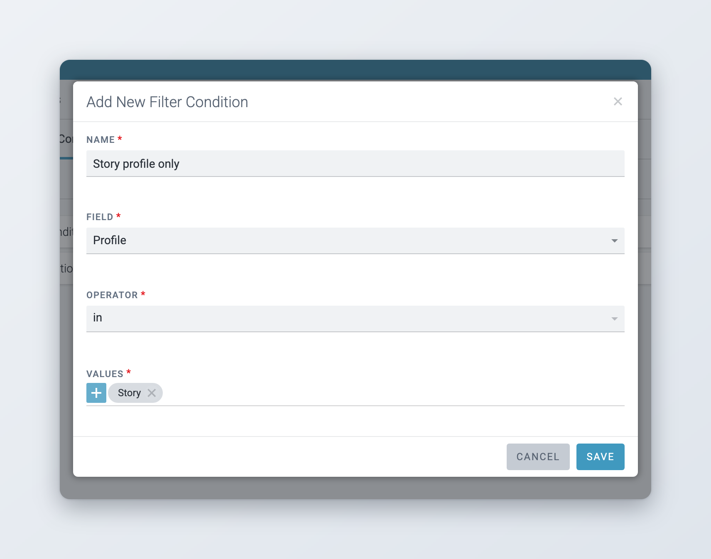
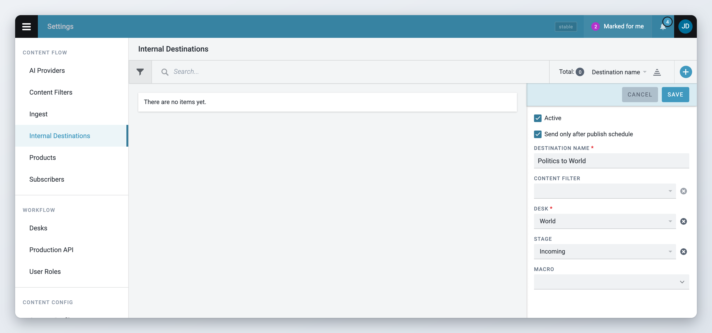

# Content Filters and Internal Destinations

Content Filters select which published items go to which Products and Internal Destinations. Internal Destinations copy published items to a desk. For an overview of how publishing is set up, see [Defining Publishing in Superdesk](README.md).

## Make Content Filters

Content Filters allow you to create a series of criteria through which Superdesk can narrow down the news items and create news item groupings. These Content Filters allow you to build various Products for distribution. You can use any number of Filter Conditions, or Content Filters, to automatically select the content for the Product.

To get started with Content Filters, open the Main menu and go to **Settings** > **Content Filters**. The page has three tabs along the top: **Filters**, **Filter Conditions** and **Filter Search**.

To save changes you need the **Content Filters** privilege. The entry only shows in **Settings** if your role also has **Dictionaries List Management**. See [Privileges](README.md#privileges).

Before you can apply a Content Filter, you must first create at least one Filter Condition.

To create a new Filter Condition, click the **Filter Conditions** tab, then click **Add New** in the top right corner. The **Add New Filter Condition** window opens.

* **Name**: label for the filter condition. Descriptive names help other users understand the filter. Use fewer than 80 characters.
* **Field**: the metadata field of the item to look at when filtering. The list has the standard fields (Category, Genre, Subject, Urgency, Priority, Type, Keywords, Slugline, Source, Headline, Body HTML, Ed. Note, Place, Take Key, Desk, Stage, SMS, Ingest Provider, Embargo, Feature Media and Profile), followed by the controlled vocabularies and custom text fields of your instance.
* **Operator**: the logical operator. The operators are shown as short codes and depend on the field. For controlled vocabularies: `in` and `nin` (not in). For single values: `eq` (equals) and `ne` (not equals). For text fields: `like`, `notlike`, `startswith`, `endswith` and others. Feature Media only offers `exists`.
* **Values**: depends on the field and the operator. With `in` and `nin` you pick one or more values from a list. Selecting multiple values produces an OR (value1 OR value2). With `eq` and `ne` you pick a single value from a drop-down. For text fields you type the value.

    

To add values from a list, click the add button in the **Values** section and pick the values. To remove a value, hover over it and click the **x**. Once you have entered **Name**, **Field**, **Operator** and **Values**, click **Save**.

<figure><figcaption>
A filter condition on the content profile
</figcaption></figure>

### Filtering by content profile

*Available since Superdesk 3.1.*

The **Profile** field lets a condition match items by their content profile. The values are the enabled content profiles of your instance. For example, a condition "Profile in Story" matches only items created with the Story profile. Use it to send items of one profile to some subscribers only.

### Keeping embargoed items from a subscriber

An embargo does not hold an item back. Superdesk sends the item to subscribers when it is published, marked with the embargo date. See [Sending, scheduling and publishing items](../../content-management/sending-scheduling-and-publishing.md#embargo-and-publish-schedule). If a subscriber must not receive items while their embargo is still running, filter them out with the **Embargo** field:

1. Create a filter condition with Field **Embargo**, Operator `eq` and Value **True**. It matches items whose embargo date is still in the future when they are published.
2. Create a Content Filter that uses this condition.
3. In the subscriber's Product, select this Content Filter and set **Content Filter Type** to **Blocking**.

If the Product already uses a permitting Content Filter, add a condition with Field **Embargo**, Operator `ne` and Value **True** to that filter instead.

Superdesk checks the condition only when the item is published. An item blocked this way is not sent to the subscriber later, when the embargo ends.

### Assemble and test Content Filters

To create a new Content Filter, click the **Filters** tab, then click **Add New** in the top right of the Filters tab.

Note that Content Filters can be made up of a single condition or multiple conditions. For clarity, the name of the Content Filter should reflect the conditions it uses.

Three switches at the top of the window change how the filter is used:

* **Global Block**: the content the filter defines is blocked by default for all Subscribers. You unblock it for specific Subscribers by switching it off on the **Applied Global Block Filters** tab of the Subscriber form.
* **Archived Block**: controls what happens to published content when it expires. Items that match an Archived Block filter are deleted on expiry. All other published items are moved to the archive. See [Content expiry](publish-queue-legal-archive-and-content-expiry.md#content-expiry).
* **Block API**: items that match the filter are not added to the Content API, so Content API subscribers can not read them.

A single Filter Statement can search for multiple overlapping conditions. Add multiple conditions to the same Filter Statement (these combine with AND). Click **Add Filter Statement** to add another Filter Statement (separate statements combine with OR).

 

**Filter Preview** shows the constructed query. Conditions in the same Filter Statement join with AND; separate Filter Statements join with OR. You can also use other Content Filters within a statement (Condition X AND Filter Y). You can have any number of Filter Statements in a single Content Filter, but you can only apply one Content Filter per Product.

### Testing the Content Filter

You can test the filter by copying an article GUID (from the item's information in the preview or the editor) and pasting it into the **Filter Test** field at the bottom of the window. Click **Test**. Superdesk shows **Does match** or **Doesn't match**.

### Filter Search

The **Filter Search** tab shows which existing Content Filters contain your query Conditions and whether they are in use (and where). This helps before editing or deleting a Filter Condition.

Select the **Field**, **Operator** and **Values** used to create the Condition, then click **Search**. The results show which Conditions match, which Content Filters contain them, and which Subscribers use those Content Filters.

### Edit, test or delete an existing Content Filter

Once created, Content Filters appear in the **Filters** tab, with a label for each switch that is on (**Global Block**, **Archived Block**, **Block API**). Hover over a Filter to see the options to test, edit or delete it.

Testing (**Test Filter Against Content**, the checkmark icon) opens the **Filter Test Results** window, which lists the articles that match the Filter conditions. You can also view non-matching articles by switching the result type.

## Internal Destinations (optional)

Internal Destinations route a copy of a published article to a Desk so you can reuse content without recreating it. Common uses include providing content to translators or creating shortened versions for further distribution.

Configure Internal Destinations in the Main menu at **Settings** > **Internal Destinations**. You need the **Internal Destinations** privilege.

When an item is published, it goes in two directions: to the Subscribers, and to every active Internal Destination. For each Internal Destination, Superdesk checks the item against the destination's Content Filter. If it matches, or if the destination has no Content Filter, a copy of the item is created on the destination's Desk and Stage. The optional macro then runs on the copy. Macros typically change the copy's metadata, for example its language. An item published from the destination's own Desk is not copied.

To create an Internal Destination, click the round **+** button in the top right corner of the Internal Destinations page. The form opens on the right:

* **Destination name**: a name for the destination (required).
* **Active**: only active destinations receive copies. Inactive destinations are marked **Inactive** in the list.
* **Content filter**: only items that match this filter are copied. Leave it empty to copy every published item.
* **Desk** (required) and **Stage**: where the copy is created.
* **Macro**: an optional macro to run on the copy. The list shows the macros available for the selected Desk.
* **Send only after publish schedule**: for items with a publish schedule, the copy is created when the scheduled time arrives, not when the editor clicks **Publish**.

<figure><figcaption>
Creating an Internal Destination
</figcaption></figure>

Example: news items matching a "Desk = Politics" Content Filter are copied to the Translations desk, Incoming stage, and a macro sets the language of the copy. To pause a destination, edit it and clear **Active**.
