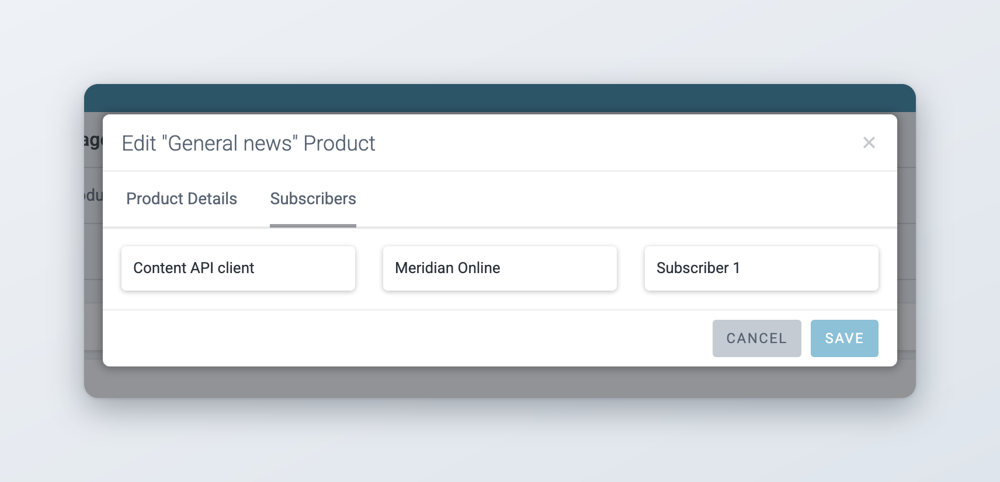
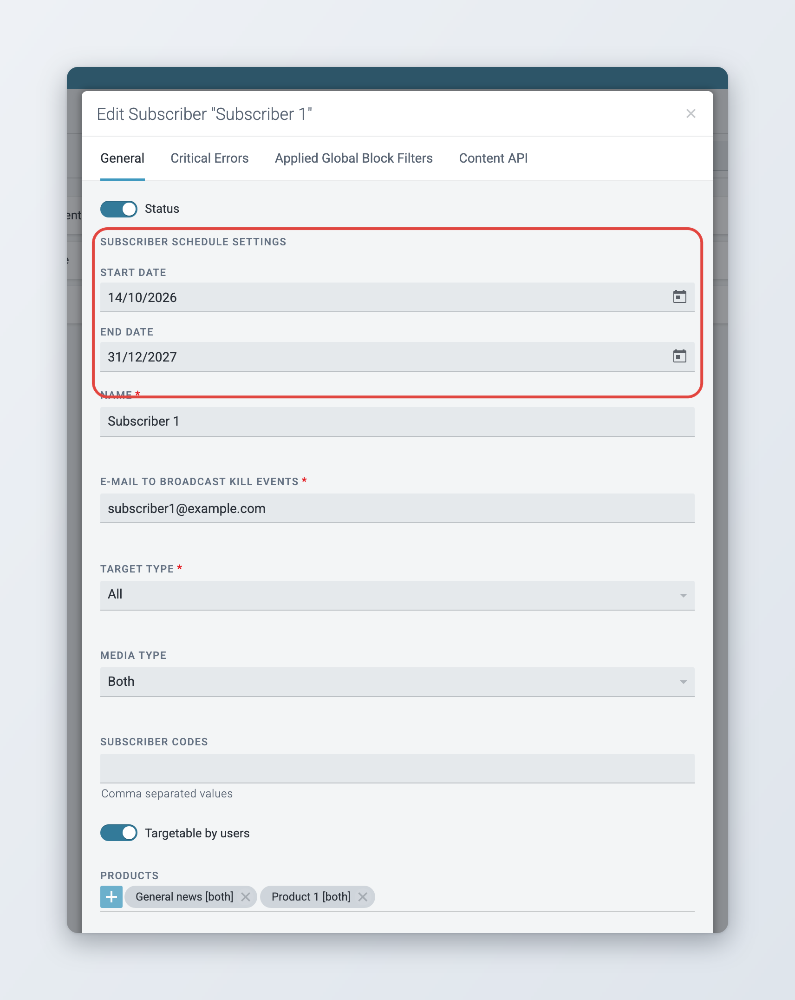
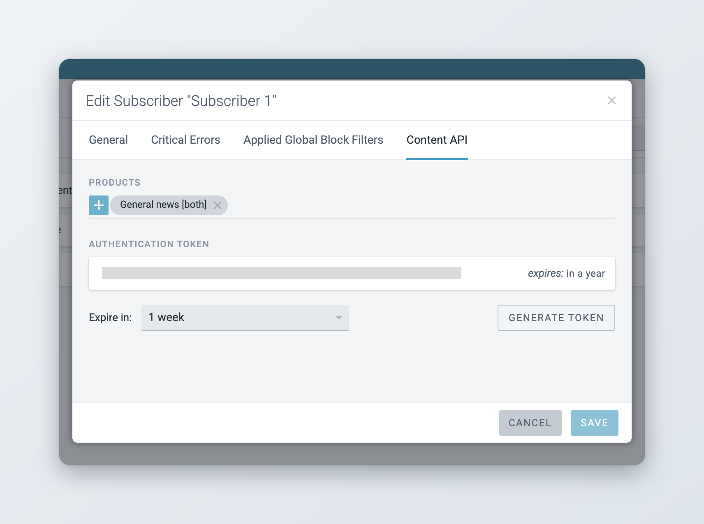

# Products and Subscribers

Products group published items, and Subscribers receive Products at their Destinations or through the Content API. You create the Products first, then give them to Subscribers. For an overview of how publishing is set up, see [Defining Publishing in Superdesk](README.md).

## Creating Products

Products can be thought of as another layer of Content Filters. A Product might apply a Content Filter and further define territorial restrictions. Products can also apply the inverse of a Content Filter as a blocking filter.

Access Products in the Main menu at **Settings** > **Products**. The page has two tabs: **Products** and **Product Test**.

The **Products** tab lists the current Products with their type. You can search by name and filter the list by **Product Type**. Hover over a Product and click the pencil icon to edit it, or the bin icon to remove it.

Click **Add New** to create a Product. The simplest Product uses no filters: give it a name and all published content becomes part of the Product.

Fields on the **Product Details** tab:

* **Product ID**: shown once the Product is saved, with a button to copy it.
* **Product name**: Superdesk-internal name (mandatory).
* **Product description**: Superdesk-internal description (optional).
* **Product Type**: **Direct**, **API** or **Both**. Direct Products can be given to Subscribers on the **General** tab of the Subscriber form, for delivery to Destinations. API Products can be given to Subscribers on the **Content API** tab. **Both** works in either place.
* **Product codes**: proprietary descriptors or designators for upstream use, separated by commas.
* **Content Filter**: one filter per Product. If none is selected, every published item in the instance can be sent to the Product's Subscribers.
* **Content Filter Type**: shown once a Content Filter is selected. **Permitting** allows only articles that match the conditions. **Blocking** prevents articles that match the conditions from being selected (all but Filter XY).
* **Target Regions**: if configured, narrows the Product by region. Only the selected regions receive the Product.

### Which subscribers use a product

The **Subscribers** tab of the Product form lists every Subscriber that receives the Product. It includes Subscribers that have the Product on their **General** tab, and Subscribers that read it through the Content API (since 3.2). Check it before you change or remove a Product.

<figure><figcaption>
The Subscribers tab of a Product
</figcaption></figure>

### Testing products

On the **Product Test** tab, paste an article GUID into **Story GUID**, choose a **Result Type** (**All**, **Match** or **No-Match**) and click **Test Products**. Superdesk lists the Products with the test result for each. For a Product that does not match, it also gives the reason.

## Define Subscribers

Admins define Subscribers in the Main menu at **Settings** > **Subscribers**.

Together, the Content flow settings define:

* Subscribers (to whom)
* Products (what they should receive)
* Destinations (where to send it)
* Formats (how it should be sent)

Subscribers are customers. Each Subscriber can receive multiple Products at any number of Destinations (for example a website and a mobile app).

The Subscribers list shows each Subscriber's state: **Active**, **Not Active**, **Active until** a date, or **Scheduled from** one date **to** another. You can search by name and filter the list by **Target Type** and by **Status** (**Active**, **Inactive** or **Both**). By default the list shows active Subscribers only.

To add a Subscriber, click **Add New**. The Subscriber form has four tabs: **General**, **Critical Errors**, **Applied Global Block Filters** and **Content API**.

Fields on the **General** tab:

* **Status**: the switch at the top makes the Subscriber active or inactive. Only active Subscribers receive items.
* **Subscriber Schedule Settings**: optional start and end dates. See [Subscriber start and end dates](#subscriber-start-and-end-dates).
* **Name**: the Subscriber's name (required).
* **E-Mail to broadcast Kill Events**: email address used to send notifications about killed articles (required). Fill in a valid address even if you do not use kills.
* **Target Type**: **All**, **Digital/Internet** or **Wire/Paper**. Editors can restrict an item to a target type when they publish it.
* **Media Type**: **Media**, **Non-media** or **Both**.
* **Subscriber codes**: subscriber-specific tokens or keys for upstream platforms, separated by commas.
* **Targetable by users**: if on, editors can pick the Subscriber under **Target subscribers** when they publish an item, and send the item to it even if the item does not match the Subscriber's Products.
* **Products**: the Products the Subscriber receives at its Destinations. Only Products of type **Direct** or **Both** are offered. If none is selected, all published news items can be sent to this Subscriber.
* **Sequence Number Settings**: the **Minimum** and **Maximum** of the transmission sequence numbers (required).
* **Parallel publishing**: when on, Superdesk can send several items to this Subscriber at the same time.
* **High priority**: sends this Subscriber's items through a priority queue. Only shown when the priority queue is enabled on the server.
* **Destinations**: see below.

<figure><figcaption>
The General tab of a Subscriber
</figcaption></figure>

Sequence number settings: Transmission Sequence Numbers are a range of IDs in the Publish Queue passed to end users as part of delivered document formats. Historically used to detect transmission breaks; commonly run 1-999 or 1-9999 with a rollover. Sequence numbers usually avoid repetition within a 24-hour news cycle.

### Subscriber start and end dates

*Available since Superdesk 3.1.*

Use the **Start Date** and **End Date** under **Subscriber Schedule Settings** for a Subscriber that should only receive content for a set period, for example a trial or a fixed-term contract.

* Both dates must be today or later; the date pickers do not offer earlier days.
* Fill in both dates, or leave both empty. If only one is filled in, Superdesk shows "Both start and end date need to be filled in (or cleared) to save the subscriber." and does not save.
* The end date must be after the start date.
* Superdesk checks the dates once a day, just after midnight. On the start date it activates the Subscriber. On the end date it deactivates the Subscriber and clears both dates.
* The **Status** switch wins over the dates when you save. If the Subscriber is active but its start date is still in the future, or its end date has passed, the form warns you that the switch keeps the Subscriber active. If the Subscriber is inactive and today is within the dates, the form warns you that saving activates it.

### Destinations

Destinations are the "where" in publishing. You can add multiple Destinations per Subscriber. Click **Add New Destination** to add one, then fill in:

* **Name**: a name for the Destination (required).
* **Format**: the output format (required). See [Output formats](README.md#output-formats).
* **Preview endpoint URL**: optional. If set, editors get a **Preview** button in the **Publish** tab that shows how the item will look for this Subscriber.
* **Delivery type**: how the formatted item is sent (required). More fields appear depending on the delivery type. See [Delivery types](README.md#delivery-types).

Click **Save** in the Destination box, then **Save** at the bottom of the form. A Subscriber that only reads content through the Content API does not need a Destination.

### Critical Errors and Applied Global Block Filters

The **Critical Errors** tab lists the transmission errors Superdesk knows about. Switch on the errors that should be treated as critical for this Subscriber.

The **Applied Global Block Filters** tab lists all Content Filters marked as **Global Block**. They apply to every Subscriber. Switch one off to let this Subscriber receive the content it blocks.

### Content API

The **Content API** tab is for Subscribers that read published content through the Superdesk Content API.

* **Products**: the Products the Subscriber can read through the Content API. Only Products of type **API** or **Both** are offered.
* **Authentication Token**: the tokens the Subscriber uses to authenticate. Choose how long a new token is valid in **Expire in:** (from **1 week** to **10 years**, or **Never expire**) and click **Generate token**. You can only generate a token once the Subscriber is saved. When a Subscriber has five tokens, the tab hides **Generate token**: revoke one to add another. Each token is listed with its expiry date and buttons to copy or revoke it.

<figure><figcaption>
The Content API tab of a Subscriber
</figcaption></figure>

See [Superdesk API](../../integrations-and-advanced-features/superdesk-api.md) for more about the Content API.
