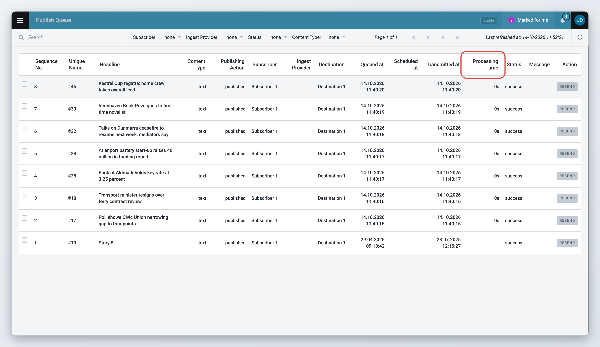
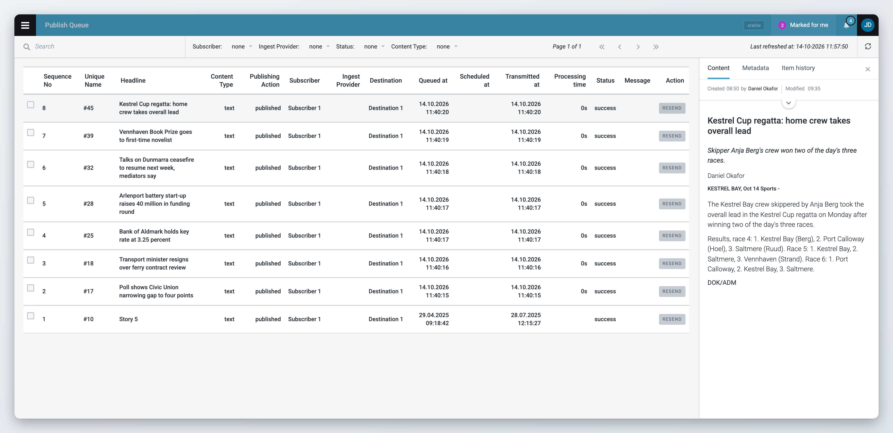
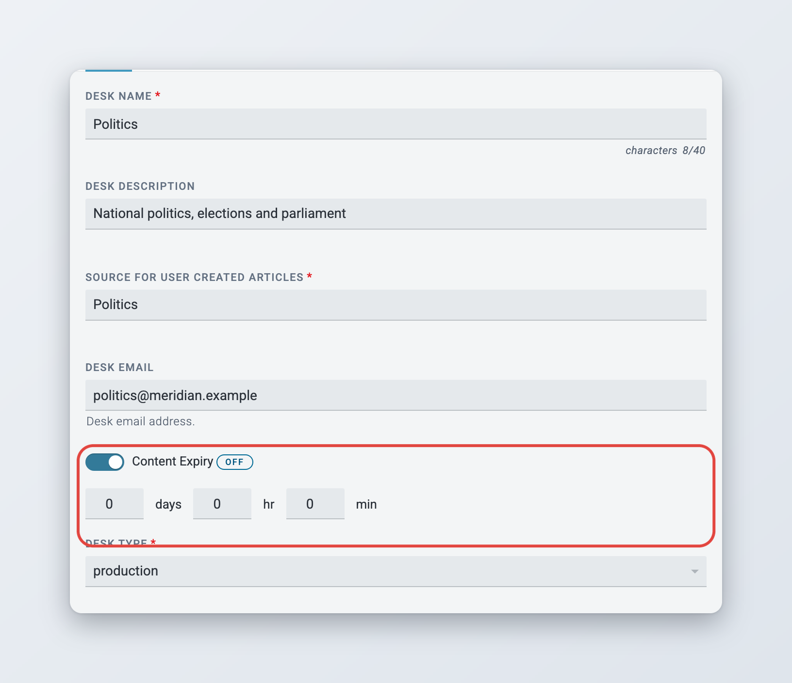

# Publish Queue, Legal Archive and Content Expiry

The Publish Queue shows what was sent to each Subscriber, the Legal Archive keeps a record of every published item, and content expiry removes items after a set time. For an overview of how publishing is set up, see [Defining Publishing in Superdesk](README.md).

## Check Publish Queue

The Publish Queue lists published items and their destinations. Open the Main menu and click **Publish Queue**. You need the **Publish Queue** privilege.

If an article failed to publish, it is recorded here and you can resend it from the Publish Queue. Note: "published" means the **Publish** button was pressed. If no Product, Subscriber or Destination matches, the content stays in Superdesk even if it is marked published.

The Publish Queue shows what was sent to each Subscriber and whether the transmission worked.

<figure><figcaption>
The Publish Queue
</figcaption></figure>

Use the bar at the top to narrow the list:

* **Search**: type part of a headline, or a unique name.
* **Subscriber**, **Ingest Provider**, **Status** and **Content Type**: pick a value, or **None** to clear the filter.

Navigate pages with the arrows next to the filters. The time of the last refresh is shown on the right, next to the **Refresh** button. Status changes appear in the list as they happen.

Each entry shows the **Sequence No**, **Unique Name**, **Headline**, **Content Type**, **Publishing Action**, **Subscriber**, **Ingest Provider**, **Destination**, **Queued at**, **Scheduled at**, **Transmitted at**, **Processing time**, **Status** and **Message**.

The **Status** is one of:

* **pending**: waiting to be sent.
* **in-progress**: being sent.
* **retrying**: a send failed and Superdesk will try again.
* **success**: sent. Content API transmissions are marked success straight away, because the item is stored in the Content API instead of being sent.
* **error**: the item could not be prepared for this Destination, for example because formatting failed. The **Message** column says why.
* **failed**: sending failed and Superdesk stopped retrying.
* **canceled**: canceled by a user.

For a moment after publishing, an entry can also show **routing** while Superdesk hands it to the transmitter.

### Resending and canceling

* Click **Resend** on an entry with the status success, failed or canceled to send it again.
* Click **Cancel** on an entry that is still pending or retrying to stop it.
* To act on several entries, tick their checkboxes. A **Resend** button appears when none of the selected entries is pending, in-progress or retrying. A **Cancel** button appears when the selection only has entries that can not be resent and some of them are pending or retrying. **Cancel Selection** clears the selection.

Each entry has a unique name and a sequence number. Resending creates a new entry with the same unique name and a new sequence number.

### Processing time and formatting errors

The **Processing time** column shows how long the item took from publishing until it was transmitted to that Destination (since 3.6). Use it to spot slow Destinations.

If Superdesk can not format an item for one Destination, that entry gets the status **error** with the reason in the **Message** column (since 3.3). The other Subscribers still receive the item. Fix the cause, for example the Destination's settings, and resend the entry.

### Previewing an entry

Click an entry to open its preview on the right side, with the **Content**, **Metadata** and **Item history** tabs (and **Duplicates** if the item has duplicates). Items can not be edited from the Publish Queue.

<figure><figcaption>
Previewing a Publish Queue entry
</figcaption></figure>

* **Content**: preview of the news item.
* **Metadata**: unique name, GUID, state, etc.
* **Item history**: versions and updates.

## View Legal Archive (optional)

The Legal Archive is an optional, immutable forensic record of every published item, including every edit action: what changed, when and by whom. It serves as an evidential record for commercial or legal disputes. Your instance might not include the Legal Archive.

Users with the **Legal Archive** privilege open it from the Main menu.

Use the search icon to open the search panel on the left and enter your search criteria.

Search by **GUID**, **Unique Name**, **Headline**, **Slugline**, **Story Text** keywords, or a date range with **Published From** and **Published Until**. Click **Go** to search and **Clear** to reset the fields.

Click an article to open its preview on the right, with the **Content**, **Metadata** and **Item history** tabs. Articles in the Legal Archive can not be edited or deleted.

## Content expiry

Content expiry is the removal of items after a set time. It keeps the production database small. When an item expires:

* an item that was never published is deleted,
* a published item is moved to the archive, where it can still be found in search, unless it matches a Content Filter marked **Archived Block**. Then it is deleted,
* an item linked to a Planning assignment and not yet published is kept.

As an administrator, you can set expiry in three places. A more specific setting wins over a general one:

1. **Stage**: in **Settings** > **Desks**, edit the desk, go to its stages and edit a stage. A stage's expiry overrides the desk's.
2. **Desk**: in **Settings** > **Desks**, on the desk's general settings. A desk's expiry overrides the system default.
3. **Ingest source**: in **Settings** > **Ingest**, on the source. This sets how long ingested items stay in Ingest. See [Ingesting News Items and Events](../../integrations-and-advanced-features/ingesting-news-items-and-events.md).

Each place has a **Content Expiry** switch with fields for days, hours and minutes. When the switch is off, or all values are 0, the setting is not used and a label shows which default applies, for example **Using System default** or **Using Desk default**. Hover over the label to see that default.

<figure><figcaption>
Content expiry in the desk settings
</figcaption></figure>

Superdesk works out an item's expiry date each time the item is created, saved, moved or published, from the stage and desk it is in at that moment. For a published item with an embargo or a publish schedule, the time counts from that date. The expiry date is shown in the item's metadata as **Expiry**.

If your server sets a separate expiry for published items, published items follow that instead of the desk or stage setting. In that case the desk settings also show **Preserve Published Content**. Switch it on to keep the content published from that desk from expiring.

The system defaults are set on the server by a system administrator, not in the user interface. They include the default expiry for items in production (`CONTENT_EXPIRY_MINUTES`), published items (`PUBLISHED_CONTENT_EXPIRY_MINUTES`), ingested items (`INGEST_EXPIRY_MINUTES`), archived items (`ARCHIVED_EXPIRY_MINUTES`), the Publish Queue (`PUBLISH_QUEUE_EXPIRY_MINUTES`) and the Content API (`CONTENT_API_EXPIRY_DAYS`). Spiked items have their own server setting.

For more on desk and stage settings, see [Desk Creation and Desk Management](../desk-creation-and-desk-management.md).
