# Desk Creation and Desk Management

Desks are the teams of your newsroom. Each desk has its own stages, members, default template and settings. Administrators, and users whose role has the **Desk Management** privilege, create and edit desks in **Settings** > **Desks**.

To get there, open the **Main menu** (also called the hamburger menu) in the top-left corner, click **Settings**, and then click **Desks** under **Workflow**.

<figure>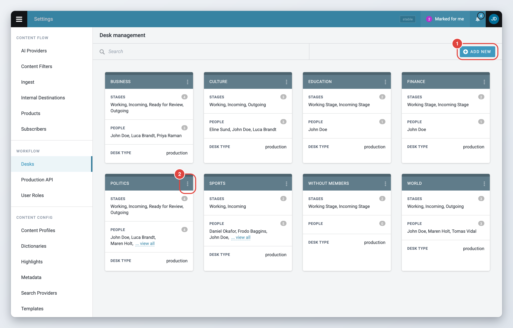<figcaption>
The Desk management page
</figcaption></figure>

The **Desk management** page shows one card per desk. Each card lists the desk's stages, its people and its desk type. It also shows the desk language, and "Published Content: Not Expired" when that option is on. Use the search field at the top to find a desk by name.

## Creating and editing a desk

To create a desk, click **+ Add New** in the top-right corner. The **Add New Desk** window opens.

To edit a desk, click the actions menu (the three dots) on the desk's card and choose **Edit**. The same menu has **Monitoring settings** and **Remove**, described further down this page.

<figure>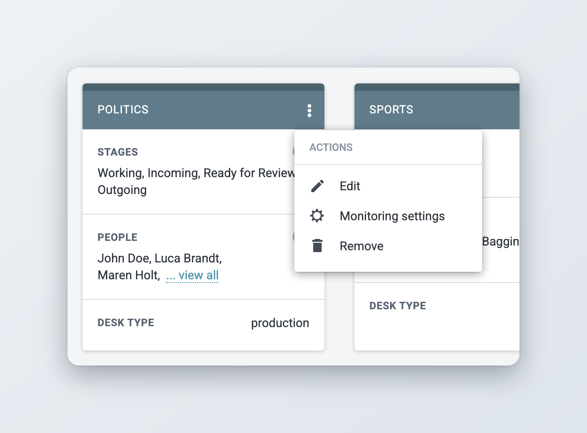<figcaption>
The actions menu of a desk
</figcaption></figure>

The desk window has four tabs: **General**, **Stages**, **People** and **Macros**. **Save & Continue** (or **Continue** on the Stages tab) saves your changes and opens the next tab. **Done** saves and closes the window.

A new desk always starts with two stages, **Working Stage** and **Incoming Stage**. You can rename them and add more stages on the **Stages** tab.

### General tab

<figure>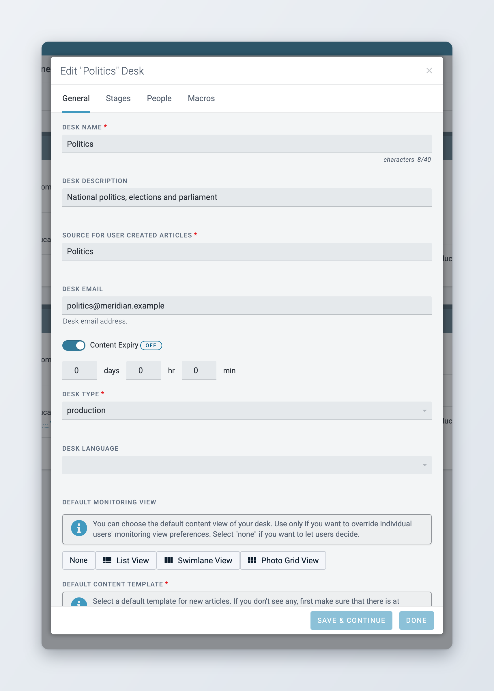<figcaption>
The General tab
</figcaption></figure>

**Desk name** is the name all users see. It is required, can be up to 40 characters long and must be unique.

**Desk description** tells other users what the desk is for.

**Source for User Created Articles** is required. Superdesk puts this text in the Source field of every article created on this desk.

**Desk Email** is an email address for the desk. See [Desk email and Slack channel](#desk-email-and-slack-channel).

**Content Expiry** sets how long items stay on the desk before Superdesk removes them. Turn the switch on and enter days, hours and minutes. If you leave all three at 0, or turn the switch off, the desk uses the system default, and the label next to the switch shows **Using System default**. If your installation has no system default, the label shows **OFF** and items do not expire. A stage can set its own expiry, which then wins over the desk's.

**Preserve Published Content** only appears when your installation removes published content after a while. Turn it on to keep the content published from this desk.

**Desk Type** is required. Choose **authoring** or **production**. An authoring desk is for writing content. A production desk is where content is edited and published. Your administrator can block publishing from authoring desks. In that case Superdesk shows a note when you pick **authoring**. You cannot change the type of a desk that already has articles.

**Desk language** sets the language of new items created on this desk.

<figure>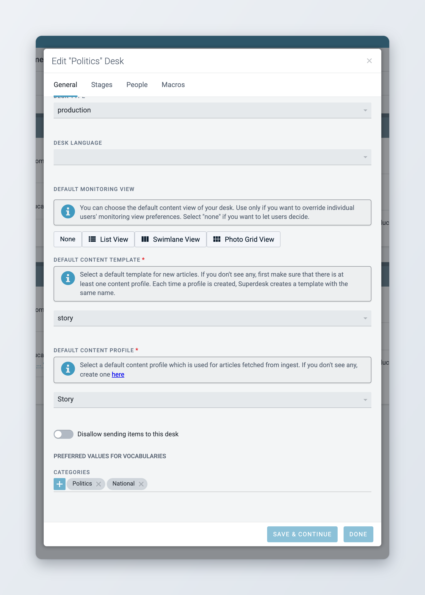<figcaption>
Defaults, sending restriction and preferred values on the General tab
</figcaption></figure>

**Default monitoring view** decides how the desk's lists look in Monitoring. Choose **Swimlane View** or **Photo Grid View** to open the desk in that view for everyone, whatever view each user picked. Users can still switch views while they work, but the next time they select the desk, its default view comes back. Choose **None** to let each user decide (**List View** currently has the same effect). **Swimlane View** is only offered when your installation has it turned on. See [Monitoring Tab](../workspace-and-search/monitoring-tab.md).

**Default Content Template** is required. When users work on this desk, the create menu shows this template under **Default desk template**. If the list is empty, check that at least one content profile exists: Superdesk creates a template with the same name every time a profile is created.

**Default Content Profile** is required. Superdesk gives this content profile to text items fetched to this desk from ingest. To create profiles, see [Content profiles](content-configuration/content-profiles.md).

### Restricting sending to a desk

*Available since Superdesk 2.7.*

Turn on **Disallow sending items to this desk** on the **General** tab to remove the desk from the destinations in the **Send to** panel. Users can then no longer send items to it. Use it for desks that should only get content in other ways, for example through ingest routing or by fetching.

See [Sending, scheduling and publishing items](../content-management/sending-scheduling-and-publishing.md).

### Preferred vocabulary values

Under **Preferred values for vocabularies** on the **General** tab, you can pick the values this desk uses most for each vocabulary, for example a handful of categories. When users on this desk open that field in an item, the dropdown has a **Desk** entry that lists only these values. **All** shows the full list again.

Users can also set their own preferred values in their profile. When a user has their own values for a vocabulary, the dropdown opens on the **User** list first. See [Your profile and preferences](../navigating-superdesk/your-profile-and-preferences.md).

Only vocabularies marked **Available in user/desk preferences** appear here. If none is marked, the section says "There are no vocabularies configured." See [For administrators](#for-administrators).

### Desk email and Slack channel

**Desk Email** stores an email address for the desk (since Superdesk 2.7). Superdesk does not send email to it by itself. When the Planning component is set up to add extended information to its output, coverages assigned to the desk include this address.

**Slack Channel Name** only appears when your installation has Slack notifications turned on. Enter the channel name without the leading #. The Planning component posts its desk notifications to this channel.

### Stages tab

Stages reflect the workflow of a desk. An article can go through several stages, for example a first edit and a second edit, before it is published.

<figure>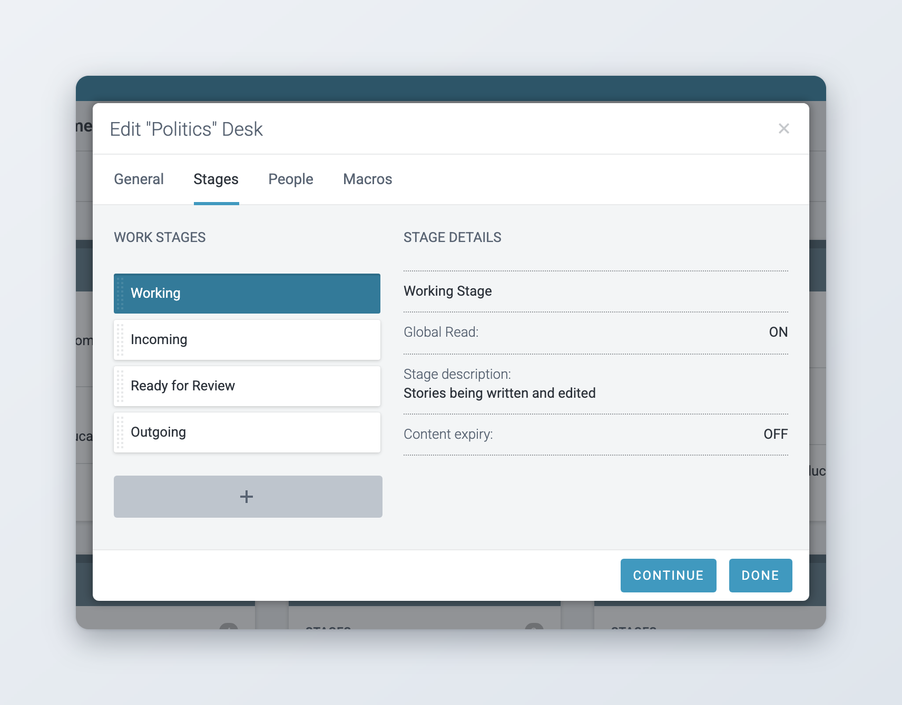<figcaption>
The Stages tab
</figcaption></figure>

The **Work stages** list is on the left. Click a stage to see its settings under **Stage Details** on the right.

* To add a stage, click the **+** button below the list, type a name and click **Save**. A stage name can be up to 40 characters long and must be unique on the desk.
* To edit a stage, hover over it and click the pencil icon.
* To change the order of the stages, drag a stage up or down.
* To remove a stage, hover over it and click the trash icon. You cannot remove the working stage or the incoming stage, a stage that still has items, or a stage that an ingest routing scheme uses.

When you edit a stage, these options appear:

**Global Read** lets users who are not members of the desk see the items in this stage, for example in their own monitoring views and in search. Turn it off to show the stage's items only to desk members. The incoming stage must keep **Global Read** on.

**Local Read Only** stops desk members from editing items while they are in this stage.

**Working Stage** marks the stage where new items created on this desk start. **Incoming Stage** marks the stage where items fetched or routed to the desk arrive. Each desk has exactly one of each. When you turn either option on for another stage, Superdesk moves it there.

**Stage description** is optional text for other users.

**Content Expiry** sets how long items stay in this stage. It works like the desk's content expiry. If you leave it at 0 or off, the stage uses the desk's expiry, or the system default when the desk has none.

**Incoming Rule**, **Moved onto stage Rule** and **Outgoing Rule** run a macro on an item automatically:

* **Incoming Rule** runs when an item arrives in the stage, for example when it is sent, fetched or routed there.
* **Moved onto stage Rule** runs after an item has been moved onto the stage from another stage.
* **Outgoing Rule** runs when an item leaves the stage.

A macro can, for example, fill in a dateline, check that required fields are filled in, or convert currencies. The **Desk Routing** macro is used to close a desk, see [Desk routing](#desk-routing). Which macros you can choose depends on your installation.

### People tab

On the **People** tab you add or remove the members of the desk. Members see the desk in their **Desks menu** and can work on its items.

<figure>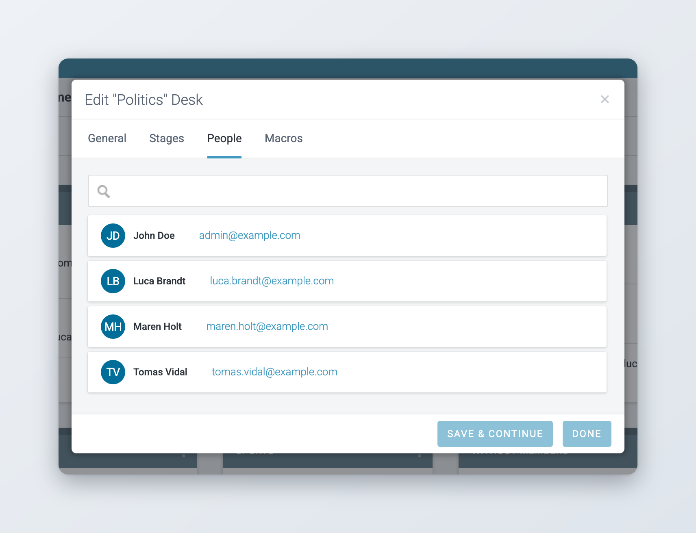<figcaption>
The People tab
</figcaption></figure>

To add a user, type their name in the search field at the top and select them. To remove a user, hover over them and click the **x** on the right. Disabled and inactive users stay in the list, greyed out. Click **Save & Continue** or **Done** to keep your changes.

### Macros tab

The **Macros** tab lists the macros available on this desk, with their access type and action type. These are the macros you can choose as stage rules. Macros are written by a developer and installed on the server. You cannot create them here. See [Macros](content-configuration/templates-macros-and-dictionaries.md#macros).

<figure>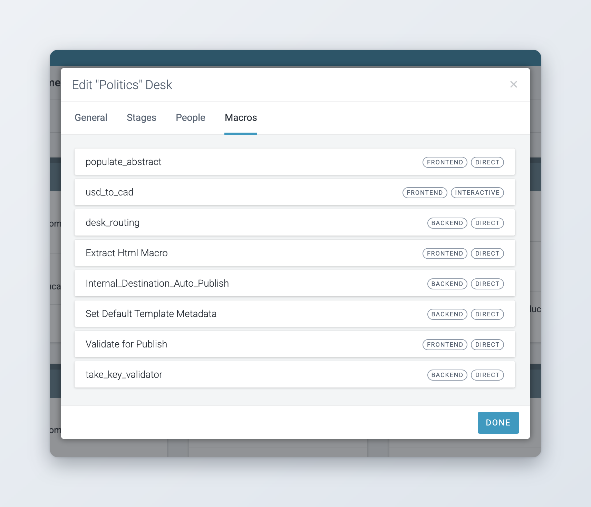<figcaption>
The Macros tab
</figcaption></figure>

## Monitoring settings of a desk

The monitoring settings decide which groups users see when they open the desk in Monitoring: stages, desk outputs and saved searches, their order and their size. To change them, open the desk's actions menu and choose **Monitoring settings**.

The setup has four steps: **Desks**, **Saved Searches**, **Reorder Sections** and **Items Count**. Use **Next** and **Previous** to move between them, and **Done** to save.

<figure>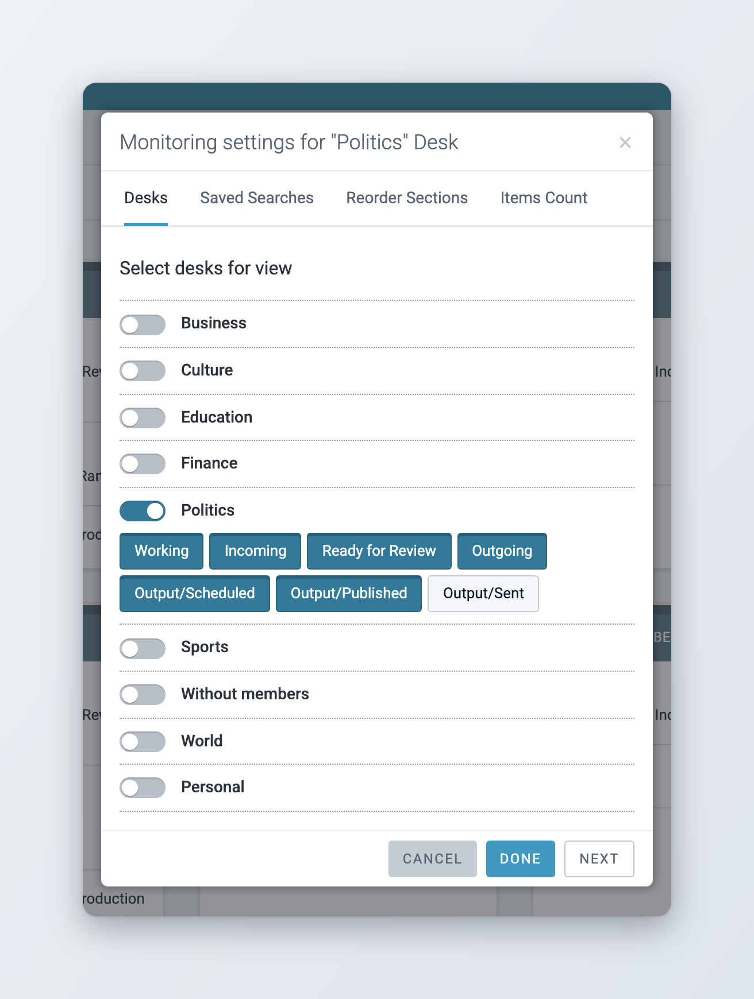<figcaption>
Monitoring settings for a desk
</figcaption></figure>

* **Desks**: turn on the stages and outputs of this desk, or of other desks, that the desk's monitoring should show. The outputs are **Output/Scheduled**, **Output/Published** and **Output/Sent**.
* **Saved Searches**: turn on global saved searches to show their results as groups.
* **Reorder Sections**: drag the groups into the order you want.
* **Items Count**: set how many items each group shows.

See [Monitoring Tab](../workspace-and-search/monitoring-tab.md) for how users work with these groups.

## Removing a desk

Open the desk's actions menu, choose **Remove** and confirm. Superdesk does not remove a desk that:

* has articles, or is referenced by versions of articles,
* is the default desk of one or more users,
* is used by an ingest routing scheme.

In that case an error message explains why, and the desk stays.

## Desk routing

Desk routing lets you close a desk for a while, for example overnight, and point its incoming content to another desk. The desk being closed is called the source desk. The desk that takes over is called the target desk.

The content stays on the source desk. Superdesk only marks it for the target desk, so that the target desk's users can find it and work on it. If the target desk is closed too, the content is marked for that desk's own target. For example, if desk A routes to B, and B is closed and routes to C, content arriving on A is marked for C.

To choose the target desk and to start or stop routing, you need the **Desk routing** privilege. Other users see the routing status but cannot change it.

Setting up routing takes five steps. The first three are on the source desk, the last two on the target desk.



### Add the routing macro to the source desk's stages

Go to **Settings** > **Desks**, open the source desk with **Edit**, and click the **Stages** tab. For each stage that receives new content while the desk is closed, edit the stage and choose **Desk Routing** as its **Incoming Rule**. Click **Save**.

The macro runs on every item that arrives in the stage. When the desk is open, it does nothing. When the desk is closed, it marks the item for the target desk.

<figure>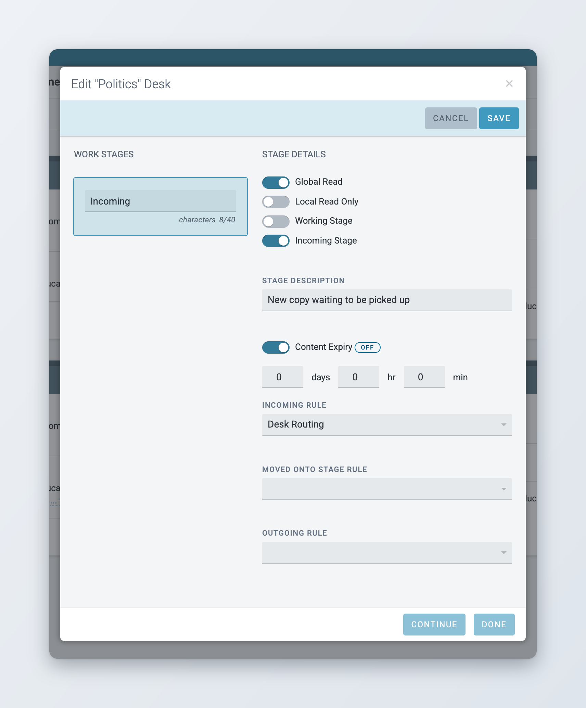<figcaption>
Desk Routing as the incoming rule of a stage
</figcaption></figure>



### Add the Desk Router widget to the source desk's dashboard

Select the source desk and open the **Dashboard**. Click the **Add widget** button in the top-right corner, choose **Desk Router** and click **Add This Widget**. The widget works on a desk's dashboard, not on a custom workspace.

See [Dashboards and Widgets](../workspace-and-search/dashboards-and-widgets.md).



### Choose the target desk

In the **Desk Router** widget, choose the target desk under **Route incoming content to**.

<figure>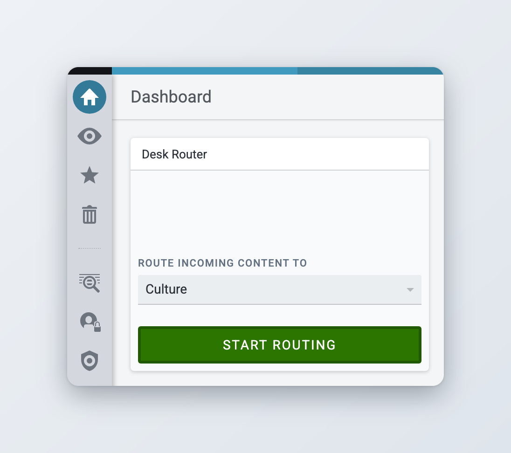<figcaption>
The Desk Router widget
</figcaption></figure>



### Create a saved search for the target desk

The target desk needs a saved search that finds the content marked for it. Open **Search** and the search parameters. Under **Marked Desks**, select the target desk and run the search. Click **Save Search**, give it a name and turn on **Make global**, so that the search can be added to the desk's monitoring.

<figure>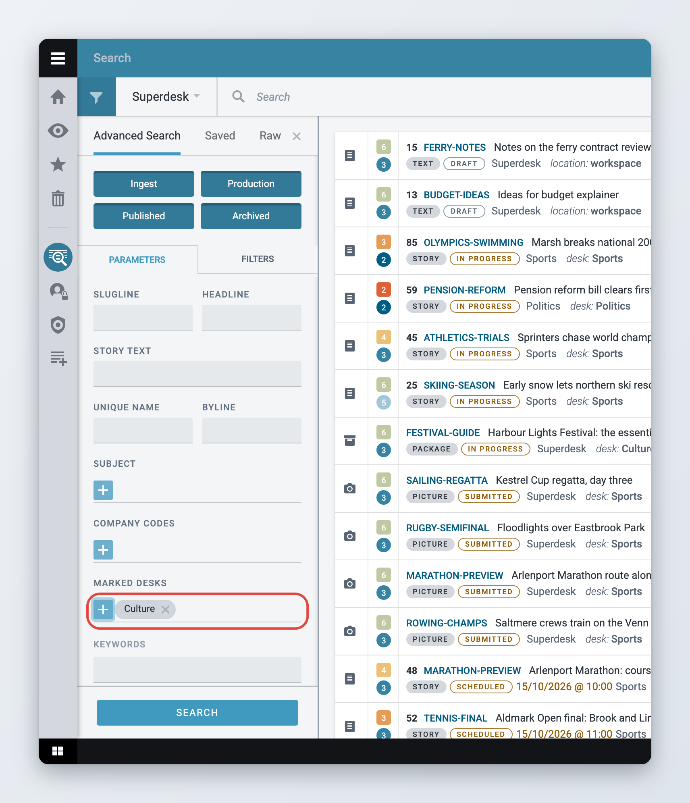<figcaption>
Searching for content marked for the target desk
</figcaption></figure>



### Add the saved search to the target desk's monitoring

Go to **Settings** > **Desks**, open the target desk's actions menu and choose **Monitoring settings**. On the **Saved Searches** step, turn on the search you created. On **Reorder Sections** you can move it to the top.

Users of the target desk now see the routed items in that group. Items marked for a desk show a bell icon. Click it to see which desks the item is marked for.



### Closing the source desk

Open the source desk's dashboard, check that the target desk is selected in the **Desk Router** widget, and click **Start routing**. From now on, all content that arrives in the stages with the routing macro is marked for the target desk.

While the desk is closed, the top bar of the source desk shows **Routing to:** and the name of the target desk. The top bar of the target desk shows **Routed from:** and the names of the closed desks that route to it. In the **Desks menu**, closed desks and desks that receive routed content are highlighted.

<figure>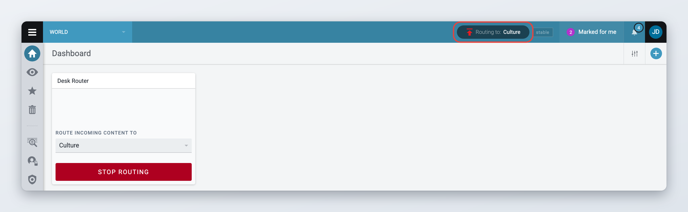<figcaption>
A closed desk shows where its content goes
</figcaption></figure>

On the target desk, the **Desk Router** widget lists under **Routed from** every desk that has this desk as its target, and shows whether each of them is closed and routing now.

### Reopening the source desk

Open the source desk's dashboard and click **Stop routing** in the **Desk Router** widget.

Superdesk removes the marks that routing added to the desk's items. Marks that users added by hand stay.

<figure>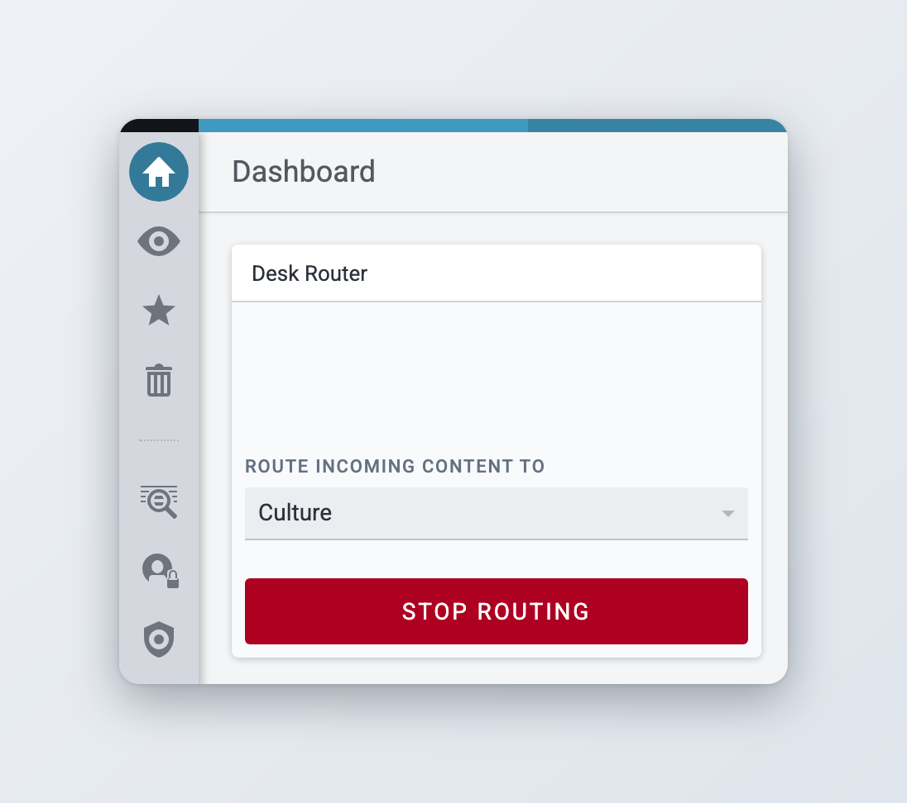<figcaption>
Reopening a closed desk
</figcaption></figure>

## For administrators

**Privileges.** Set them in [User Management and User Roles](user-management-and-user-roles.md).

| Privilege | Allows |
| --- | --- |
| **Desk Management** | Creating, editing and removing desks and stages in **Settings** > **Desks** |
| **Desk routing** | Choosing the target desk and starting or stopping routing in the **Desk Router** widget |
| **Mark items for desks** | Marking items for desks by hand |

**Configuration.**

| Setting | Where | What it does |
| --- | --- | --- |
| `CONTENT_EXPIRY_MINUTES` | Server | The system default content expiry, used by desks and stages that have none. |
| `PUBLISHED_CONTENT_EXPIRY_MINUTES` | Server | Removes published content after this many minutes. When it is set, desks show **Preserve Published Content**. |
| `features.noPublishOnAuthoringDesk` | Client | Blocks publishing from desks of type **authoring**. |
| `features.swimlane` | Client | Offers **Swimlane View** in Monitoring and as a desk's default monitoring view. |
| `features.slackNotifications` | Client | Shows **Slack Channel Name** in the desk settings. |
| `features.hideRoutedDesks` | Client | On a target desk, the top bar shows **Routed from other desks** instead of the names of the closed desks. |

**Preferred values.** To make a vocabulary available for desk and user preferred values, edit it in **Settings** > **Metadata** and tick **Available in user/desk preferences**.
