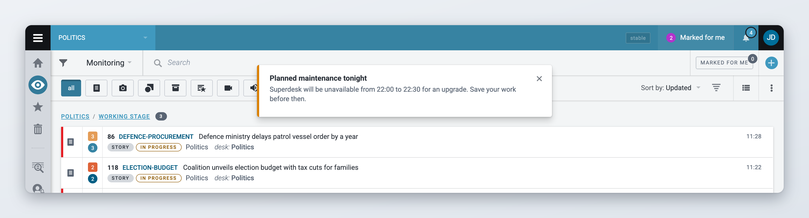
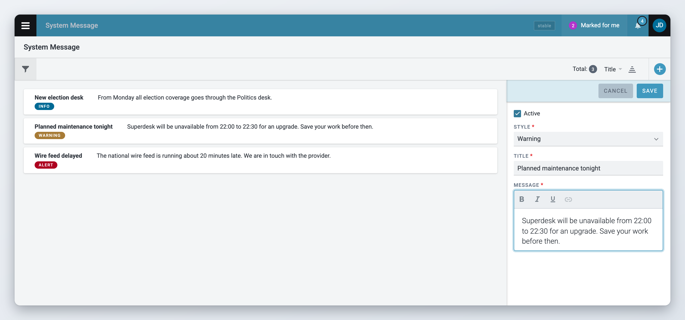
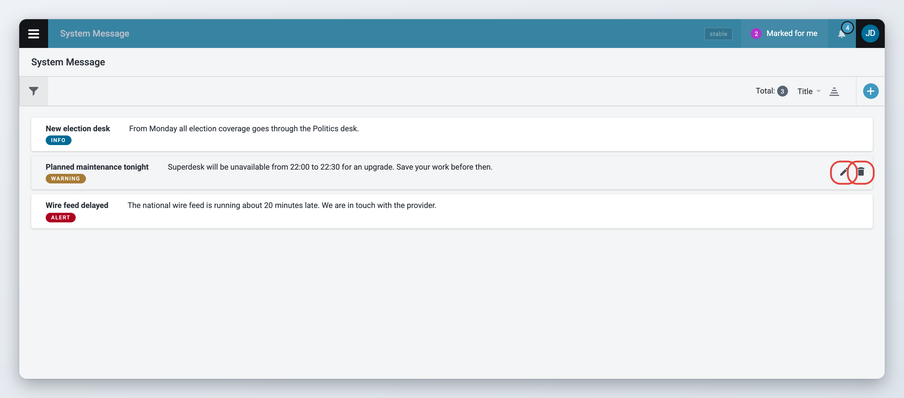

# System messages

*Available since Superdesk 2.3.*

A system message is a notice that every logged-in user sees at the top of the screen. Use it to tell the whole newsroom about planned maintenance, an outage of a feed, or a change in the workflow.

This page is for administrators. To manage system messages you need the **System Message** privilege.

## What users see

An active message appears at the top of the screen as a notice with a coloured bar on its left edge, a title and a short text. It appears for every logged-in user, whatever their role or desk.

The notice stays on screen until the user closes it with the cross. Closing it only hides it for now. It appears again the next time the user loads Superdesk, for as long as the message is active.

When you create, change or remove a message, every user's screen updates straight away. All active messages then appear again, including ones a user had already closed. If several messages are active, they appear one under the other.

<figure><figcaption>
An active system message, as every user sees it
</figcaption></figure>

## Opening the System Message page

Open the **Main menu**. Under **Admin tools**, click **System Message**. The page lists all messages, active or not, with their title, text and style.

If you do not see **System Message** in the menu, your role does not have the privilege. Ask your administrator.

## Creating a message



### Start a new message

Click the **+** button in the top-right corner of the page. A form opens on the right.



### Fill in the message

* **Active**: tick it to show the message to users as soon as you save. Leave it unticked to save a draft that nobody sees yet.
* **Style**: the colour of the notice. See [Message styles](#message-styles).
* **Title**: a short heading, for example "Planned maintenance".
* **Message**: the text. You can use bold, italic, underline and links.



### Save

Click **Save**. If the message is active, it appears on every user's screen.



Keep the message short. Superdesk does not save a message longer than 200 characters. The message is stored with its formatting, and the hidden formatting code counts toward the limit, so bold, italic, underline and links leave less room for text.

<figure><figcaption>
Creating a system message
</figcaption></figure>

There is no start or end time. A message shows while it is active, until you turn it off or remove it. To prepare a message in advance, save it without ticking **Active**, then turn it on when the time comes.

## Message styles

The style sets the colour of the notice.

| Style | Use it for |
| --- | --- |
| **Info** | General information, such as a new feature or a reminder |
| **Success** | Good news, for example that a problem is fixed |
| **Warning** | Something users should plan for, such as maintenance |
| **Alert** | Something that affects work right now, such as an outage |

The names are only suggestions. Superdesk treats all styles the same way.

## Changing a message

Hover over the message in the list and click the pencil icon (**Edit**). You can also click the message to open it in the **Details** panel, then click the pencil icon there.

Change the fields and click **Save**. Users see the new version straight away.

To take a message off users' screens but keep it for later, untick **Active** and save.

<figure><figcaption>
The list of system messages
</figcaption></figure>

## Removing a message

Hover over the message in the list and click the bin icon (**Remove**). Click **Delete** to confirm. The message disappears from every user's screen and from the list. You cannot undo this.

## For administrators

Access to the System Message page is controlled by the **System Message** privilege ("User can manage system messages"). Give it only to the people who should speak to the whole newsroom.



### Open the role privileges

Open the **Main menu**, go to **Settings** > **User Roles** and select the **Roles privileges** tab.



### Grant the privilege

Tick **System Message** for each role that should manage messages. Users may need to log out and log back in before the change applies.



Users do not need any privilege to see the messages. See [User Management and User Roles](user-management-and-user-roles.md) for more on roles and privileges.
