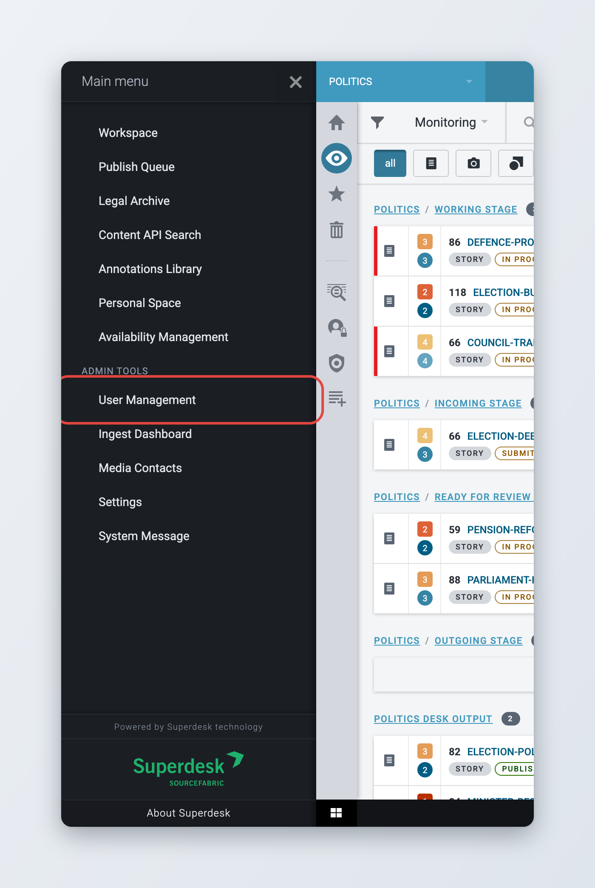
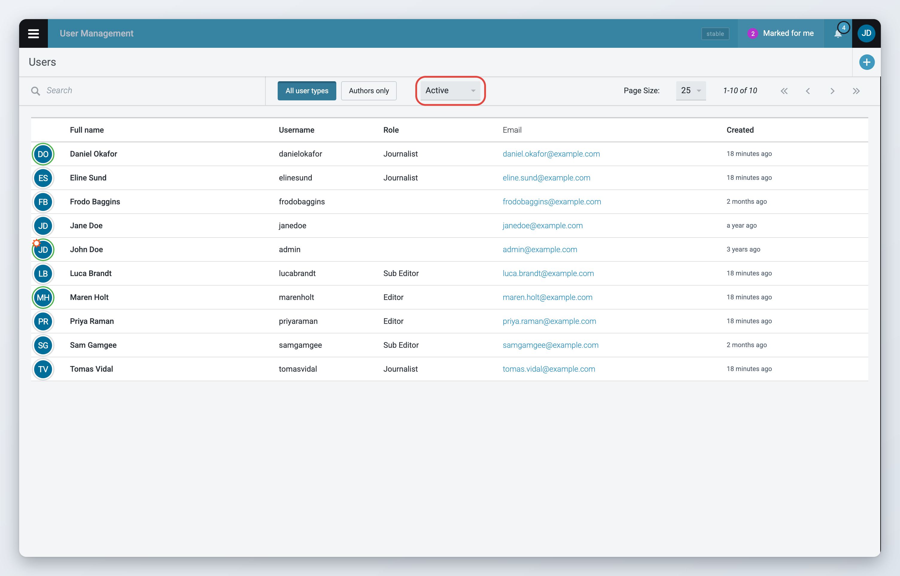
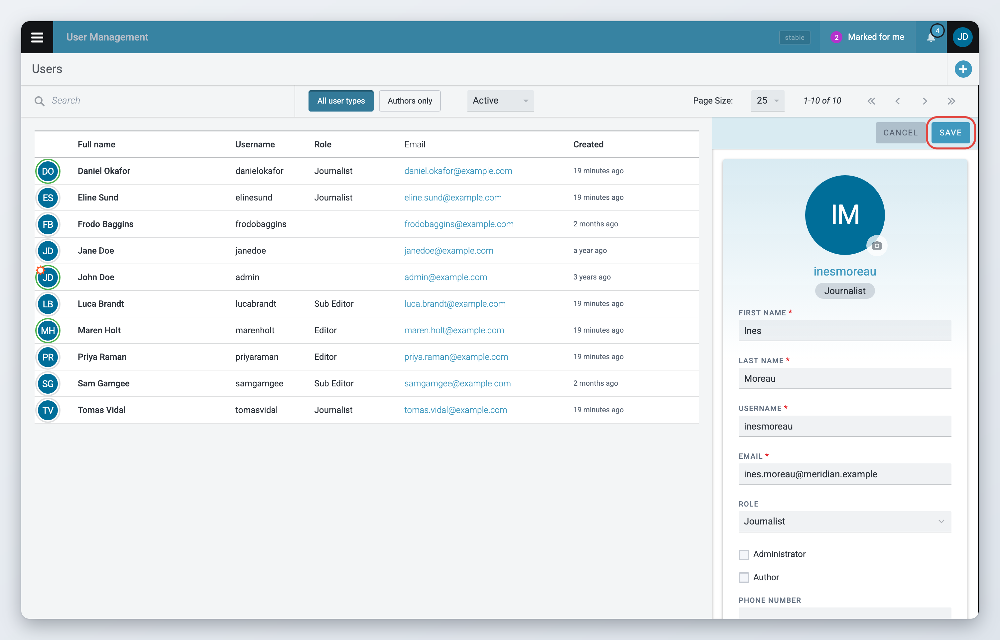
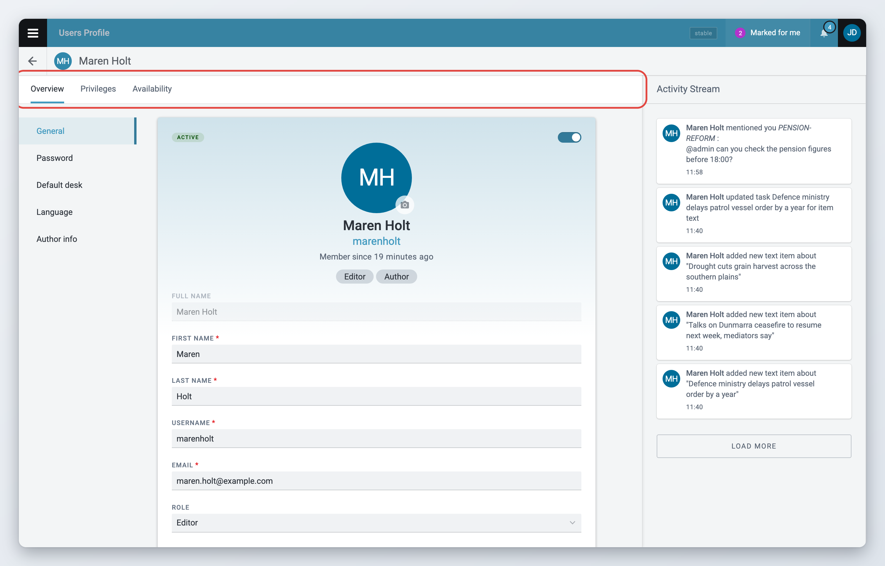
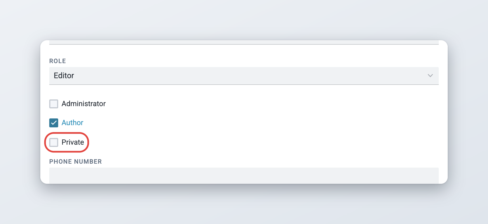
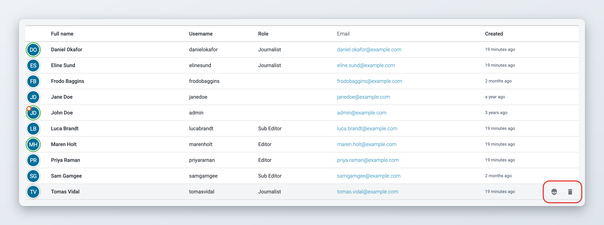
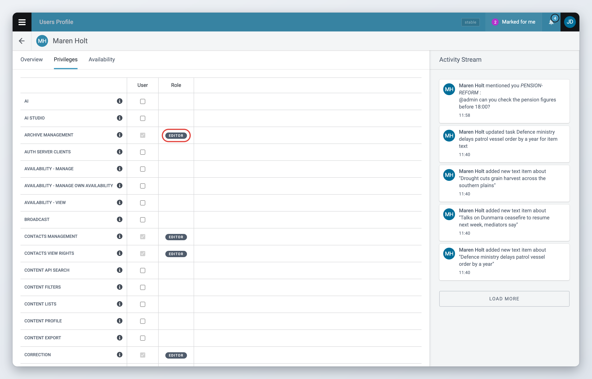
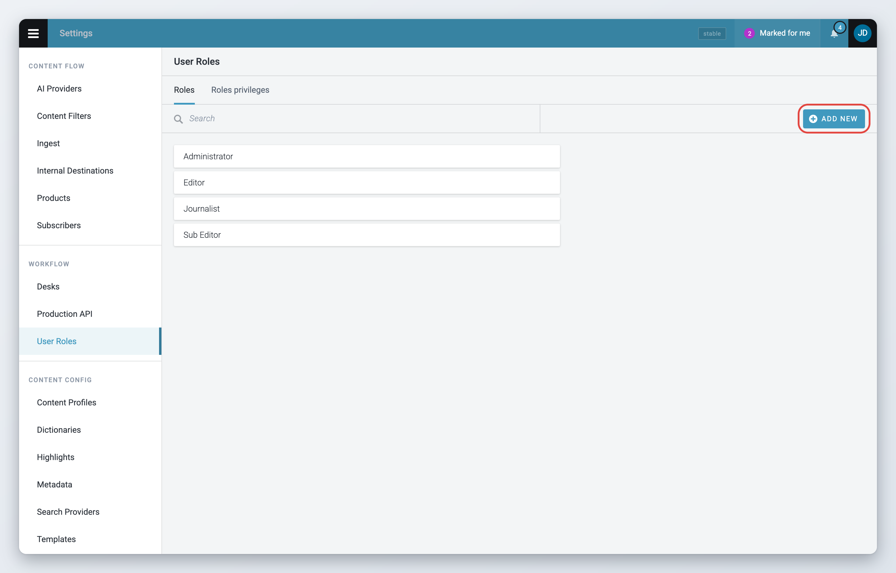
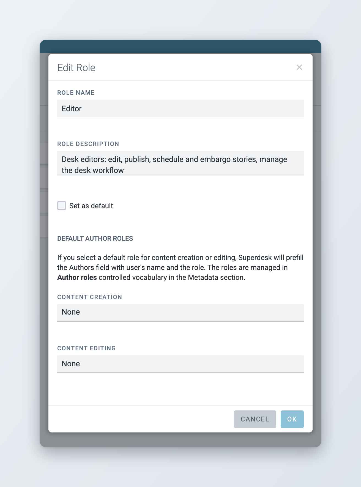
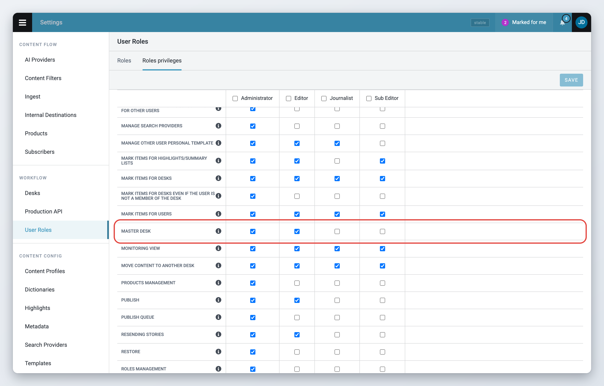

# User Management and User Roles

In **User Management** administrators create users, edit their profiles, deactivate or disable them and end their sessions. In **User Roles** they decide which privileges each group of users has.

You need the **User Management** privilege to open User Management, and the **Roles Management** privilege to open User Roles. Administrators have every privilege.

## User Management

To open it, click the **Main menu** (also called the hamburger menu) in the top-left corner and choose **User Management** under **Admin tools**.

<figure><figcaption>
User Management in the Main menu
</figcaption></figure>

### The user list

User Management opens with a list of the users of your Superdesk. The columns are **Full name**, **Username**, **Role**, **Email** and **Created**. Click **Full name**, **Username**, **Email** or **Created** to sort by that column.

<figure><figcaption>
The user list
</figcaption></figure>

Use the search field at the top to find users by name, username, email address or sign-off (since Superdesk 3.1).

Next to the search field there are filters:

* **All user types** and **Authors only** switch between all users and only users who are authors.
* The status dropdown shows **Active** users by default. You can also choose **Online**, **Pending**, **Inactive**, **Disabled** or **All**. Pending users have been created but have not activated their account yet.

The user's avatar has a green ring when the user is online and a small orange gear when the user is an administrator. Users who are disabled, inactive or pending have that word next to their name.

### Adding new users



### Open the new user form

Click the **Create user** button (the plus icon) in the top-right corner. A form opens on the right.



### Fill in the details

Fill in at least the required fields: **first name**, **last name**, **username** and **email**. Choose a **Role**. The other fields are optional.

A username can contain letters, numbers, dashes, underscores, apostrophes and periods. It must be unique, and it cannot be changed after the user is created, so choose carefully. The email address must not belong to another user.



### Save

Click **Save** at the top of the form. Superdesk sends the new user an email with a link to activate the account and set a password. Until they do, the user shows as pending.



<figure><figcaption>
Creating a user
</figcaption></figure>

### Importing users from a directory

If your Superdesk checks logins against your organisation's directory (LDAP or Active Directory), the **Create user** button opens the **Import user** window instead of the form. Enter your own directory username and password under **Your Credentials**, enter the username of the person to add under **User Profile to Import**, and click **Import**. Superdesk copies the profile from the directory.

### Editing user profiles

Click a user in the list to open their profile in a pane on the right. Change the fields you need, then click **Save** at the top of the pane. **Cancel** discards your changes.

To see everything, click **View full profile** at the top of the pane. The full profile has these tabs:

* **Overview**: the user's details, password, default desk, language and author information.
* **Privileges**: extra privileges for this user, see [Privileges of a single user](#privileges-of-a-single-user).
* **Availability**: only when your Superdesk uses Availability Management. See [View and edit Availability](../availability-management/view-and-edit-availability.md).

The **Personal preferences** tab only appears on your own profile. The **Activity Stream** on the right lists what the user did recently.

<figure><figcaption>
The full profile of a user
</figcaption></figure>

The **Overview** tab has a menu on the left with **General**, **Password**, **Default desk**, **Language** and, for authors, **Author info**. Click an entry to jump to that section.

**General** holds the name, username, email address, **Role**, phone number and other contact details. Changing a user's role changes their privileges. Only users with the **User Management** privilege can change a role.

**Default desk** is the desk the user sees after logging in. You can choose one of the desks the user is a member of.

**Language** is the language of the Superdesk interface for this user. See [Your profile and preferences](../navigating-superdesk/your-profile-and-preferences.md).

**Author info** has the user's **Sign-Off**, **Byline**, **Job Title**, **Biography** and social media accounts.

### Administrators, authors and private authors

In the **General** section, three checkboxes describe the user:

<figure><figcaption>
Administrator, Author and Private
</figcaption></figure>

* **Administrator**: the user has all privileges, whatever their role. Only administrators see this checkbox, so a user manager who is not an administrator cannot make anyone, including themselves, an administrator.
* **Author**: the user can be chosen as an author of items, and their profile gets the **Author info** section.
* **Private**: only shown for authors (since Superdesk 2.5). Tick it when the author does not want to be publicly visible. Superdesk stores this choice with the user. It does not hide the author anywhere in Superdesk itself. Your website or other systems that receive your content can use it to keep the author's name and profile out of public view.

### Resetting a user's password

If a user has forgotten their password, open their profile, go to the **Password** section and click **reset password**. Confirm with **Reset password**. Superdesk sends the user an email with a link to set a new password.

The button only appears for active users, and only when Superdesk manages passwords itself. It is missing, for example, when logins are checked against an LDAP directory. Users who log in through single sign-on manage their password with that service. See [Logging in and single sign-on](../getting-started/logging-in-and-single-sign-on.md).

On your own profile, the button is **change password**, and you need your current password.

### Deactivating and disabling users

There are two ways to stop someone from logging in. Both keep the user's name and username in Superdesk, so you can still find the items they worked on and the changes they made.

<figure><figcaption>
Actions on a user in the list
</figcaption></figure>

**Deactivate.** Open the user's profile and turn off the switch next to their status label at the top. The label changes from **active** to **inactive**. Turn it on again to reactivate the user. You cannot deactivate yourself.

**Disable.** Hover over the user in the list and click the trash icon (**Disable user**), then confirm. The user is marked **disabled** and no longer appears in the default **Active** list. Their profile is kept, so you can enable them again later. This is useful for freelancers or seasonal staff who need access from time to time. To enable a disabled user, choose **Disabled** in the status filter, hover over the user and click **Enable user**.

When a user is deactivated or disabled, Superdesk ends all their sessions. When a user is disabled, Superdesk also unlocks the items they had open and removes new items they never saved.

### Clearing a user's sessions

Hover over a user in the list and click the skull icon (**Clear sessions**), then confirm. Superdesk logs the user out wherever they are logged in. They have to log in again to continue working.

Use it, for example, when a user left Superdesk open on a shared computer. Administrators can also clear their own sessions, which logs them out everywhere, including the current browser.

### Privileges of a single user

The **Privileges** tab of a user's full profile lists all privileges. Use it to give one user a privilege that their role does not have.

<figure><figcaption>
The Privileges tab of a user
</figcaption></figure>

The **User** column has a checkbox for each privilege. The **Role** column shows the role name next to privileges the user already has through their role. Those checkboxes are ticked and greyed out: you cannot take away a privilege that comes from the role. To do that, change the role or give the user another role.

Tick the extra privileges and click **Save**.

## User Roles

A role is a set of privileges that you give to a group of users, for example editors or journalists. Each user has one role. Administrators have every privilege, whatever their role.

To manage roles, open the **Main menu**, click **Settings**, and then click **User Roles** under **Workflow**. The page has two tabs, **Roles** and **Roles privileges**.

### Roles

The **Roles** tab lists the roles. The default role is marked **default**. Use the search field to find a role by name.

<figure><figcaption>
The Roles tab
</figcaption></figure>

* To add a role, click **+ Add New**.
* To edit a role, hover over it and click the pencil icon.
* To delete a role, hover over it and click the trash icon, then confirm. You cannot delete the default role, or a role that users still have.

<figure><figcaption>
Editing a role
</figcaption></figure>

In the role window:

* **Role Name** is required and must be unique.
* **Role Description** is optional.
* **Set as default** makes this role the one new users get. There is always one default role. To change it, open another role and tick **Set as default** there.
* **Default author roles**: if you choose a role for **Content creation** or **Content editing**, Superdesk fills in the Authors field of items with the user's name and that author role. The author roles come from the **Author roles** vocabulary in **Settings** > **Metadata**.

Click **Ok** to save.

### Roles privileges

The **Roles privileges** tab is a table with one row per privilege and one column per role. Tick a box to give a privilege to a role. The checkbox in a column header ticks or clears all privileges of that role. Click **Save** to keep your changes.

<figure><figcaption>
The Roles privileges tab
</figcaption></figure>

Hover over the info icon next to a privilege to see what it allows. Superdesk hides the actions a user has no privilege for. Privileges also decide which icons a user sees in the Workspace Panel on the left, for example **Dashboard**, **Monitoring view** and **Global searches**.

Users get changes to their role when their privileges are next loaded. If a user does not see a change, ask them to reload Superdesk or log in again.

### Privileges added since Superdesk 2.0

The list of privileges depends on the modules your Superdesk uses. These privileges came with features added after Superdesk 2.0:

| Privilege | Allows | Since |
| --- | --- | --- |
| **Master Desk** | Opening [Master Desk](../workspace-and-search/master-desk.md) | 2.1 |
| **System Message** | Creating and removing [system messages](system-messages.md) for all users | 2.3 |
| **Sams**, **Sams manage**, **SAMS Manage Assets** | Using, setting up and managing [asset management (SAMS)](../integrations-and-advanced-features/asset-management.md). Only when SAMS is installed. | 2.2 |
| **Rundowns** | Using [Broadcasting: shows and rundowns](../broadcasting-shows-and-rundowns.md) | 2.7 |
| **Availability - view** | Opening the [Availability Management](../availability-management/README.md) dashboard | 2.10 |
| **Availability - manage** | Changing the availability that other users have set | 2.10 |
| **Availability - manage own availability** | Setting your own availability in your profile | 3.1 |
| **Auth Server Clients** | Managing Production API keys in **Settings** > **Production API**. See [Superdesk API](../integrations-and-advanced-features/superdesk-api.md). | 3.2 |
| **Content Lists** | Managing [content lists](../integrations-and-advanced-features/content-lists.md). Only when the content lists module is installed. | 3.7 |
| **AI Studio** | Managing AI providers in **Settings** > **AI Providers**. See [AI features](../integrations-and-advanced-features/ai-features.md). | 3.7 |
| **AI** | Using AI actions | 3.7 |

When the Planning component is installed, the list also has privileges for agendas, events, planning items, assignments and planning settings. See [Planning administration](../superdesk-planning-component/planning-administration.md).

## Media Contacts

Superdesk has an internal repository for Media Contacts. Users with the **Contacts View Rights** privilege can see them, and users with **Contacts Management** can create and edit them. Open **Media Contacts** from the **Main menu**.

Media Contacts save journalists and editors time. Without leaving Superdesk, users can find contact information for their sources, contributors or subscribers.

To add a contact, click the Create icon in the top-right corner of the Media Contacts pane. A pane opens on the right:

* Required fields are marked with a red asterisk. Click **Save** in the top-right corner of the pane to add the contact.
* Besides phone and email, you can add fax, Twitter, Facebook, Instagram and a street address.
* In the Media Contacts list, clicking the mail, Twitter, Facebook or Instagram icon opens that website or your mail program.
