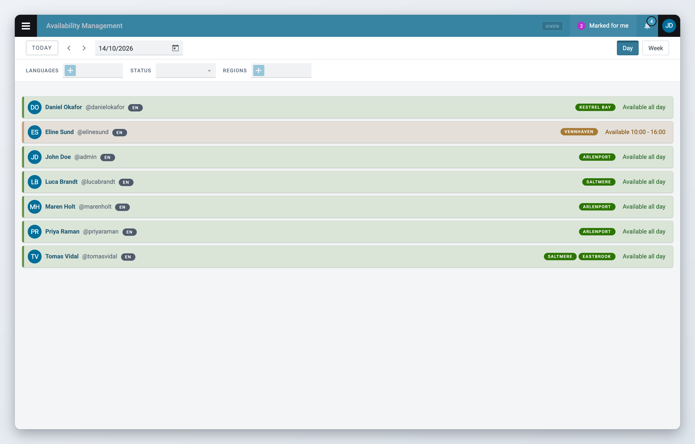
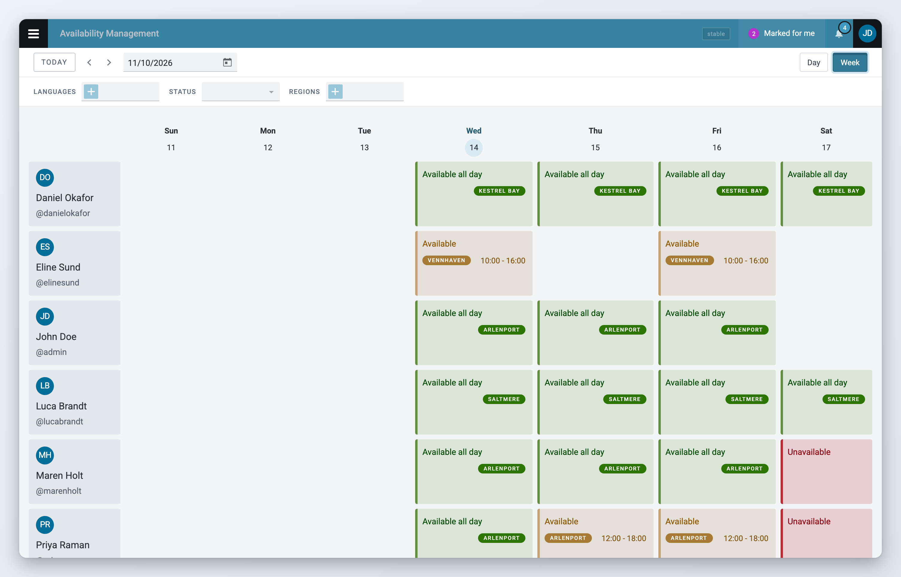
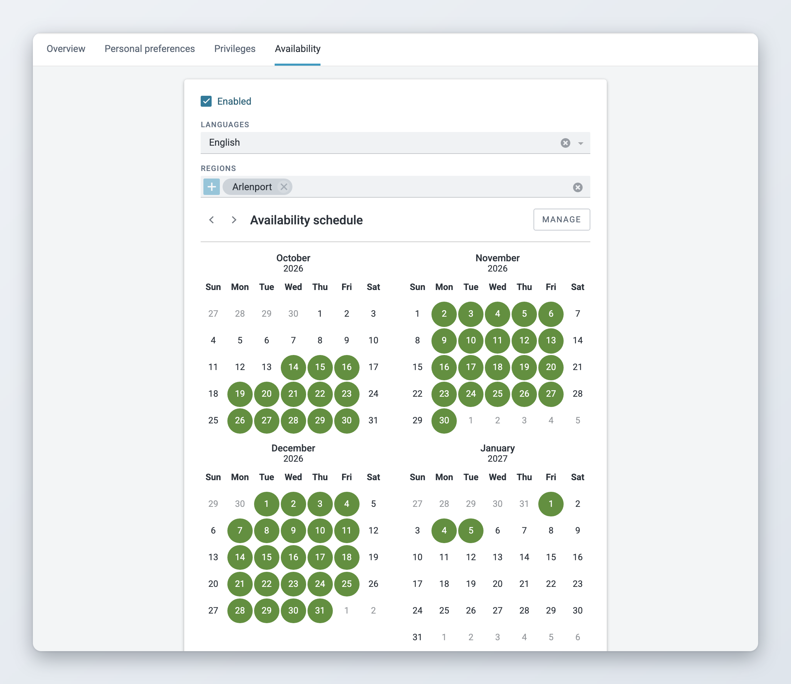

# Availability Management

*Available since Superdesk 2.10.*

Availability Management lets freelancers and correspondents tell the newsroom when they can work. Each person sets their own availability in their profile. Editors with the right privilege see everyone's availability on the **Availability Management** dashboard, and can change it when plans change.

Availability can be linked to tasks and subtasks, for example a type of coverage, or a province and its regions. Administrators manage these in a controlled vocabulary with the ID `availability_manager_tags`. The vocabulary can be renamed, and the dashboard and the profile show its name. See [How to set it up](how-to-set-it-up.md).


The dashboard loads at most 1,000 availability entries at a time. The day view has one entry per person, so it can show up to 1,000 people. The week view has up to seven entries per person, so if more than about 140 people have an entry on every day of the week, some of them are left out. Use the day view or the filters to narrow the list.


## Availability overview

The **Availability Management** dashboard shows the availability of everyone who has turned availability on in their profile. To open it, open the Main menu (also called the hamburger menu, top left) and click **Availability Management**. Your administrator can also put a link to it in the Workspace Panel on the left. You only see the dashboard if your role has the **Availability - view** privilege.

Switch between **Day** and **Week** in the top-right corner. Use **Today** and the arrows to move between days or weeks, or pick a date in the date field. Each entry is coloured by status: green for available, orange for partially available and red for unavailable.

You can filter the dashboard by language, by status and by task or region. The **Status** filter also has a **Not set** option, which shows the people who have not entered their availability for that day.

**The day view**

<figure><figcaption>
The day view
</figcaption></figure>

**The week view**

<figure><figcaption>
The week view
</figcaption></figure>

## Setting your availability

Freelancers and correspondents find an **Availability** section in their user profile. There they turn availability on, choose their language and tasks, set a default weekly schedule and change single days in a calendar. You need the **Availability - manage own availability** privilege to see this section. See [View and edit Availability](view-and-edit-availability.md).

Editors with the **Availability - manage** privilege can also change other people's availability. See [Manage Availability](manage-availability.md).

<figure><figcaption>
The Availability section in your profile
</figcaption></figure>

## Availability in the Production API

Availability data is also available through the Production API. An external system, such as an invoicing tool, can read for each person and day the availability status, the working hours, and how many articles and events they published. See [Superdesk API](../integrations-and-advanced-features/superdesk-api.md).

## Key concepts

### Availability status

Each day can have one of these statuses:

| Status              | Description                                                   |
| ------------------- | ------------------------------------------------------------- |
| Available           | The person is available for work all day.                     |
| Partially available | The person is available during the working hours they set.    |
| Unavailable         | The person is not available, for example on holiday or sick.  |
| Not set             | The person has not entered anything for that day.             |

### Default schedule and daily entries

Availability is made of two parts:

1. **Default schedule**: the weekly pattern a person usually works. Superdesk uses it to fill in the coming weeks automatically.
2. **Daily entries**: availability for a single date. A daily entry that you set by hand replaces the default schedule for that day.

### In this section

* [How to set it up](how-to-set-it-up.md)
* [View and edit Availability](view-and-edit-availability.md)
* [Manage Availability](manage-availability.md)
