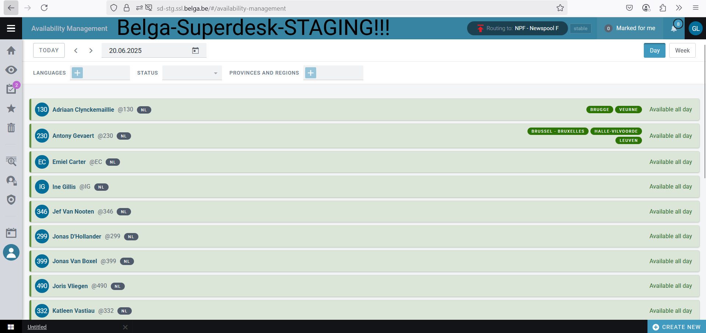
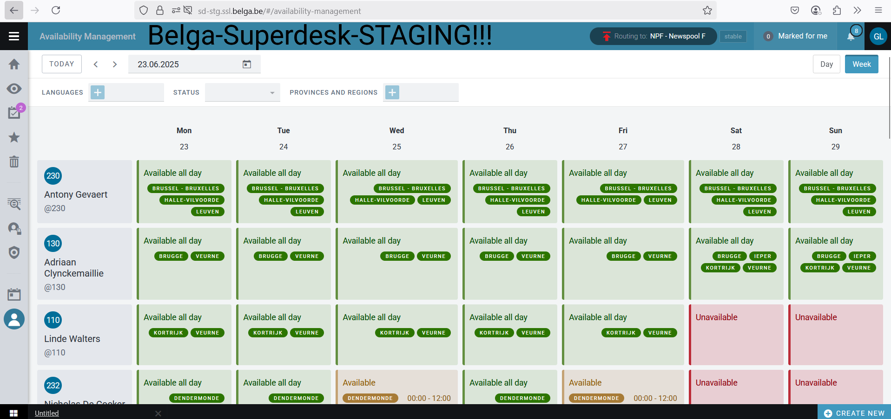
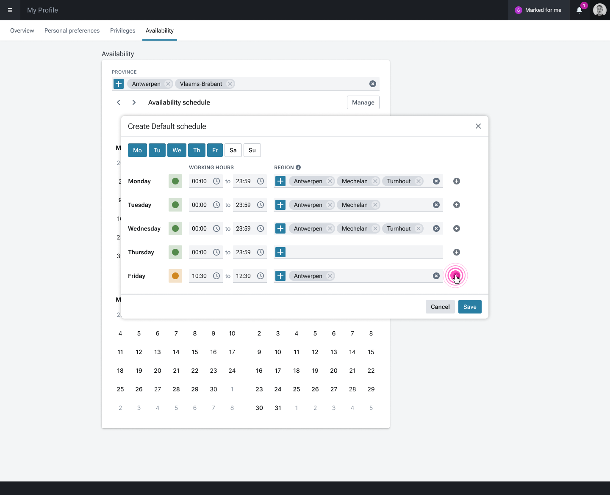

# Availability Management

Task and subtasks are managed in a Controlled Vocabulary within Superdesk. The CV is called "availability\_manager\_tags" and allows admins to set tasks and subtasks used in the respective news organisation. The CV can be renamed and its values could also be used to address the Coverage of certain Provinces (layer 1 of the CV) and its Regions (layer 2 of the CV).

**Note: The Availability feature can deal with up to 500 users. If there are more, adjustments may be necessary.**

### Availability Overview

The Availability Manager provides an **overview of the (un)availabilities of freelancers** working for a news organisation. The overview is available to the editorial team via a new Settings view, but it can also be configured to show up in the left grey toolbar with its respective icon.

**The day by day view**

<figure><figcaption></figcaption></figure>

**The week view**

<figure><figcaption></figcaption></figure>

### Set Availability&#x20;

The freelancers do find a tab in their **user profile** which allows them to **set and manage** their availability in a Calendar view. Availability of a freelancer can also be optionally managed by an Admin user with the respective user rights (Manage Availability).&#x20;

<figure><figcaption></figcaption></figure>

### Production API endpoint

There is also a new endpoint in the production API which can be used to inform an external  **invoicing system** about how many news items a freelancer produced and how much time he was available within a month time.

### Key Concepts

#### Availability Status

Each day can have one of three availability statuses:

| Status      | Description                                             |
| ----------- | ------------------------------------------------------- |
| Available   | User is fully available for work                        |
| Partial     | User is partially available (e.g., working partial day) |
| Unavailable | User is not available (vacation, sick leave, off-duty)  |

#### Components

The Availability Manager has two main components:

1. **Default Availability Settings** - Recurring weekly schedules configured by users
2. **Daily Availability Records** - Specific day-by-day availability entries
