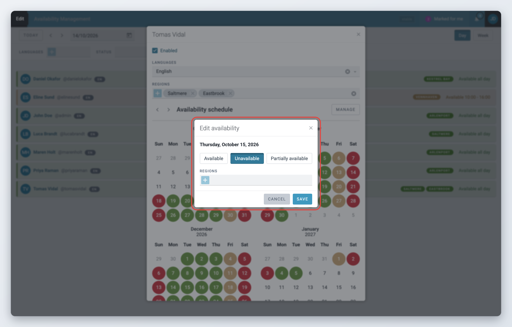
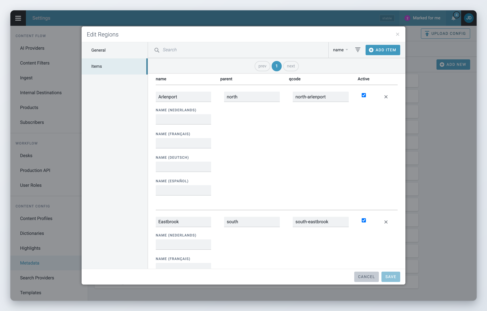

# Manage Availability

## What availability managers can do

If your role has the **Availability - manage** privilege, you can:

* view and change any user's availability from the Availability Management dashboard,
* override the availability a user has set,
* add or remove daily entries for other users,
* make sure your newsroom has the coverage it needs.

## Change another user's availability

You need both **Availability - view** (to see the dashboard) and **Availability - manage** (to make changes).



### Open the dashboard

Open the Main menu and click **Availability Management**.



### Open the user's calendar

Find the person in the day or week view and click their name or avatar. A window with their name opens. It shows their availability settings and calendar, the same as in their own profile.



### Pick the date

Click the date in the calendar. If the day has no entry yet, the **Edit availability** window opens. If it already has one, a short summary opens: click the pencil icon (**Edit**) to change it, or the bin icon (**Remove**) to delete it.



### Set the status and hours

Choose **Available**, **Unavailable** or **Partially available**. For partial availability, set the start and end time. Add or remove tasks if needed.



### Save

Click **Save**.



Superdesk records who made the change. In the user's calendar the day gets an outline, and its summary reads "Modified by" with your name and the date. This way the user can see that someone else changed their availability.

The user's default schedule can be changed in the same window, with the **Manage** button next to **Availability schedule**. See [View and edit Availability](view-and-edit-availability.md).

<figure><figcaption>
An availability manager edits another user's availability
</figcaption></figure>

## Monitor coverage

1. Open the Availability Management dashboard in the **Day** or **Week** view.
2. Look for gaps on specific dates.
3. Filter by task or region to see who covers it, and by language if you need a specific language.
4. Set the **Status** filter to **Not set** to find people who have not entered their availability yet.

## Permissions and restrictions

| Action                                   | Privilege needed                           |
| ---------------------------------------- | ------------------------------------------ |
| View and change your own availability    | **Availability - manage own availability** |
| View everyone's availability             | **Availability - view**                    |
| Change other users' availability         | **Availability - manage**                  |
| Add or remove other users' daily entries | **Availability - manage**                  |
| Change other users' default schedule     | **Availability - manage**                  |

## Manage the tasks and subtasks

This requires Superdesk administrator rights.

Open the Main menu, click **Settings** and then **Metadata**, and find the controlled vocabulary with the ID `availability_manager_tags`.

<figure><figcaption>
Manage the availability tasks and subtasks
</figcaption></figure>

Edit the vocabulary to add your tasks and subtasks. For example, to organise coverage by region, set it up like this:

Province A\
&#x20;    \- Region X\
&#x20;    \- Region Y\
Province B\
&#x20;    \- Region Z
