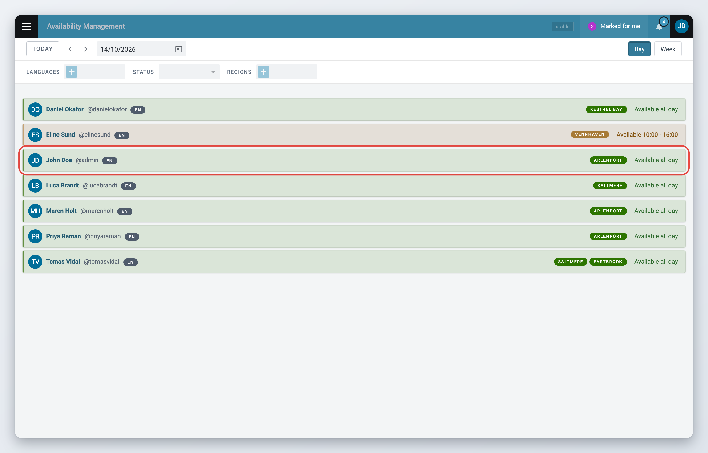

# View and edit Availability

## Understanding your availability

Your availability has two parts:

* **Default schedule**: your weekly pattern, the days and hours you usually work. Superdesk uses it to fill in the coming weeks for you.
* **Daily entries**: your availability on one date. An entry you set by hand replaces the default schedule for that day.

## View your availability

### In your profile

1. Click your avatar in the top-right corner and click **Manage profile**.
2. Click the **Availability** tab.
3. Under **Availability schedule** you see a calendar of the coming months. Each day is coloured by status: green for available, orange for partially available and red for unavailable. Days without a colour have no entry.

Superdesk fills in the next 12 weeks from your default schedule. Days you changed by hand are shown the same way.

### On the dashboard

If your role has the **Availability - view** privilege, you can also see your availability next to everyone else's on the **Availability Management** dashboard. Open the Main menu and click **Availability Management**. See [Availability Management](README.md#availability-overview).

<figure><figcaption><p>Your availability on the dashboard</p></figcaption></figure>

## Edit your default schedule

### Choose your language and tasks

At the top of the **Availability** tab:

1. Pick your working language in the language field. You can choose one language. Daily entries created from your default schedule get this language.
2. Add the tasks you can take on, for example a region or a type of coverage, in the tasks field. The field is named after your newsroom's task list, for example "Regions". The tasks you pick here are the ones you can choose from when you set up your schedule.

Both fields are saved as soon as you change them.

### Set your weekly schedule

Your default schedule sets the pattern for the weeks that Superdesk fills in for you.

<figure><figcaption><p>Set your weekly availability in the Default schedule window</p></figcaption></figure>



### Open the Default schedule window

Click **Manage** next to **Availability schedule**. The **Default schedule** window opens.



### Choose your working days

Click the weekday buttons at the top (**Mon** to **Sun**) to add or remove days. Days you leave out get no entry and show as **Not set** on the dashboard.



### Set each day

For each day, choose the status: **Available**, **Partially available** or **Unavailable**. Add tasks for that day if you want. For **Partially available**, set the start and end time. Use the plus button to add a second time range and the minus button to remove one.



### Save

Click **Save**.



For example:

```
Monday:     Available
Tuesday:    Available
Wednesday:  Partially available  09:00 - 13:00
Thursday:   Available
Friday:     Available
Saturday:   Unavailable
Sunday:     Unavailable
```

When you save your default schedule or change your language, Superdesk fills in the next 12 weeks again straight away. It also does this every night. Only days that came from the default schedule are replaced. Days you set by hand keep their values.

## Edit the availability of a single day

Use this for days that differ from your default schedule.

<figure><figcaption><p>Click a date to see its summary, then edit or remove it</p></figcaption></figure>



### Click the date

On the **Availability** tab of your profile, click the date in the calendar. If the day has no entry yet, the **Edit availability** window opens. If it has one, a summary opens: click the pencil icon (**Edit**) to change it.



### Change the day

The window shows the date at the top. Set:

* **Status**: **Available**, **Partially available** or **Unavailable**.
* The start and end time, for **Partially available**.
* The tasks for that day.



### Save

Click **Save**. The entry now counts as set by hand, so your default schedule no longer changes it.



If an availability manager changed one of your days, the day has an outline in your calendar and its summary reads "Modified by" with their name. See [Manage Availability](manage-availability.md).

## Delete a daily entry

1. Click the date in the calendar. The summary opens.
2. Click the bin icon (**Remove**).

If the day is part of your default schedule, Superdesk fills it in again from the schedule during the next nightly run. To mark a day off, set it to **Unavailable** instead of deleting it.
