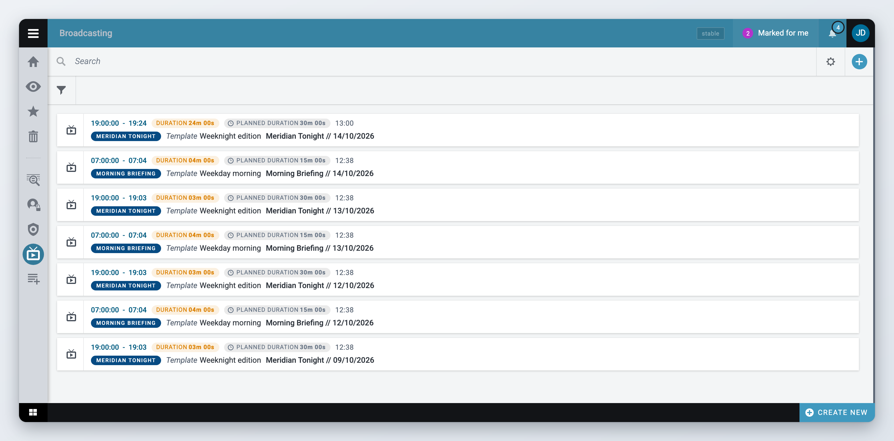
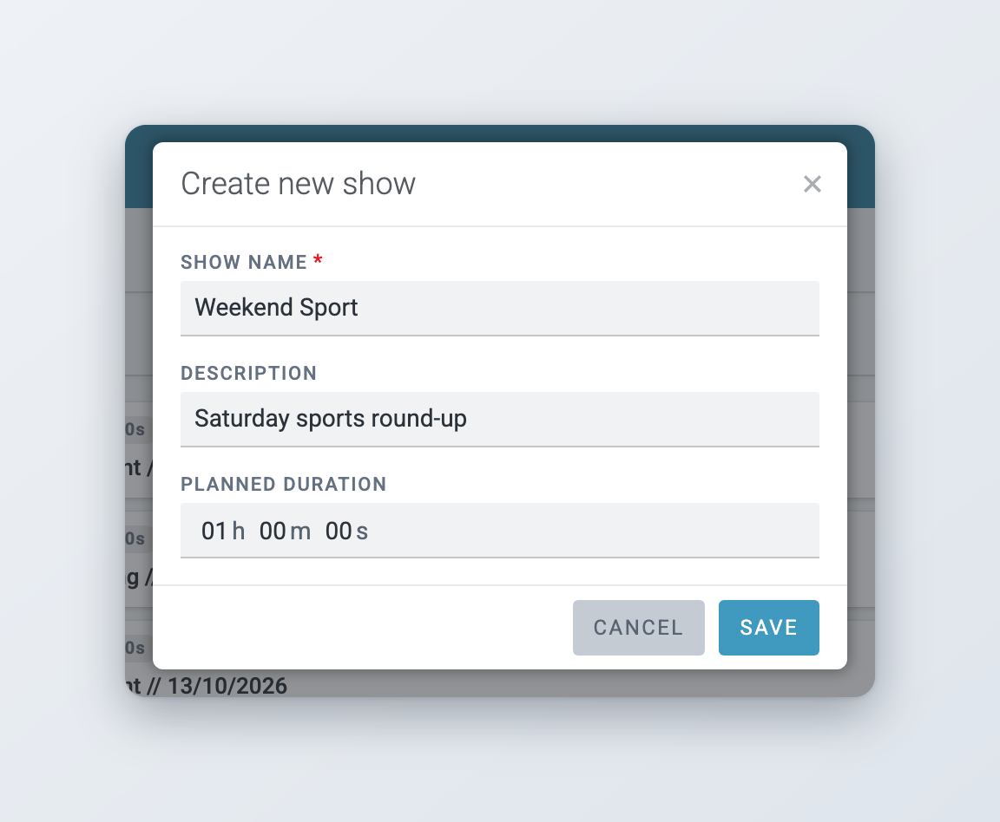
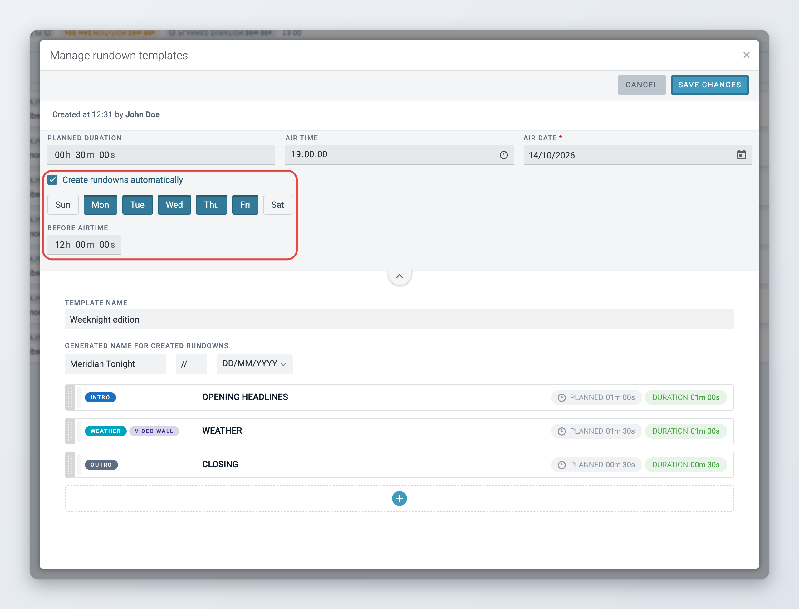
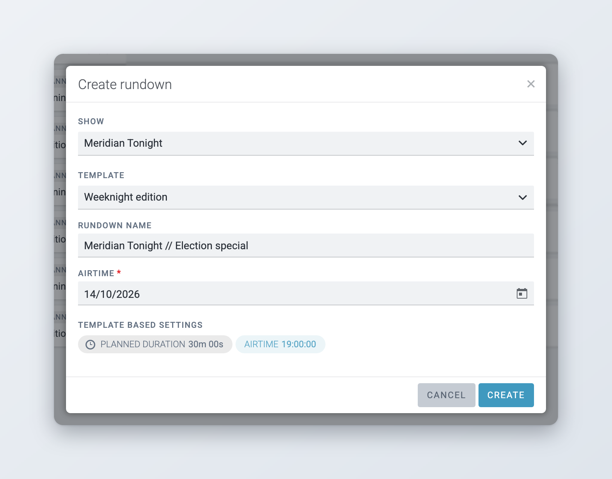
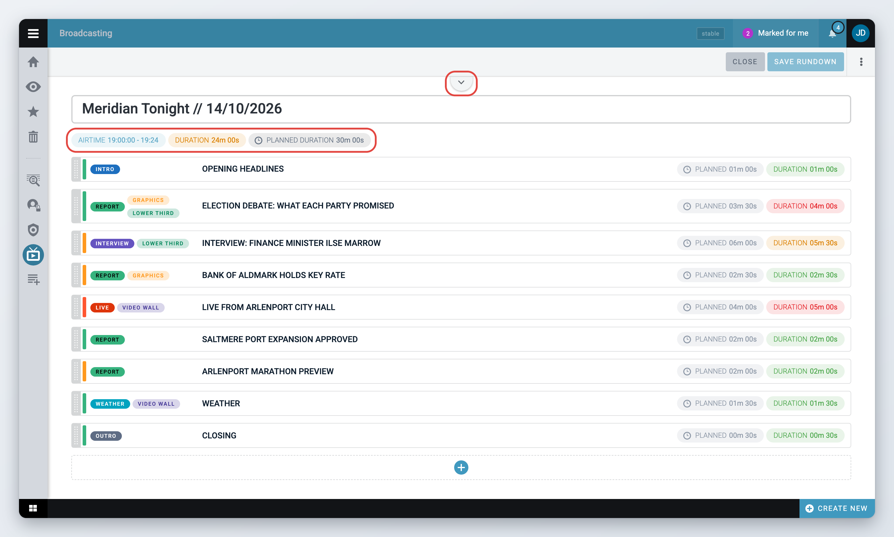
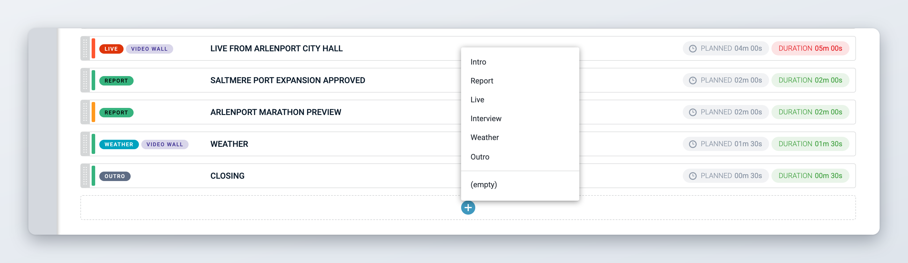
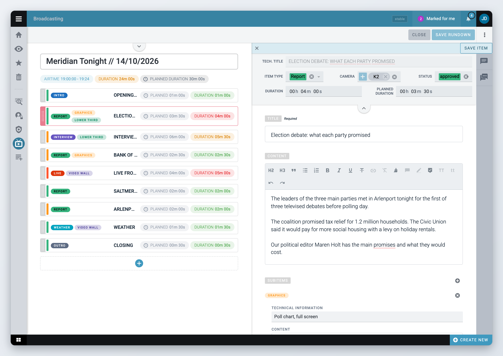
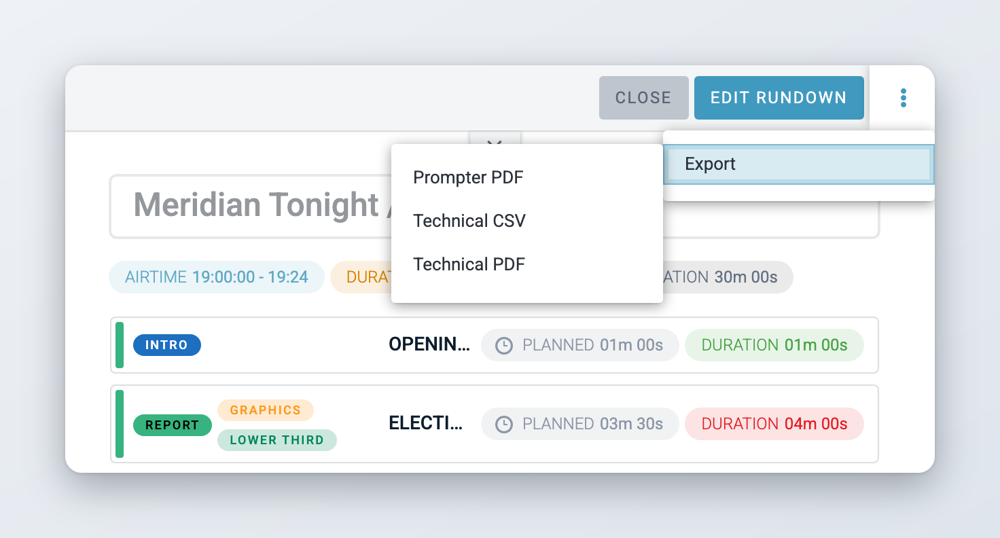

# Broadcasting: shows and rundowns

*Available since Superdesk 2.7.*


This is an optional module. If you do not see it, ask your administrator.


The Broadcasting module helps radio and TV teams plan a programme item by item. You build a **rundown**: the ordered list of everything that goes on air in one broadcast, with the planned length of each part and the time the programme starts. Superdesk adds up the durations as you work, so you can see straight away whether the programme runs long or short.

The module uses a few terms:

* **Show**: a programme that goes on air regularly, for example an evening news bulletin.
* **Rundown template**: a ready-made structure for a show, with its air time, planned length and the items that are always there. A template can also create rundowns automatically on set days.
* **Rundown**: one broadcast of a show on a given date. It is created from a template.
* **Rundown item**: one part of the rundown, such as an opening, a report, a live link or the weather.
* **Subitem**: an extra element attached to a rundown item, such as a graphic or an on-screen caption, with its own technical notes.

## Opening Broadcasting

Click the **Broadcasting** icon in the Workspace Panel on the left of the screen. See [Navigation](navigating-superdesk/navigation.md) for the other icons in the Workspace Panel.

The Broadcasting page lists all rundowns, the most recently changed first. Each row shows:

* the air time, from the start to the expected end,
* the running time (**Duration**) and the **Planned duration**,
* when the rundown was created or last changed,
* the show, the template it was made from, and the rundown name.

A lock icon on a row means someone has the rundown open for editing.

<figure><figcaption>
The Broadcasting page lists all rundowns
</figcaption></figure>

The header has a search bar, the filter icon, the settings icon and the **+** (Create) button. The settings icon opens **Manage Rundown Templates** and **Manage Shows**.

## Shows

Every rundown belongs to a show. Create the show first, then a template for it.

### Creating a show



### Open the Create menu

Click the **+** button in the header of the Broadcasting page, then click **Create new Show** at the bottom of the menu.



### Fill in the show details

The **Create new show** dialog opens. Fill in:

* **Show name** (required),
* **Description**,
* **Planned duration**: how long the show usually runs. The default is one hour.

Click **Save**.



### Create a template right away (optional)

Superdesk confirms that the show was created and asks whether you want to create a rundown template for it. Click **Yes, create a template** to go straight to the template editor with the show already selected, or **Cancel** to do it later.



<figure><figcaption>
Creating a show
</figcaption></figure>

### Managing shows

Click the settings icon in the header and choose **Manage Shows**. The dialog lists all shows by name. You can:

* search for a show by name,
* click **+** to add a show,
* click a show to see its details,
* hover a show and click the pencil icon to edit it, or the bin icon to remove it.

When you edit a show you also see the **Show code** field, a short code for the show. Superdesk uses it in the technical titles of some item types (see [Item names in the rundown list](#item-names-in-the-rundown-list)).

You cannot remove a show that still has rundowns. Remove or keep its rundowns first. When you remove a show, its rundown templates are removed with it.

## Rundown templates

A template holds everything that stays the same from one broadcast of a show to the next. You need at least one template per show, because every rundown is created from a template.

To open the templates, click the settings icon in the header and choose **Manage Rundown Templates**. Pick a show in the dropdown at the top left. Its templates are listed below.

### Creating a template



### Start a new template

In **Manage Rundown Templates**, select the show, then click the round **+** button (**Create new template**) above the list of templates.



### Set the air time and planned duration

At the top of the editor, fill in:

* **Planned duration**: how long the programme should run,
* **Air time**: when the programme starts (required),
* **Air date**: the first date the template applies to. Automatic creation starts from this date.



### Name the template

Type a **Template name**, for example "Weekday edition". It is required.



### Set the name for new rundowns

Under **Generated name for created rundowns**, set the text, the separator and the date format. See [Naming rundowns](#naming-rundowns) below.



### Add the standard items

Add the items that every broadcast of this show has, such as the opening and the closing. You add them the same way as in a rundown, see [Adding items](#adding-items). The item list only appears once you have set an air time. In the template, click **Apply** in the item editor to keep your changes to an item.



### Save the template

Click **Create template**.



<figure><figcaption>
A rundown template that creates a rundown every weekday
</figcaption></figure>

When a rundown is created from the template, Superdesk copies the template's items into it, with their type, title, content, subitems and durations. Cameras and status are not copied. Later changes to the template do not change rundowns that already exist.

### Naming rundowns

**Generated name for created rundowns** has three parts:

* the text at the start, usually the show name,
* a separator, `//` by default,
* the date format. The options depend on the date format of your Superdesk, for example day, month and year, month and year, or day and month.

A template with the text "Evening News", the separator `//` and a day-month-year format names its rundowns like "Evening News // 13.10.2026". Rundowns created automatically always get this name. When you create a rundown yourself, the name field starts with the text part only, and you can change it.

### Creating rundowns automatically

A template can create the rundown for each broadcast by itself, so the team finds it ready in the list.



### Turn on automatic creation

In the template editor, tick **Create rundowns automatically** and pick the days you need.



### Pick the days

Click the day buttons to choose the days of the week the show goes on air.



### Choose how early to create the rundown

In **Before airtime**, set how long before the air time Superdesk should create the rundown, for example 12 hours. If you leave it at zero, Superdesk uses the default set by your administrator (12 hours unless changed).



### Save

Click **Create template** or **Save changes**.



Superdesk checks for rundowns to create every 15 minutes, so a rundown can appear up to 15 minutes after the time you set. It creates only one rundown per broadcast, even if the check runs again. Air times for automatic creation use the time zone your administrator set for rundowns.

Automatic creation needs an **Air time** on the template. If you change the air time, air date, days or **Before airtime**, Superdesk works out the next rundown again from the new settings.

### Editing and deleting templates

In **Manage Rundown Templates**, click a template to see it. The top of the editor shows who created it and when. Click **Edit** to change it, then **Save changes**, or **Cancel** to discard your changes.

To edit or delete a template from the list, click the three-dot menu on its row and choose **Edit** or **Delete**.

## Creating a rundown



### Open the Create menu

Click the **+** button in the header of the Broadcasting page and choose **Rundown**.



### Choose the show and template

In the **Create rundown** dialog, pick the **Show**, then the **Template**. If the show has only one template, it is selected for you.



### Check the name and date

The **Rundown name** starts with the text from the template's generated name. Change it if you need to. Pick the broadcast date in **Airtime**. It defaults to today's date in UTC, so check it when you work close to midnight.

**Template based settings** shows the planned duration and the air time that the rundown takes from the template.



### Create

Click **Create**. Superdesk confirms with "Rundown created" and the rundown appears in the list, with the template's items already in it.



<figure><figcaption>
Creating a rundown from a template
</figcaption></figure>

## Working with a rundown

### Opening a rundown

* **Click** a rundown to open it read-only next to the list.
* **Double-click** it, or choose **Edit** in its three-dot menu, to open it for editing. Superdesk locks the rundown so nobody else can change it at the same time.

If you opened it read-only, click **Edit Rundown** to switch to editing. Click **Close** when you are done. If you have unsaved changes, Superdesk asks whether to discard them.

If someone else is editing the rundown, the header shows **Locked by** and their name, and the rundown stays read-only. Click **Unlock** to take the lock over, for example when a colleague forgot to close it, then click **Edit Rundown**.

To give the rundown the whole width of the screen, click the **Broadcasting** icon in the Workspace Panel again while a rundown is open. The rundown list is hidden. Click the icon once more to bring the list back.

<figure><figcaption>
A rundown open for editing
</figcaption></figure>

The rundown name is the large field at the top. The **Planned duration**, **Air time** and **Air date** of the rundown sit in a collapsed header above it. Click the toggle at the top of the rundown to show or hide them.

Changes to the name, the air time and date, the planned duration, the order of the items and removed items are only stored when you click **Save Rundown**.

### Air time, durations and the running time

Above the item list, three labels sum up the rundown:

* **Airtime**: the start time and the expected end time.
* **Duration**: the running time, the sum of the **Duration** of all items.
* **Planned duration**: how long the programme should run.

The **Duration** label changes colour so you can see at a glance whether the rundown fits:

* green: the running time matches the planned duration,
* orange: the rundown is shorter than planned,
* red: the rundown is longer than planned.

The expected end time is the air time plus the running time. The running time updates whenever an item's duration changes.

### The item list

Each row in the item list shows:

* a coloured bar on the left for the item's status, for example pending, in approval or approved,
* the item type and the subitems, as coloured labels,
* the item name,
* the item's **Planned** and **Duration** times.

Click an item to preview it in the panel on the right. Double-click it to edit it. The three-dot menu on a row has **Edit**, **Preview** and **Delete**.

You can open, preview and edit items even when the rundown itself is read-only. Adding, moving and deleting items needs the rundown open for editing.

### Adding items



### Choose where the item goes

To add an item at the end, click the round **+** button (**Add item**) below the list. To add it after a specific item, hover the line under that item and click the **+** that appears.



### Pick the item type

A menu lists the item types set up in your Superdesk. Click one, or click **(empty)** to add an item without a type.



### Fill in the item

The rundown item editor opens on the right. Fill in at least the **Title** and click **Save item**.



The new item is added to the rundown as soon as you save it. You do not need to click **Save Rundown** for that.

<figure><figcaption>
Adding an item: pick the item type
</figcaption></figure>

### Reordering and removing items

To change the order, drag an item up or down the list. To remove an item, open its three-dot menu, choose **Delete** and confirm.

Both changes need the rundown open for editing, and both are only kept when you click **Save Rundown**.

## The rundown item editor

The rundown item editor opens in a panel on the right of the rundown. In preview, click **Edit item** to start editing. Click **Save item** to store your changes, and the cross at the top left to close the editor. If you switch to another item with unsaved changes, Superdesk asks whether to discard them.

While you edit an item, Superdesk locks it. If someone else has it open, the editor shows **Locked by** and their name. Click **Unlock** to take it over.

<figure><figcaption>
The rundown item editor
</figcaption></figure>

### Item fields

| Field | What it is for |
|---|---|
| **Tech. title** | The technical title, generated by Superdesk from the item's title (and, for some item types, the show code and cameras). You cannot edit it. |
| **Item Type** | The kind of item, for example a report or a live link. The list comes from your Superdesk settings. |
| **Camera** | One or more cameras used for the item. |
| **Status** | Where the item is in your workflow, for example pending, in approval or approved. The status colour shows as the bar on the item's row. |
| **Duration** | How long the item actually runs. If you leave it empty, Superdesk uses the planned duration. |
| **Planned duration** | How long the item should run. |
| **Title** | The item's name. Required. |
| **Content** | The script or notes for the item, with basic formatting. |
| **Subitems** | Extra elements for the item, see below. |
| **Subitem attachments** | Files that belong to the item, for example a graphic. |

The item types, cameras, statuses and subitem types are lists your administrator manages.

### Subitems

Subitems describe extra elements that go with an item, such as graphics, a video wall or an on-screen caption. Each subitem type can be added once per item.



### Add a subitem

In the **Subitems** field, click the **+** button and pick a subitem type.



### Describe it

Fill in **Technical information**, the short note the technical team needs, and the **Content** of the subitem.



To remove a subitem, click the red remove icon next to its name. Subitems appear as coloured labels on the item's row, and their technical information goes into the technical exports.

### Comments

The editor has two comment panels on its right edge: comments on the whole item, and inline comments on selected text in the **Content** field. Open a panel with its icon. Comments are available once the item has been saved.

To draw a colleague's attention, type `@` in the comment and pick them from the list. They get a notification with an **Open item** button that opens the rundown with the item's comments.

## Finding rundowns

### Searching

Type in the search bar at the top of the Broadcasting page and press **Enter**. Superdesk searches the rundown names. Click a rundown in the results to open it.

### Filtering

Click the filter icon below the search bar to open **Advanced filters**. You can filter by:

* **Show**,
* **Airtime time from** and **Airtime time to**,
* **Airtime date from** and **Airtime date to**,
* **Duration from** and **Duration to**.

Click **Filter** to apply them. The active filters appear next to the filter icon. Click the cross on a filter to remove it, or click **Clear** in the panel to remove them all.

## Exporting and printing a rundown



### Open the actions menu

Open the rundown and click the three-dot (**Actions**) button at the top right.



### Pick a format

Point to **Export** and choose a format. Your browser downloads the file.



| Format | What you get |
|---|---|
| **Prompter PDF** | Each item's technical title followed by its content, in large type for the presenter. |
| **Technical PDF** | A table with the order, type, technical title, the technical information of each subitem type used in the rundown, and the duration of each item. Landscape A4. |
| **Technical CSV** | The same table as the technical PDF, for spreadsheets and playout systems. |

Exports use the saved rundown, so click **Save Rundown** first if you have changes. To print a rundown, export it as PDF and print the file.

<figure><figcaption>
Exporting a rundown
</figcaption></figure>

## Who can do what

The module has a single privilege, **Rundowns**. If your role has it, you see the Broadcasting icon and can do everything on this page: create and remove shows and templates, create, edit and delete rundowns and items, comment and export. Without it, the Broadcasting icon is not shown.

Locks stop two people from changing the same rundown or item at the same time. Anyone with the privilege can take over a lock with **Unlock**.

## For administrators

### Enabling the module

Broadcasting has a server part and a client part. Both are on in the default Superdesk installation:

* the server app `apps.rundowns` in `INSTALLED_APPS`,
* the `broadcasting` client extension.

Automatic rundown creation runs as a background task every 15 minutes (`rundowns:create-scheduled-rundowns`), so the Celery beat scheduler must be running.

### Privilege

Give the **Rundowns** privilege (`rundowns`, "Rundowns management") to the roles that work with broadcasts: open the Main menu, go to **Settings** > **User Roles**, select the **Roles privileges** tab and tick **Rundowns**. See [User Management and User Roles](administration/user-management-and-user-roles.md).

### Lists used by rundown items

Rundown items take their choices from four vocabularies. Edit them in **Settings** > **Metadata** > **Vocabularies** (see [Metadata and custom fields](administration/content-configuration/metadata-and-custom-fields.md)):

| Vocabulary | ID | Used for |
|---|---|---|
| Item Type | `rundown_item_types` | The **Item Type** field and the **Add item** menu. Each value can have a colour for its label. |
| Subitem Type | `rundown_subitem_types` | The subitem types. Each value can have a colour. |
| Rundown Item Status | `rundown_item_status` | The **Status** field. The colour shows as the bar on the item's row. |
| Camera | `camera` | The **Camera** field. |

The default installation creates these vocabularies with example values. Replace them with the values your newsroom uses.

### Server settings

| Setting | Default | What it does |
|---|---|---|
| `RUNDOWNS_TIMEZONE` | `DEFAULT_TIMEZONE` | The time zone of template air times when rundowns are created automatically. |
| `RUNDOWNS_SCHEDULE_HOURS` | `12` | How many hours before air time a rundown is created when the template's **Before airtime** is zero. |

### Item names in the rundown list

The rundown item list can show either the item's title or its technical title. This is set when the client is built, with the `getRundownItemDisplayName` customization of the `broadcasting` extension. The default Superdesk build shows the technical title.

The technical title is generated on the server: the item title in capital letters. For the PRLG and AACC item types it is the item type, show code, title and cameras joined with dashes.
