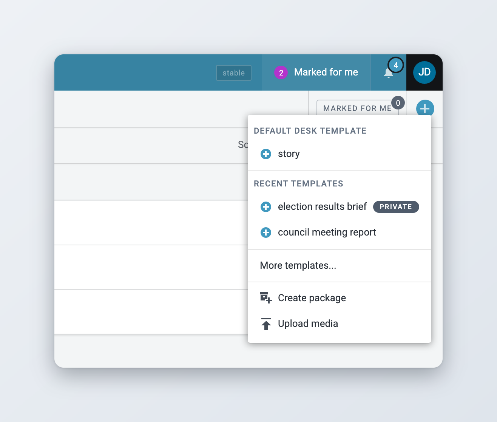
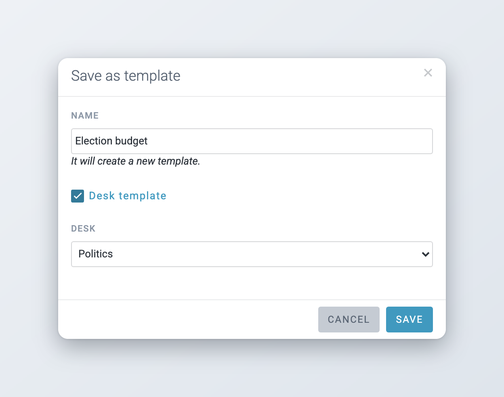
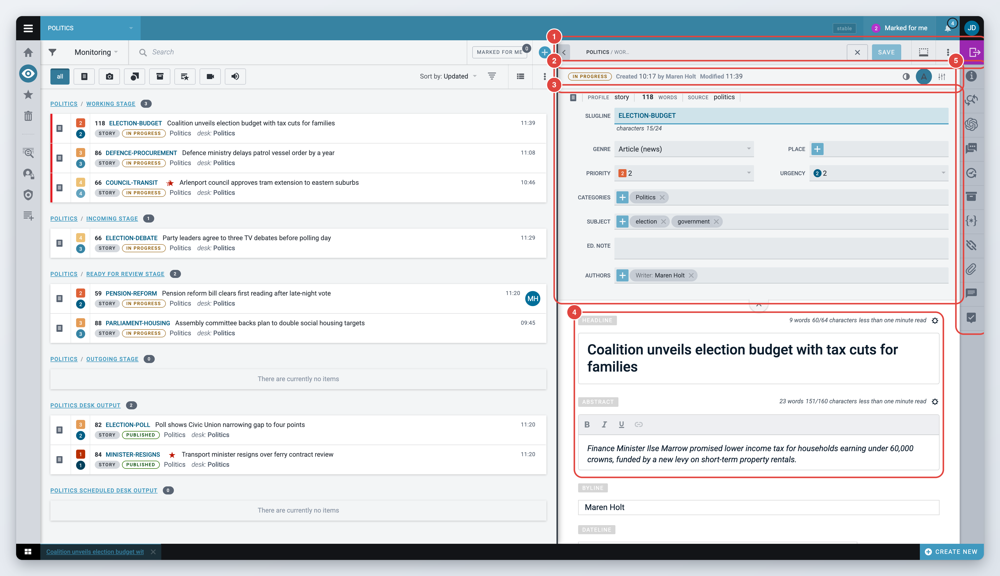
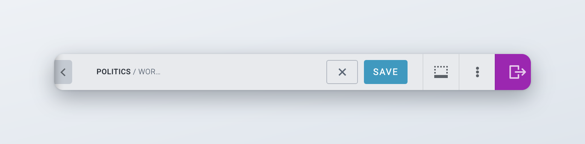
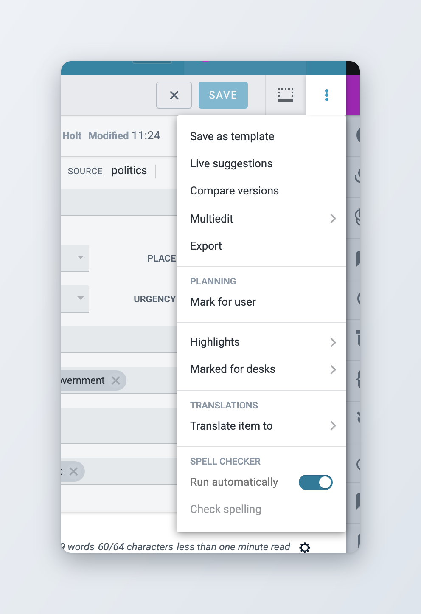
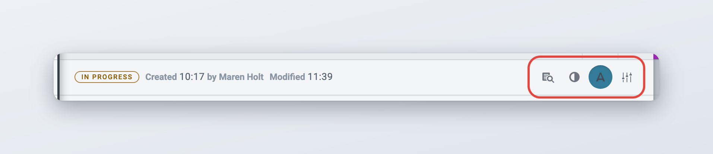
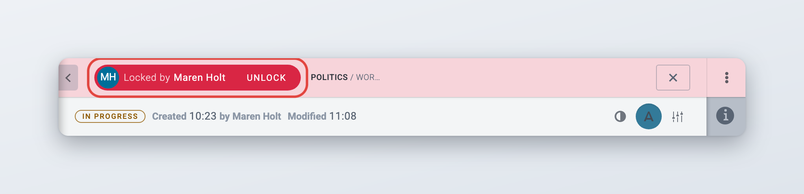
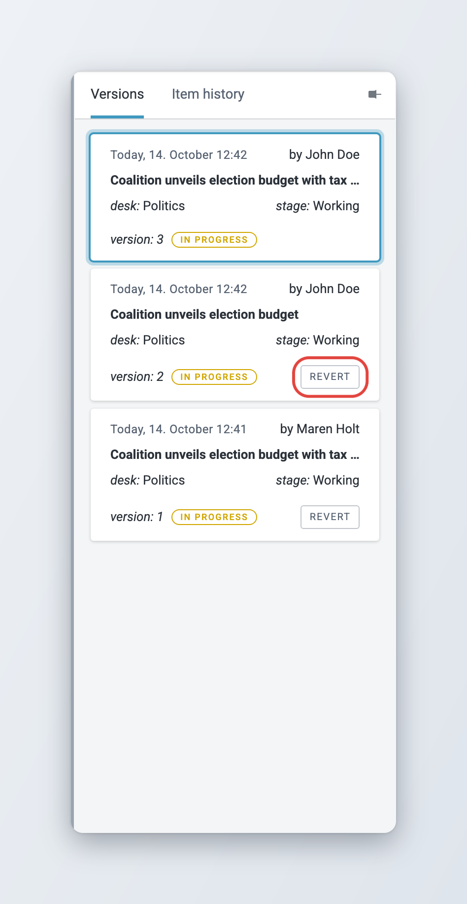

# Creating and Editing Content Items

This page explains how to create a news item, find your way around the editing screen, and save and close your work.

Four related pages go into more detail:

* [Writing and formatting](writing-and-formatting.md): the body editor and its toolbar, links, tables, embeds, custom blocks and tags, annotations, character counts, spell checking, and find and replace.
* [Metadata and fields](metadata-and-fields.md): the header fields, content profiles, vocabulary, custom and predefined text fields, and the widgets in the widget bar.
* [Edit Media items](edit-media-items.md): uploading pictures, video and audio, editing image metadata and crops, galleries.
* [Collaboration tools](collaboration-tools.md): comments, inline comments, suggestions and marking items for other users.

When an item is ready to move on, see [Sending, scheduling and publishing items](../sending-scheduling-and-publishing.md).

## Creating an item

You create items with the **Create** button. You find it in two places:

* in the Monitoring header, as a round **+** button with the tooltip "Create new item",
* at the right end of the opened-items bar at the bottom of the screen, as the **Create new** button. This one is there wherever you are in Superdesk.

Both open the same menu.

<figure><figcaption>
The Create menu
</figcaption></figure>

The menu has these entries:

* **Default desk template**: creates an item from the template your administrator set as the default for the current desk.
* **Recent templates**: the last templates you used on this desk. Personal templates carry a **Private** tag.
* **More templates...**: opens a searchable list of all templates you can use. Click the back arrow to return to the menu.
* **Create package**: creates an empty package. This entry is not offered in Personal space. See [Packages](../packages.md).
* **Upload media**: opens the upload window for pictures, video and audio. See [Edit Media items](edit-media-items.md).



### Choose the desk

In Monitoring, select the desk you want to work on in the **Desks menu**. The new item is created on that desk.



### Open the Create menu

Click the **Create** button.



### Pick a template

Click the default desk template, one of the recent templates, or **More templates...** to search for another one.



### Start writing

The item opens in the editor, locked to you. Fill in the fields and click **Save**.



Where the new item goes:

* If you are working on a desk, the item is placed in the desk's working stage.
* If you are in Personal space, the item stays in your Personal space. Nobody else can see it until you send it to a desk.

If you create an item and close it without saving anything, Superdesk deletes it. This keeps desks free of empty items.

### What a template fills in

A template sets the item's content profile, which decides the fields you see, and it can pre-fill any of those fields, for example the category, the dateline or a standard sign-off. If the template has no byline, Superdesk uses the byline from your user profile.

Administrators manage templates in **Settings** > **Templates**. See [Templates, macros and dictionaries](../../administration/content-configuration/templates-macros-and-dictionaries.md#templates).

### Saving an item as a template

You can turn the item you are editing into a template.



### Open the actions menu

Click the **More actions** button (three vertical dots) in the top bar and choose **Save as template**.



### Name the template

Type a **Name** of up to 40 characters. Superdesk tells you whether this creates a new template or updates an existing one with the same name.



### Choose who can use it

If you have the **Templates** privilege, you also see the **Desk template** checkbox and a **Desk** list. Tick **Desk template** and pick a desk to share the template with everyone on that desk. Leave it unticked to keep the template personal.



### Save

Click **Save**.



<figure><figcaption>
Saving an item as a template
</figcaption></figure>

Without the **Templates** privilege, every template you save is personal. Only you can use your personal templates. Users with the **Manage other user personal template** privilege can manage them in **Settings** > **Templates**.

### Starting from an ingested item

Items that arrive from news agencies and other feeds sit in the ingest area and cannot be edited there. To work on one, copy it to a desk first, using its actions menu:

* **Fetch** (Ctrl+Enter) copies the item to your current desk.
* **Fetch To** lets you choose the desk and stage.

You need the **Fetch Content To a Desk** privilege. See [Ingesting News Items and Events](../../integrations-and-advanced-features/ingesting-news-items-and-events.md).

### Duplicating an item

The **Duplicate** group in an item's actions menu makes a copy of an existing item:

* **Duplicate in place** (Ctrl+Alt+D) creates a copy on your current desk. Superdesk shows "Item Duplicated".
* **Duplicate To** (Ctrl+Alt+R) opens the side panel, where you pick the desk and stage for the copy.
* **Duplicate to personal** puts a copy in your Personal space.

Items in Personal space have a **Copy** action instead, which makes a copy next to the original.

You need the **Duplicate Content within a Desk** privilege for **Duplicate in place** and **Duplicate To**. Locked items cannot be duplicated.

## Opening an existing item

Items are listed in Monitoring, Search and Personal space. To open one:

* double-click it, or
* hover over it, open its actions menu and choose **Edit** (Ctrl+Alt+E). **Edit in new Window** (Ctrl+Alt+N) opens it in a separate browser window.

**Open** (Alt+O) shows the item without locking it. Click **Edit** in the top bar when you want to change it.

Every item you have open appears as a tab in the opened-items bar at the bottom of the screen. Click a tab to switch to that item. The **Minimize** button in the top bar keeps the item open in the bar and gives the screen back to the list. The button at the far left of the bar shows all your opened items at once.

## The authoring screen

The editing screen, also called authoring, opens to the right of the list.

<figure><figcaption>
The parts of the authoring screen
</figcaption></figure>

1. The **top bar**, with the item's desk and stage, the action buttons and the **Send to / Publish** button.
2. The **status bar**, with the item's state, who created it, when it was last changed, and the view controls.
3. The **header fields**, the item's metadata. See [The header fields](metadata-and-fields.md#the-header-fields).
4. The **content fields**: headline, abstract, body and the other fields of the content profile. See [Writing and formatting](writing-and-formatting.md).
5. The **widget bar** on the right, with tools such as Info, Find and Replace, Comments and Versions/History. See [Widgets](metadata-and-fields.md#widgets).

### The top bar

From left to right, the top bar shows:

* the **Full width mode** button (an arrow at the far left), see [Full width mode](#full-width-mode),
* the desk and stage the item is in, and labels for highlights, desk marks and planning assignments,
* **Read-only** if the item is in a stage you can only read,
* the shortcut buttons your administrator has added, see [Shortcut buttons in the top bar](#shortcut-buttons-in-the-top-bar),
* **Close** (Ctrl+Shift+E) and **Save** (Ctrl+Shift+S),
* **Minimize**,
* **More actions** (three vertical dots),
* **Send to / Publish**, the coloured button at the far right.

<figure><figcaption>
The top bar
</figcaption></figure>

When the item is published, or you opened it read-only, the top bar shows the buttons that fit its state instead, such as **Edit**, **Update**, **Correct**, **Takedown**, **Kill** or **Deschedule**. Those are explained in [Updates, corrections, kills and takedowns](../updates-corrections-kills-and-takedowns/README.md).

The **More actions** menu holds the less frequent actions. What you see depends on the item and on your privileges:

| Entry | What it does |
| --- | --- |
| **Save as template** | Saves the item as a template. See [Saving an item as a template](#saving-an-item-as-a-template). |
| **Live suggestions** | Shows related content suggestions while you write, when your installation provides them. |
| **Mark for user** | Brings the item to a colleague's attention. See [Collaboration tools](collaboration-tools.md#mark-for-user). |
| **Compare versions** | Shows two versions of the item side by side. See [Versions and history](#versions-and-history). |
| **Multiedit** | Opens a submenu to open the item next to other items so you can edit them side by side. |
| **Export** | Downloads the item in a chosen format. See [Exporting an item](#exporting-an-item). |
| **Planning** | Planning actions, when Superdesk Planning is installed. |
| **Highlights**, **Marked for desks** | Adds the item to a highlight or marks it for a desk. See [Highlights](../../workspace-and-search/highlights.md). |
| **Translate item to** | Creates a translation. See [Translating content](../translating-content.md). |
| **Spell Checker** | Turns automatic spell checking on or off and runs a check. See [Checking spelling](writing-and-formatting.md#checking-spelling). |

<figure><figcaption>
The More actions menu
</figcaption></figure>

### The status bar

Under the top bar, the status bar shows when the item was **Created** and by whom, and when it was last **Modified**. It also shows the item's state as a coloured label, for example **In Progress**, **Published** or **Scheduled** (since 3.2).

On the right of the status bar are the view controls:

* **Preview** (an eye icon) opens a printable preview of the item. It only appears if your administrator turned previews on, and only for text and picture items. See [Previewing and printing](#previewing-and-printing).
* **Toggle theme** switches the editor between your default theme and your proofreading theme.
* The **spell checker** button turns spell checking on and off. See [Checking spelling](writing-and-formatting.md#checking-spelling).
* The settings button next to them opens **Configure Editor themes**. For each theme you choose a font, a colour scheme and the text size (S, M or L) of the headline, the abstract and the body. Click **Save** to keep your choice.

<figure><figcaption>
The status bar and view controls
</figcaption></figure>

### Full width mode

*Available since Superdesk 2.8.*

Click the arrow at the far left of the top bar to hide the list and give the editor the whole width of the screen. The tooltip reads "Full width mode". Click it again ("Leave full width mode") to bring the list back. Switching back and forth keeps your place in the item and any text you have not saved yet (since 3.6).

## Saving, autosave and locks

### Saving

Click **Save** in the top bar or press Ctrl+Shift+S. The button is only active when there is something to save. Each save creates a new version of the item, which your colleagues can see.

### Autosave

Superdesk saves your work in the background a few seconds after you stop typing. This autosave is not a new version. It is a draft copy that protects your changes if your browser closes. When you open the item again, Superdesk brings back the autosaved changes, and you can save them.

Your colleagues see the last version you saved, not the autosave.

### Locks

When you open an item for editing, Superdesk locks it to you. Other users see a lock on the item in lists. If they open it, they see it read-only, with "Locked by" and your name in the top bar.

The lock ends when you close the item. If you need to work on an item that someone else has locked, ask them to close it. Users with the **Unlock content** privilege can click **Unlock** in the top bar (Ctrl+Shift+U) instead. An item that has never been saved cannot be unlocked by someone else.

If someone unlocks your item, Superdesk tells you "This item was unlocked by" and their name. Changes you had not saved yet but that were autosaved are saved into the item at that moment, so they are not lost.

<figure><figcaption>
An item locked by another user
</figcaption></figure>

### Closing an item

Click **Close** in the top bar, or press Ctrl+Shift+E. If you have unsaved changes, Superdesk asks "There are some unsaved changes, do you want to save it now?" (while sending or correcting, the prompt offers **Save and send** instead):

* **Save** saves the changes and closes the item.
* **Ignore** throws the changes away, including the autosave, and closes the item.
* **Cancel** keeps the item open.

Closing also unlocks the item, so others can work on it.

## Versions and history

Open the **Versions/History** widget to see what happened to the item.

* The **Versions** tab lists every saved version, newest first, with its time, author, desk, stage and state. Click a version to view it. Click **revert** on an older version to make it the current text again. This creates a new version, so nothing is lost. **revert** is only offered when you have no unsaved changes.
* The **Item history** tab is a log of events: who created, updated, moved, duplicated, fetched, spiked or published the item, and when. For published items, it also shows which subscribers received it.

<figure><figcaption>
The Versions tab
</figcaption></figure>

To compare two versions side by side, choose **More actions** > **Compare versions** and pick the versions from the dropdowns. This is available for items on a desk.

## Previewing and printing

If your administrator turned previews on, the **Preview** button in the status bar opens the item as it will read, with its metadata, pictures and text. From there you can **Print** it, or click **Hide media** first to print only the text. For a picture, an **Original** button opens the full-size file. See [Edit Media items](edit-media-items.md#opening-the-original-file).

To print several items, select them in a list and choose **Print** in the action bar.

## Exporting an item

You can download an item in one of your newsroom's output formats, for example to send it to someone outside Superdesk. You need the **Content export** privilege.



### Choose Export

In the editor, choose **More actions** > **Export**. Superdesk closes the item first, and asks you to save it if you have unsaved changes. To export several items, select them in a list and choose **Export** in the action bar instead.



### Pick a format

Choose the format under **Formatters**. Turn on **Validate** to check the items against their content profiles first, as if you were publishing them.



### Export

Click **Export**. Superdesk downloads a ZIP file with one file per item. If some items fail, it tells you how many.



## Shortcut buttons in the top bar

Your administrator can add buttons to the top bar for the moves you make most often: **To Desk**, **Publish**, **Publish & Continue**, **Close & Continue** and **Send & duplicate**. On narrow screens they shrink to their initials, such as **T D** or **P & C**. What each button does is explained in [Sending, scheduling and publishing items](../sending-scheduling-and-publishing.md#shortcut-buttons-in-the-top-bar).

## Sending and publishing

To move the item to another desk or stage, or to publish it, click **Send to / Publish** in the top bar. The panel and its options are explained in [Sending, scheduling and publishing items](../sending-scheduling-and-publishing.md).

## For administrators

This section is for administrators. Most of the behaviour on this page comes from content profiles, vocabularies and templates, which are set up in **Settings**. See [Content Configuration](../../administration/content-configuration/README.md).

The settings for the body editor and for fields are listed on [Writing and formatting](writing-and-formatting.md#for-administrators) and [Metadata and fields](metadata-and-fields.md#for-administrators).

### Client configuration

These keys go in the Superdesk client configuration (`superdesk.config.js`).

| Setting | Effect |
| --- | --- |
| `features.preview` | Shows the **Preview** button in the status bar, and with it the **Original** button for pictures. Off by default. |
| `features.customAuthoringTopbar` | Adds the shortcut buttons to the top bar. See [Sending, scheduling and publishing items](../sending-scheduling-and-publishing.md#for-administrators). |

### Privileges

| Privilege | Allows |
| --- | --- |
| **Create content** | Creating and saving items |
| **Templates** | Saving desk templates |
| **Manage other user personal template** | Managing other users' personal templates |
| **Fetch Content To a Desk** | **Fetch** and **Fetch To** on ingested items |
| **Duplicate Content within a Desk** | **Duplicate in place** and **Duplicate To** |
| **Unlock content** | Unlocking items that other users have open |
| **Content export** | **Export** |
