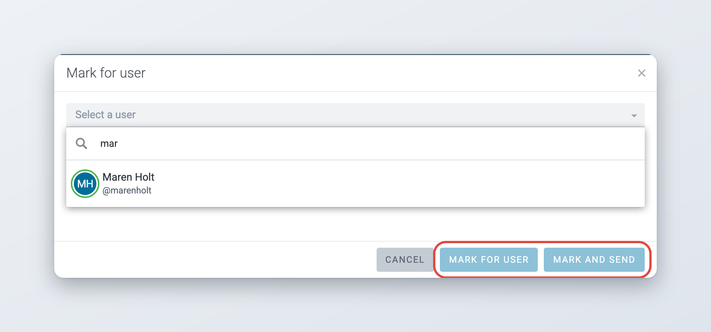
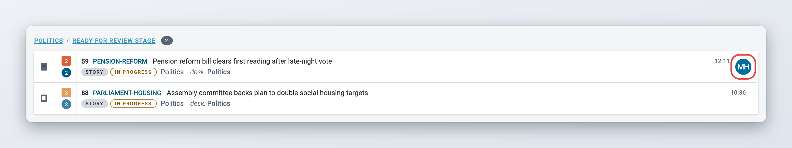
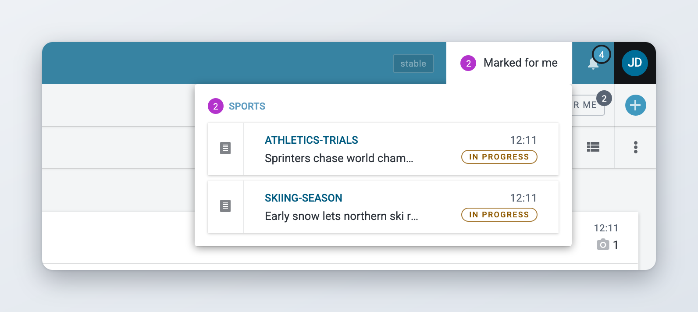
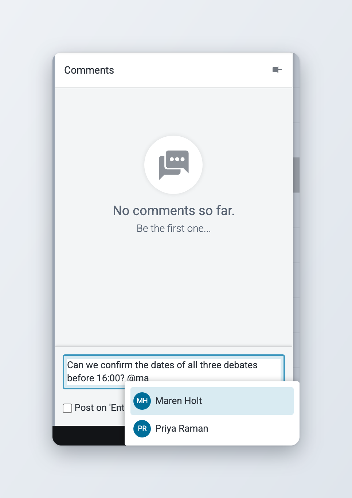
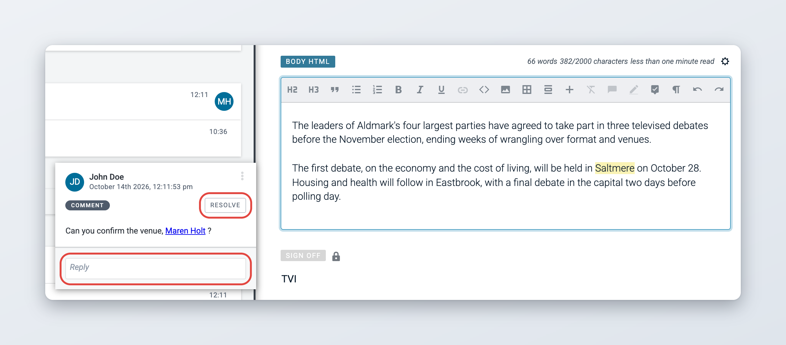
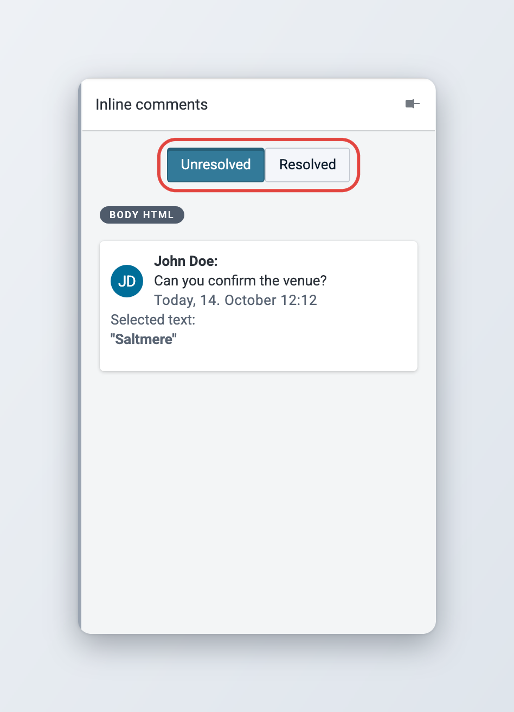
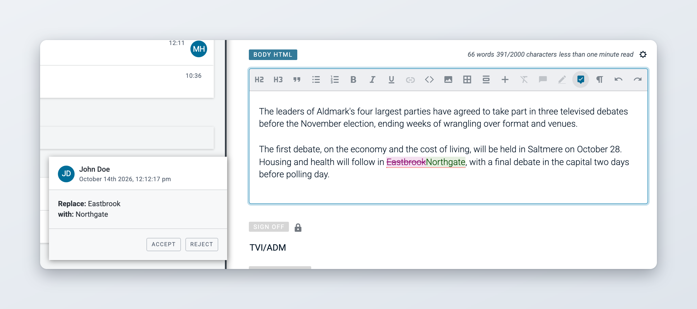

# Collaboration tools

Superdesk has several tools for working on content together:

* **Mark for user** brings an item to a colleague's attention.
* **Comments** are notes about the whole item, in the widget bar.
* **Inline comments** are notes on a piece of text in the body.
* **Suggestions** let you propose changes to the body that someone else accepts or rejects.
* **Mentions** tag a colleague or a desk in a comment, so they get a notification.

For the editor itself, see [Creating and Editing Content Items](README.md).

## Mark for user

Mark for user brings an item to a colleague's attention without changing where it sits in the workflow. It works like Mark for desk, but for one person.


If you do not see **Mark for user**, your Superdesk does not use it or your role does not have the privilege. Ask your administrator.


### Marking an item for a colleague



### Choose Mark for user

You can start from several places:

* In any list, such as Monitoring or Highlights, hover over the item, click the **Item actions** icon (three vertical dots) and choose **Mark for user**.
* In the preview pane, open the **More actions** menu and choose **Mark for user**.
* In the editor, open the **More actions** menu in the top bar and choose **Mark for user**.
* To mark several items, select them and click **Mark for user** in the bar at the top of the list. If the items are already marked for different users, the window says so.



### Pick the user

The **Mark for user** window opens with the user list and a search field. Type a name to filter the list. Each user's avatar shows whether they are online.



### Confirm

Click **Mark for user**. To also move the item to the next stage of its desk, click **Mark and send** instead. If the item is in the last stage, **Mark and send** moves it to the first stage. **Mark and send** is not available while the item is open for editing.



<figure><figcaption>
Marking an item for a user
</figcaption></figure>

The mark is saved straight away, even when the item is open in the editor.

### Seeing who an item is marked for

A marked item shows the avatar of the marked user in lists and in the top bar of the editor. Click the avatar to open the **Mark for user** window, where you can change or remove the mark.

<figure><figcaption>
An item marked for a user
</figcaption></figure>

### Finding items marked for you

You can see the items marked for you in three places:

* **Marked for me** in the top bar. The badge shows how many items are marked for you. Click it to see the items grouped by desk, then click an item to open it. Published items are not listed.
* The **Marked for me** button in the Monitoring toolbar. It shows only the items on the current desk that are marked for you. See [Monitoring Tab](../../workspace-and-search/monitoring-tab.md#marked-for-me).
* The **Marked for me** section of your Personal Space.

<figure><figcaption>
Items marked for you
</figcaption></figure>

An item opened from the **Marked for me** menu opens read-only. Click **Edit** in its top bar to start editing, unless someone else is working on it.

### Changing or removing a mark

Open the item's action menu (three vertical dots). For a marked item it offers **Unmark user** and **Mark for other user**. You can also click **Unmark** in the **Mark for user** window.

### Notifications

When you mark an item, the user gets a notification in Superdesk with an **open item** link. They also get an email if they have not turned off **Send Mark for User notifications** in their preferences. See [Your profile and preferences](../../navigating-superdesk/your-profile-and-preferences.md#notifications).

When you mark the item for someone else, the previously marked user is notified too. When you remove the mark, the user who was marked is notified.

### What cannot be marked

You cannot mark items that are in a Personal Space, published, archived or spiked, or items that another user has open for editing. Spiking an item removes its mark. A duplicate of a marked item is not marked.

## Comments

Use comments for notes about the whole item, for example to ask a colleague to check a fact. Comments are visible to everyone who opens the item and are never published.



### Open the Comments widget

With the item open, click the **Comments** icon in the widget bar. The widget lists the comments on the item.



### Write your comment

Type in the box at the bottom. To mention a colleague or a desk, type `@` and pick them from the list. See [Mentioning colleagues and desks](#mentioning-colleagues-and-desks).



### Post it

Click **Post**. If you tick **Post on 'Enter'**, pressing Enter posts the comment. Click **Clear** to empty the box.



<figure><figcaption>
The Comments widget
</figcaption></figure>

## Inline comments

Inline comments are attached to a piece of text in the body. Use them to ask a question about a sentence or to explain a change. Inline comments are not published with the item. For information that must travel with the item, use the **Ed. Note** field.

### Adding an inline comment



### Select the text

In the body of an item you are editing, select the words you want to comment on.



### Click the Comment button

Click **Comment** in the toolbar above the body. A box opens under the button with the placeholder "Type your comment...".



### Write and submit

Type your comment. To notify a colleague, type `@` and pick their name. Click **Submit**.



### Save the item

The commented text is now highlighted. Save the item. Colleagues you mentioned are notified when the item is saved.



The **Comment** button only works when text is selected.

### Reading, replying to and resolving inline comments

Click highlighted text in the body to open its comment. The comment shows the author, the date and the text.

<figure><figcaption>
An inline comment
</figcaption></figure>

* To **reply**, type in the **Reply** box and click **Reply**.
* To **edit** or **delete** your comment or reply, click the three dots next to it and choose **Edit** or **Delete**. Superdesk asks you to confirm a delete.
* To **resolve** the comment when it has been dealt with, click **Resolve**. The highlight disappears from the text, but the comment is kept.

### The Inline comments widget

Click the **Inline comments** icon in the widget bar to see all inline comments on the item, grouped by field. Each comment shows the commented text, the replies and, for resolved comments, who resolved it and when. Switch between **Unresolved** and **Resolved** at the top of the widget. The widget opens on the **Resolved** list.

<figure><figcaption>
The Inline comments widget
</figcaption></figure>

## Suggestions

In suggestions mode, your changes to the body are not applied directly. They are kept as suggestions that you or a colleague accept or reject later. This works like tracking changes in a word processor.

### Making suggestions

Click **Toggle Suggestions Mode** in the toolbar above the body. While it is on:

* text you add is shown in green,
* text you delete stays in place, in red with a line through it,
* formatting changes are highlighted.

Some tools, such as **Remove formatting** and the uppercase and lowercase buttons, are not available while suggestions mode is on. Click **Toggle Suggestions Mode** again to go back to normal editing.

### Accepting or rejecting a suggestion

Click a suggestion in the body. A box shows who made it, when, and what it changes, for example **Replace:** old text **with:** new text. Click **Accept** to apply the change or **Reject** to discard it.

<figure><figcaption>
Accepting or rejecting a suggestion
</figcaption></figure>


An item with open suggestions cannot be published. Superdesk shows "Article cannot be published. Please accept or reject all suggestions first." Accept or reject every suggestion, then publish.


The **Suggestions** widget in the widget bar lists the suggestions that have been resolved, with **Accepted by** or **Rejected by**, the user and the date.

## Mentioning colleagues and desks

You can tag colleagues in comments so they know you need them.

* In the **Comments** widget, type `@` and pick a user or a desk from the list. A user appears as `@username`, a desk as `#Desk_Name`.
* In an **inline comment**, type `@` and pick a user. The list also offers desks after `#`, but only mentioned users get a notification from an inline comment.

A mentioned user gets a notification in the **Notifications** panel (the bell in the top bar) saying that you mentioned them, with a link that opens the item. They also get an email if email notifications are turned on in their preferences. See [Your profile and preferences](../../navigating-superdesk/your-profile-and-preferences.md#notifications).

When a desk is mentioned in the Comments widget, the desk's members see a number badge in the Monitoring view. See [Monitoring Tab](../../workspace-and-search/monitoring-tab.md#groups-in-the-monitoring-view).

## For administrators

This section is for administrators.

* **Mark for user** is a client extension, `markForUser`. The default Superdesk build loads it. Users need the **Mark items for users** privilege (**Settings** > **User Roles**) to mark and unmark items. Everyone can see the items marked for them.
* **Comment and suggestion buttons.** The **Comment** and **Toggle Suggestions Mode** buttons appear when the `comments` and `suggestions` formatting options are turned on for the body field in the content profile (**Settings** > **Content Profiles**).
* **Sidebar widgets.** The **Comments**, **Inline comments** and **Suggestions** widgets can be hidden per content profile on the profile's **Widgets** tab. The **Inline comments** and **Suggestions** widgets only appear for profiles that have a body field, and the client settings `features.editorInlineComments` and `features.editorSuggestions` set to `false` hide them for everyone. See [Metadata and fields](metadata-and-fields.md#client-configuration).
