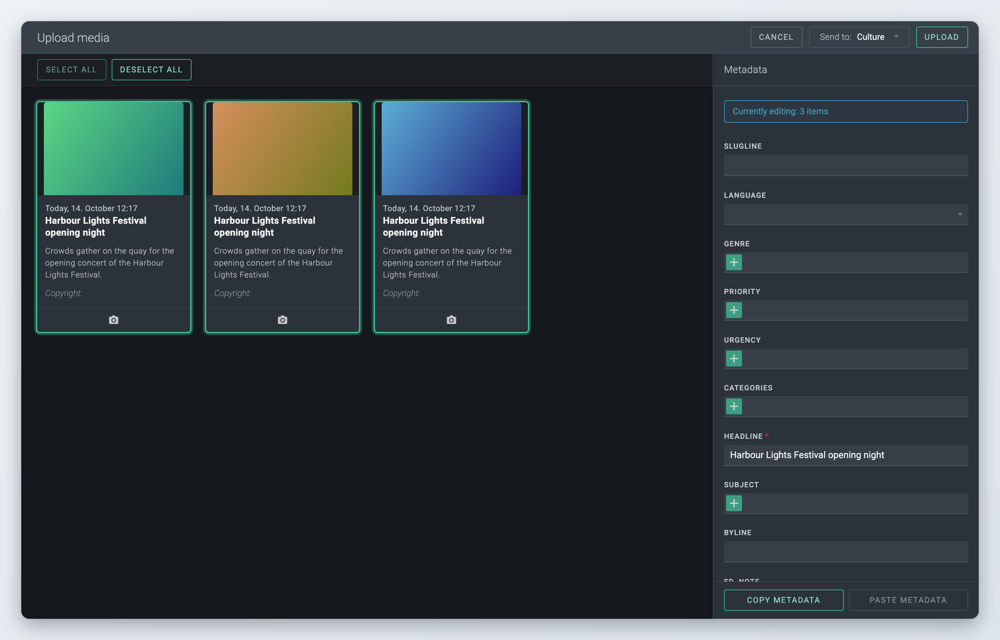
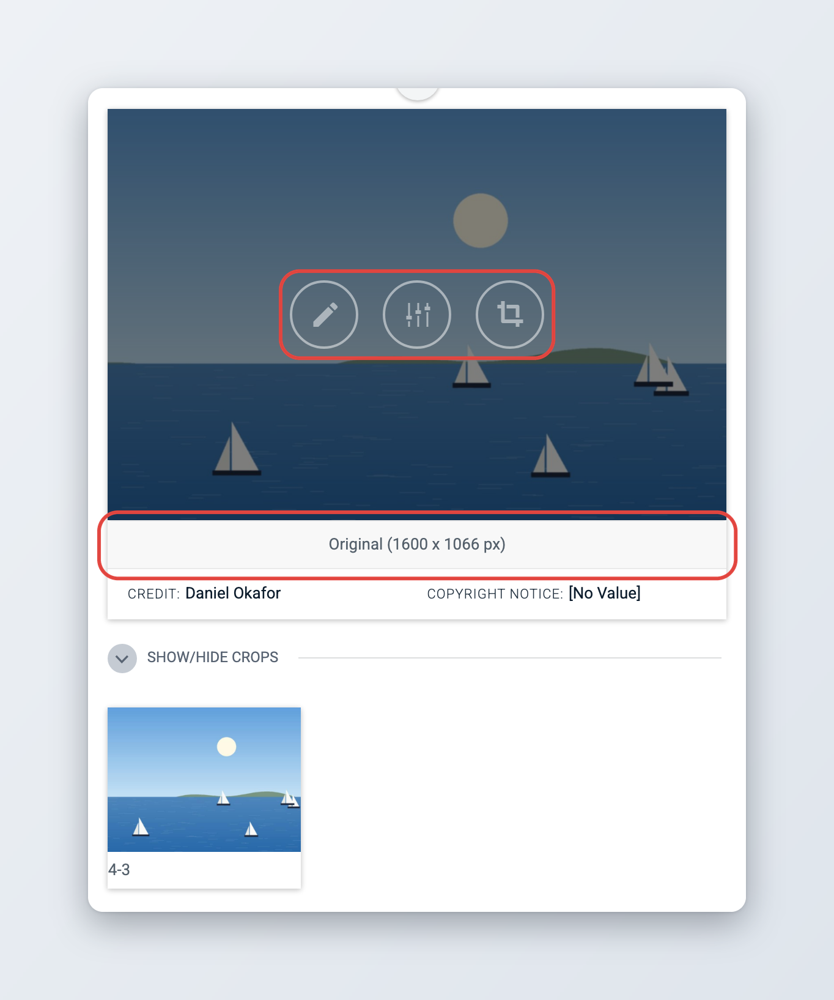
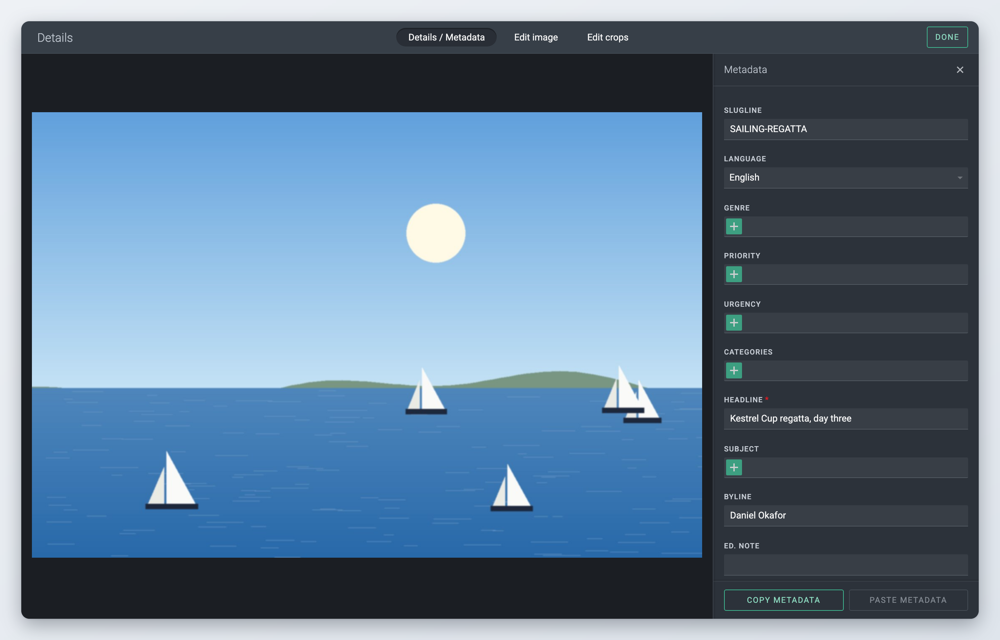
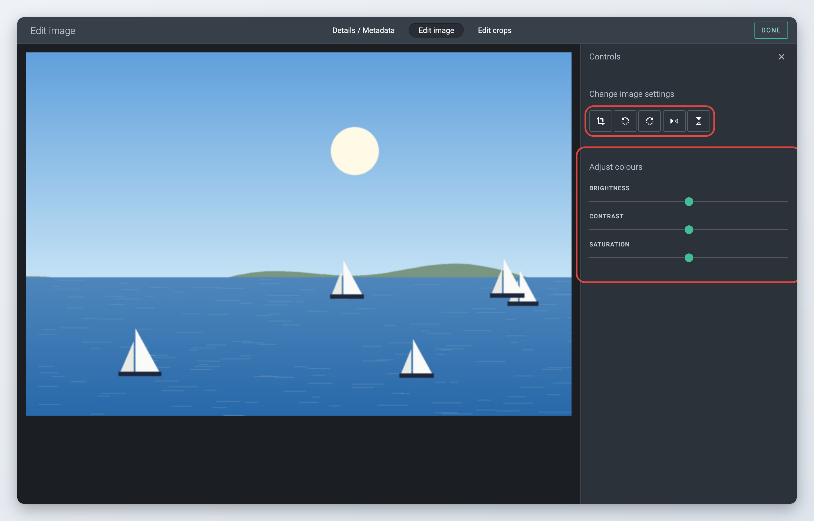
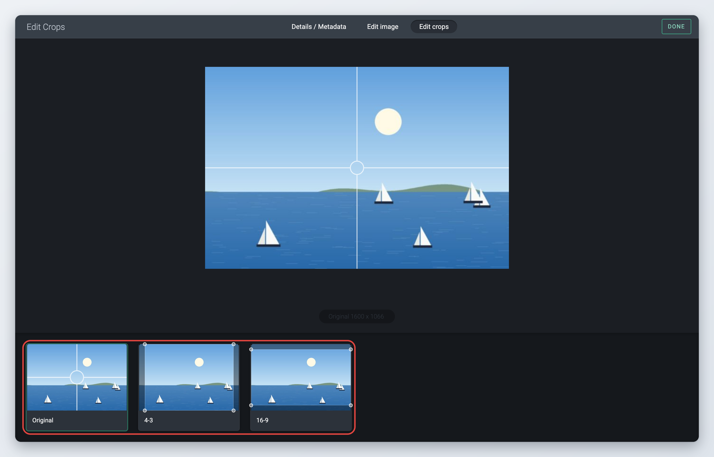
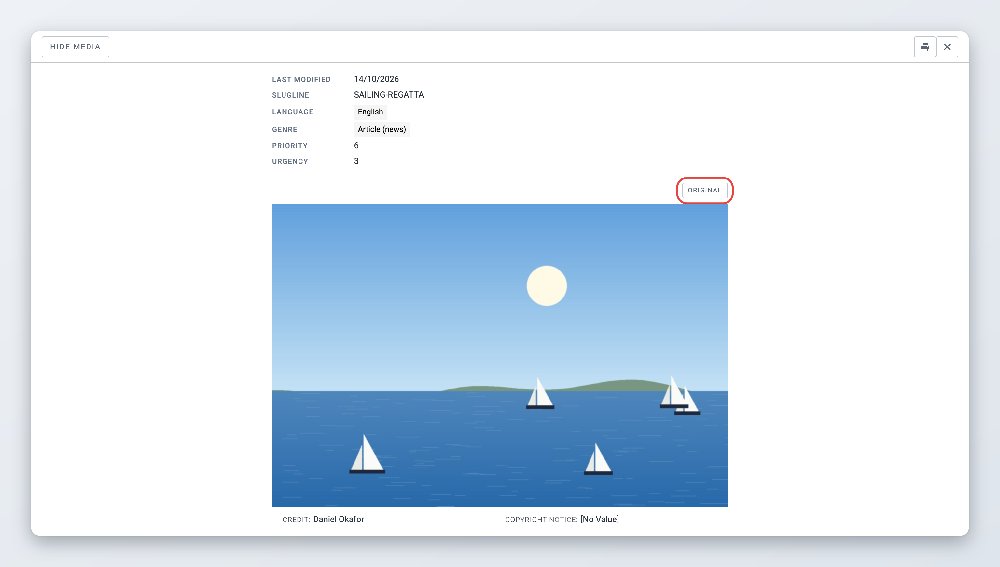
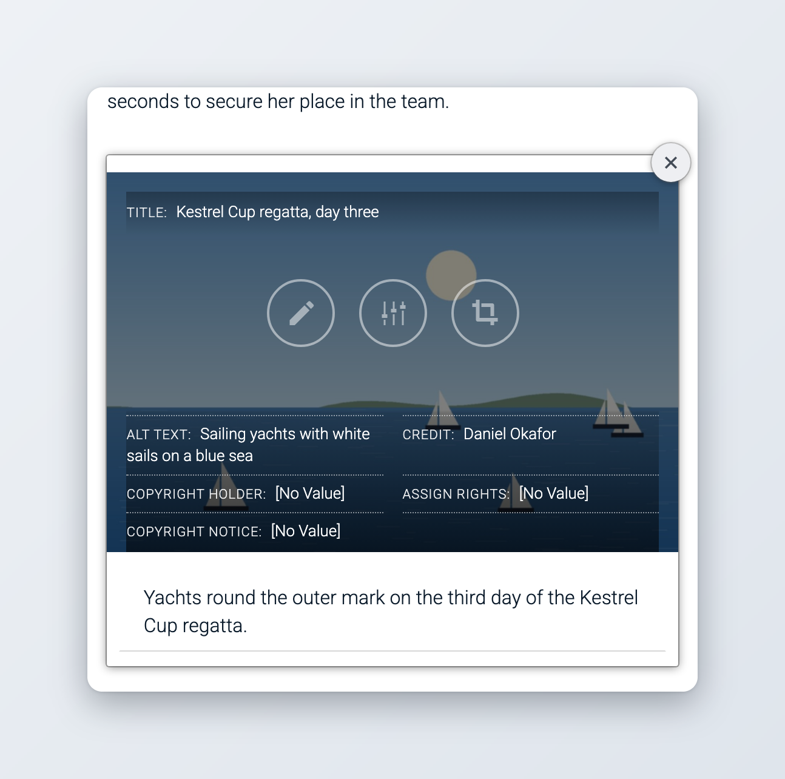

# Edit Media items

Pictures, video and audio are media items in Superdesk. This page explains how to upload them, how to fill in their metadata, how to edit pictures and their crops, and how to use media in an article: in the body, as featured media and in galleries.

For the body editor and the other fields of an article, see [Creating and Editing Content Items](README.md).

## Uploading media

You can upload media in several ways:

* **Create** > **Upload media** in Monitoring or in the opened-items bar. You can also drop files straight onto the **Create** button.
* The **Media** button in the body editor toolbar, or by dropping files into the body. See [Adding media to the body](#adding-media-to-the-body).
* A featured media or gallery field in an article. See [Featured media](#featured-media) and [Galleries](#galleries).

Each way opens the same **Upload media** window.



### Add the files

Drag your files onto the window, or click **Select them from folder**. You can add several files at once, and mix pictures, video and audio if the place you upload to accepts them. Files of other types are refused with the message "Only the following files are allowed:" and the allowed types.



### Choose the desk

When you upload from the **Create** menu, the **Send to:** list at the top shows the desk the files go to. Pick another desk if needed. The new media items are placed in that desk's working stage.



### Select the files to describe

The files are shown as thumbnails, all selected. Click a thumbnail to select or deselect it, or use **Select All** and **Deselect All**. The **Metadata** panel shows how many items you are editing, for example "Currently editing: 3 items". Remove a file you added by mistake with the **x** on its thumbnail.



### Fill in the metadata

Type the metadata in the **Metadata** panel. What you type applies to every selected file, so you can describe a whole set at once and then select single files to give them their own headline or caption. Required fields are marked.



### Upload

Click **Upload**. A progress circle shows on each thumbnail. If a required field is empty, Superdesk names it in a message such as "Required field Headline is missing." Click **Cancel** to close the window without uploading.



<figure><figcaption>
The Upload media window
</figcaption></figure>

When you upload pictures into an article, Superdesk then opens each picture in the media editor so you can check its crops. Click **Done** to move on to the next one. See [Editing crops](#editing-crops).

### Metadata taken from the file

Superdesk reads the metadata embedded in your files and fills in the matching fields for you: headline, caption, byline, credit, copyright notice and language. If a file has no byline, Superdesk uses the byline from your user profile. For video files, Superdesk reads the embedded XMP metadata (since 2.10). Check these values before you upload, since agency files often carry text you do not want to publish.

### Copying metadata between uploads

At the bottom of the **Metadata** panel, **Copy metadata** remembers the values you typed. In a later upload, click **Paste metadata** to fill them in again. **Clear saved metadata** forgets them. This is useful when you upload pictures from the same assignment in several batches.

### Which fields you see

*Available since Superdesk 3.5.*

The fields in the **Metadata** panel come from the picture content profile your administrator set up, and fields marked as required there are required in the upload window too. If there is no picture profile, Superdesk shows a default set of fields. See [Media content profiles](#media-content-profiles).

## Editing a media item

Open a media item like any other item: double-click it, or choose **Edit** in its actions menu. The editor shows the media and the fields of its content profile.

* A **picture** is shown with its size, for example "Original (3000 x 2000 px)". Hover over the picture to see three buttons: **Edit metadata**, **Edit image** and **Edit crops**. **Edit crops** only appears when your newsroom has crop sizes set up. The crops are shown under the picture.
* A **video** has a player, an **Edit metadata** button and a thumbnail. Click **Select thumbnail** to choose an image file as the video's thumbnail, click the thumbnail to replace it, or remove it with its **x**.
* An **audio** item has a player and an **Edit metadata** button.

<figure><figcaption>
A picture item in the editor
</figcaption></figure>

To change only the metadata of a media item without opening it, choose **Edit Media Metadata** (Ctrl+Alt+M) in its actions menu. To change the metadata of several media items at once, select them in a list and click **Edit metadata** in the action bar. The window works like the upload window, with **Save**, **Save & Close** and **Close** buttons.

### The media editor

The three buttons over a picture open the media editor on one of its tabs. The same editor opens from a picture in the body, in a featured media field or in a gallery.

* **Details / Metadata**: the picture and its metadata.
* **Edit image**: crop, rotate, flip and adjust the colours of the picture.
* **Edit crops**: the point of interest and the crops used by your subscribers.

The window title follows the tab, for example **Edit Crops**.

When you are finished, click **Done**. The changes are saved with the item.

### Editing metadata

On the **Details / Metadata** tab, change the values in the **Metadata** panel on the right. When you change something, **Apply** and **Cancel** buttons appear at the top of the panel. Click **Apply** to keep your changes. **Copy metadata** and **Paste metadata** at the bottom of the panel work as in the upload window.

<figure><figcaption>
Editing a picture's metadata
</figcaption></figure>

### Editing the image

The **Edit image** tab changes the picture itself. The **Controls** panel has:

* **Crop**: draw a frame on the picture to cut it. Type the **Image size** in pixels, or click **Original**, **16 : 9**, **4 : 3** or **3 : 2** to fix the proportions. Click **Confirm crop** to apply it.
* **Rotate left**, **Rotate right**, **Flip horizontal** and **Flip vertical**.
* **Adjust colours**: sliders for **Brightness**, **Contrast** and **Saturation**.

You see each change in the preview straight away. Click **Apply** to save the edited picture, or **Cancel** to undo your changes.

<figure><figcaption>
Editing the image
</figcaption></figure>


Changes on the **Edit image** tab replace the stored picture, and Superdesk makes the crops again from the new version. A crop on this tab cannot be smaller than the crop sizes your newsroom uses; Superdesk shows "Original size cannot be less than the required crop sizes." if it is.


### Editing crops

Your subscribers often need a picture in fixed shapes and sizes, for example a wide crop for a homepage and a square one for social media. Superdesk makes these crops, also called renditions, automatically. On the **Edit crops** tab you check and adjust them. Editing the crops does not change the picture itself.



### Set the point of interest

With **Original** selected, click the most important part of the picture, for example a face. Superdesk uses this point of interest to place the crops.



### Adjust a crop

Click one of the crops in the strip below the picture. Drag and resize its frame so that it shows what you want.



### Save

Click **Save** at the top to keep your crops, or **Cancel** to go back to the previous ones. Then click **Done**.



If a picture is too small for a crop size, the crop is marked in red. This does not stop you from publishing; there are just fewer crops for that picture.

<figure><figcaption>
Editing crops
</figcaption></figure>

Administrators set the crop sizes in **Settings** > **Metadata** > **Vocabularies** > **Image Crop Sizes**.

### Opening the original file

*Available since Superdesk 3.6.*

In the preview of a picture, the **Original** button opens the full-size file in a new browser tab, where you can look at it closely or download it. The preview opens from the **Preview** button in the editor's status bar, when your administrator has turned previews on. See [Previewing and printing](README.md#previewing-and-printing).

<figure><figcaption>
The Original button in the picture preview
</figcaption></figure>

## Using media in an article

### Adding media to the body



### Place the cursor

Click in the body where the media should go.



### Upload the files

Click **Media** in the toolbar and upload your files as described in [Uploading media](#uploading-media). You can also drop files from your computer straight into the body.



### Check the crops

For each picture, the media editor opens on the **Edit crops** tab. Adjust the crops if needed and click **Done**.



To use a picture, video or audio item that is already in Superdesk, drag it from Monitoring or Search into the body.

In the body, each media item is shown as a block with:

* a **Title**, if the field is set up to show titles,
* the media, with the **Edit metadata**, **Edit image** and **Edit crops** buttons when you hover over a picture,
* its **Alt text**, **Credit**, **Copyright holder**, **Assign rights** and **Copyright notice**,
* a **Caption** box, where you can write a caption of several lines.

To remove the media from the body, click the **x** at the top right of the block. This only removes it from the article; the media item stays in Superdesk.

<figure><figcaption>
A picture in the body
</figcaption></figure>

### Featured media

Some content profiles have a featured media field, used for the main picture or video of a story. Its name depends on your profile. Click **Drop items here or click to upload** to upload a file, or drag a media item from a list onto the field. Hover over the picture to edit its metadata, image or crops, and use the **x** to remove it.

### Galleries

A gallery field holds several pictures, videos or audio files, for example a photo series. Your administrator decides which media types a gallery accepts and how many items it can hold.

* To add media, click **Drop items here or click to upload**, or drag files or media items onto the gallery.
* Use the arrows on the sides to move through the gallery.
* Hover over a picture to use **Edit metadata**, **Edit image** or **Edit crops**. For video and audio, click **Edit metadata**.
* Click the **x** on an item to remove it from the gallery.

Administrators create gallery fields in **Settings** > **Metadata** > **Related content**, with the type **Media gallery**, and add them to a content profile.

## Media content profiles

*Available since Superdesk 2.7.*

Like articles, media items have content profiles. A newsroom can have one profile for each media type: picture, video and audio. The profile decides which metadata fields you fill in and which of them are required before the media item can be published. The picture profile also sets the fields of the upload window and of the media editor.

If you think a field is missing or should not be required, ask your administrator. Profiles are set up in **Settings** > **Content Profiles**. See [Profiles for pictures, video and audio](../../administration/content-configuration/content-profiles.md#profiles-for-pictures-video-and-audio).

## Metadata in the published file

*Available since Superdesk 2.8.*

Your administrator can set Superdesk up to write the item's metadata into the picture or video file when you publish it. The caption, credit, byline, copyright notice and other fields you filled in then travel with the file itself, in IPTC and XMP form, and stay there in every crop. Agencies and photo desks rely on this, because many systems read a picture's caption from the file and not from the article.

## The video editor


This is an optional module. If you do not see it, ask your administrator.


*Available since Superdesk 2.1.*

The video editor lets you shorten and crop a video without leaving Superdesk. It needs a separate video server, so it only works for videos that were processed by that server.



### Open the editor

Open the video item and click **Edit video**.



### Make your changes

In the **Edit Video** window, drag the handles on the timeline to cut the start or the end. Use the crop list to crop the picture to another shape, the rotate button to turn it, and **Quality:** to choose the resolution.



### Choose a thumbnail

Under **Video thumbnail**, click **Use current frame** to use the frame shown in the player, or **Upload image** to use an image file. Click the check mark (**Save change**) to keep the new thumbnail, or the cross (**Reset change**) to go back to the old one.



### Save

Click **Save**. Superdesk shows "Video is editing, please wait..." while the video server works. Click **Done** to close the window.



## For administrators

This section is for administrators.

### Media profiles and crop sizes

* Create media profiles in **Settings** > **Content Profiles** by choosing **Picture**, **Video** or **Audio** as the **Content Type**. Only one profile per media type is allowed. The fields of the picture profile are used in the upload window and the media editor (since 3.5).
* Crop sizes are the items of the **Image Crop Sizes** vocabulary in **Settings** > **Metadata**. Without it, the **Edit crops** button is hidden.
* Gallery fields are **Media gallery** fields on the **Related content** tab of **Settings** > **Metadata**, with the allowed media types, **Allow multiple items** and **Max. number of items**.

### Settings

| Setting | Where | Effect |
| --- | --- | --- |
| `PICTURE_METADATA_MAPPING` | Server | Maps item fields to file metadata fields. When it is set, Superdesk writes the metadata into every rendition of a picture or video on publish. Empty by default. *Since 2.8.* |
| `features.validatePointOfInterestForImages` | Client | Requires a point of interest that lies inside every crop before crops can be saved. |
| `features.editFeaturedImage` | Client | Set to `false` to stop users from uploading or editing media in featured media and gallery fields. |
| `features.preview` | Client | Shows the **Preview** button, and with it the **Original** button for pictures. |
| `VIDEO_SERVER_ENABLED`, `VIDEO_SERVER_URL` | Server | Connects Superdesk to the video server used by the video editor. |

The metadata already embedded in an uploaded picture (EXIF) is kept when Superdesk makes the crops (since 3.6).

### Video editor

The video editor is the `videoEditor` client extension, which the default build does not load. It also needs the video server above. When `VIDEO_SERVER_ENABLED` is on, every video uploaded to Superdesk is sent to the video server instead of the normal media storage. The **Edit video** button only shows for videos the video server has processed, so videos uploaded before you turned it on cannot be edited.
