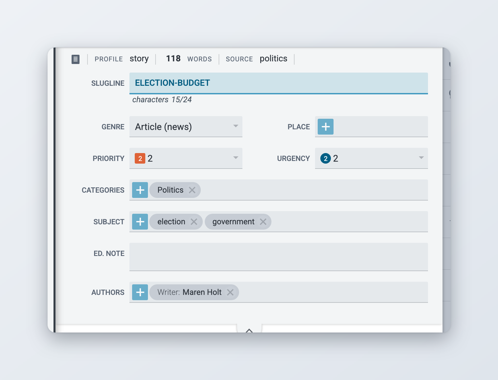
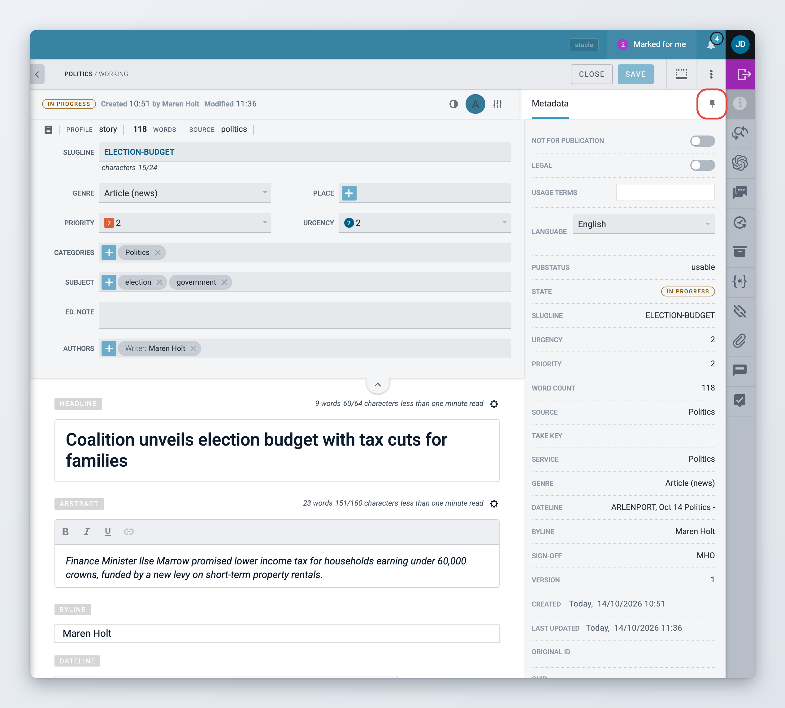

# Metadata and fields

This page explains the header fields of an item, how content profiles decide which fields you see, the kinds of fields you can meet, and the widgets in the widget bar.

For creating, saving and closing items, see [Creating and Editing Content Items](README.md). For the body editor, see [Writing and formatting](writing-and-formatting.md).

## The header fields

The header holds the item's metadata, such as slugline, category, subject, urgency, priority, genre, language, keywords and the editor's note. Which fields appear, in which order and under which names is set by the item's content profile, so it differs between newsrooms and between kinds of items.

Above the fields, a summary line shows the item type, the **PROFILE**, the word count, the **SOURCE** and flags such as **Legal** or **Not For Publication**. If the item has related items or translations, their number is shown here too, and clicking it opens the matching widget.

To get more room for writing, click the arrow under the header fields to collapse them. Click it again to show them.

<figure><figcaption>
The header fields
</figcaption></figure>

## Content profiles and fields

A content profile is the set of fields an item has. A short news story, a long feature and a picture usually use different profiles. The profile decides:

* which fields you see, and whether they sit in the header or in the content area,
* which fields are required before the item can be published,
* the minimum and maximum length of text fields,
* which formatting buttons the editor toolbar offers in each field,
* the help text shown under some fields.

The current profile is shown as **PROFILE** in the summary line above the header fields. If your administrator allows it, **PROFILE** is a dropdown on text items, and you can switch the item to another profile used on the desk. Fields that the new profile does not have are hidden.

A field can also be read-only. You can see its value but not change it, and hovering over it shows "This field is read-only".

Before an item is published, Superdesk checks it against its profile. If a required field is empty or a value is too long, Superdesk marks the field in red and shows an error, for example "HEADLINE is a required field". Fix the field and try again.

Administrators set up profiles in **Settings** > **Content Profiles**. See [Content profiles](../../administration/content-configuration/content-profiles.md).

### Vocabulary fields

Many header fields take their values from a vocabulary, a list your administrator maintains in **Settings** > **Metadata**. Category, genre, urgency, priority and subject are typical examples. Depending on the vocabulary, you pick one value from a dropdown, or several values from a list or a tree. Start typing to filter long lists. The values and their names are specific to your newsroom.

### Custom fields

Your administrator can add fields of their own to a profile. You may see:

* **custom text fields**, which work like the abstract or the body, with their own formatting options,
* **date fields**, with a date picker,
* **embed fields**: paste a URL and click **Generate From URL**, or paste an embed code. **Preview** shows the result and **Clear Embed** empties the field,
* **related content fields**, where you drag in other items to link them,
* **URL fields**, for one or more web addresses,
* **media gallery fields**, see [Edit Media items](edit-media-items.md#galleries).

### Predefined text fields


This is an optional module. If you do not see it, ask your administrator.


A predefined text field offers a list of ready-made texts, for example standard disclaimers or contact lines. Pick one from **Select from a predefined value**. If the field allows it, you can also choose **Use custom value** and type your own text.

## Widgets

The widget bar on the right of the editor opens tools that work on the current item. Click an icon to open its panel, and click it again to close it. **Ctrl+Alt+1** to **Ctrl+Alt+9** open the widgets by their position in the bar.

Which widgets you see depends on the kind of item, its state and your installation:

| Widget | What it is for |
| --- | --- |
| **Info** | The item's metadata and flags. See [The Info widget](#the-info-widget). |
| **Find and Replace** | Finds and replaces text in the body. See [Find and replace](writing-and-formatting.md#find-and-replace). |
| **Comments** | General comments about the item. See [Collaboration tools](collaboration-tools.md). |
| **Versions/History** | Earlier versions and a log of what happened to the item. See [Versions and history](README.md#versions-and-history). |
| **Packages** | The packages the item belongs to. Click one to open it. |
| **Macros** | Runs macros on the item. See [Macros](#macros). |
| **Related Items** | Items with the same slugline or keywords. Only for text items. |
| **Translations** | The item's original and its translations. See [Translating content](../translating-content.md). |
| **Attachments** | Files attached to the item. |
| **Inline comments**, **Suggestions** | The inline comments on the item, and the suggestions that have been accepted or rejected. See [Collaboration tools](collaboration-tools.md). |

Optional modules add more widgets, for example the AI Assistant. See [AI features](../../integrations-and-advanced-features/ai-features.md).

### Pinning a widget

*Available since Superdesk 2.8.*

Click the pin icon at the top of an open widget to keep it open next to the editor while you work. A pinned widget stays open when you switch to another item, and Superdesk remembers it the next time you log in. Click the pin again to unpin it.

<figure><figcaption>
A pinned widget
</figcaption></figure>

### The Info widget

The **Info** widget shows the item's metadata in one list. You can change some values here:

* **Not For Publication**: marks the item for internal use. An item with this flag cannot be published.
* **Legal**: marks the item as legally sensitive. This is a warning for colleagues and does not stop publication.
* **Usage terms**: conditions for using the item, often taken over from the agency.
* **Unique name**: a short identifier you can search for. You need the **Edit Unique Name** privilege to change it.

The rest is information, such as the GUID, type, state, version, source and ingest provider, when the item was created and last updated, and when it expires if the desk deletes old items automatically. If the item belongs to a planning assignment, an **Assignment** tab shows the assignment.

### Macros

Macros are small programs your newsroom has installed, for example to convert units or to fill in standard metadata. Open the **Macros** widget and click a macro to run it on the item. Some macros make their change straight away. Others show what they found and let you **replace** each match, moving through them with **prev** and **next**, before you click **done**.

Turn on **Group Macros** to see the macros in groups. Some macros have their own keyboard shortcut; ask your administrator.

## For administrators

This section is for administrators. Most of the behaviour on this page comes from content profiles and vocabularies, which are set up in **Settings**. See [Content Configuration](../../administration/content-configuration/README.md).

### Client configuration

These keys go in the Superdesk client configuration (`superdesk.config.js`).

| Setting | Effect |
| --- | --- |
| `item_profile.change_profile` | Set to `1` to let users switch a text item's content profile from the **PROFILE** dropdown. |
| `features.editorAttachments`, `features.editorInlineComments`, `features.editorSuggestions` | On by default. Set one to `false` to hide the **Attachments**, **Inline comments** or **Suggestions** widget for everyone. |

### Content profile options used in the editor

In **Settings** > **Content Profiles**, each field has options that change what users see in the editor: **Required**, **Read-only**, **Minimum length**, **Maximum length**, **Maximum soft length** (since 3.1), **Show Floating Character Count** (since 3.5), **Clean Pasted HTML** and **Formatting options**. The **Can be embedded** switch on the profile itself allows its articles to be embedded in other articles. To hide a widget for the items of one profile, use the profile's **Widgets** tab.

### Predefined text fields

The predefined text field is the `predefinedTextField` client extension, which the default build does not load. Once it is loaded, you can add a field of the type **Predefined text field** on the **Other fields** tab of **Settings** > **Metadata**. In the field's **Configure predefined values**, add values with a **Title** and a **Definition**, and choose whether to **Allow switching to free text input**. Definitions can contain placeholders for item data; the extension's `placeholderMapping` configuration sets which placeholders exist. Add the field to a content profile to show it in the editor.

### Privileges

| Privilege | Allows |
| --- | --- |
| **Edit Unique Name** | Changing the **Unique name** in the Info widget |
| **Content Profile** | Managing content profiles |
