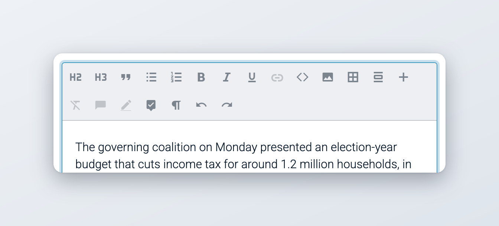
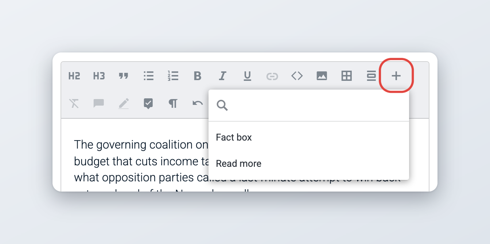
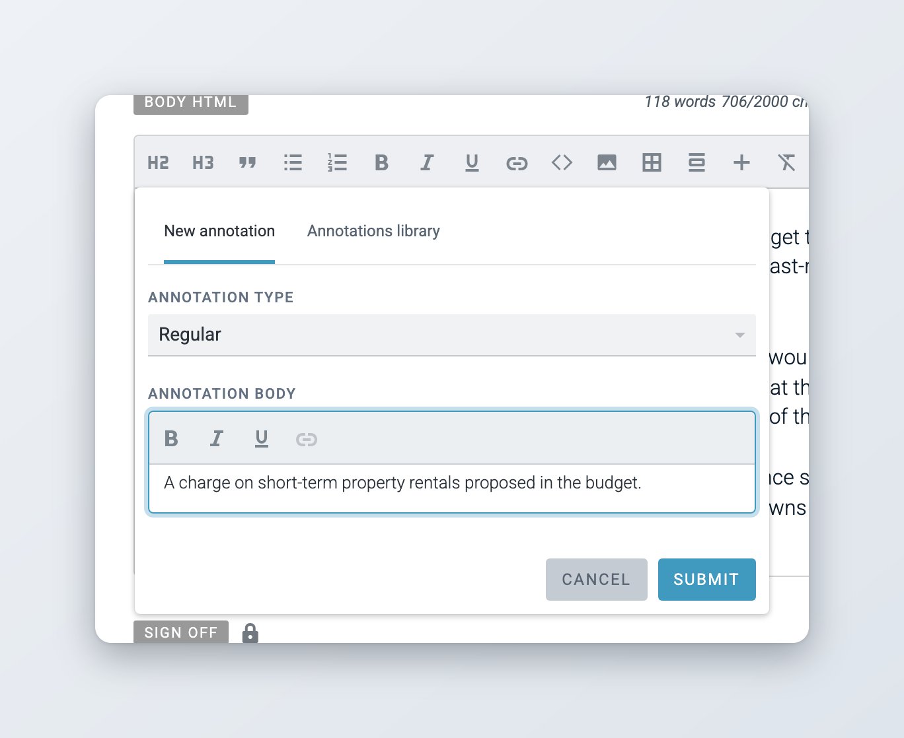
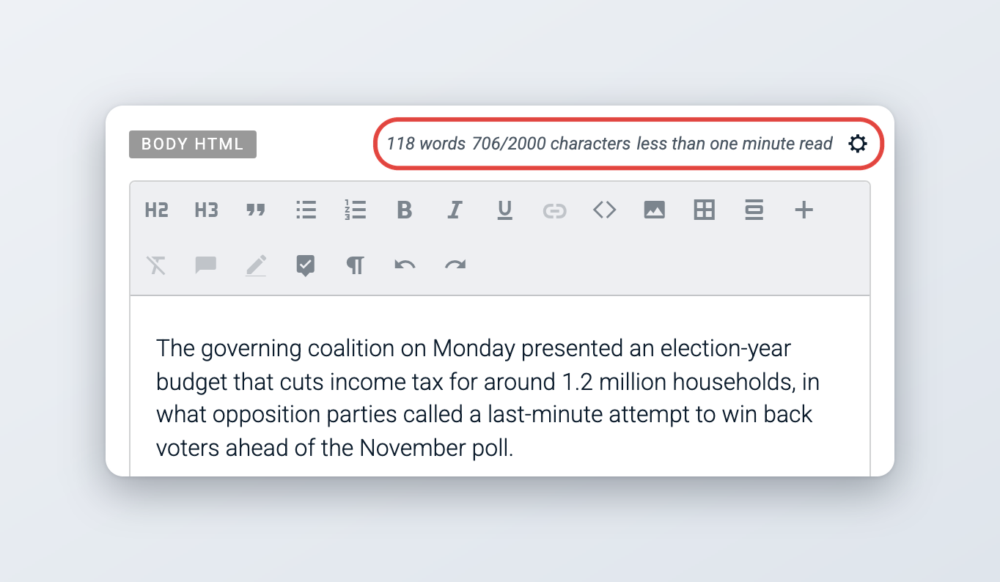
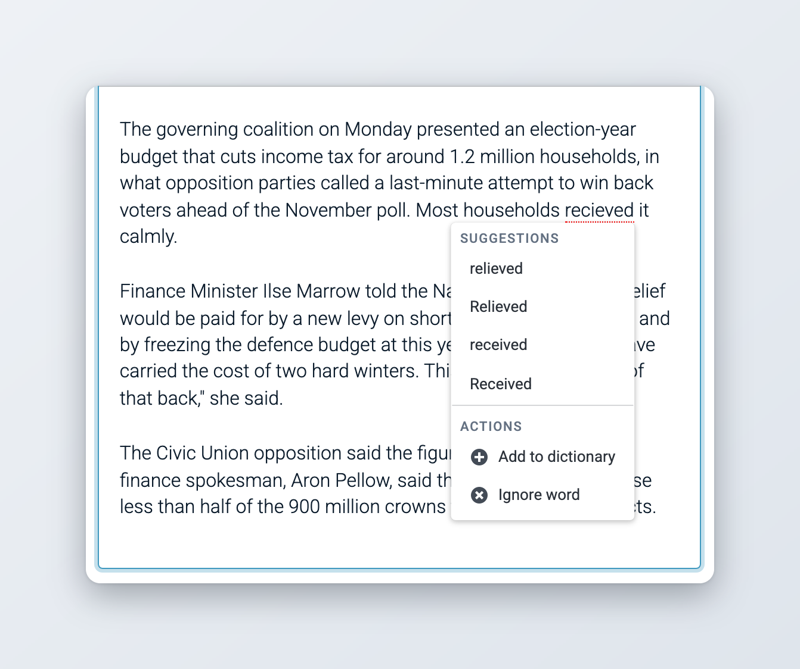
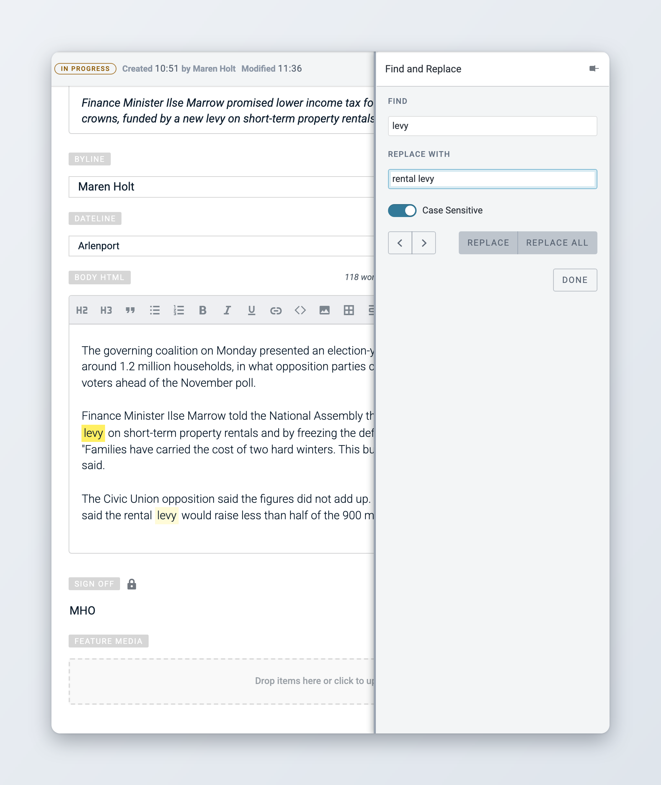

# Writing and formatting

This page explains how to write in the body editor and the other rich text fields: the toolbar and its formatting, links, tables, embeds, custom blocks and tags, annotations, character limits and counts, spell checking, and find and replace.

For creating, saving and closing items, see [Creating and Editing Content Items](README.md). For the fields of an item, see [Metadata and fields](metadata-and-fields.md).

## Writing in the body editor

The body and the other rich text fields use the same editor. When you click into a field, its toolbar appears above it. In a long text, the toolbar stays at the top of the screen while you scroll.

The buttons in the toolbar depend on the formatting options the content profile allows for that field, so the body may have many buttons and the headline only a few. Hover over a button to see its name and its keyboard shortcut, if it has one.

<figure><figcaption>
The body editor toolbar
</figcaption></figure>

| Button | What it does |
| --- | --- |
| **H1** to **H6** | Turns the paragraph into a heading of that level. |
| **Quote** | Formats the paragraph as a quote. |
| **Unordered list**, **Ordered list** | Starts a bulleted or numbered list. |
| **Preformatted text** | Keeps spacing and line breaks exactly as typed. |
| **Bold** (Ctrl+B), **Italic** (Ctrl+I), **Underline** (Ctrl+U), **Strikethrough** | Formats the selected text. |
| **Superscript**, **Subscript** | Raises or lowers the selected text. |
| **Link** (Ctrl+K) | Adds a link to the selected text. See [Links](#links). |
| **Embed** | Inserts a social media post, a video or other web content. See [Embeds](#embeds). |
| **Media** | Uploads pictures, video or audio into the body. See [Edit Media items](edit-media-items.md#adding-media-to-the-body). |
| **Table** | Inserts a table. See [Tables](#tables). |
| **Multi-line quote** | Inserts a quote block. See [Multi-line quotes](#multi-line-quotes). |
| **Custom block** | Inserts a block your administrator has defined. See [Custom blocks](#custom-blocks). |
| **Remove formatting** | Removes the formatting from the selected text. |
| **Remove all formatting** | Turns the whole field into plain text in a single paragraph. |
| **Comment** | Adds an inline comment to the selected text. See [Collaboration tools](collaboration-tools.md). |
| **Annotation** | Adds an annotation to the selected text. See [Annotations](#annotations). |
| **Toggle Suggestions Mode** | Records your changes as suggestions that others can accept or reject. See [Collaboration tools](collaboration-tools.md). |
| **Toggle formatting marks** | Shows paragraph marks and other invisible characters. |
| **Convert text to uppercase**, **Convert text to lowercase** | Changes the case of the selected text. |
| **Undo** (Ctrl+Z), **Redo** (Ctrl+Y) | Undoes or redoes your last change. |

**Remove formatting**, **Remove all formatting** and the case buttons are not available while Suggestions Mode is on.

Your administrator can rename some buttons. For example, the multi-line quote is called "Pullquote" in some installations.

When you paste text from another program, the field may strip its formatting, depending on how the profile is set up. Press Shift+Enter to start a new line within the same paragraph.

### Links



### Select the text

Select the words you want to link.



### Open the link window

Click **Link** in the toolbar or press Ctrl+K.



### Enter the address

On the **URL** tab, type or paste the address and click **Insert**. If the item has attachments, the **Attachment** tab lets you link to one of them instead.



Click linked text to see the link controls: **Open** the link in a new tab, **Edit** it or **Delete** it. Your administrator decides whether links open in a new window for readers.

### Tables

Click **Table** to insert a table. While the cursor is in the table, the toolbar changes to table controls:

* **TH** turns the first row into a header row.
* The **minus** button and **+ row** remove the current row or add a row below it.
* The **minus** button and **+ column** remove the current column or add one after it.
* The text formatting buttons work inside the cells.

### Embeds



### Click Embed

Put the cursor where the embed should go and click **Embed** in the toolbar.



### Paste the URL or the code

Paste a URL, for example of a social media post or a video, or paste an embed code. A URL gives you a responsive embed. An embed code is used as it is.



### Confirm

Click the check mark or press Enter. If Superdesk cannot embed the URL, it shows "This URL could not be embedded."



Under the embed you can type a **Description**. Hover over the embed to edit its code with the pencil button (**Edit embed**) or to remove it with the **x** button.

### Multi-line quotes

*Available since Superdesk 2.7.*

A multi-line quote is a block for a longer quotation, often used as a pull quote. Click **Multi-line quote** in the toolbar and type the quote in the block. You can use the usual text formatting inside it, apart from **Quote**. Your installation may call this button "Pullquote".

### Custom blocks

*Available since Superdesk 2.8.*

Custom blocks are reusable pieces of content that your administrator defines, for example a fact box or a "read more" list. Each block has a name and can come with starting text.

To insert one, click **Custom block** (the large **+** button) in the toolbar and choose the block by name; the menu has a search field for long lists. Then edit the text inside the block. The formatting you can use inside a block is set by the administrator for each block.

<figure><figcaption>
Choosing a custom block
</figcaption></figure>

Administrators define custom blocks in **Settings** > **Metadata** > **Custom blocks**. See [Custom blocks](../../administration/content-configuration/metadata-and-custom-fields.md#custom-blocks) in the administration guide.

### Embedding other articles

*Available since Superdesk 2.7.*

You can place one Superdesk article inside another, for example a short explainer inside a longer story. Drag the article from Monitoring or Search and drop it into the body. The embedded article appears as a block that starts with "Embedding from:" and a link that opens the original in a new window.

This only works when both content profiles allow it:

* the body field of the item you are editing has the **embed articles** formatting option,
* the content profile of the article you drag has **Can be embedded** turned on.

Otherwise Superdesk shows an error, such as "Item content profile is not configured to allow embedding." An article whose profile can be embedded cannot itself receive embedded articles.

### Custom tags and special characters

*Available since Superdesk 3.5.*

Your installation can add its own toolbar buttons of two kinds:

* **tags**, which mark a piece of text, for example a person's or a company's name. Tagged text is shown with a coloured underline, and keeps its tag when you copy and paste it.
* **character insertions**, which type a character that is hard to reach on a keyboard, for example an en dash or a thin space.

Each button can have a keyboard shortcut. The buttons, their names and their shortcuts are different in every installation, and each field only shows the ones its content profile allows. Hover over a button to see what it does. See also [Keyboard shortcuts](../../reference/keyboard-shortcuts.md).

### Comments and suggestions

Inline comments, Suggestions Mode and general comments on an item are explained in [Collaboration tools](collaboration-tools.md).

## Annotations

Annotations add background information to a word or phrase, such as a definition, a footnote or an explanation of jargon. Subscribers can show this information to their readers.



### Select the text

Select the word or phrase you want to explain.



### Open the annotation window

Click **Annotation** in the toolbar.



### Write the annotation

On the **New annotation** tab, choose the **Annotation Type** and write the **Annotation Body**. You can format the body text.



### Submit

Click **Submit**. The annotated text is highlighted in the editor.



Click annotated text to read the annotation, edit it or **Delete** it.

<figure><figcaption>
Adding an annotation
</figcaption></figure>

### The Annotations Library

The Annotations Library is your newsroom's shared collection of terms and their definitions.

* In the annotation window, the **Annotations library** tab lists library entries whose name matches the selected text. Click **Use this** to reuse an entry. When there is a match, this tab opens first.
* When you submit a new annotation, Superdesk also adds it to the library, unless the same text with the same definition is already there.

Users with the **Knowledge base management** privilege can open **Annotations Library** from the **Main menu** to browse, add, edit and remove entries. Each entry has a **Name**, a **Language** and a **Definition**. Several entries can share a name, for example in different languages.

## Character limits and counts

Next to the label of rich text fields such as the body, Superdesk shows how long the text is: the number of words, the number of characters, an estimated reading time and, if your administrator set a line length, the number of lines (since 3.6).

<figure><figcaption>
Text statistics next to the body field
</figcaption></figure>

When a field has a maximum length, the character count shows the limit too. Click the settings button next to the count to open **Character limit settings** and choose what happens when you go over the limit:

* **Highlight characters**: the characters over the limit are highlighted in red. This is the default.
* **Limit further typing**: you cannot type more once the limit is reached.

Your choice is saved for that field and applies to every item.

### Soft limits

*Available since Superdesk 3.1.*

A field can also have a maximum soft length. You can keep typing past it, but the text beyond the soft limit is highlighted, so you see that the text is longer than your newsroom wants.

### Floating character count

*Available since Superdesk 3.5.*

If the content profile turns it on for a field, a character count travels with the editor toolbar while you type. It shows "Position: *n* characters", the number of characters before the cursor. When you select text, it shows "Selected: *n* characters" instead.

### Characters that are not allowed

Your administrator can block certain characters in some fields. If you type one, Superdesk shows a message such as "Character ¶ not allowed in the slugline." under the field.

## Checking spelling

Superdesk checks spelling against the dictionaries set up for the item's language. Misspelled words are underlined while you type. If you change the item's language, the dictionaries change with it.

### Turning the spell checker on and off

*Available since Superdesk 3.5.*

Click the **spell checker** button in the status bar, or press **Alt+S** (**Option+S** on a Mac), to turn automatic checking on or off. Hover over the button to see whether checking is on and which shortcut your installation uses. Superdesk remembers your choice.

The same switch is in **More actions** > **Spell Checker** > **Run automatically**. When automatic checking is off, click **Check spelling** in that menu to check the item once.

The button and the menu entries only appear when a spell checker is available for the item's language.

### Correcting a word

Right-click an underlined word to see:

* **Suggestions**: click one to replace the word,
* **Actions**: **Add to dictionary** adds the word to your personal dictionary for that language, and **Ignore word** stops marking it in this item until you close it.

Some spell checkers also check grammar. Their menu shows an **Explanation** of the problem.

<figure><figcaption>
Spelling suggestions for an underlined word
</figcaption></figure>

Superdesk creates your personal dictionary the first time you add a word in a language. Administrators manage the shared dictionaries in **Settings** > **Dictionaries**. See [Dictionaries and spell checking](../../administration/content-configuration/templates-macros-and-dictionaries.md#dictionaries-and-spell-checking).

If your installation uses the Tansa proofreading service, **More actions** > **Spell Checker** has a **Check spelling** entry with the shortcut **Ctrl+Shift+Y** instead.

## Find and replace



### Open the widget

Click **Find and Replace** in the widget bar.



### Search

Type the text in **Find**. Every match in the body is highlighted. Use the arrow buttons to move between matches. Turn off **Case Sensitive** to also match other capitalisation.



### Replace

Type the new text in **Replace with**. Click **Replace** to change the current match, or **Replace All** to change every match.



### Close

Click **Done**.



Find and replace only works in the body.

<figure><figcaption>
Find and replace
</figcaption></figure>

## For administrators

This section is for administrators. The field options this page relies on, such as the length limits and **Formatting options**, are set in the content profile. See [Content profile options used in the editor](metadata-and-fields.md#content-profile-options-used-in-the-editor) and [Content profiles](../../administration/content-configuration/content-profiles.md).

### Client configuration

These keys go in the Superdesk client configuration (`superdesk.config.js`).

| Setting | Effect |
| --- | --- |
| `authoring.lineLength` | Characters per line used for the line count. Without it, the line count is hidden. |
| `authoring.customEditorFeatures` | Defines custom tags (`inlineStyles`) and character insertions (`characterInsertions`), each with an `id`, `label`, `icon` and an optional `tooltip` and `shortcut`. Turn them on per field in the content profile's formatting options (since 3.5). |
| `spellchecking.shortcut` | Shortcut of the spell checker button. Default Alt+S (since 3.5). |
| `spellchecking.defaultRunningMode` | `remember-user-preference` (default) or `initially-disabled`, which starts with automatic checking off until the user turns it on. `spellchecking.spellcheckersByLanguage` sets a spell checker and running mode per language. |
| `features.useTansaProofing` | Uses the Tansa service instead of the built-in spell checker. |
| `linksBlankTarget` | Makes every link added in the editor open in a new window. |
| `langOverride` | Renames interface labels, for example "Multi-line quote" to "Pullquote". |

The server setting `DISALLOWED_CHARACTERS` lists the characters that are not allowed. They are only checked in fields whose content profile schema has `validate_characters` set to `true`. The **Content Profiles** settings page does not offer this option, so it has to be set in the profile's schema directly.

### Privileges

| Privilege | Allows |
| --- | --- |
| **Knowledge base management** | Opening and editing the Annotations Library |
