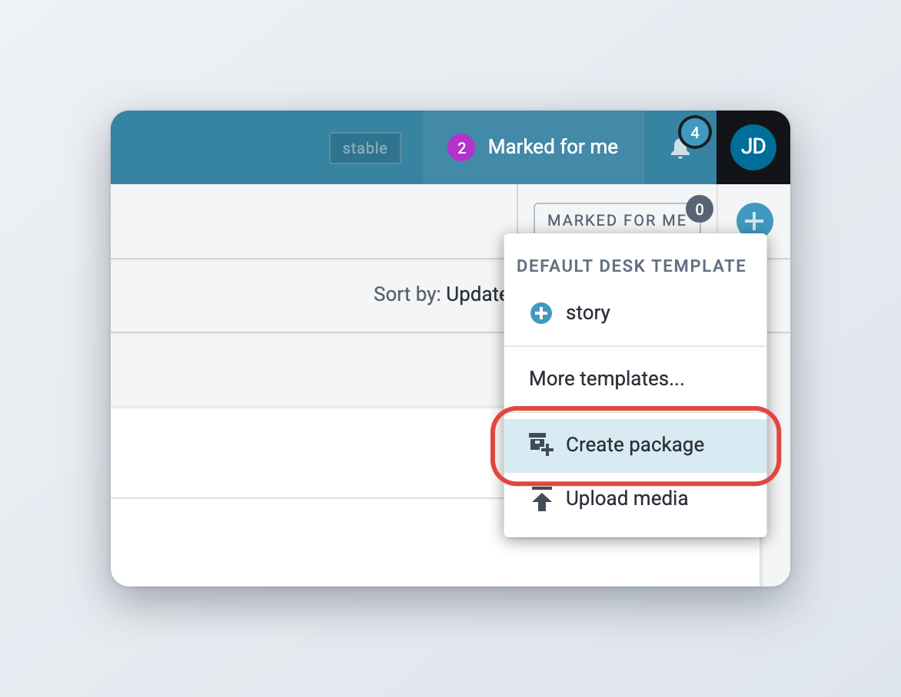
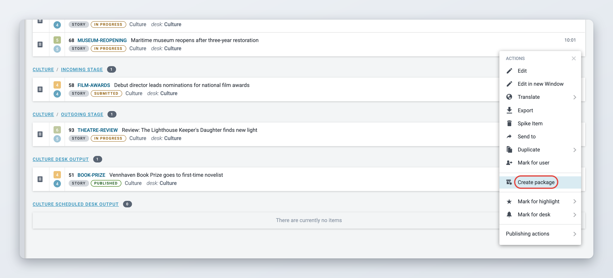
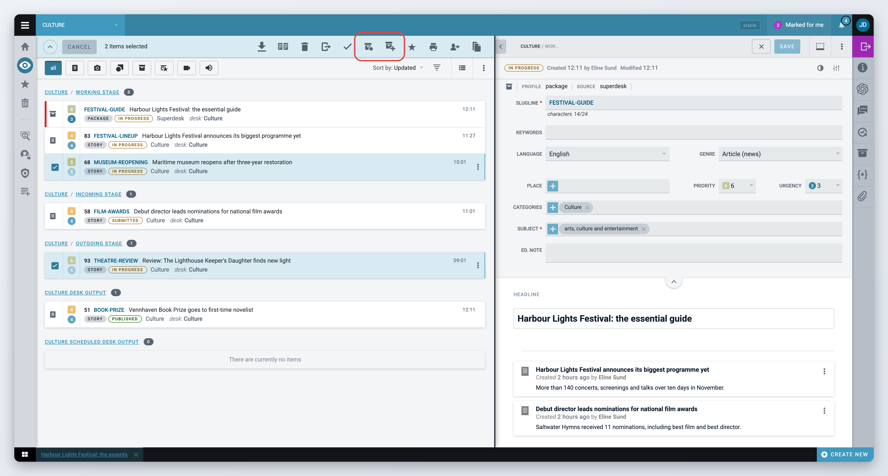
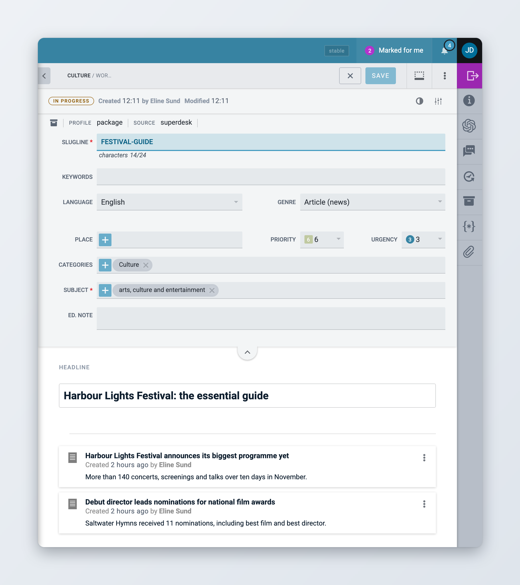
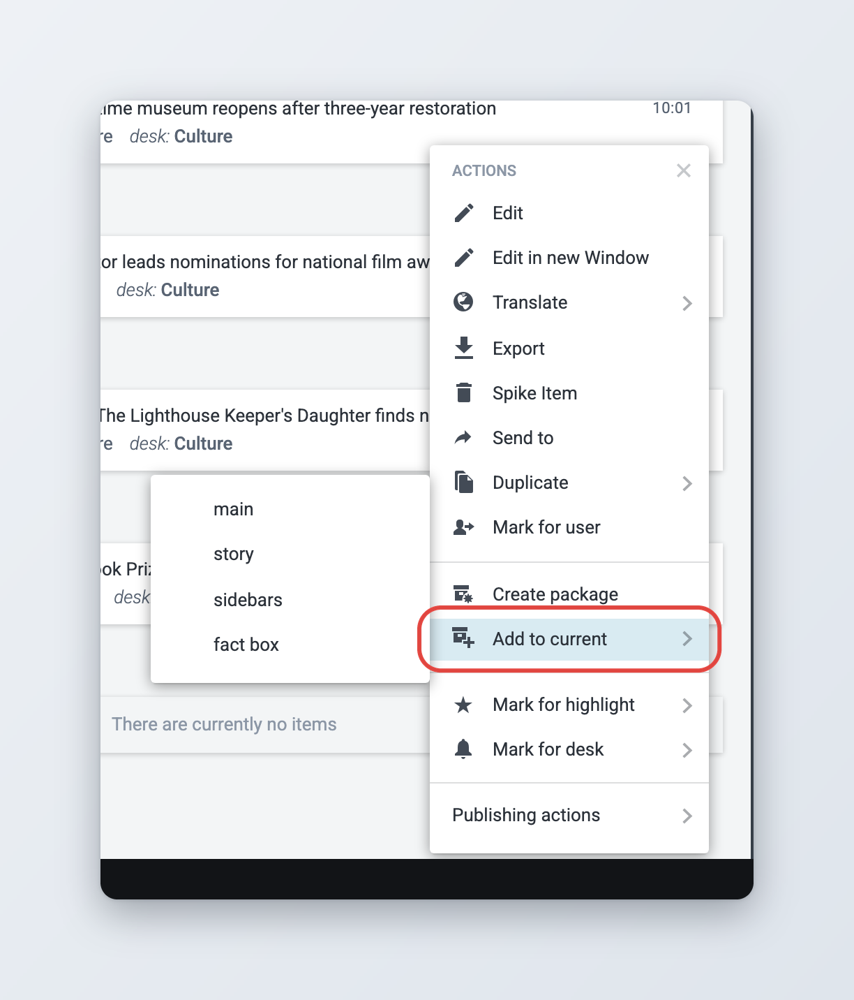
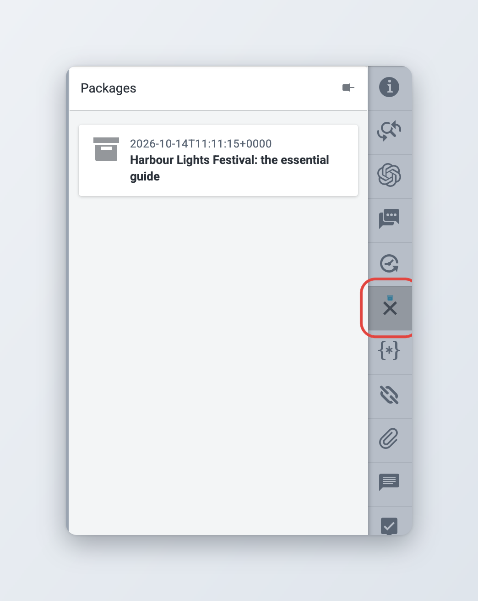

# Packages

A Package is a container consisting of various news items. You can pair plain text items and image(s) or group related articles together to be published as one. Packages have their own metadata, independent of the metadata of their individual news items. There are several ways to create a package.

## Creating an empty Package

Users can create a package by clicking the **Create** button (the round **+** button) in the top-right corner of the Monitoring pane.

Clicking the **Create** button opens a menu from which you can select the **Create package** option. This option is not offered in your Personal space. Packages have their own metadata, independent of the metadata in their individual pieces.

<figure><figcaption>
The Create package entry in the Create menu
</figcaption></figure>

While this empty Package is still open, you can add news items to it by selecting articles from any article list window (such as the Monitoring pane, or Search pane) and clicking the **Add to Current Package** button in the action bar at the top of the list.

## Creating a Package from a single item

In the Monitoring tab or Search tab of the Workspace Panel, choose a news item to start creating a new package from by clicking on the item's **Item actions** button (three vertical dots). From the menu that pops up, select **Create package**. You can also select the item and press **Ctrl+Alt+P**.

<figure><figcaption>
Creating a package from the item actions menu
</figcaption></figure>

This will create a package containing the original news item and the item's headline is copied to the package headline.

You can also click **Create Package** in the action bar that appears once you select the checkbox beside an item (see [Creating a Package from multiple items](#creating-a-package-from-multiple-items)).

## Creating a Package from multiple items

In any list view (for example the Monitoring tab or Search tab of the Workspace Panel), select multiple items by hovering over the item's icon on the left side of the article entry, which turns into a checkbox. Check off the boxes of the desired items, and click **Create Package** in the action bar at the top of the list to create a package with these items in it. If you are creating a package from the Search tab, note that you cannot use Ingested articles to create a package. Articles must be fetched to a Desk before they can be added to a package.

<figure><figcaption>
Package buttons in the action bar
</figcaption></figure>

A new Package is then created with empty metadata but a copy of the headline from the first item you selected.

<figure><figcaption>
A package open for editing
</figcaption></figure>

## Adding items to an existing Package

While working on the package (i.e. having it open) users can add more news items to it.

A single item can be added to a Package by clicking on the item's **Item actions** button and selecting the **Add to current** option, then choosing whether it should be featured as main, story, sidebars or fact box. If you create a Package and add items to it one at a time, the headline does not automatically get filled in.

<figure><figcaption>
Adding an item to the open package
</figcaption></figure>

## Adding multiple items to a Package

Multiple items can be added to a package by selecting their checkboxes and clicking **Add to Current Package** in the action bar at the top of the list. This button only appears while a package is open.

You cannot add an item to a package if it is killed, recalled, unpublished, spiked or scheduled, or if it is an ingested item that has not yet been fetched to a desk. A package also cannot contain items with an embargo.

## The Packages widget

When an article is open in editing mode, the **Packages** widget in the [widget bar](creating-and-editing-content-items/metadata-and-fields.md#widgets) shows whether the article belongs to a Package and the name of the Package to which it belongs.

<figure><figcaption>
The Packages widget
</figcaption></figure>
