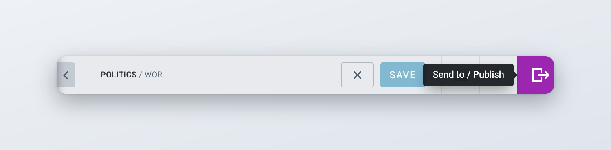
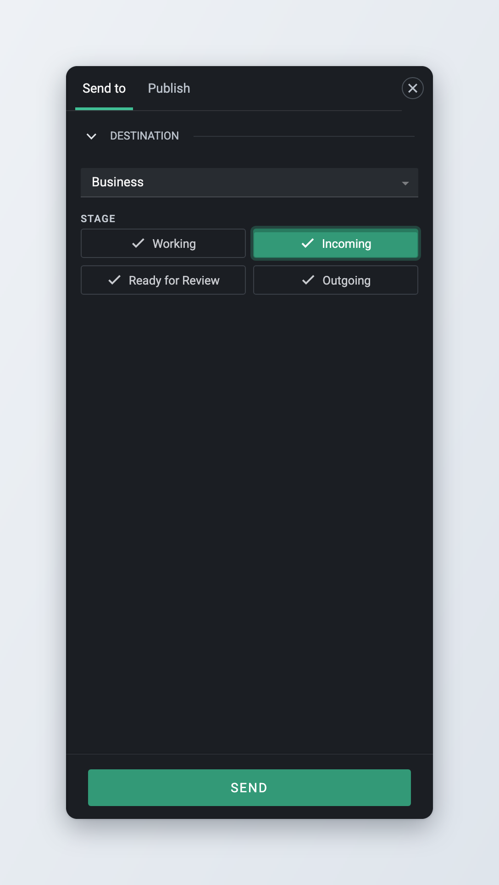
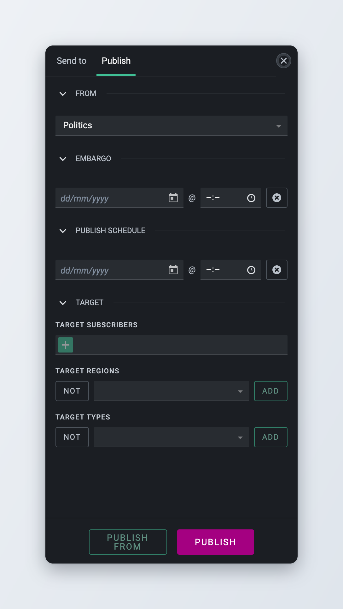
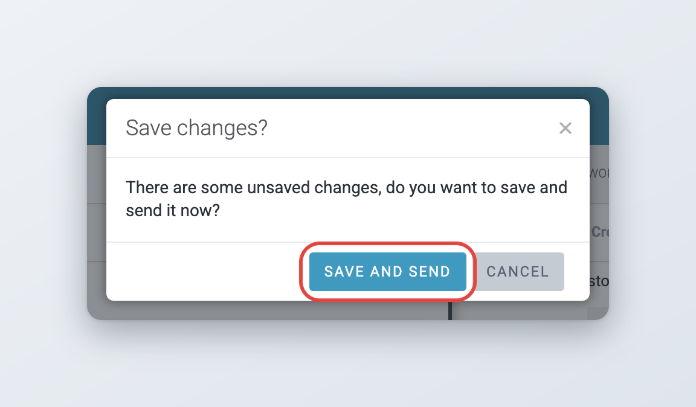
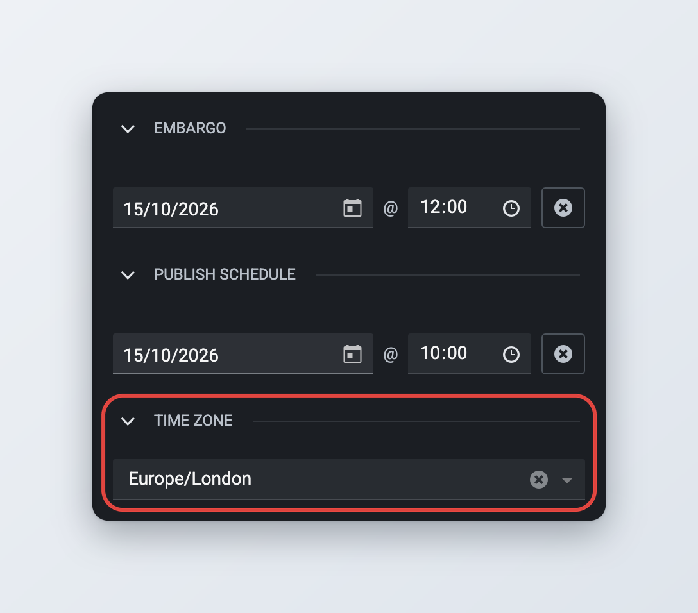
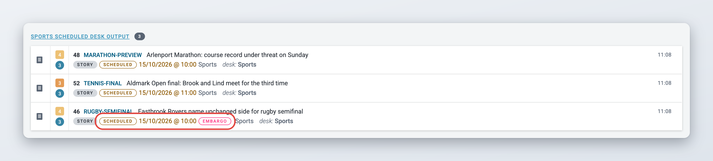
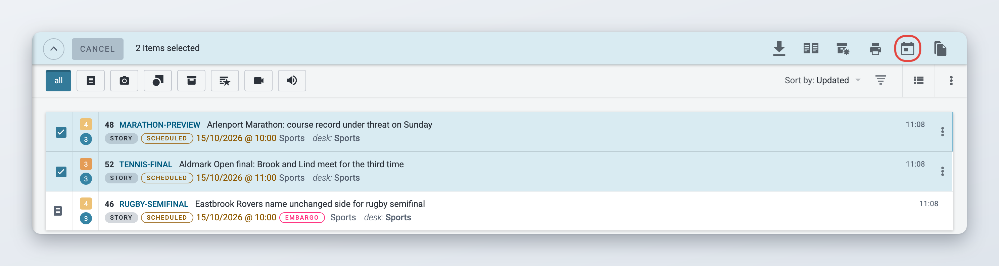
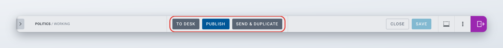

# Sending, scheduling and publishing items

When an item is ready to move on, you either send it to another desk or stage, or you publish it. Both happen in the **Send to / Publish** panel. This page explains the panel, how to set an embargo or a publish schedule, how to cancel a scheduled publication, and what your administrator can change.

For what you can do with an item after it is published (updates, corrections, kills and takedowns), see [Updates, corrections, kills and takedowns](updates-corrections-kills-and-takedowns/README.md).

## The Send to and Publish panel

*Available since Superdesk 2.7.*

The panel opens on the right side of the screen, next to the item you are working on. It replaces the pop-up window that older versions of Superdesk used.

To open it while you edit an item, click the **Send to / Publish** button at the far right of the authoring top bar. It is the coloured button with an arrow leaving a box, and its tooltip reads "Send to / Publish".

<figure><figcaption>
The Send to / Publish button in the authoring top bar
</figcaption></figure>

The panel has tabs along the top. Which tabs you see depends on where you open the panel and on what you are allowed to do with the item.

| Where you open the panel | Tabs |
| --- | --- |
| **Send to / Publish** button in authoring | **Send to**, and **Publish** if you can publish the item |
| **Send to** in the item actions menu, or in the action bar when several items are selected | **Send to** |
| **Duplicate** > **Duplicate To** in the item actions menu | **Duplicate to** |
| **Fetch to** on an ingested item | **Fetch to** |
| **Unspike** on a spiked item | **Unspike** |

In authoring, the panel opens on the **Publish** tab when that tab is available. Your administrator can change this so the panel always opens on **Send to**. To close the panel without doing anything, click the close button (**X**) in the panel header.

This page covers the **Send to** and **Publish** tabs. The other tabs work the same way: you pick a destination and confirm. See [Unspiking an item](spiked-items.md#unspiking-an-item) and [Duplicating an item](creating-and-editing-content-items/README.md#duplicating-an-item).

When you are correcting a published item, the panel shows a **Publish** tab with a **Send correction** button instead of **Publish**. See [Corrections](updates-corrections-kills-and-takedowns/corrections.md).

## Sending an item to a desk or stage

Use **Send to** to move an item to another stage of the same desk, to another desk, or to your Personal space.



### Open the panel

Open the item for editing and click **Send to / Publish**. If the panel opens on the **Publish** tab, click the **Send to** tab.



### Choose the desk

Under **Destination**, pick a desk from the list. You can type to filter the list.



### Choose the stage

Under **Stage**, click the stage you want. The stage the item is in now is greyed out, because sending an item to where it already is does nothing.



### Send

Click **Send**. Superdesk shows "Sent successfully", closes the item and unlocks it, so people on the destination desk can work on it straight away.



<figure><figcaption>
The Send to tab
</figcaption></figure>

A few things about the destination list:

* Superdesk remembers the last destination you sent to and selects it again next time.
* Desks that your administrator has closed to incoming items ("Disallow sending items to this desk") are not in the list.
* Stages that are hidden on a desk only appear if you are a member of that desk.
* **Personal space** is at the end of the list if your Superdesk allows sending to Personal space and you have the privilege to do it. It is only offered for items that are currently on a desk.

When you send an item from a list instead of from authoring, the panel also has a **Send and open** button. It sends the item and then opens it for editing at its new location.

If you have unsaved changes when you click **Send**, Superdesk asks you to save them first. See [Saving and sending in one step](#saving-and-sending-in-one-step).

### Sending several items at once



### Select the items

In Monitoring or Search, tick the checkbox of each item you want to send. The action bar appears at the top of the list.



### Open the Send to panel

Click **Send to** in the action bar. It is only offered when none of the selected items is locked or published.



### Pick the destination and send

Choose the desk and stage, then click **Send**.



You cannot set an embargo or a publish schedule when you send several items at once. Those fields only appear for a single item.

### Sending packages

When every selected item is a package, the panel shows a **Send package and items** button next to **Send**. It sends the package together with the items inside it. If a package contains items that are already published, Superdesk lists them and warns you that they can not be sent. Click **Continue** to send the rest, or **Cancel**. See [Packages](packages.md) for more on packages.

### Preferred desks

*Available since Superdesk 3.6.*

If you send items to the same few desks every day, mark them as preferred desks. Preferred desks are listed first in the **Destination** list, so you find them without scrolling.

To set them, open your profile, go to **Personal preferences** and tick the desks under **Preferred Desks**. See [Your profile and preferences](../navigating-superdesk/your-profile-and-preferences.md).

## Publishing an item

You need the **Publish** privilege to publish. Your workflow may also require items to go through other stages first. Ask your editor or administrator how publishing works in your newsroom.



### Open the Publish tab

Open the item for editing and click **Send to / Publish**. The panel opens on the **Publish** tab, unless your administrator made **Send to** the default tab. In that case, click **Publish**.



### Check the options

Set an embargo, a publish schedule or a target if you need them. These options are explained below. Leave them empty to publish right away.



### Publish

Click **Publish**. If everything is valid, Superdesk shows "Item published.", closes the item and moves it to the desk output.



<figure><figcaption>
The Publish tab
</figcaption></figure>

The **Publish** tab can show these sections, depending on your configuration:

* **From**: the desk the item is published from. It decides which desk output the published item appears in. See [Publishing from another desk](#publishing-from-another-desk).
* **Embargo** and **Publish schedule**: see [Embargo and publish schedule](#embargo-and-publish-schedule).
* **Target**: limits who receives the item. **Target subscribers** picks specific subscribers, **Target regions** and **Target types** restrict the item by region and by subscriber type. Leave them empty to send the item to every subscriber whose filters match.

If one of your subscribers has a preview address set up, a **Preview** button also appears. It shows how the item will look for that subscriber before you publish.

### When the Publish tab is missing

The **Publish** tab only appears if you can publish the item. It is missing when:

* you do not have the **Publish** privilege,
* the item is marked **Not For Publication**,
* the item is in your Personal space, unless your administrator allows publishing from Personal space,
* the item is on an authoring desk and your administrator has turned off publishing from authoring desks. Send the item to a production desk first.

### Publishing from another desk

Sometimes you work on an item on one desk but it should be published by, and appear in the output of, another desk. Use **Publish from** for that.



### Choose the desk

In the **Publish** tab, under **From**, pick the other desk. Only desks you can publish from are listed. The **Publish** button is disabled while another desk is selected.



### Publish from that desk

Click **Publish from**. Superdesk sends the item to the chosen desk and publishes it from there. The item appears in that desk's output.



Your administrator can turn this option off. Then the **From** section and the **Publish from** button are not shown.

### When publishing fails

Before publishing, Superdesk checks the item against its content profile. If a required field is empty or a value is not allowed, publishing stops. An error message names the field, for example "HEADLINE is a required field". The item stays open, so you can fix it and click **Publish** again.

Other checks can also stop publishing. For example, the embargo or the publish schedule is in the past, or a picture or other media item in the article has been killed or spiked, or has its own embargo.

### Publishing several items at once

In Monitoring or Search, select the items and click **Publish** in the action bar. Superdesk asks "Do you want to publish *n* articles?" and lists the items, with their scheduled time if they have one. Click **Publish** to confirm. When all items go out, Superdesk shows "All items were published successfully." If some items can not be published, Superdesk shows an error for each of them with the reason, and the other items are still published.

The **Publish** action only appears if you can publish every selected item.

### Saving and sending in one step

If the item has unsaved changes when you click **Send**, **Publish** or **Publish from**, Superdesk asks:

> **Save changes?** There are some unsaved changes, do you want to save and send it now?

Click **Save and send** to save the item and then send or publish it in one go. Click **Cancel** to go back to the item without doing either.

<figure><figcaption>
Superdesk asks to save your changes before sending or publishing
</figcaption></figure>

Changing a value in the **Publish** tab, such as the embargo, the schedule or the target, also counts as an unsaved change. That is why you may see this dialog even if you did not touch the text.

This also works after a failed attempt (since 3.6). If publishing stopped because of a validation error, fix the field and click **Publish** again. One click on **Save and send** saves your fix and publishes the item. If the save itself fails, Superdesk shows an error and does not send or publish anything, so an old version of the item never goes out.

## Embargo and publish schedule

You can attach two dates to an item before you publish it:

* **Embargo**: the date and time before which subscribers must not use the item.
* **Publish schedule**: the date and time when Superdesk publishes the item.

### Setting an embargo

You need the **Embargo** privilege to set an embargo.



### Open the Publish tab

Open the item, click **Send to / Publish** and go to the **Publish** tab.



### Enter the date and time

Under **Embargo**, pick a date and a time.



### Check the time zone

The **Time zone** section appears as soon as you enter a date. Check it before you continue. See [Time zones](#time-zones).



### Publish

Click **Publish**.




An embargo does not hold the item back. Superdesk publishes the item straight away and marks it as embargoed until the date you set, and subscribers are expected to respect that date. If the item must not leave Superdesk before a certain time, use a publish schedule instead, or both.


The embargo must be in the future. You can not set an embargo on a package, and a package can not contain items with an embargo. Whether an update of an embargoed item can keep the embargo depends on your configuration. See [Updates of embargoed stories](updates-corrections-kills-and-takedowns/updates.md#updates-of-embargoed-stories).

Your administrator decides where the **Embargo** field appears. By default it is in the **Publish** tab and not in the **Send to** tab.

### Scheduling publication



### Open the Publish tab

Open the item, click **Send to / Publish** and go to the **Publish** tab.



### Enter the date and time

Under **Publish schedule**, pick the date and time when the item should be published. It must be in the future.



### Check the time zone

Check the **Time zone** section. See [Time zones](#time-zones).



### Publish

Click **Publish**. The item does not go out yet. Its state changes to **Scheduled** and Superdesk publishes it at the time you set.



### Using an embargo and a schedule together

*Available since Superdesk 2.10.*

You can set both dates on the same item. Superdesk publishes the item at the scheduled time, and the item carries the embargo until the embargo date.

<figure><figcaption>
Embargo, publish schedule and time zone
</figcaption></figure>

### Time zones

*Available since Superdesk 3.1.*

You enter the embargo and the publish schedule as local time in the time zone shown under **Time zone**. When you enter a date, Superdesk fills in your newsroom's default time zone. If you are writing for another region, pick that region's time zone from the list before you publish. You can type to filter the list.

If the **Time zone** field is empty, Superdesk shows "If not set, the UTC+0 time zone is assumed." and treats your dates as UTC.

The time zone is saved with the item. When you correct a published item, Superdesk keeps the embargo in its original time zone.

Your administrator can also let you enter seconds in these fields (since 3.6).

### Clearing an embargo or a schedule

*Available since Superdesk 3.1.*

To remove a date before you publish, click the **Clear** button (the round icon at the end of the field). The field is emptied and the date is removed from the item when you send or publish it.

To cancel the schedule of an item that is already scheduled, deschedule it. See [Descheduling items](#descheduling-items).

### Where you see scheduled and embargoed items

*Available since Superdesk 3.4.*

In Monitoring and Search lists:

* an item with a publish schedule in the future shows the **Scheduled** label and its scheduled time. Hover over the time to see "Article is scheduled for" followed by the full date. This also applies to items that are not published yet but already have a schedule saved on them. Once the time has passed, the label shows the item's real state again, for example **Published**,
* an embargoed item shows an **Embargo** label until the embargo has passed. Hover over it to see the embargo date.

Each desk can also show a **Scheduled Desk Output** group in Monitoring. It lists the desk's items that are waiting for their publish schedule. If you do not see it, it can be turned on in the monitoring settings of the desk.

<figure><figcaption>
A scheduled and embargoed item in Monitoring
</figcaption></figure>

## Descheduling items

Descheduling cancels a scheduled publication. The item is not published, goes back to the **In progress** state on its desk and can be edited again.

The item keeps its publish schedule date, and the **Publish schedule** field still shows it. Before you publish the item again, clear the date or set a new one. If you leave it and the date is still in the future, Superdesk schedules the item for that time again. If the date has passed, publishing fails because the schedule is in the past.

### Descheduling one item



### Open the scheduled item

Find the item in Monitoring, for example in the **Scheduled Desk Output** group, and open it.



### Deschedule

Click **Deschedule** in the authoring top bar.



### Descheduling several items at once

*Available since Superdesk 2.5.*



### Select the items

In Monitoring or Search, tick the checkbox of each item you want to deschedule.



### Deschedule

Click **Deschedule** in the action bar. The action appears as soon as at least one selected item is scheduled.



### Confirm

Superdesk asks "Do you want to deschedule articles?". Confirm, and Superdesk reports how many articles were descheduled. Items in your selection that were not scheduled are left alone.



<figure><figcaption>
Descheduling several items at once
</figcaption></figure>

## Shortcut buttons in the top bar

Your administrator can add shortcut buttons to the authoring top bar, so common moves take one click instead of opening the panel. You may see some of these:

* **To Desk**: sends the item to the next stage of the same desk. After the last stage it goes back to the first one.
* **Publish**: publishes the item from its current desk, after a confirmation.
* **Publish & Continue**: publishes the item and then opens a new update of it, so you can keep working on the story.
* **Close & Continue**: closes the item and opens a new update of it.
* **Send & duplicate**: see below.

If you have unsaved changes, these buttons save the item first. The buttons are shown as soon as you open an item and stay disabled until the action is possible (since 3.6).

<figure><figcaption>
Shortcut buttons in the authoring top bar
</figcaption></figure>

### Send and duplicate

*Available since Superdesk 3.1.*

**Send & duplicate** puts a copy of the item on a desk and stage that your administrator has chosen, and keeps the original where it is. This helps when every story also has to go to a second desk, for example a translation or regional desk.



### Click Send & duplicate

While editing the item, click **Send & duplicate** in the top bar.



### Save your changes

If you have unsaved changes, Superdesk asks whether to save them. Save, or cancel to stop.



### Keep working

Superdesk places the copy on the configured desk and stage and opens the original item again so you can continue.



By default the copy does not keep the embargo or the publish schedule. Your administrator can configure **Send & duplicate** so the copy keeps both (since 3.4).

## Checking the publish queue

After you publish, Superdesk sends the item to each subscriber whose filters match. The **Publish Queue** shows each of these transmissions. You need the **Publish Queue** privilege to open it from the main menu.

For each transmission, the queue shows the headline, unique name, subscriber, destination and status, plus when it was queued, scheduled and transmitted. The **Processing time** column shows how long the item took from publishing to transmission (since 3.1). The status is one of pending, in-progress, success, error, retrying, failed or canceled. You can **Cancel** a transmission that is still pending or retrying, and **Resend** one that succeeded, failed or was canceled.

If Superdesk can not format the item for one subscriber, that subscriber's entry gets the error status and the reason in the **Message** column. The other subscribers still receive the item (since 3.1).

The publish queue is mostly an administrator's tool. It is described in detail in [Publish Queue, Legal Archive and Content Expiry](../administration/defining-publishing-in-superdesk/publish-queue-legal-archive-and-content-expiry.md).

## For administrators

This section is for administrators. Most of the panel's behaviour is set in the Superdesk client configuration (`superdesk.config.js`) or in the server settings.

### What the panel shows

| Setting | Where | Default | Effect |
| --- | --- | --- | --- |
| `AUTHORING_ACTIONS_DEFAULT_TAB` | Server | `publish` | Set to `send_to` to open the panel on **Send to** instead of **Publish** (since 3.1). |
| `ui.publishEmbargo` | Client | `true` | Shows **Embargo** in the **Publish** tab. |
| `ui.sendEmbargo` | Client | `false` | Shows **Embargo** in the **Send to** tab (since 2.10). |
| `authoring.panels.publish.publishSchedule` | Client | `true` | Shows **Publish schedule** in the **Publish** tab (since 2.10). |
| `authoring.panels.sendTo.publishSchedule` | Client | `false` | Shows **Publish schedule** in the **Send to** tab (since 2.10). |
| `authoring.panels.publish.publishingTarget` | Client | `true` | Shows the **Target** section in the **Publish** tab (since 2.10). |
| `authoring.panels.publish.allowSeconds` | Client | `false` | Lets users enter seconds in the embargo and schedule fields (since 3.6). |
| `ui.sendAndPublish` | Client | `true` | Shows the **From** section and the **Publish from** button. |
| `ui.sendDefaultStage` | Client | not set | `incoming` or `working`: the stage preselected in **Send to**. When not set, the last used stage is preselected, then the desk's incoming stage. |
| `DEFAULT_TIMEZONE` | Server | server time zone | The time zone filled in when a user enters an embargo or schedule. |

The embargo fields also require the user to have the **Embargo** privilege.

### Workflow options

| Setting | Where | Effect |
| --- | --- | --- |
| `features.noPublishOnAuthoringDesk` | Client | Removes the **Publish** tab and the publish shortcuts on desks whose type is **Authoring**. Users must send items to a production desk to publish (since 2.8). |
| `features.sendToPersonal` | Client | Offers **Personal space** as a destination and adds **Send to Personal Space** to the item actions. Users also need the **Send Content to Personal desk** privilege. |
| `features.publishFromPersonal` | Client | Allows publishing items that are in Personal space. |
| `features.confirmDueDate` | Client | Asks users to confirm before publishing from the **Publish** tab, showing the scheduled time if there is one. |
| `features.customAuthoringTopbar` | Client | Adds shortcut buttons to the authoring top bar: `toDesk`, `publish`, `publishAndContinue`, `closeAndContinue` (each `true` or `false`) and `sendAndDuplicate`. |

`sendAndDuplicate` takes an object with `deskName` and `stageName`: the desk and stage that receive the copy, matched by name. If the stage is not found, the desk's incoming stage is used. If the desk is not found, the button is not shown. Add `preserveEmbargoAndSchedule: true` to keep the embargo and publish schedule on the copy (since 3.4).

### Desk settings

In **Settings** > **Desks**, on the desk's general settings:

* **Desk Type**: with `features.noPublishOnAuthoringDesk` on, items on **Authoring** desks can not be published. Superdesk shows a note about this when you pick the type.
* **Disallow sending items to this desk**: removes the desk from the **Send to** destination list (since 2.7).

See [Desk Creation and Desk Management](../administration/desk-creation-and-desk-management.md).

### Privileges

These privileges control the actions on this page. Set them in [User Management and User Roles](../administration/user-management-and-user-roles.md).

| Privilege | Allows |
| --- | --- |
| **Publish** | Publishing items, and the **Publish** tab |
| **Embargo** | Setting an embargo |
| **Send Content to Personal desk** | Sending items to Personal space (with `features.sendToPersonal`) |
| **Publish Queue** | Opening the Publish Queue |

### Keeping embargoed items from some subscribers

Because an embargo does not hold an item back, subscribers receive embargoed items straight away. Use a content filter with a filter condition on the **Embargo** field (operator equal, value True) if a subscriber must not receive items while their embargo is still running. The condition matches only while the embargo is in the future at the moment of publishing. See [Keeping embargoed items from a subscriber](../administration/defining-publishing-in-superdesk/content-filters-and-internal-destinations.md#keeping-embargoed-items-from-a-subscriber).
