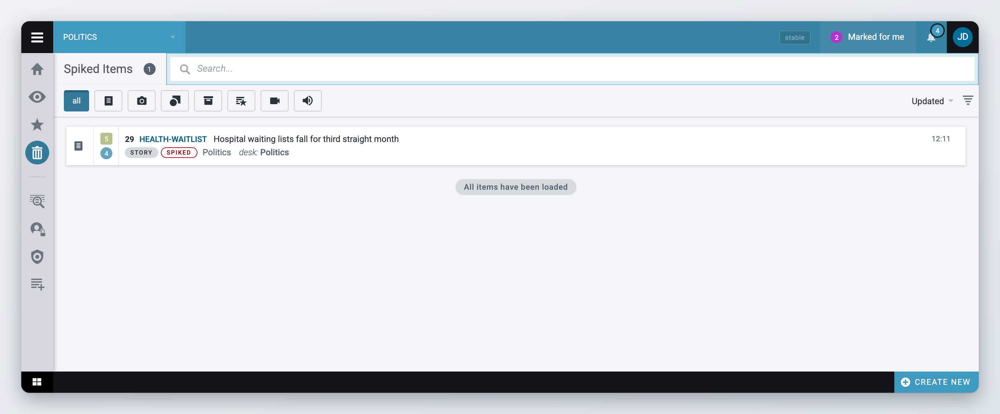
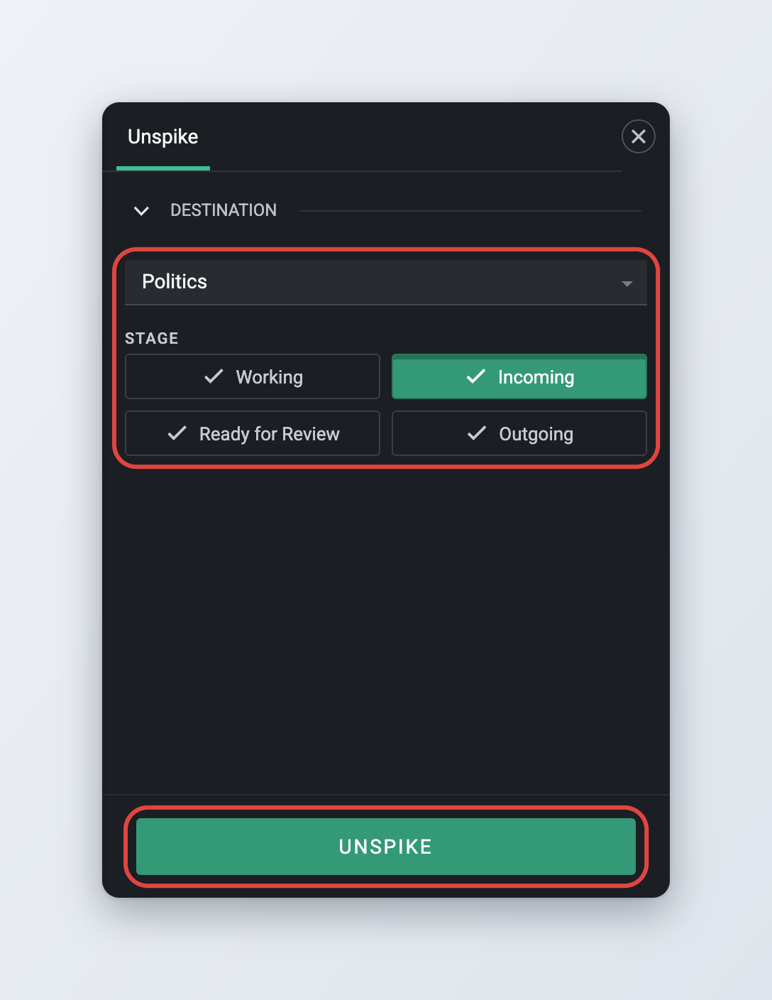
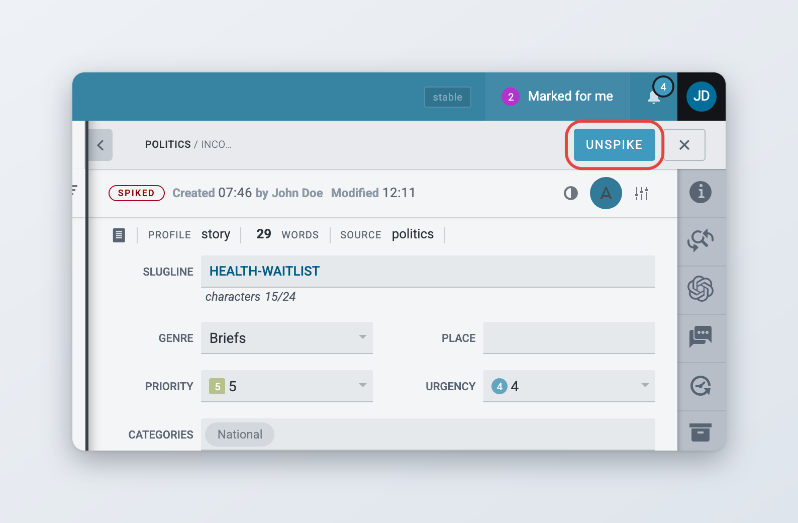

# Spiked Items

Spiked items are articles and other content items that have been removed from a desk's workflow. Spiking is different from killing: published items cannot be spiked and must be killed instead. Spiking an item from a desk is reversible. Spiking an item from your Personal Space deletes it.

Spiked items are not kept forever. By default Superdesk deletes a spiked item 30 days after it was spiked. Your administrator can change this period.

## The Spiked Items view

Click the **Spiked Items** icon in the Workspace Panel, or press **Ctrl+Alt+K**. The view lists the items spiked from the desk that is selected in the Desks menu at the top left. To see the spiked items of another desk, select that desk.

<figure><figcaption>
The Spiked Items view
</figcaption></figure>

The view has:

* the **Spiked Items** heading with the number of items,
* a search box to search the spiked items by keyword,
* buttons to filter by item type (**All**, text, picture and the other types),
* a sort control, showing the current sort field such as **Updated** and the direction.

Click an item to preview it. Double-click it to open it read-only. See [Opening a spiked item](#opening-a-spiked-item).

## Spiking an item


Spiking an item from your Personal Space deletes it. Superdesk asks "Do you want to delete the item permanently?" before it does. Spiking an item from a desk is reversible.




### Open the item actions

In any list, such as the Monitoring view, a custom workspace, Search or your Personal Space, hover over the item and click the **Item actions** button (three vertical dots) at the right of the row.



### Choose Spike Item

Click **Spike Item**. You can also select the item and press **Ctrl+Shift+#**.



### Confirm

Superdesk asks "Are you sure you want to spike the item?" Click **Spike**. The item disappears from the list and appears in the desk's Spiked Items view.



To spike several items at once, select them and click **Spike** in the bar at the top of the list. See [Selecting several items](../workspace-and-search/monitoring-tab.md#selecting-several-items).

You cannot spike an item that:

* is published, scheduled, corrected or killed. Deschedule a scheduled item first. Kill a published item instead.
* is part of a package. Remove it from the package first.
* is open for editing by another user.

If you spike an item that you have open with unsaved changes, Superdesk first asks what to do with those changes.

### What happens when you spike an item

* The item is unlocked and closed for everyone who has it open.
* If the item was marked for a user, the mark is removed. See [Collaboration tools](creating-and-editing-content-items/collaboration-tools.md#mark-for-user).
* If the item is a translation, it is no longer linked to the original item.
* If the item is a package, the items in it are released from the package. Unspiking the package puts them back.

## Unspiking an item

*Available since Superdesk 2.7.*

When you unspike an item, you choose the desk and stage it goes to.



### Open Spiked Items

Click the **Spiked Items** icon in the Workspace Panel and select the desk the item was spiked from.



### Choose Unspike Item

Hover over the item, click the **Item actions** button and choose **Unspike Item**. To unspike several items, select them and click **Unspike** in the bar at the top of the list.



### Choose the destination

The **Unspike** panel opens. Under **Destination**, pick the desk, then the **Stage**.



### Click Unspike

The item goes back to its state before it was spiked, on the desk and stage you chose.



<figure><figcaption>
Choosing where an unspiked item goes
</figcaption></figure>


The panel preselects the desk you last sent an item to, or otherwise your current desk, and that desk's incoming stage. This is not always the desk and stage the item was spiked from, so check the destination before you click **Unspike**. To put an item back exactly where it was, open it and use the **Unspike** button in its top bar instead.


## Opening a spiked item

*Available since Superdesk 2.10.*

Double-click a spiked item in the Spiked Items view to open it. Spiked items always open read-only, so you can check the content but not change it.

The top bar of a spiked item has an **Unspike** button. Click it to return the item to the desk and stage it was spiked from, without choosing a destination.

<figure><figcaption>
A spiked item opened read-only
</figcaption></figure>

## Searching spiked items

Use the search box and the type buttons in the Spiked Items view to find an item spiked from the current desk.

To search spiked items on every desk you have access to, use [Search](../workspace-and-search/searching-content-in-superdesk.md). On the **Parameters** tab of the advanced search, set **Spiked Content** to **Spiked only content**, or to **Include spiked content** to search them together with other items.

## For administrators

* **Privileges** (in **Settings** > **User Roles**): **Spike** lets users spike items, **Spike view** shows the Spiked Items icon, and **Unspike** lets users unspike items.
* **Server configuration**: `SPIKE_EXPIRY_MINUTES` sets how long spiked items are kept before they are deleted. The default is 43200 minutes (30 days). When it is set to `None`, the content expiry of the item's desk or stage is used instead.
* **Client configuration**: `confirm_spike: false` in `superdesk.config.js` skips the spike confirmation. Superdesk still asks when there is a warning to show, and always asks before deleting from Personal Space.
