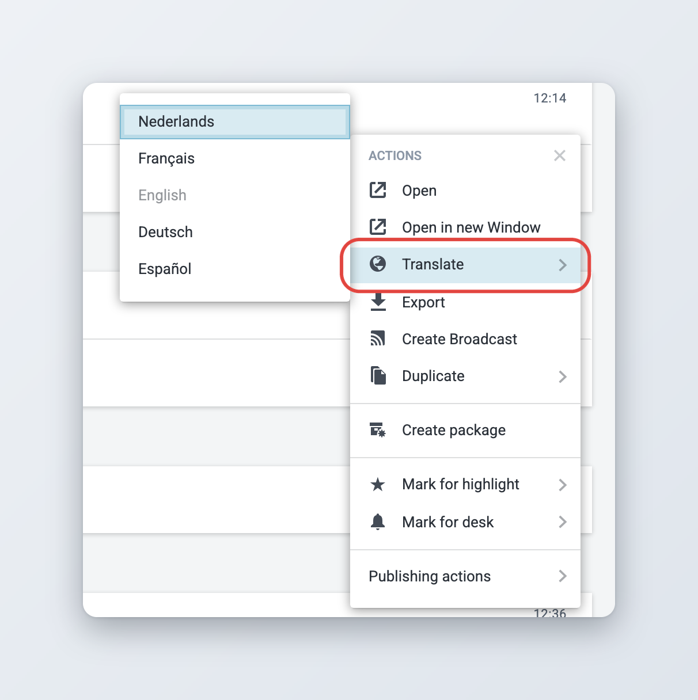
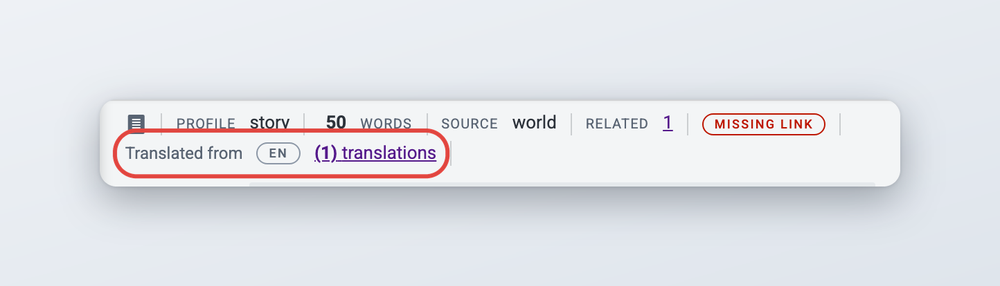
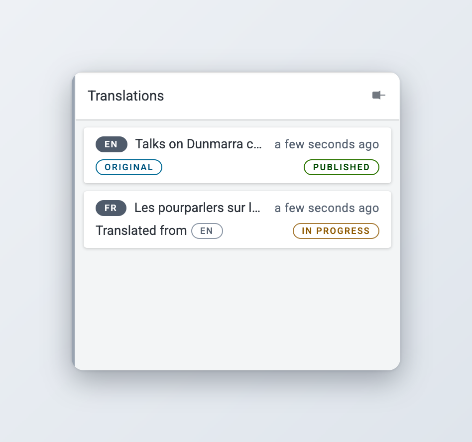
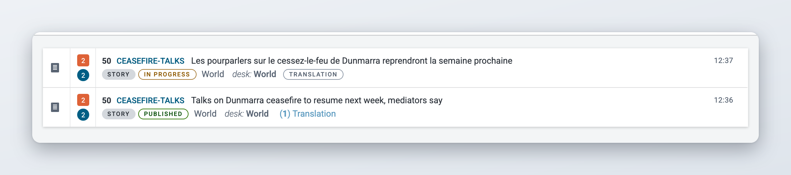
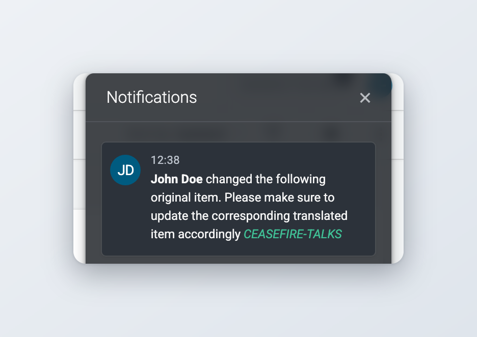
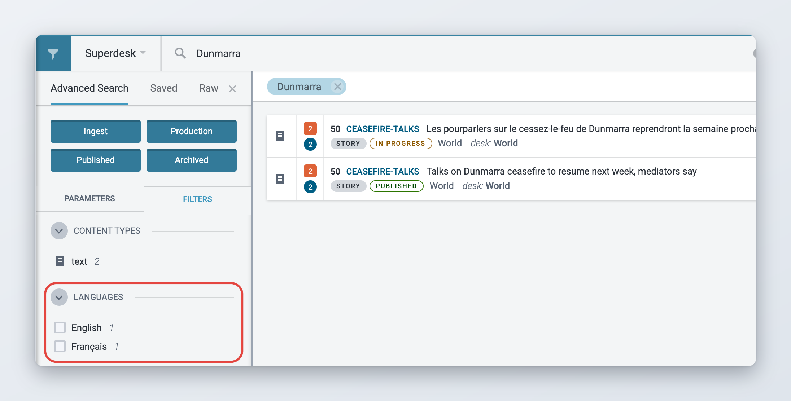

# Translating content

Superdesk can make a translation of an item. A translation is a new item in another language that stays linked to the item it was translated from. This page explains how to create a translation, how to move between an original and its translations, what happens when the original is corrected, and how to find translations in lists and in search.

The **Translate** action does not translate the text for you. It creates a copy of the item, sets the new language and opens it, so you or a translator can write the translated text. If your Superdesk has the AI Assistant, it can translate the text too. See [AI translation](#ai-translation).

## Before you start

Translating needs three things:

* **Languages.** Your administrator sets up the languages your newsroom works in. If no languages are set up, the **Translate** action does not appear at all.
* **An item language.** The item you want to translate must have a language, and that language must be one of the languages set up in your Superdesk.
* **The privilege.** Your user role needs the **Translate Content within a Desk** privilege. Ask your administrator if you are not sure.

## Translating an item

You translate an item from a list: Monitoring, Search, or any other place where the item has an actions menu. You can translate items that are still in progress and items that are already published. You cannot translate spiked, killed or recalled items.



### Select the desk the translation should go to

The translation is created on the desk you have selected in the Desks menu at the top of the screen, not on the desk of the original. If the translators work on another desk, select that desk first. You can still reach the original from there through Search.



### Open the actions menu

Hover over the item in the list and click the three dots on the right of it to open its actions menu. You can also open the actions menu from the item's preview.



### Choose the language

Hover over **Translate**. A list of languages opens. Click the language you want to translate into.

The item's current language is greyed out, because you cannot translate an item into the language it already has.



### Write the translation

Superdesk creates the translation and opens it for editing. Translate the headline, body and the other text fields, then save.



<figure><figcaption>
Choosing the target language from the Translate menu
</figcaption></figure>

You can translate the same item into several languages, one after the other. You can also translate an item into a language it already has a translation in, which gives you a second, separate translation.

### What the translation contains

The new item is a copy of the original at the moment you translated it:

* Headline, body, abstract, metadata and media are copied as they are, still in the original language.
* The **Language** field is set to the language you chose.
* Embargo, publish schedule, highlights and desk marks are not copied. Set them again on the translation if you need them.
* The sign-off is yours, because you created the translation.

The translation is placed in the working stage of the desk you have selected, and assigned to you. Its status is **Submitted**. If you are working in a custom workspace, Superdesk uses the desk you last selected, or your default desk. If you are not a member of any desk, the translation stays on the same desk and stage as the original.

The translation keeps the item history of the original. A **Translated by** entry, with your name and a link to the original, marks where the translation begins.

### Translating a package

When you translate a package, Superdesk also translates every item in it into the same language. The new package contains the new translations, not the original items. See [Packages](packages.md) for more about packages.

## Moving between an original and its translations

An original and all its translations form one group. Superdesk shows the links between them in three places: the authoring header, the **Translations** widget and the list view.

### In the authoring header

When you open an item that belongs to a group of translations, the header shows where the item comes from:

* On the original you see an **Original** label and a link with the number of translations, for example **(2) translations**.
* On a translation you see **Translated from** and the code of the language it was translated from, for example **EN**, followed by the same link.

Click the **translations** link to open the **Translations** widget.

<figure><figcaption>
The authoring header of a translation
</figcaption></figure>

Items that have never been translated, and that are not translations themselves, show none of this.

### The Translations widget

The **Translations** widget is in the [widget bar](creating-and-editing-content-items/metadata-and-fields.md#widgets) on the right of the item. It only appears on items that are part of a group of translations.

The widget lists every item in the group, the item you are looking at included, oldest first. Each entry shows:

* the language code and the headline,
* when the item was last changed,
* **Original** on the original, or **Translated from** and the source language on a translation,
* the item's status, for example **Published** or **In Progress**.

Click an entry to open that item for editing in a new browser window or tab. This way you can keep the original and the translation open side by side.

<figure><figcaption>
The Translations widget
</figcaption></figure>

A translation can be translated again. For example, you can translate an English story into French, and then the French version into Dutch. All three items are in the same group, and the Dutch item shows that it was translated from French.

### In the list view

Lists in Monitoring and Search can show translation links on the second line of each item. Whether they appear depends on how your administrator has set up the list view.

* A translation shows a **Translation** label. Click it to see the item it was translated from.
* An item with translations shows a link such as **(1) Translation** or **(3) Translations**. Click it to see the translations made from that item.

The list that opens shows the language and headline of each item.

<figure><figcaption>
Translation links in the list view
</figcaption></figure>

The list view link only counts direct translations. In the example above, the English original shows one translation (French), even though the French version has its own Dutch translation. The **Translations** widget shows the whole group.

### When a translation is spiked or deleted

If you spike a translation, Superdesk removes its link to the original. The original no longer lists it, and the spiked item no longer shows **Translated from**. If you duplicate a translation, the duplicate is not linked to the group either.

## When the original is corrected

A translation does not change when its original changes. If the original is corrected after it was translated, the translators need to know, so they can decide whether the translation needs a correction as well.

When someone publishes a correction of the original, Superdesk notifies the people involved with each published translation:

* the user recorded as the creator of the translation. A translation keeps the creator of the item it was made from, so this is usually the author of the original, not the translator,
* the user who last changed the translation.

They get an in-app notification and an email. The notification reads "*name* changed the following original item. Please make sure to update the corresponding translated item accordingly", followed by the slugline of the original. Click the slugline to open the original. The email has the subject "The original item *headline* has been changed" and a link to the original.

<figure><figcaption>
The notification sent to translators when the original is corrected
</figcaption></figure>

A few things to keep in mind:

* Only corrections trigger the notification. Updates (rewrites), kills and takedowns of the original do not.
* Only translations that have been published count. Nobody is notified about translations that are still in progress.
* Superdesk only checks the original, the item marked **Original**. Correcting a translation that has its own translations, like the French version in the example above, does not notify anyone.

Corrections are explained in [Corrections](updates-corrections-kills-and-takedowns/corrections.md).

## Finding translations in search

Every item has a language, so you can filter by it.

* In **Search**, click the filter icon (**Toggle filters**) at the top left of the results, open the **Filters** tab and use the **Languages** section. It lists the languages of the items in your results, with a count next to each. Tick a language to show only those items. In local search you can also click the negate icon next to a language to leave those items out.
* If your administrator has added it, the search parameters also have a **Language** field.
* The list view links described above let you jump from a search result to its original or its translations.

<figure><figcaption>
Filtering search results by language
</figcaption></figure>

See [Searching Content in Superdesk](../workspace-and-search/searching-content-in-superdesk.md) for more on search.

## Languages in Superdesk

Several settings in Superdesk are called "language". They do different things.

| Setting | What it controls | Where it is set |
| --- | --- | --- |
| Item language | The language of the content. It decides which languages the item can be translated into, and in which language metadata values are shown. | The **Language** field in the item, if your content profile has it |
| Template language | The language of every item created from the template | The **Language** field in the template settings |
| Desk language | The language of new items created on the desk | **Desk language** in the desk settings |
| Default language | The language of new items when neither the template nor the desk sets one | Server setting, ask your administrator |
| Interface language | The language of Superdesk's menus, buttons and labels. It has nothing to do with the language of items. | Your profile, see [Your profile and preferences](../navigating-superdesk/your-profile-and-preferences.md) |

A new item gets the language of its template. If the template has no language, it gets the desk language. If the desk has none either, it gets the default language of your Superdesk.

Metadata values, such as categories or subjects, can have a name for each language. When they do, Superdesk shows them in the language of the item, not in your interface language. So a French translation shows French category names, even if your Superdesk is in English.

## AI translation

*Available since Superdesk 2.8.*


This is an optional module. If you do not see it, ask your administrator.


The AI Assistant widget can translate the body of an item for you. It can also be connected to the **Translate** action, so that the new translation opens with the AI Assistant already translating it. Both are explained in [AI features](../integrations-and-advanced-features/ai-features.md#translating-an-item).

Check every AI translation before you publish it.

## For administrators

This section is for administrators. It lists what you can configure for translations.

**Languages.** The languages offered by **Translate** come from the **Languages** vocabulary. To manage it, go to **Settings** > **Metadata** > **Vocabularies** and open **Languages**. Every active language in it is offered, both as a language to translate from and as a language to translate into. The same vocabulary feeds the **Language** field in authoring, templates and desk settings. If the vocabulary has no active languages, the **Translate** action and the **Translations** widget are hidden.

**Default language.** The server setting `DEFAULT_LANGUAGE` (default `en`) is the language of new items when neither the template nor the desk sets one. The vocabulary editor shows a **Name (*language*)** field for every language except the default one, so you can give each vocabulary value a name in the other languages.

**Desk and template language.** Set **Desk language** in the desk settings (see [Desk Creation and Desk Management](../administration/desk-creation-and-desk-management.md)) and **Language** in the template settings.

**Language field in authoring.** Add the **Language** field to a content profile so users can see and change the item language. See [Content profiles](../administration/content-configuration/content-profiles.md).

**Privilege.** Users need **Translate Content within a Desk** (`translate`) in their role to create translations. See [User Management and User Roles](../administration/user-management-and-user-roles.md).

**Translations widget.** The widget can be hidden per content profile, on the **Widgets** tab of the profile.

**List view links.** The **Translation** label and the **(N) Translations** link appear when `translations` is in the `list` settings of the client configuration (`list.firstLine` or `list.secondLine`). The standard Superdesk build has it in the second line.

**Language search parameter.** The **Language** field in the search parameters comes from the `search_cvs` client setting, with an entry such as `{id: 'language', name: 'Language', field: 'language', list: 'languages'}`. The standard Superdesk build has it.

**Translation macros.** A server macro that defines `to_languages` (and optionally `from_languages`) runs automatically on every translation between those languages. Use it, for example, to call a machine translation service or to adjust metadata. The server setting `UPDATE_TRANSLATION_METADATA_MACRO` names one more macro that runs on every new translation.

**Email notifications.** The emails sent when an original is corrected need outgoing email to be set up on the server, and users need an email address in their profile.

**AI translation.** The AI Assistant and its link to the **Translate** action are set up in the ai-widget extension configuration. See [AI features](../integrations-and-advanced-features/ai-features.md).
