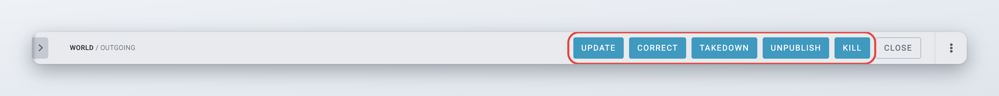
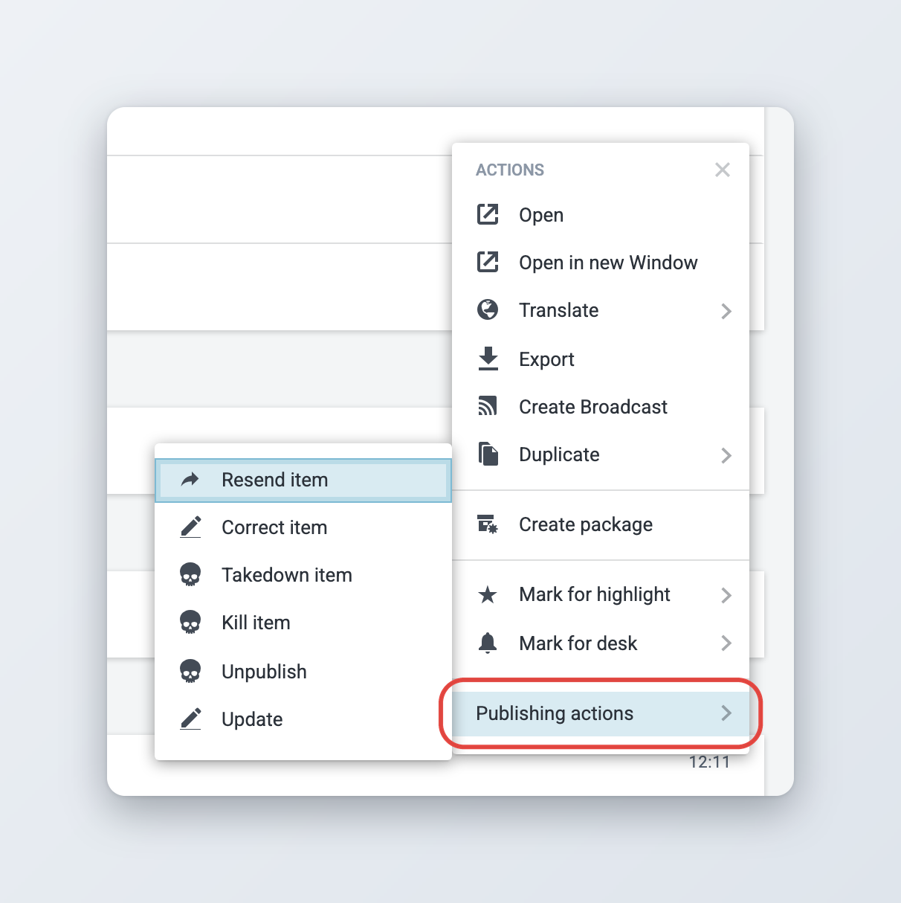

# Updates, corrections, kills and takedowns

Once an item is published, you can no longer edit it directly. Instead, you use one of the actions in this section to change what your subscribers have. This section explains each action, what happens to the item afterwards, and how embargoes, schedules and media carry over.

For the **Send to / Publish** panel itself, and for embargoes and publish schedules on new items, see [Sending, scheduling and publishing items](../sending-scheduling-and-publishing.md).

## Choosing the right action

| Action | Use it when | What happens to the published item |
| --- | --- | --- |
| [**Update**](updates.md) | The story develops and you want to publish a new version as a follow-up. | Stays published. A new story is created and linked to it. |
| [**Correct**](corrections.md) | The published text has a mistake that you want to fix in place. | Replaced by a corrected version, with the **Corrected** state. |
| [**Kill**](kills-takedowns-and-unpublishing.md#killing-an-item) | Subscribers must stop using the item, for example after a court orders that a story is not published. | Gets the **Killed** state. This is final. |
| [**Takedown**](kills-takedowns-and-unpublishing.md#taking-down-an-item) | The same as a kill, when your subscribers expect a takedown instead. | Gets the **Recalled** state. This is final. |
| [**Unpublish**](kills-takedowns-and-unpublishing.md#unpublishing-an-item) | You want to withdraw the item quickly, possibly to publish it again later. | Gets the **Unpublished** state and goes back into the workflow. |
| [**Resend**](kills-takedowns-and-unpublishing.md#resending-an-item) | A subscriber needs the item again, for example after a transmission problem on their side. | Nothing changes. The same version is sent again. |

Each action needs its own privilege. If you do not see an action, ask your administrator.

## Where to find the actions

You can start these actions in two places.

**From the item itself.** Open a published item from the desk output or from Search. It opens read-only, and the authoring top bar shows a button for each action you can take: **Update**, **Correct**, **Takedown**, **Unpublish** and **Kill**. While the Monitoring list is open next to the item, the buttons shrink to their initials (U, C, T, UP, K); switch to full width to see the labels.

<figure><figcaption>
Actions for a published item in the authoring top bar
</figcaption></figure>

**From a list.** In Monitoring or Search, open the item actions menu of a published item (the three dots) and point to **Publishing actions**. The submenu lists **Update**, **Correct item**, **Kill item**, **Takedown item**, **Unpublish** and **Resend item**, depending on your privileges and on the item.

<figure><figcaption>
The Publishing actions submenu
</figcaption></figure>

Every time an item is published, corrected or killed, Superdesk adds a new entry to the desk output, so you can see the item's history in the list. Only the newest entry has these actions. Older entries can only be opened.

Superdesk does not offer the actions when:

* the item is locked by another user,
* the item is killed or recalled, because those states are final,
* the item is scheduled. Deschedule it first, see [Descheduling items](../sending-scheduling-and-publishing.md#descheduling-items),
* a correction of the item is in progress, see [The corrections workflow](corrections.md#the-corrections-workflow).

## Who receives what

* **Updates** go to the subscribers that received the original story, and to any other subscriber whose filters match the update.
* **Corrections** go to the subscribers that received the item before, and to any other subscriber whose filters now match the corrected item.
* **Kills, takedowns and unpublishes** go only to the subscribers that received the item before. If no subscriber received it, Superdesk sends them to the subscribers whose filters match, unless your administrator has turned this off.
* **Resends** go only to the subscribers you pick.

## Pictures and media in updates and corrections

Pictures and other media embedded in a story travel with it. When you publish an update or send a correction, the embedded media go out again with the new version, so subscribers do not have to find and attach them again. A subscriber that received a picture with an earlier version receives it again with the new version.

A correction or an update can not be sent if one of its embedded media items has been killed, recalled or spiked, or has its own embargo. Remove that media item from the story first.

## For administrators

This section is for administrators. These options are set in the Superdesk server settings, except where noted.

### Settings

| Setting | Default | Effect |
| --- | --- | --- |
| `CORRECTIONS_WORKFLOW` | `False` | Turns on [the corrections workflow](corrections.md#the-corrections-workflow) (since 2.1). |
| `OVERRIDE_EDNOTE_FOR_CORRECTIONS` | `True` | Replaces the editor's note with a correction notice when a user starts a plain correction. Set to `False` to keep the existing note. |
| `OVERRIDE_EDNOTE_TEMPLATE` | not set | The correction notice. Use `{date}` and `{slugline}` as placeholders, for example `Story "{slugline}" corrected on {date}`. When not set, the default notice is used. |
| `ALLOW_UPDATING_EMBARGOED_ITEMS` | not set | Allows updates of stories whose embargo is still running, and embargoes on updates (since 3.4). |
| `ALLOW_UPDATING_SCHEDULED_ITEMS` | not set | Allows creating an update of a scheduled story without descheduling it first. |
| `WORKFLOW_ALLOW_MULTIPLE_UPDATES` | `False` | Allows more than one unpublished update in a chain. Superdesk still refuses to publish updates out of order. |
| `RESET_PRIORITY_VALUE_FOR_UPDATE_ARTICLES` | `False` | Gives new updates the default priority (`DEFAULT_PRIORITY_VALUE_FOR_MANUAL_ARTICLES`) instead of the original's priority. |
| `UNPUBLISH_TO_MATCHING_SUBSCRIBERS` | `True` | When an item killed, taken down or unpublished was never sent to any subscriber, sends the kill to the subscribers whose filters match. Set to `False` to send it to nobody in that case. |
| `PUBLISH_ASSOCIATED_ITEMS` | `False` | Publishes embedded media as items of their own when the story is published, and corrects them when the story is corrected. |
| `KILL_TEMPLATE_NULL_FIELDS` | `["byline", "place"]` | Fields emptied when the kill template is applied. |
| `features.noMissingLink` | not set | Client configuration. Hides the **Missing Link** label in the authoring header. |

### Kill and takedown templates

The kill notice and the takedown notice come from two content templates named `kill` and `takedown`, of the type **Kill**. Edit them in **Settings** > **Templates** to set the headline and body your subscribers receive. You can not create new templates of this type or rename these two.

Template fields can use placeholders for the item being killed, for example `{{ item.slugline }}` or `{{ item.headline }}`. A new Superdesk installation ships with placeholder text ("FIXME" in the body), so check both templates before your newsroom first needs them.

The "Please kill story slugged ..." line at the top of the body is added by Superdesk when the kill is sent. It is not part of the template.

### Privileges

Set these in [User Management and User Roles](../../administration/user-management-and-user-roles.md).

| Privilege | Allows |
| --- | --- |
| **Update** | Creating updates, associating a story as an update and unlinking updates |
| **Correction** | Correcting published items and cancelling corrections |
| **Kill** | Killing published items |
| **Take down** | Taking down published items |
| **Unpublish** | Unpublishing published items |
| **Resending Stories** | Resending published items |
| **Edit Unique Name** | Changing the unique name, also during a correction |
| **Archive Management** | Together with **Kill** or **Take down**, killing or taking down archived items |
