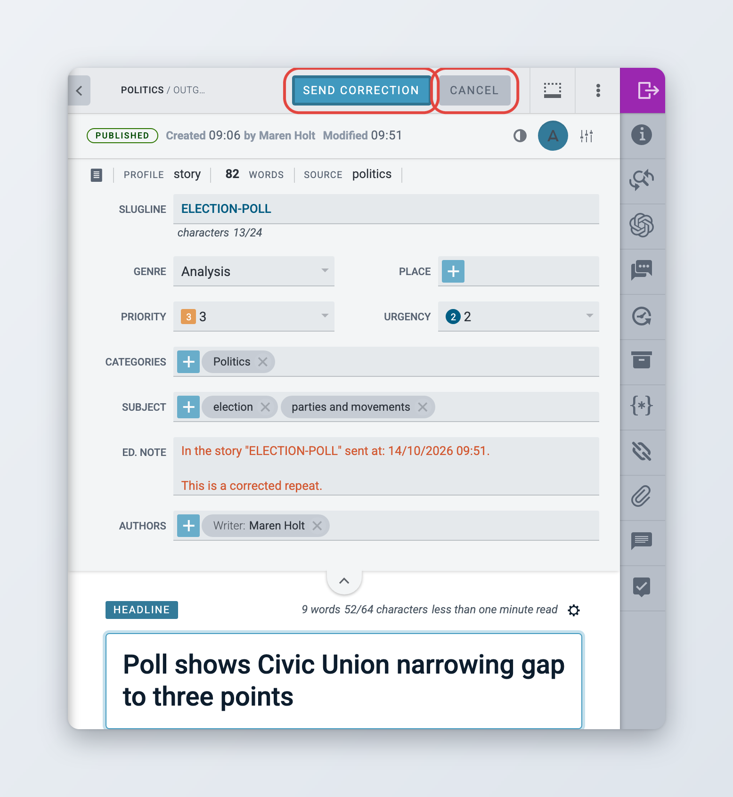
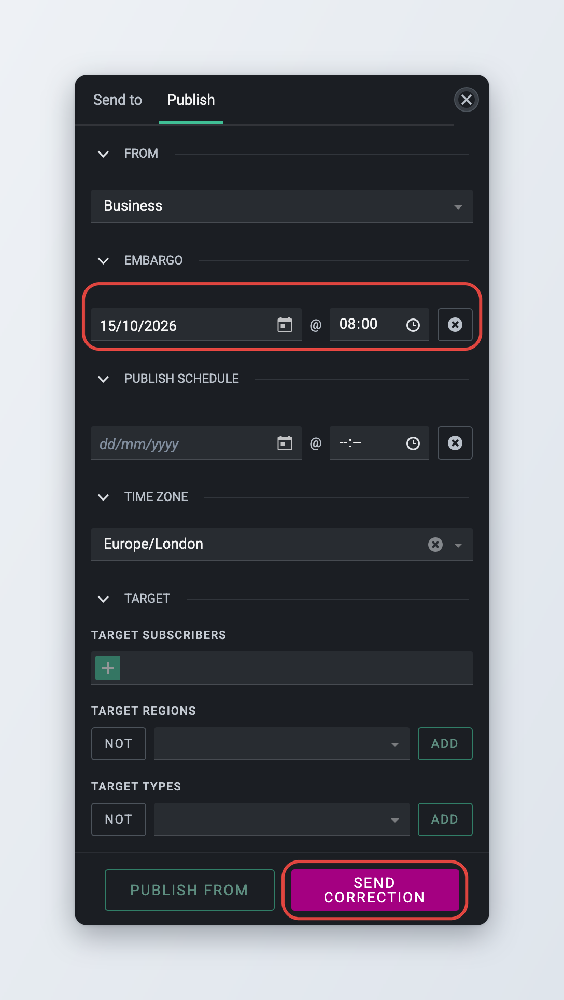
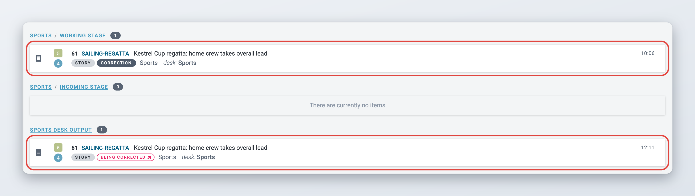

# Corrections

A correction replaces the published version of an item with a fixed version. Subscribers receive it as a correction of the same item, not as a new story.

If your administrator has turned on the corrections workflow, correcting works differently. See [The corrections workflow](#the-corrections-workflow).

## Correcting a published item



### Start the correction

Open the published item and click **Correct** in the top bar. Or, in a list, choose **Publishing actions** > **Correct item**.



### Make your changes

The item opens for editing. Fix the text and metadata. The top bar now shows **Send Correction** and **Cancel** instead of the usual buttons.



### Send the correction

Click **Send Correction**. Superdesk publishes the corrected version and closes the item. The item now shows the **Corrected** state in the desk output.



<figure><figcaption>
Correcting a published item
</figcaption></figure>

There is no **Save** button while you correct an item: your changes go out when you send the correction. To stop without sending anything, click **Cancel**.

When you start a correction, Superdesk replaces the editor's note with a correction notice, by default "In the story "*slugline*" sent at: *date*. This is a corrected repeat." Your administrator can change this text or turn it off (see [For administrators](README.md#for-administrators)). Superdesk also clears the SMS flag, so a correction is not sent as an SMS again.

If you have the **Edit Unique Name** privilege, you can also change the item's unique name in the **Info** widget while you correct it (since 2.6).

### Sending a correction from the Send to and Publish panel

*Available since Superdesk 3.6.*

While you correct an item, you can also click the **Send to / Publish** button. The panel opens on the **Publish** tab, which works like the normal **Publish** tab but has a **Send correction** button instead of **Publish**. Use it when you want to check or change the embargo or the target before you send the correction.

<figure><figcaption>
The Publish tab during a correction
</figcaption></figure>

### Embargo and schedule on corrections

* If the item was published with an embargo, the correction keeps it. You can change the embargo date when you correct the item (since 3.4). The embargo stays in the time zone it was set in (since 3.5).
* You can not add an embargo to an item that was published without one. Superdesk shows "Embargo can't be set after publishing".
* Once the embargo has passed, the next correction goes out without it.
* A correction is not scheduled. It is sent as soon as you send it. Leave the **Publish schedule** field on the Publish tab empty: a correction with a schedule is refused with a "Workflow transition is invalid" error.

### Corrections and packages

If the corrected item is part of a published package, Superdesk also sends a correction of the package, so the package shows the item's new headline and slugline.

## The corrections workflow

*Available since Superdesk 2.1.*


The corrections workflow is turned off by default. If **Correct** works as described in the previous section in your Superdesk, ask your administrator whether your newsroom wants to use it.


With the plain correction, the person who clicks **Correct** edits and sends the correction in one go. The corrections workflow treats a correction like a new item instead: it goes back to a desk, where it can be saved, sent to other stages or desks for review, and sent once it has been checked. The published version stays as it is until the correction goes out.



### Start the correction

Open the published item and click **Correct**, or choose **Publishing actions** > **Correct item** in a list.



### Work on the correction

Superdesk puts the item back in the working stage of its desk with the **Correction** state and opens it for editing. The published version stays in the desk output with the **Being Corrected** state. Edit, save and close the correction as often as you need. It keeps the **Correction** state the whole time.



### Send it through your workflow

Use **Send to** in the **Send to / Publish** panel to move the correction to another stage or desk for review, as with any other item.



### Send the correction

When the correction is ready, open it, click **Send to / Publish** and go to the **Publish** tab. Click **Send correction**. The corrected version appears in the desk output with the **Corrected** state, and the earlier entry loses the **Being Corrected** state.



<figure><figcaption>
A correction in the working stage and the published item being corrected in the desk output
</figcaption></figure>

In the desk output, click the **Being Corrected** label to open the correction read-only.

The correction keeps the original's embargo and its time zone. It does not keep a publish schedule.

### What you can do during a correction

While a correction is in progress, both the correction and the published item are limited, so that nobody publishes a conflicting version.

| | Correction | Being Corrected |
| --- | --- | --- |
| Edit, save, send to another desk or stage | Yes | No |
| Send correction | Yes | No |
| Cancel correction | Yes | No |
| Export | Yes | No |
| Resend | No | Yes |
| Update, correct, kill, takedown, unpublish | No | No |
| Spike, duplicate, add to a package, mark for highlights | No | No |

To kill, take down or unpublish an item while a correction is in progress, cancel the correction first.

### Cancelling a correction

If you decide not to correct the item after all, cancel the correction. In a list, open the item actions menu of the correction and choose **Publishing actions** > **Cancel correction**. Superdesk shows "Correction has been removed". The published item goes back to its previous state (**Published**, or **Corrected** if it had been corrected before), and the cancellation is recorded in the item history.
