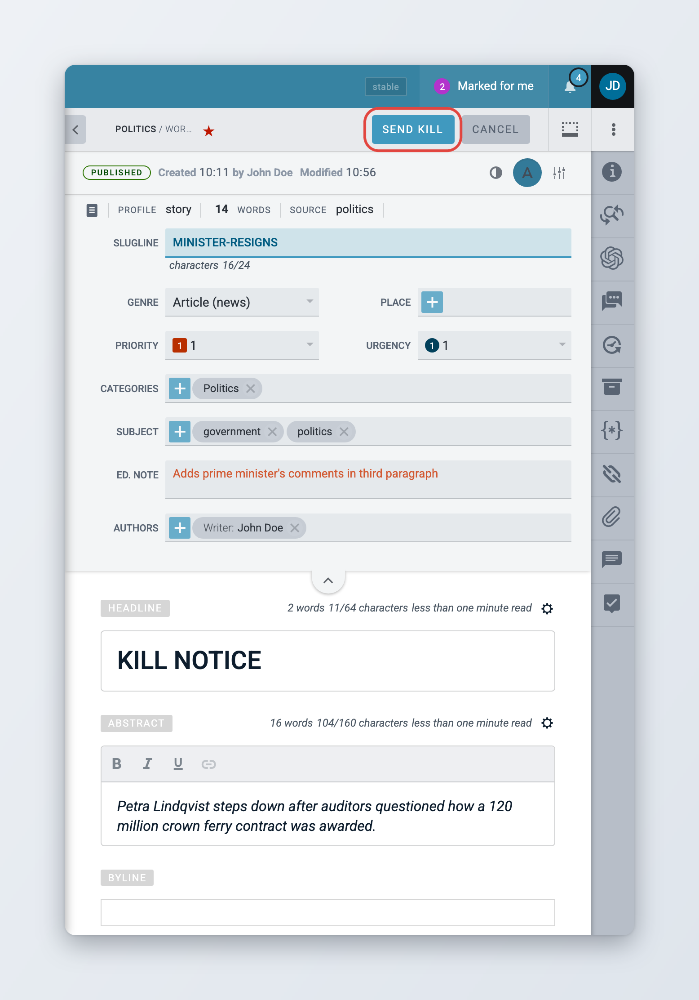
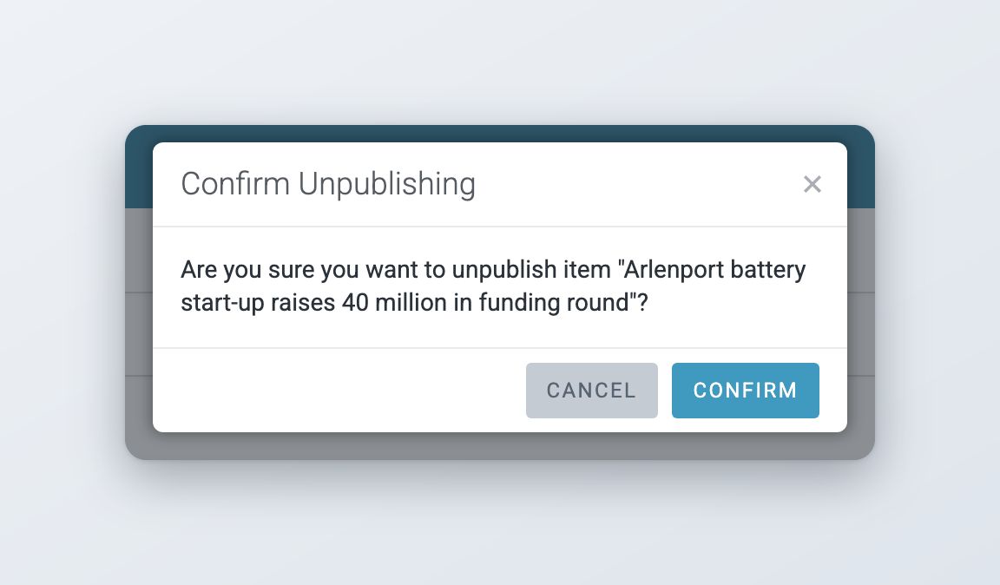
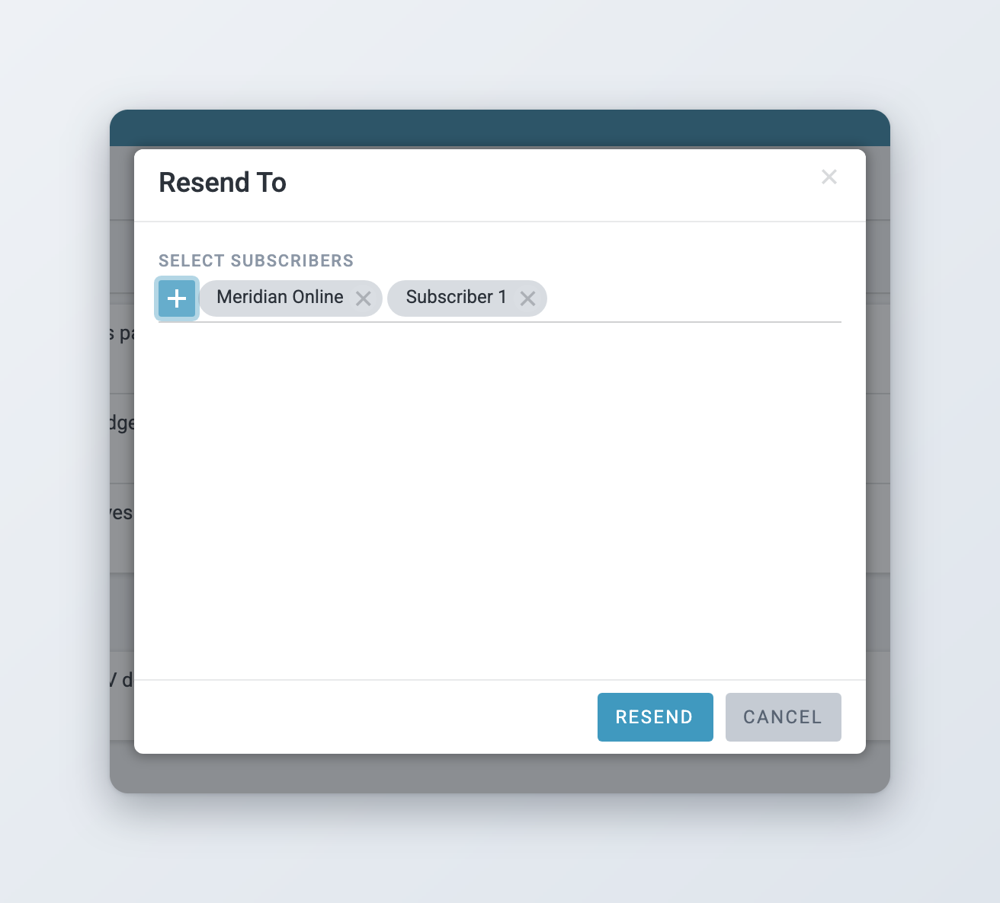

# Kills, takedowns and unpublishing

This page explains how to withdraw a published item from your subscribers, either for good with a kill or a takedown, or for now with an unpublish, and how to resend an item to subscribers who need it again.

## Killing an item

A kill tells subscribers to stop using an item and to remove it. Superdesk sends a kill notice in place of the item. Use it for legal problems, such as a court ordering that a story must not be published, or for serious errors that a correction can not fix.


A kill can not be undone. A killed item can not be updated, corrected or published again. If you may want to publish the item again later, use [Unpublish](#unpublishing-an-item) instead.




### Start the kill

Open the published item and click **Kill** in the top bar. Or, in a list, choose **Publishing actions** > **Kill item**.



### Check the kill notice

The item opens with the kill template applied. The headline and the body are replaced with the kill notice that your administrator set up (see [Kill and takedown templates](README.md#kill-and-takedown-templates)). Edit the text if your newsroom allows it, for example to give the reason for the kill.



### Send the kill

Click **Send Kill** in the top bar. To stop without killing the item, click **Cancel**.



<figure><figcaption>
Sending a kill notice
</figcaption></figure>

When you send the kill, Superdesk adds a first line to the body that identifies the original item: "Please kill story slugged *slugline* headlined *headline* ex *city* at *date and time*." Your kill notice follows it.

After the kill:

* The item has the **Killed** state and opens read-only. No further actions are offered.
* Superdesk sends the kill to every subscriber that received the item.
* Superdesk also emails the kill notice to the email addresses of all your subscribers, including inactive ones and those that never received the item.
* Any embargo or publish schedule on the item is removed.

You can not kill an item that is still part of a package, unless that package has itself been killed, taken down or unpublished. Superdesk shows "This item is in a package. It needs to be removed before the item can be killed". Remove the item from the package, or kill the package first.

Items that have moved to the archived collection can also be killed. In Search, select the **Archived** repository, open the item actions menu of the item and choose **Kill item**. A **Kill Item** window shows the kill notice. Click **Kill** to send it. This needs the **Archive Management** privilege as well as **Kill**, and works for text items only.

## Taking down an item

A takedown works like a kill. Use it when your agreements with subscribers call for a takedown instead of a kill.

The steps are the same as for a kill: click **Takedown** in the top bar, or choose **Publishing actions** > **Takedown item** in a list, check the notice and click **Send Takedown**. The differences are:

* Superdesk applies the takedown template instead of the kill template.
* The first line of the body reads "Please takedown story slugged ..." instead of "Please kill story slugged ...".
* The item gets the **Recalled** state instead of **Killed**.
* Subscribers receive a takedown instead of a kill, so their systems can handle the two differently.

Like a kill, a takedown is final, is also emailed to your subscribers, and is not possible while the item is in a package. Archived items can be taken down from Search with **Takedown item**.

## Unpublishing an item

Unpublish withdraws an item from subscribers without sending a kill notice, and without making the decision final. You can edit the item and publish it again later.



### Start unpublishing

Open the published item and click **Unpublish** in the top bar. Or, in a list, choose **Publishing actions** > **Unpublish**.



### Choose related items

Superdesk asks "Are you sure you want to unpublish item "*headline*"?". If other published items belong to the same story, for example duplicates, translations or published updates, they are listed under **Unpublish related items:**. Tick the ones you also want to unpublish.



### Confirm

Click **Confirm**. Superdesk shows "Item was unpublished successfully."



<figure><figcaption>
Confirming an unpublish
</figcaption></figure>

Superdesk sends a new version of the item with the status "unpublished" to every subscriber that received it. Subscribers' systems are expected to take the item down when they receive it.

The item gets the **Unpublished** state, leaves the desk output and appears again in the stage it was published from. To publish it again, open it for editing, make your changes, save it and publish it as usual. As soon as you save it, its state changes to **In Progress**.

If the item is part of a published package, it stays in the package with the **Unpublished** state, and Superdesk sends the package to subscribers again. Remove the item from the package yourself if it should no longer be there.

## Resending an item

Resend sends a published item again to subscribers you choose, without creating a new version. Use it when a subscriber missed the item or asks for it again.



### Start the resend

In a list, open the item actions menu of the published item and choose **Publishing actions** > **Resend item**.



### Choose the subscribers

The **Resend To** window opens. Under **Select Subscribers**, pick one or more subscribers.



### Resend

Click **Resend**. Superdesk shows "Item has been resent."



<figure><figcaption>
Resending an item to selected subscribers
</figcaption></figure>

You can only resend text items that are published, corrected or being corrected, and only the latest version. You can not resend a story that has already been updated. Resend the update instead.

To resend a single transmission to the subscriber it was meant for, administrators can also use the publish queue. See [Checking the publish queue](../sending-scheduling-and-publishing.md#checking-the-publish-queue).
