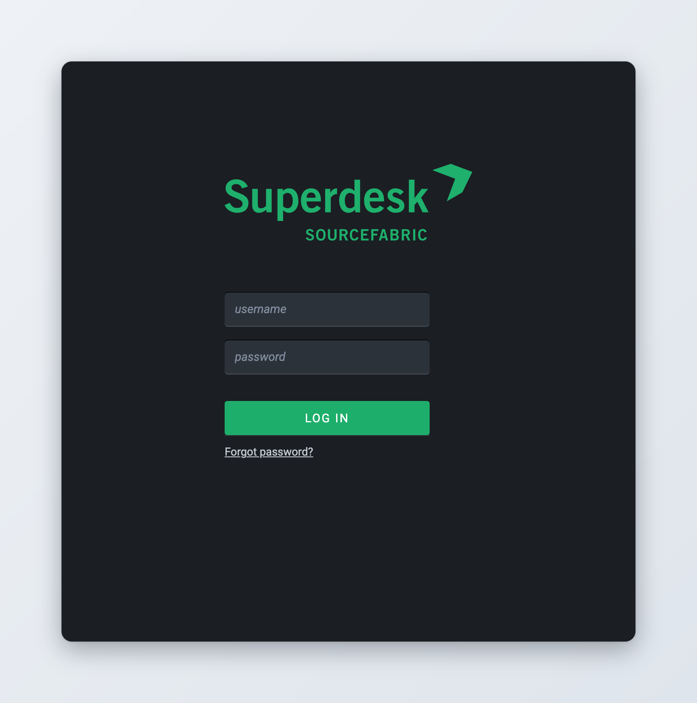
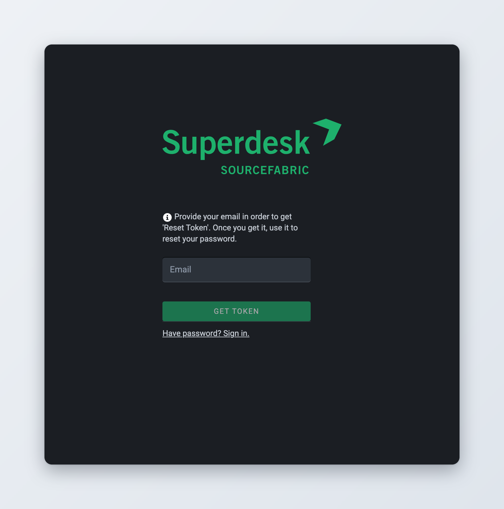
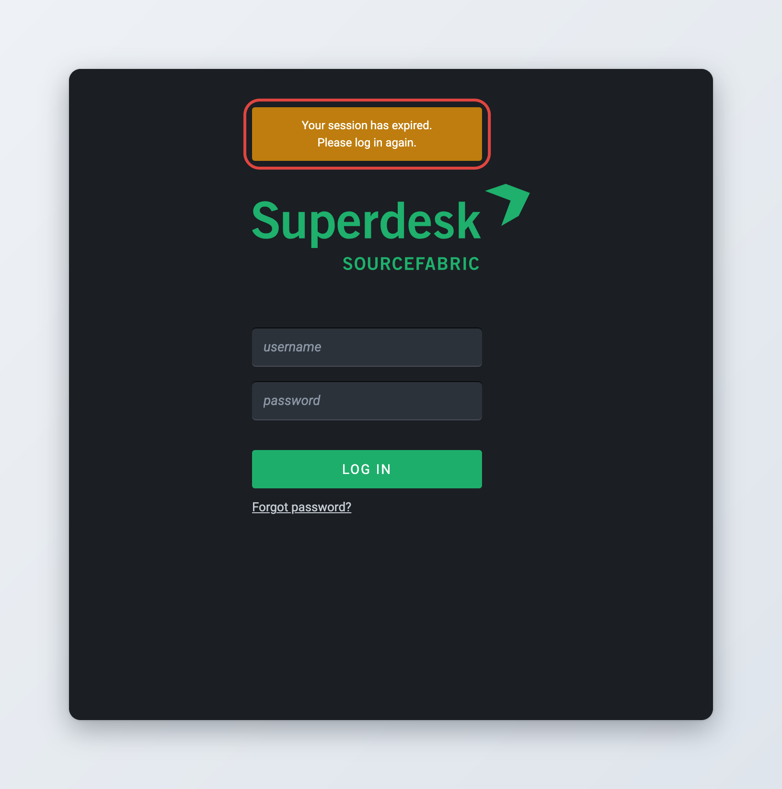
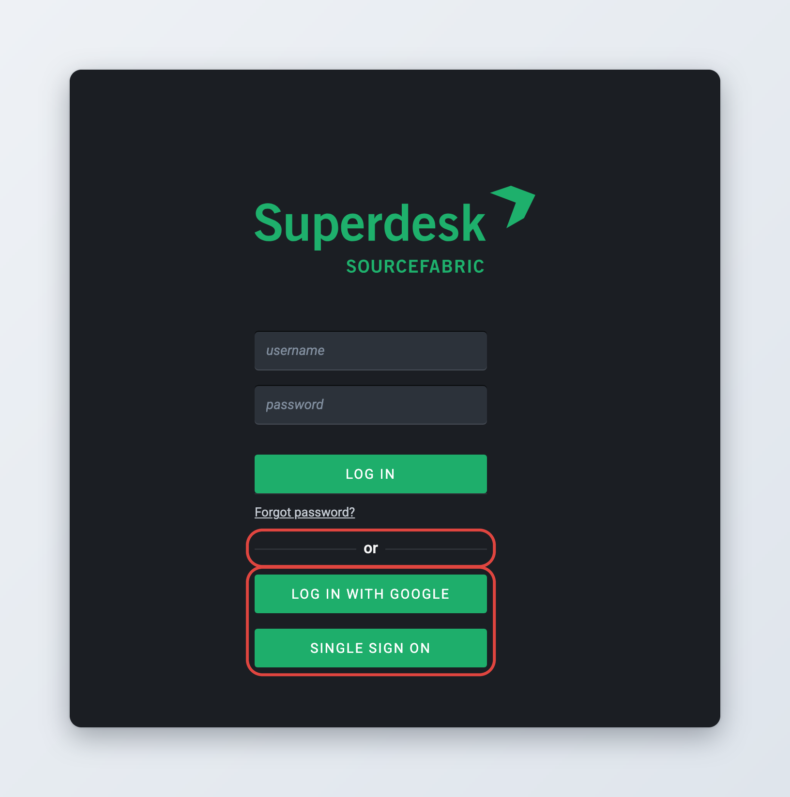

# Logging in and single sign-on

You open Superdesk in your web browser at the address your organisation gives you. Before you can work, you log in. Depending on how your Superdesk is set up, you log in with a Superdesk username and password, with your organisation's account (single sign-on), or with both options on the same page.

## Logging in with your username and password



### Open Superdesk

Go to your Superdesk address. The login page opens.



### Enter your details

Type your username in **username** and your password in **password**.



### Log in

Click **Log In**. Superdesk opens, with your default desk selected.



If your organisation connects Superdesk to its user directory (LDAP), use the same username and password as for your other work systems. In that case the **Forgot password?** link is not shown.

<figure><figcaption>
The login page
</figcaption></figure>

### If you cannot log in

The login page tells you what went wrong:

| Message | What it means |
| --- | --- |
| Oops! Invalid Username or Password. Please try again. | The username or the password is wrong. Check the spelling and that Caps Lock is off. |
| Sorry, but your account has been suspended. | Your account is disabled or inactive. Ask your administrator to turn it back on. |
| Sorry, user not found. | You signed in with your organisation's account, but Superdesk has no user with that email address. Ask your administrator to create your user. |
| Sorry, but can't reach the server now. Please try again later. | Superdesk is not responding. Wait a moment and try again. |

## Your first login

When an administrator creates your account, Superdesk sends you an email with a link. Open the link to set your password, then log in with your username and the new password. The link is valid for 7 days by default. If it has expired, use **Forgot password?** on the login page, or ask your administrator to send a new one.

If your organisation uses single sign-on, you may not get this email. Log in with your organisation's account instead.

## Forgot your password?



### Ask for a reset link

On the login page, click **Forgot password?**. Type the email address of your Superdesk account in **Email** and click **Get token**.



### Check your email

Superdesk shows "A link was sent to the specified email address." Open the email called "Reset password" and click the link in it. The link is valid for a limited time, one day by default.



### Set a new password

The link opens a page with two fields. Type your new password in **Enter new password** and again in **Confirm new password**. Click **Reset password**.



### Log in

Superdesk takes you back to the login page. Log in with your new password.



If the address is not known, Superdesk says "Oops! Invalid user Email." A reset link works only once and only for a limited time. If yours has expired or was already used, ask for a new one.

To go back to the login page without resetting your password, click **Have password? Sign in.**

<figure><figcaption>
Asking for a password reset link
</figcaption></figure>

An administrator can also send you a reset link from your user profile. You can change your password at any time while logged in, see [Your profile and preferences](../navigating-superdesk/your-profile-and-preferences.md#changing-your-password).

## When your password expires

Your organisation may require a new password after a set number of days. When yours has expired, the login page says "Your password has expired. Please change your password." Type a new password in **Enter new password** and **Confirm new password**, then click **Change password**. Log in again with the new password.

## When your session expires

Superdesk keeps you logged in while you work. If you do nothing for a while, your session ends. By default this happens after 4 hours without activity. Automatic refreshes of lists on your screen do not count as activity.

When your session has ended, the login page appears over your work with the message "Your session has expired. Please log in again." Log in and carry on.

When your session ends, Superdesk unlocks the items you had open for editing, so colleagues can work on them. For items that are not yet published, it first saves the changes it had autosaved for you. After you log in again, open the item again to carry on editing.

<figure><figcaption>
Logging in again after your session expired
</figcaption></figure>

## Single sign-on

With single sign-on you log in with the account you already use at your organisation, for example your Microsoft or Google work account. You do not need a separate Superdesk password. Your administrator decides which options you see. They appear under the password form, after the word "or".

Single sign-on only works if Superdesk has a user with the same email address as your organisation's account. Some installations create that user automatically the first time you log in.

<figure><figcaption>
Single sign-on buttons on the login page
</figcaption></figure>

### Your organisation's account (SAML, for example Microsoft Azure)

*Available since Superdesk 2.0.*



### Click the sign-on button

Click the single sign-on button. Its label is chosen by your administrator, for example **Single Sign On** or the name of your organisation. A new browser window opens.



### Sign in with your organisation

Sign in on your organisation's page, as you do for your email or other work tools. If you are already signed in there, this step may be skipped.



### Back in Superdesk

The window closes by itself and Superdesk opens.



If no window opens, your browser may be blocking pop-ups. Allow pop-ups for your Superdesk address and try again.

When you log in this way, Superdesk may update your name and email from your organisation's account.

### Google

Click **Log In with Google**. A new window opens with the Google sign-in page. Choose your account and sign in. The window closes and Superdesk opens.

## Login page language

*Available since Superdesk 3.1.*

The login page uses the interface language of the last person who signed out in your browser. If nobody has signed out in this browser yet, it uses the default language of your Superdesk. After you log in, Superdesk switches to the language set in your profile. To change your language, see [Your profile and preferences](../navigating-superdesk/your-profile-and-preferences.md#interface-language).

## Signing out

Click your avatar in the top-right corner and then **Sign out**. See [Your profile and preferences](../navigating-superdesk/your-profile-and-preferences.md#signing-out-and-sessions).

## For administrators

This section lists the server settings behind each login method. They are set in the server configuration or as environment variables. Changes need a server restart.

**Username and password** are on by default.

* `PASSWORD_EXPIRY_DAYS`: days after which users must change their password. `0` (the default) means passwords never expire.
* `RESET_PASSWORD_TOKEN_TIME_TO_LIVE` (environment variable `RESET_PASS_TTL`): days a password reset link stays valid. Default `1`.
* `ACTIVATE_ACCOUNT_TOKEN_TIME_TO_LIVE` (environment variable `ACTIVATE_TTL`): days the link in the new account email stays valid. Default `7`.
* Reset and account emails need a working mail server (`MAIL_SERVER`, `MAIL_PORT`, `MAIL_USERNAME`, `MAIL_PASSWORD` and related settings).

**Directory login (LDAP)**: set `LDAP_SERVER` and the other `LDAP_*` settings. Superdesk then checks usernames and passwords against the directory. The **Forgot password?** link and the **Change password** button disappear, because passwords are managed in the directory.

**Session timeout**: `SESSION_EXPIRY_MINUTES`, the minutes without activity after which a session ends. Default `240`.

**SAML (for example Microsoft Azure)**:

* Add `superdesk.auth.saml` to `INSTALLED_APPS` and set `SECRET_KEY`.
* Set `SAML_PATH` to the folder that holds the SAML `settings.json` and the certificates. Superdesk publishes its service provider metadata at `<server URL>/api/login/saml_metadata`.
* `SAML_LABEL`: the text of the login button. Default "Single Sign On".

**Google**: set `GOOGLE_CLIENT_ID` and `GOOGLE_CLIENT_SECRET`. The login button appears when both are set. In the Google API console, add `<server URL>/api/login/google_authorized` as an authorised redirect URI.

**Creating users on first single sign-on** (SAML): `USER_EXTERNAL_CREATE` turns it on, `USER_EXTERNAL_DESK` adds new users to a desk, and `USER_EXTERNAL_USERNAME_STRIP_DOMAIN` removes the domain from usernames. Without `USER_EXTERNAL_CREATE`, an administrator must create each user first, with the same email address as in the identity provider.

**Login page language**: when nobody has signed out in a browser yet, the login page uses `DEFAULT_LANGUAGE`. The languages users can pick come from the client setting `profileLanguages`.

To manage users, roles and their sessions, see [User Management and User Roles](../administration/user-management-and-user-roles.md).
