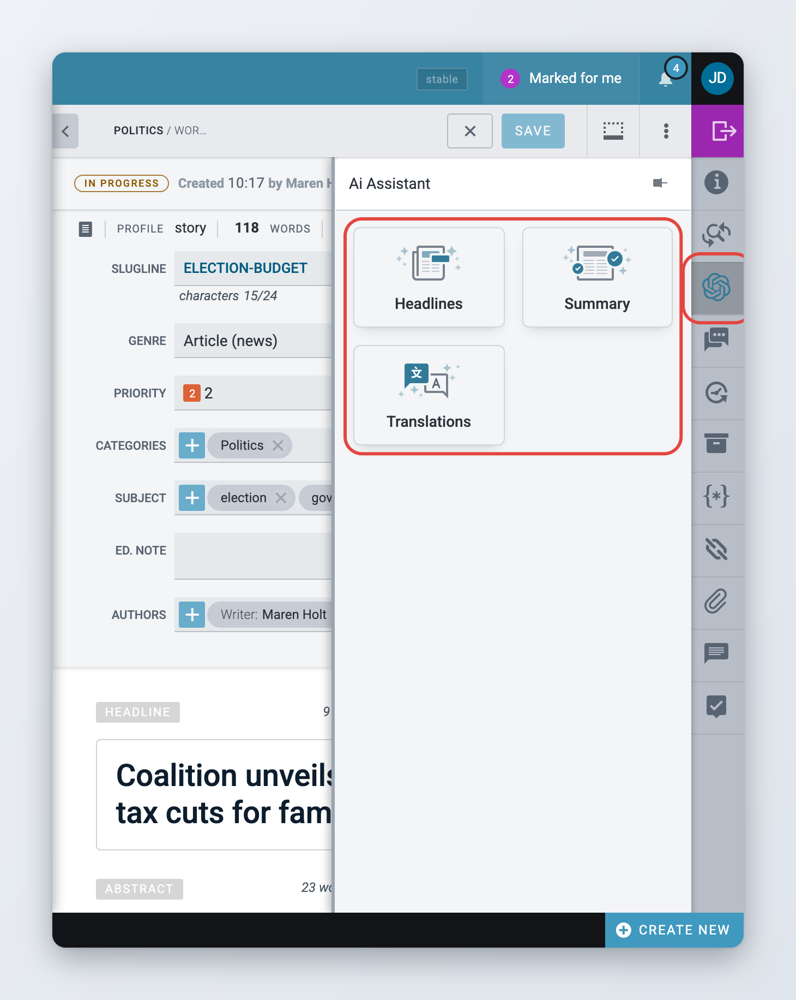
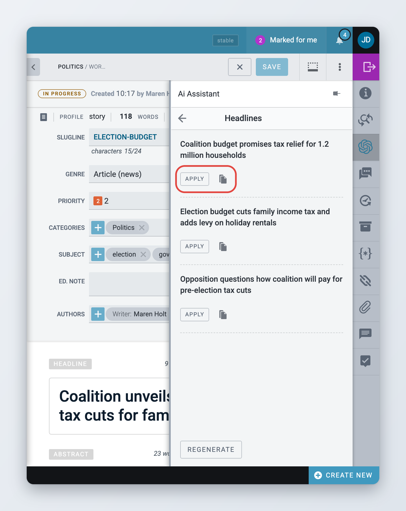
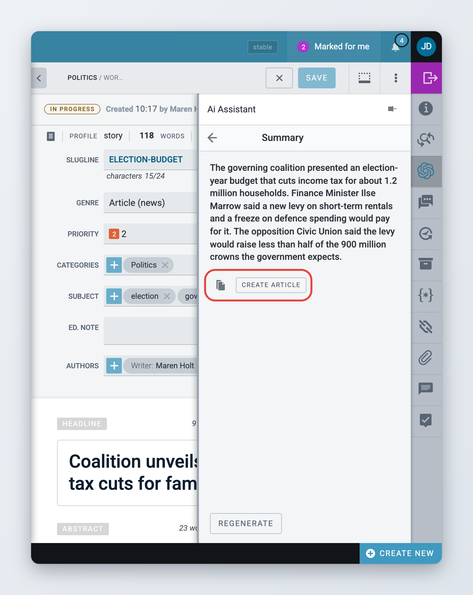
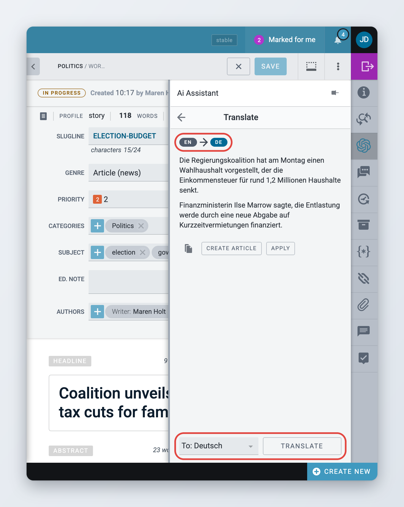
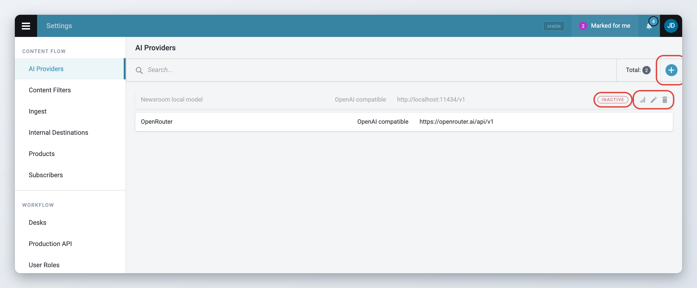
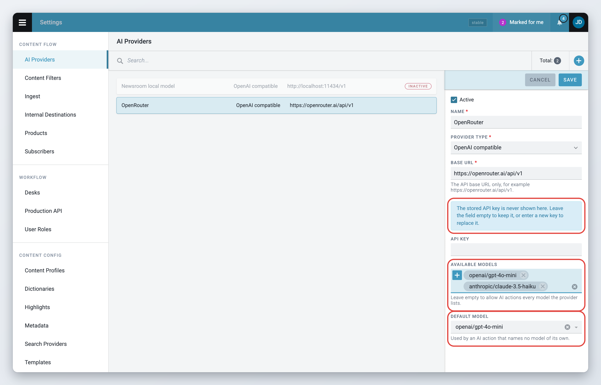

# AI features

Superdesk can use AI services to help you write and tag stories. This page explains the parts you can see in the interface:

* the **AI Assistant** widget, which suggests headlines, writes a short summary and translates an item,
* **iMatrics auto-tagging**, which suggests topics, people, organisations and places for an item, and can suggest images,
* the **AI Providers** settings page, where administrators store the connections to AI services.

The two widgets are optional modules. Your Superdesk may have one, both or neither. The AI Providers page is part of every Superdesk since 3.7, but only administrators see it.

| Feature | Who uses it | Optional module | Since |
| --- | --- | --- | --- |
| AI Assistant widget | Journalists and editors | Yes | 2.8 |
| iMatrics auto-tagging | Journalists and editors | Yes | 2.1 |
| AI Providers settings | Administrators | No | 3.7 |

AI suggestions can be wrong. Check every headline, summary, translation and tag before you publish.

## AI Assistant widget

*Available since Superdesk 2.8.*


This is an optional module. If you do not see it, ask your administrator.


The AI Assistant widget lives in the [widget bar](../content-management/creating-and-editing-content-items/metadata-and-fields.md#widgets), on the right of the item you are editing. It can do up to three things: suggest headlines, write a summary and translate the item. Your administrator decides which of them are available, so you may see fewer than three.

### Opening the AI Assistant



### Open the item

Open the item for editing.



### Open the widget

Click the **Ai Assistant** icon in the widget bar. Its tooltip reads "Ai Assistant".



### Pick a task

The widget shows one button per task: **Headlines**, **Summary** and **Translations**. Click the one you need.



To go back to the three buttons, click the back arrow at the top of the widget. While the widget stays open, it keeps each task's last result, so you can switch between tasks without losing it.

<figure><figcaption>
The AI Assistant widget with its three tasks
</figcaption></figure>

### Getting headline suggestions

Click **Headlines**. The assistant reads the item and shows a list of suggested headlines. This takes a few seconds.

For each suggestion you can:

* click **Apply** to replace the item's headline with it,
* click the copy icon to copy it to the clipboard, for example to use it in another field.

If you do not like any of them, click **Regenerate** at the bottom of the widget to get a new list. Applying a headline changes the item like any other edit, so save the item to keep it.

<figure><figcaption>
Headline suggestions with Apply and Copy
</figcaption></figure>

### Getting a summary

Click **Summary**. The assistant writes a short summary of the item.

You can then:

* click the copy icon to copy the summary, for example into the abstract,
* click **Create article** to start a new text item with the summary as its body. The new item opens for editing. It uses the same content profile as the item you started from and is created in the working stage of your current desk.

Click **Regenerate** to get a different summary.

<figure><figcaption>
A generated summary
</figcaption></figure>

### Translating an item

Click **Translations**. The widget is empty at first and asks you to choose a language.



### Choose the target language

Click the language field at the bottom of the widget. It reads **To:** followed by a language. Pick the language you want. The list shows the languages set up in your Superdesk.



### Translate

Click **Translate**. After a few seconds the translated body appears. Two labels above it show the source language and the target language.



### Use the translation

Choose what to do with it:

* **Create article** creates a translation of the item in the target language, with the AI translation as its body, and opens it for editing. It is linked to the original like any other translation.
* **Apply** replaces the body of the item you are editing with the translation.
* The copy icon copies the translation, with its formatting, to the clipboard.



The assistant translates the body only. The headline and the other fields keep their current text, so translate them yourself.

<figure><figcaption>
Translating an item with the AI Assistant
</figcaption></figure>

### AI translation from the Translate action

Your administrator can also connect the assistant to the regular **Translate** action in the item actions menu. When this is on, translating an item works like this:

1. You use **Translate** and pick a language, as described in [Translating content](../content-management/translating-content.md).
2. Superdesk creates the translation and opens it, with the AI Assistant pinned open on its translation task.
3. The assistant starts translating straight away. A notification says "Item Translated".
4. When the translation appears, click **Apply** to put it into the body of the new item, or copy it.

If you do not see the assistant open after you translate an item, this option is off in your Superdesk.

### When something goes wrong

If the AI service does not answer, the widget shows a message such as "There was an error when trying to generate headlines." Click **Regenerate** to try again. If the error keeps coming back, tell your administrator.

## iMatrics auto-tagging

*Available since Superdesk 2.1.*


This is an optional module. If you do not see it, ask your administrator.


iMatrics is an external tagging service. It reads the headline, abstract and body of a text item and suggests tags: topics and categories, people, organisations, places, events and objects. You decide which tags to keep. The tags you save are stored in the item's metadata, so they travel with the item when it is published and can be used in search.

The **iMatrics tagging** widget is only available for text items.

### Generating tags



### Open the widget

Open a text item for editing and click the **iMatrics tagging** icon (a tag) in the widget bar.



### Run the analysis

If the item has no iMatrics tags yet, the widget says "No tags yet". Click **Run** at the bottom. After a moment the suggested tags appear.



### Review the suggestions

The tags are grouped. Groups for topics, categories, events and objects come first. People, organisations and places follow, together in an entities group. Your administrator can rename and reorder the groups. Hover over a tag to see its description, aliases and source.



To run the analysis by itself whenever you open the widget on an item that has no tags yet, turn on **Run automatically**. This is a personal setting. It stays on for you until you turn it off.

### Accepting and changing tags

Suggested tags are not added to the item until you save them. While you have unsaved changes, **Save** and **Cancel** buttons appear at the top of the widget.

* **Remove a tag**: click it. If the tag has narrower tags under it, they are removed too.
* **Add a tag from iMatrics**: type in the search field above the tags and pick a result. Superdesk adds the tag together with its broader tags.
* **Add your own tag**: click the **+** button next to the search field. In the **Add entity** form, enter a **Name**, choose the **Entity type** (Organisation, Person or Place), optionally add a **Description**, and click **Add**.
* **Get new suggestions**: click **Refresh** at the bottom. iMatrics analyses the current text again and takes the tags you already have into account.

When you are happy with the list, click **Save**. The tags are written to the item at once. Click **Cancel** to throw away your changes and go back to the saved tags.

Saved tags are highlighted, so you can see at a glance which tags are already on the item.

Saving also sends the item and its final tags back to iMatrics, which uses this feedback to improve future suggestions (since 2.6).


If someone else is editing the item, the widget is read-only. You can see the tags but not change them.


The saved iMatrics tags are also shown, read-only, in an **iMatrics** row in the header of the item.

If iMatrics returns tags that it cannot place in its own hierarchy, a warning "iMatrics service error" appears above the tags with the number of tags that cannot be shown. Click **details** to see them.

### Image suggestions

*Available since Superdesk 2.7.*

iMatrics can also suggest pictures that match the item's tags. Turn on **Show image suggestions** in the widget. This is a personal setting, like **Run automatically**.

The suggestions appear below the tags, under **image suggestions** with the number of pictures found. Click a thumbnail to see it larger, with its caption. To use a picture, drag it into the body of the item. Its headline, caption, byline and source come with it when the service provides them.

The suggestions update a moment after you add or remove tags.

Image suggestions need a separate iMatrics image service. If the toggle shows no pictures, ask your administrator whether it is set up.

## For administrators

### Which parts are optional

| Part | How it is enabled | Privilege |
| --- | --- | --- |
| AI Assistant widget | Client extension `ai-widget`, plus code that connects it to an AI service | None |
| iMatrics auto-tagging | Client extension `auto-tagging-widget`, plus iMatrics server settings | None |
| AI Providers settings | Built in. The server module `superdesk.ai.module` is in the default `MODULES` | **AI Studio** |

Neither extension is in the default Superdesk build. Your technical team adds them to the `startApp` list in the client build (`client/index.ts` in the Superdesk host repository).

### Setting up the AI Assistant widget

Superdesk does not ship a backend for the AI Assistant widget. The client build has to load the `ai-widget` extension and call its `configure()` function with the code that talks to your AI service:

* `generateHeadlines` turns on **Headlines**,
* `generateSummary` turns on **Summary**,
* `translations.generateTranslations` turns on **Translations**,
* `translations.translateActionIntegration: true` connects the assistant to the **Translate** action, as described above.

Only the tasks you configure appear as buttons. If the extension is loaded without any of them, every user sees the error "You haven't registered any services for the Ai Assistant Widget!" when Superdesk starts, and the widget is not added.

The language list in **Translations** comes from the languages configured for your Superdesk. See [Translating content](../content-management/translating-content.md).

The AI Assistant widget does not use the providers stored on the AI Providers page. Each installation connects it to its AI service through `configure()`.

### AI providers

*Available since Superdesk 3.7.*

An AI provider is a stored connection to an AI service: its address, an API key and the models you allow. Superdesk supports one provider type, **OpenAI compatible**, which covers OpenAI and any service with the same API, such as gateways and locally hosted models.

The page is under **Settings** > **AI Providers**, in the **Content flow** group. You need the **AI Studio** privilege to see it.



### Open the page

Open the Main menu, go to **Settings** and click **AI Providers**.



### Add a provider

Click the **+** button in the page header. Fill in:

* **Active**: on by default. Turn it off to keep the provider without using it.
* **Name**: a name you recognise, for example the service name.
* **Provider type**: **OpenAI compatible**.
* **Base URL**: the API base address only, for example `https://openrouter.ai/api/v1`. Do not paste a full endpoint such as `.../chat/completions`.
* **API key**: the key from your AI service.
* **Default model**: optional, the model to use when nothing else names one. Type its id, for example `gpt-4o-mini`.

Click **Save**.



### Test the connection

Hover over the provider in the list and click the **Test connection** icon. A notification says "Connection successful. Models available: N." or "Connection failed:" followed by the reason.



### Choose the models

Click the edit (pencil) icon on the provider. Now that the key is stored, Superdesk asks the service for its models:

* **Available models**: pick the models AI actions may use. Leave it empty to allow every model the service offers.
* **Default model**: pick it from the full list of the service's models.

Click **Save**.



The stored API key is never shown again. When you edit a provider, the **API key** field is empty: leave it empty to keep the stored key, or type a new one to replace it. If the service cannot be reached while you edit, **Default model** becomes a text field and **Available models** is read-only, so you can still change the other fields.

Inactive providers are marked **Inactive** in the list. To remove a provider, use the delete (bin) icon and confirm.

<figure><figcaption>
The AI Providers settings page
</figcaption></figure>

<figure><figcaption>
Editing a provider and choosing its models
</figcaption></figure>

The model fields mention AI actions. These are server-side AI tasks built on a provider. This version of Superdesk has no screen for them yet.


API keys are stored unencrypted, like ingest and search provider credentials. Anyone with **AI Studio** can point a provider at another address and have its key sent there. Give **AI Studio** only to people you already trust with the system's credentials.


Privileges, under **Settings** > **User Roles** > **Roles privileges**:

* **AI Studio** ("Manage AI providers and actions") shows the AI Providers page.
* **AI** ("Use AI actions") is for running AI actions. It has no visible effect in this version, because AI actions have no screen yet.

`AI_REQUEST_TIMEOUT` sets how many seconds Superdesk waits for a provider (default 60). The web server and proxy timeouts must be longer than this, otherwise users get a gateway error first.

### Setting up iMatrics

You need an iMatrics account. iMatrics sets up the concepts for your newsroom.

Server settings (in `settings.py` or as environment variables):

* `IMATRICS_BASE_URL`, `IMATRICS_USER` and `IMATRICS_KEY`: the address and credentials of your iMatrics service. All three are required.
* `IMATRICS_SUBJECT_SCHEME`: the id of the vocabulary that iMatrics topics are matched to, through their IPTC Media Topic codes. Without it, topics are saved as iMatrics tags that are not linked to any of your vocabularies.
* `IMATRICS_IMAGE_BASE_URL` and `IMATRICS_IMAGE_KEY`: the image search service. Needed for image suggestions only.

Client:

* Add the `auto-tagging-widget` extension to the `startApp` list.
* Optional: set `iMatricsFields` in the client configuration to rename and order the tag groups in the widget. It has two parts, `entities` (keys `organisation`, `person`, `place`) and `others` (tag schemes such as `mediatopic` and `imatrics_topic`, plus `event`, `object` and `entities`), each mapping a key to `{name, order}`.

To send published items to iMatrics as well, add a subscriber destination with the **iMatrics** format and the **imatrics** delivery type. See [Destinations](../administration/defining-publishing-in-superdesk/products-and-subscribers.md#destinations).

The iMatrics endpoints need no privilege beyond being logged in.

### Showing or hiding the widgets per content profile

Both widgets appear for every content profile by default. To hide one for a profile, go to **Settings** > **Content Profiles**, edit the profile, open the **Widgets** tab, untick **Ai Assistant** or **iMatrics tagging**, and save. See [Content profiles](../administration/content-configuration/content-profiles.md).
