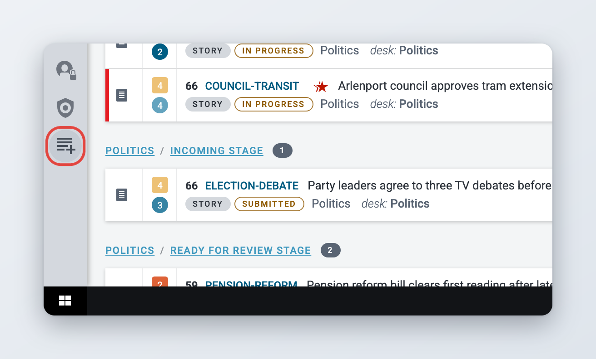
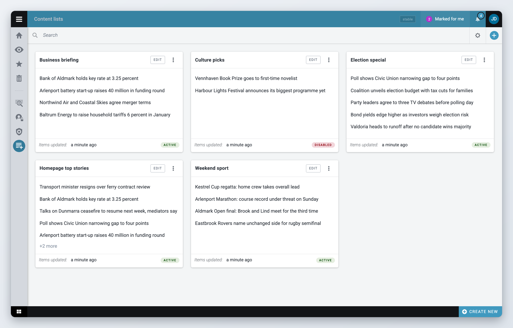
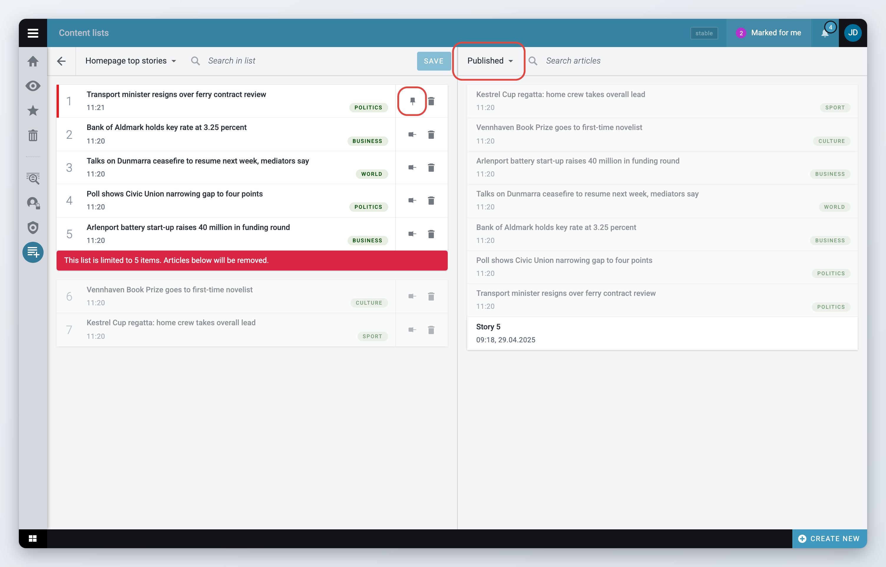
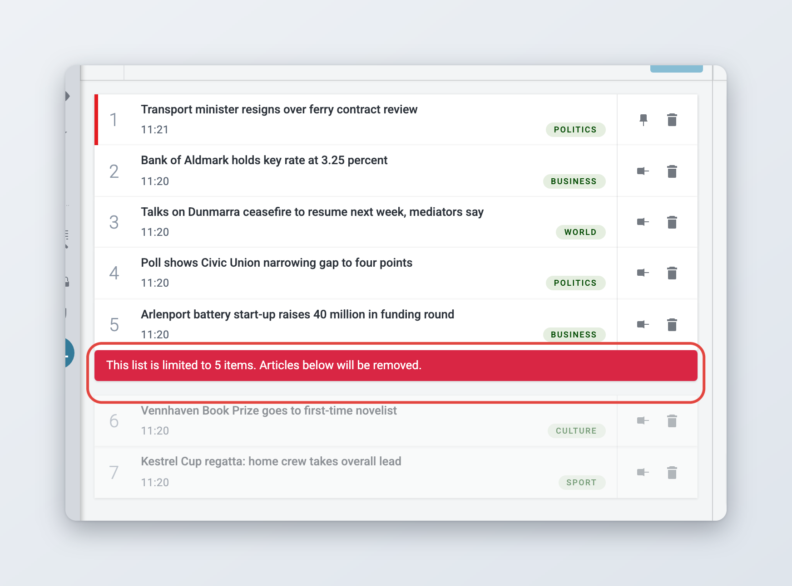
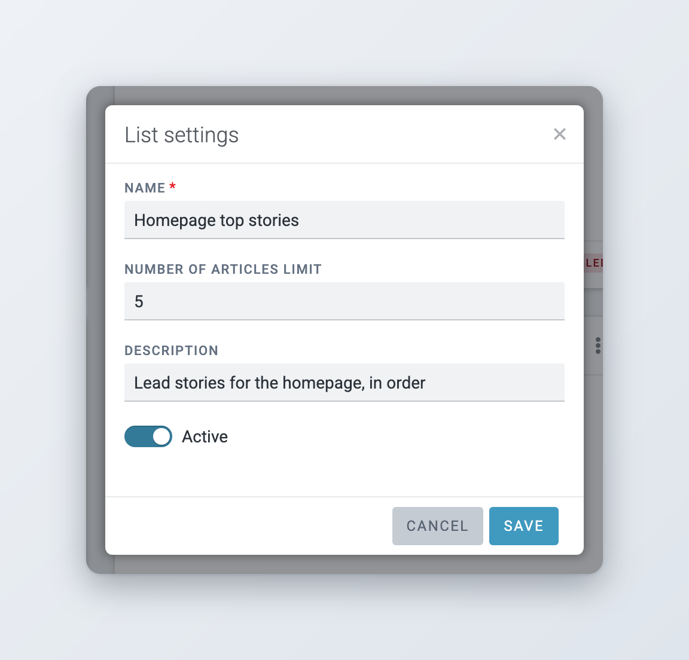
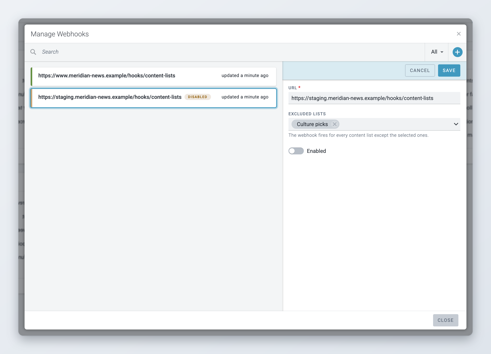
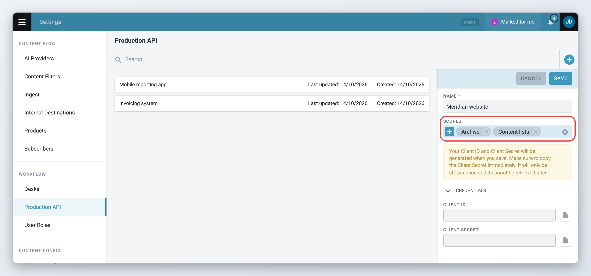

# Content lists

*Available since Superdesk 3.7.*


This is an optional module. If you do not see it, ask your administrator.


A content list is an ordered selection of articles that you curate by hand, for example the top stories on your homepage, a business briefing or the stories for an election special. You pick the articles, put them in the order you want, and pin the ones that must not move. Your website or app reads the list from Superdesk and shows the articles in that order.

Content lists do not change the articles themselves. An article can be in several lists at once, and it keeps its desk, stage and workflow status.

## Opening Content lists

Click the **Content lists** icon in the Workspace Panel on the left of the screen. See [Navigation](../navigating-superdesk/navigation.md) for the other icons in the Workspace Panel.

<figure><figcaption><p>The Content lists icon in the Workspace Panel</p></figcaption></figure>

You only see the icon if your role has the Content Lists privilege.

The page opens on an overview of all lists, one card per list, sorted by name. Each card shows:

* the list name,
* the first five article headlines, and how many more articles the list holds (for example "+3 more"),
* **Items updated**: when the articles in the list last changed,
* **active** or **disabled**, depending on whether the list is switched on for your website.

Type in the **Search** field at the top to show only the lists whose name contains your text.

<figure><figcaption><p>The Content lists overview: one card per list</p></figcaption></figure>


Superdesk creates and shows manual lists only: lists whose articles you choose yourself. The system also knows the list types "automatic" and "bucket", but there is no screen for them, and lists of those types do not appear on this page.


## Creating a list



### Start a new list

Click the **+** button at the top right of the overview. A new card with a **List name** field appears at the start of the grid.



### Name it

Type a name, then click the tick button to create the list. Click the cross to cancel.



### Add articles

Click **Edit** on the new card to open the list editor and add articles, as described below.



A new list is active straight away. Lists are shared: everyone with the Content Lists privilege sees and can edit every list.

## Adding articles to a list

Click **Edit** on a list card to open the list editor. The editor has two panes:

* on the left, the articles in the list, numbered in the order the website shows them,
* on the right, the article picker, where you find articles to add.

<figure><figcaption><p>The list editor: the list on the left, the article picker on the right</p></figcaption></figure>



### Choose where to look

Click the source button at the top of the picker and choose:

* **Published**: published and corrected articles. This is the default.
* **Scheduled**: articles scheduled to publish later.
* **In progress**: articles with the status In progress. Articles in other unpublished states, for example ones sent to another desk, are not offered.

The newest articles come first. Scroll down to load more.



### Find the article

Type in **Search articles** to narrow the results. The picker only shows text articles. Pictures, videos and packages cannot be added.



### Drag it into the list

Drag the article from the picker and drop it where you want it in the list. Articles that are already in the list are dimmed in the picker and cannot be dragged again.



### Save

Click **Save** at the top of the list. Superdesk confirms with "Content list saved." Nothing changes for your website until you save.



When the list is empty, the left pane says "Drag your articles here".

Each row shows the headline, the time the article was last changed (hover over it to see when it was created) and a label:

* for published articles, the article's category,
* for anything else, its status, for example **In progress**, **Scheduled**, **Killed** or **Recalled**.

The list always shows the current version of each article. If someone changes the headline or corrects the story, the list shows the change without you doing anything. If an article is killed or recalled, it stays in the list with a **Killed** or **Recalled** label until you remove it. If an article no longer exists in Superdesk, its row reads "Article no longer available".

An update of a published story is a new item. The list keeps pointing at the story you added. To show the update instead, add it and remove the older story.

## Ordering articles

Drag an article up or down in the list to change its position, then click **Save**.

You cannot drag while the **Search in list** field at the top of the list has text in it. Clear the search first. The search only hides rows on your screen, it does not change the list.

## Pinning articles

Pin an article to keep it at a fixed position, for example the lead story at number 1.



### Move the article into place

Drag the article to the position it should keep.



### Pin it

Click the pin button on the right of the row. The pin turns to show the article is pinned, and the button now reads **Unpin**.



### Save

Click **Save**.



A pinned article cannot be dragged. When you add, move or remove other articles, they move around it, and the pinned article keeps its number. If you drag an article onto a pinned position, it lands on the nearest free position past the pinned articles, in the direction you dragged. To move a pinned article, unpin it first.

## Removing articles

Click the bin button on the right of the row, then click **Save**. Removing an article from a list does not change or delete the article.

## Limiting the number of articles

You can set how many articles a list should hold in the list settings (see the next section). When the list has more articles than the limit, the editor shows a warning after the last article that fits: "This list is limited to 5 items. Articles below will be removed." The articles below the warning are dimmed, but Superdesk does not remove them yet: the list keeps every article when you save, and your website receives the limit together with the full list.

<figure><figcaption><p>Articles past the limit are dimmed below the warning</p></figcaption></figure>


## List settings

To change a list's settings, open the actions menu (the three dots) on its card and choose **Settings**.

<figure><figcaption><p>The List settings window</p></figcaption></figure>

* **Name**: required.
* **Number of articles limit**: the maximum number of articles. Leave it empty for no limit.
* **Description**: a note for your colleagues about what the list is for.
* **Active**: turn this off to take the list off your website without deleting it. The card then shows **disabled**.

Click **Save** to apply the changes.

## Deleting a list

Open the actions menu (the three dots) on the card, choose **Remove**, and confirm. The list and its order are deleted. The articles themselves are not.

## Switching between lists

In the list editor, click the list name at the top to jump to another list. Click **Back to content lists** to return to the overview.

If you have unsaved changes, Superdesk asks "There are unsaved changes which will be lost. Continue?" before it leaves the list. It asks the same when you click another icon in the Workspace Panel or use the browser's back button. If you reload or close the browser tab, the browser shows its own warning instead.

## Working on the same list as someone else

Lists update on your screen when someone else saves a change, as long as you have no unsaved changes of your own. If a colleague saves the same list while you are editing it, your save fails with "Cannot save. The list has been modified by another user." Superdesk then reloads the list with their changes. Make your changes again and save.

## How lists reach your website

Your website or app reads content lists from Superdesk through the [Production API](superdesk-api.md). It gets the active lists and, for each list, its articles in order, with the headline, status, thumbnail, category, subjects and dates. A developer sets this up once. You do not need to do anything after saving a list.

Superdesk can also notify your website the moment a list changes, so the site does not have to keep asking. This is done with webhooks.

### Webhooks

A webhook is a web address on your website that Superdesk calls when a list is created, its settings change, its articles are saved, or it is deleted. Your web developer gives you the address.



### Open the webhooks window

On the Content lists overview, click the settings button (the gear) at the top right and choose **Webhooks**. The **Manage Webhooks** window opens.



### Add a webhook

Click the **+** button. A panel opens on the right.



### Fill it in

* **URL**: the address to call. It must start with `http://` or `https://`.
* **Excluded lists**: lists that should not trigger this webhook. The webhook fires for every list except the ones you pick here.
* **Enabled**: turn it off to pause the webhook without deleting it.



### Save

Click **Save**. The webhook appears in the list.



<figure><figcaption><p>The Manage Webhooks window</p></figcaption></figure>

To change a webhook, click it. To delete it, open its actions menu (the three dots) and choose **Remove**. Use the search field to find a webhook by its address, and the filter button to show **All**, **Enabled** or **Disabled** webhooks. Disabled webhooks are labelled **Disabled**.

A webhook is not called when someone edits an article that is in a list. Your website sees such changes the next time it reads the list.

## For administrators

This section is for administrators.

### Enabling Content lists

Content lists has two parts:

* The server part is in superdesk-core and is loaded by default (`apps.content_lists.module` in `MODULES`). It adds the lists, their items and webhooks, and the Content Lists privilege.
* The user interface is the `content-lists` client extension (`superdesk-client-core/scripts/extensions/content-lists`). It is not in the default client build. Add it to the extensions passed to `startApp` in your client's `index.ts`, then rebuild the client.

```ts
{
    id: 'content-lists',
    load: () => import('superdesk-core/scripts/extensions/content-lists'),
},
```

The extension has its own dependencies. The client build (`npm run build`) installs them for you.

### Privileges

Give the **Content Lists** privilege ("Manage content lists") to every role that curates lists. Go to **Settings** > **User Roles**, select the **Roles privileges** tab, and tick **Content Lists**. Users without it do not see the Content lists icon and cannot see or manage webhooks. The privilege does not protect the lists themselves on the server: any logged-in user can read and change them through the internal API. Users may need to log out and back in after the change. See [User Management and User Roles](../administration/user-management-and-user-roles.md).

### Giving your website access

The website reads lists through the Production API with a client that has the **Content lists** scope.



### Open Production API settings

Open the Main menu and go to **Settings** > **Production API**. You need the **Auth Server Clients** privilege.



### Create or edit a client

Add a client, or open the website's existing client. In **Scopes**, select **Content lists**, then save. Copy the client secret when Superdesk shows it, because it is only shown once.



<figure><figcaption><p>The Content lists scope on a Production API client</p></figcaption></figure>

With that scope the client can read:

* `GET /prodapi/v1/content_lists`: the lists, sorted by name. Only active lists are returned unless you add `?enabled=false` (inactive only) or `?enabled=all`.
* `GET /prodapi/v1/content_lists/<list id>/items`: the articles of one list, sorted by position, each with an `article_content` summary (headline, status, thumbnail, category, subjects, created, updated and first published dates). This works for inactive lists too.

Lists of type `automatic` and `bucket` are returned by the Production API as well, but they can only be created through the API and nothing in Superdesk fills them. The `filters` and `cache_life_time` fields are not returned.

### Webhook calls

For each enabled webhook that does not exclude the list, Superdesk sends a `POST` with a JSON body such as `{"event": "content_list:items_updated", "list_id": "<list id>"}`. The events are `content_list:created`, `content_list:updated` (settings changed), `content_list:items_updated` (articles saved) and `content_list:deleted`. The body carries no articles: the website reads the list through the Production API when it gets the call. Calls are sent in the background by a Celery worker. A failed call is retried up to three times, one minute apart, and then dropped with an error in the logs. Webhook addresses may contain tokens, so only users with the Content Lists privilege can see them.
