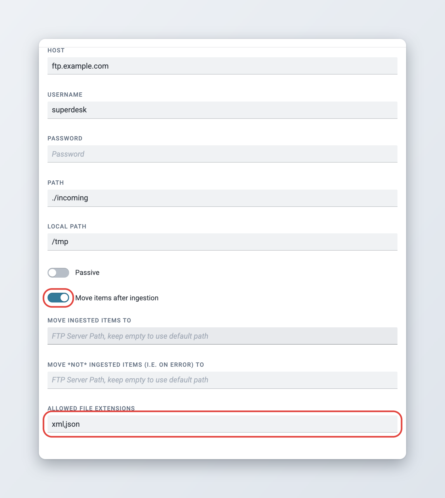
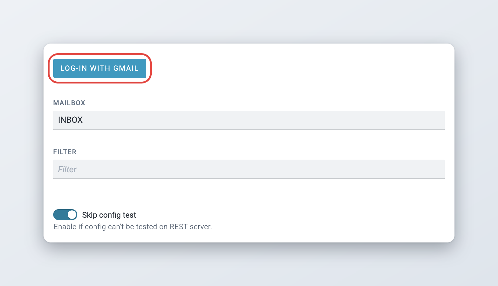
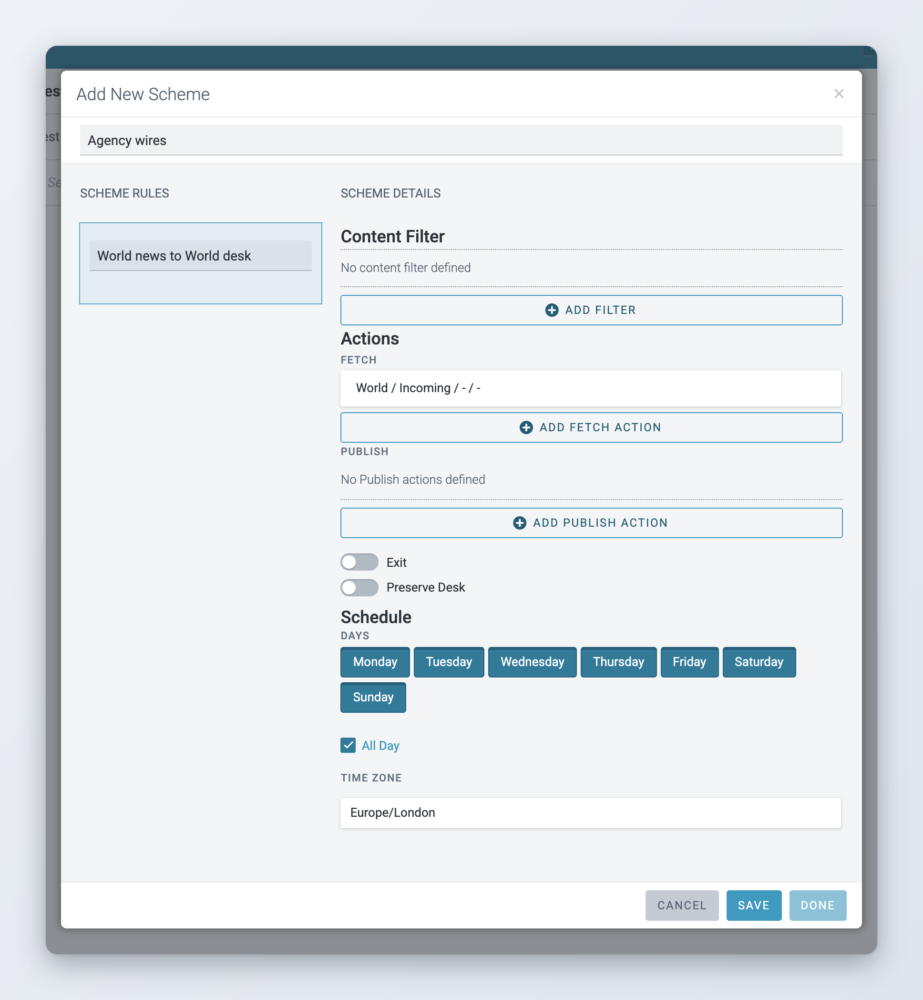

# Ingesting News Items and Events

Ingested news items are news items that arrive in Superdesk from outside sources. New ingest sources are configured in the Main menu at **Settings** > **Ingest**. You need the **Ingest Channels** privilege.

Ingest is the way in which articles from other news sources arrive in Superdesk. This section of the Settings menu allows you to configure the sources of your external news content. It is also where the Planning component's ingested events and planning items are configured. Read more about the [Superdesk Planning Component](../superdesk-planning-component/README.md).

The **Ingest** settings page has three tabs: **Ingest Sources**, **Ingest Rule sets** and **Ingest Routing**.

Each ingest source combines a **feeding service** (how Superdesk reaches the content: FTP, email, an agency API and so on) with a **feed parser** (the format the content is in). So first find out how Superdesk can access the content, then which format it is in.

## Creating New Ingest Sources

To add a new source to ingest from, click **Add New** in the upper-right corner of the **Ingest Sources** tab. The **Add New Source** window has three tabs: **General**, **Notification** and **Critical Errors**.

Fields on the **General** tab:

* **Active** / **Closed**: the switch at the top sets the status of the ingest source. If the source is active, Superdesk ingests from it. If it is closed, Superdesk does not ingest any further content from it. Closed sources are saved and can be reopened later.
* **Provider Name**: the name of the entity providing you with this feed. It must be unique. It is not used for any type of authentication and is only a label within Superdesk.
* **Source Name**: similar to provider name, but this is what content ingested from this source is tagged with, in the **Source** field of the article metadata. Several sources can share the same Source Name, so you can search for all their items at once.

* **Feeding Service**: how Superdesk gets the content. See [Feeding services](#feeding-services). The settings of the chosen service appear further down the form.
* **Feed Parser**: the format Superdesk should expect. See [Feed parsers](#feed-parsers). Some feeding services always use the same parser, or none (RSS/Atom). Then the field is not shown.

*   **Article Type(s)**: the buttons select which types of content Superdesk ingests from this feed: text, picture, graphic, composite (packages), video and audio. When the Planning component is installed, there are also buttons for events and planning items.

    For example, you could ingest only text articles and ignore pictures and packages from a particular source. Selected types are highlighted.
* **Update every**: how often, in minutes and seconds, Superdesk checks the source for new content.
* **Notify when idle for more than**: if the source sends no new content for this many hours and minutes, administrators get a notification that the source "has gone strangely quiet".
* **Content Expiry**: how long ingested items stay in Ingest if nobody fetches them. Items older than this are also not ingested at all. When the switch is off, the system default for ingested items applies (**Using System default**). See [Content expiry](../administration/defining-publishing-in-superdesk/publish-queue-legal-archive-and-content-expiry.md#content-expiry).

    This keeps your newsroom working with current news only. If you change the expiry of an existing source, items that are already in Ingest keep their old expiry.
* **Allow Remove Ingested Items**: with this enabled, users with the right privileges can remove ingested items that have not been fetched to a desk.
* **Disable Item Updates**: when on, Superdesk ingests each item only once. If the provider sends a new version of an item that is already in Superdesk, the new version is ignored (since 2.6).
* The settings of the feeding service, for example a host and credentials. When you save, Superdesk tests the connection. Switch on **Skip config test** if the source can not be tested this way.
* **Ruleset**: which Rule Set, if any, to apply to the items on ingest. Rule Sets change the text of ingested articles between the source and Superdesk. See [Creating New Ingest Rule Sets](#creating-new-ingest-rule-sets).
* **Routing Scheme**: with a routing scheme, you can tell Superdesk to fetch items to a specific desk and stage, or even publish them right after ingest. See [Creating New Ingest Routing](#creating-new-ingest-routing).

On the **Notification** tab, choose which events about this source notify administrators: **Update** (the source settings were changed), **Close**, **Open** and **Error**. All four are on by default.

On the **Critical Errors** tab, switch on the errors of this feeding service that should be treated as critical.

## Feeding services

The **Feeding Service** list shows the services installed on your server. A standard installation with the Planning component has these:

**General services**

* **RSS/Atom**: ingests the items of an RSS or Atom feed. Enter the feed URL in **Host**, and credentials if the feed needs them. **Content Field Aliases** map a field of the feed to a different Superdesk field, for example when a feed's links are not in the usual element.
* **FTP feed**: monitors a folder on an FTP server. See [FTP ingest](#ftp-ingest).
* **File feed**: monitors a folder on the server Superdesk is installed on (**Server Folder**).
* **Email**: reads messages from a mailbox over IMAP. Fill in the email server, port, user, password and mailbox. **Filter** takes an IMAP search, for example `UNSEEN` or `FROM "desk@example.com"`. When it is empty, Superdesk reads the unread messages. The subject, body and attached images of the messages are ingested. Other attachments are not.
* **Gmail**: reads messages from a Gmail mailbox. See [Gmail ingest](#gmail-ingest).

**News agency services**

* **AP feed API** and **AP Media API**: Associated Press.
* **Reuters feed API**: Reuters.
* **Ritzau feed API**: Ritzau.
* **BBC Local Democracy Reporter Service**: the BBC Local Democracy Reporting Service.

**Event and planning services** (Planning component)

* **Event file feed**, **Event HTTP feed** and **Event email**: ingest events from a server folder, a URL or a mailbox.
* **Onclusive api feed**: ingests events from the Onclusive API.

Your server may have more services added by its own configuration.

## Feed parsers

The **Feed Parser** list shows the parsers installed on your server. A standard installation has these:

**Standard formats**

* **News ML 1.2 Parser** and **News ML 2.0 Parser** (NewsML-G2)
* **NITF Parser**
* **NINJS Feed Parser**
* **IPTC 7901 Parser** and **anpa1312** (ANPA 1312)
* **EMail RFC822 Parser**: used by the Email and Gmail services
* **Image (IPTC metadata)**: JPEG pictures, with their metadata read from the IPTC fields. See [FTP ingest](#ftp-ingest).
* **Wordpress WXR parser**: WordPress export files

**News agency variants**

* AFP: **AFP News ML 1.2 Parser** and **AFP News ML New Parser** (since 2.9).
* DPA: **DPA IPTC 7901 Parser** and **DPA News ML Parser** (since 2.9).
* PA Media: **PA NITF** and **PA Parser** (since 2.10).
* Associated Press: **AP ANPA Parser** and **AP Media API**.
* Others: **ANA NewsML Parser**, **BBC NINJS Variant Parser**, **EFE NITF**, **Ritzau feed**, **Scoop Media News ML-G2 Parser**, **STT NewsML** and **WENN Parser**.

**Events and planning** (Planning component)

* **iCalendar v2.0**: ICS calendar files
* **Events ML**: events in NewsML-G2 EventsML
* **Json Event**: events in Superdesk's JSON event format
* **Planning ML**: planning items
* **Onclusive API**: used with the Onclusive api feed

## FTP ingest

Choose **FTP feed** as the feeding service and fill in:

* **Host**: the FTP server URL (required).
* **Username** and **Password**.
* **Path**: the folder on the FTP server. It usually starts with `./` or `/` and has no `/` at the end.
* **Local Path**: a working folder on the Superdesk server, typically `/tmp` (required).
* **Passive**: use passive FTP mode. On by default.
* **Move items after ingestion**: see below.
* **Allowed file extensions**: see below.

<figure><figcaption>
FTP feed settings
</figcaption></figure>

### Moving files after ingest

It is best to move ingested files out of the source folder. Switch on **Move items after ingestion**. Two more fields appear:

* **Move ingested items to**: the folder for files that were ingested.
* **Move *NOT* ingested items (i.e. on error) to**: the folder for files that could not be ingested.

Leave them empty to use the default folders: `_PROCESSED` for ingested files and `_ERROR` for failed ones, inside the source folder. A custom folder must be an absolute path on the FTP server, for example `/original_ingest_folder/OK_folder`.

### Allowed file extensions

*Available since Superdesk 2.8.*

**Allowed file extensions** limits which files Superdesk picks up, for example `xml,json`. Separate the extensions with commas. When the field is empty, the parser decides: most parsers take `.xml` and `.json` files, and the **Image (IPTC metadata)** parser takes JPEG files.

### Ingesting photos with IPTC metadata

To ingest photos from an FTP folder, choose the **Image (IPTC metadata)** feed parser and select the picture article type. Superdesk creates a picture item for each JPEG file and fills its metadata from the photo's IPTC fields:

| IPTC field | Superdesk field |
| --- | --- |
| Headline | Headline |
| By-line | Byline |
| Object Name | Slugline |
| Caption/Abstract | Description |
| Keywords | Keywords |
| Special Instructions | Ed. Note |
| Copyright Notice | Copyright notice |
| Original Transmission Reference | Assignment ID |

The Original Transmission Reference is stored as the ID of a Planning assignment on the picture item, so once the photo is fetched it is listed as content of that assignment.

## Gmail ingest

The **Gmail** feeding service reads a Gmail mailbox. It does not use a login and password. You connect the mailbox with your Google account instead.


Gmail ingest only works if Google sign-in is configured on your Superdesk server. If the log-in step fails, ask your system administrator.




### Create the source

Click **Add New**, fill in **Provider Name** and **Source Name**, and choose **Gmail** as the **Feeding Service**. Leave **Mailbox** as `INBOX` or enter another Gmail folder. **Filter** works as for the Email service.



### Save

Click **Save**. The **Connect an account** window opens.



### Log in with Google

Click **Log-in with GMail**, or click **Close** and do it later from the source's edit form. Google opens. Choose the account and allow Superdesk to read its email.



### Check the connection

Back in Superdesk, the source shows the connected address in the **email** field and a **Log-out** button. Click **Save**.



<figure><figcaption>
Connecting a Gmail mailbox
</figcaption></figure>

### Routing by Gmail label

*Available since Superdesk 2.4.*

Superdesk reads the Gmail labels of each message and stores them on the ingested item. This lets one newsroom address feed several desks: senders, or a Gmail rule, put a label on each message, and a routing scheme sends the item to the desk for that label.

The labels are stored as values of a vocabulary with the ID `gmail_label`. To use them:

1. In **Settings** > **Metadata**, on the **Vocabularies** tab, click **Add New** and create a vocabulary with the ID `gmail_label`. Click **Add Item** for each label you route on, and enter the label name exactly as it is in Gmail as the item's **QCode**. To show the labels on ingested items, also add this vocabulary to the content profile they use. See [Metadata and custom fields](../administration/content-configuration/metadata-and-custom-fields.md).
2. In **Settings** > **Content Filters**, create a filter condition. As **Field**, choose the vocabulary you created (it is listed by its name), set Operator `in` and pick the label as value. Then create a content filter that uses it. See [Make Content Filters](../administration/defining-publishing-in-superdesk/content-filters-and-internal-destinations.md#make-content-filters).
3. In **Settings** > **Ingest** > **Ingest Routing**, create a routing scheme with a rule that uses this content filter and fetches to the right desk and stage. Add one rule per label.
4. Select the routing scheme on the Gmail source.

## Ingesting events and planning items

*Available since Superdesk 2.6.*

When the Planning component is installed, ingest sources can also bring in events and planning items, for example from external calendars or agency event feeds.

To ingest events, create a source with one of the event feeding services (**Event file feed**, **Event HTTP feed**, **Event email** or **Onclusive api feed**). Choose the parser that matches the format, for example **iCalendar v2.0** for ICS files or **Events ML** for NewsML-G2 events, and select the events article type (or planning items for **Planning ML**). You can also ingest events from an FTP server with the **FTP feed** service and the **Json Event** parser.

Ingested events and planning items appear in the Planning component, not in the Ingest view. To post them automatically, or to add them to calendars or agendas, use a routing rule of the type **Autopost Planning**: see [Creating New Ingest Routing](#creating-new-ingest-routing).

For working with events and planning items, see [Superdesk Planning Component](../superdesk-planning-component/README.md).

## Creating New Ingest Rule Sets

Rule Sets are created on the **Ingest Rule sets** tab of the Ingest settings page. Click **Add New** in the top-right corner.

Give the Rule Set a name. Click **Add rule** and a new line appears with the fields **old** and **new**: they work as "find and replace". Enter your replacement and click **Save** at the bottom of the window. Upon ingest, Superdesk finds every occurrence of the old text in the body of the article and replaces it with the new text. The match must be exact: there are no wildcards. You can set up multiple rules inside a single Rule Set.

## Creating New Ingest Routing

With a routing scheme, you can tell Superdesk to fetch items to a specific desk and stage, run a macro on them, or even publish them right after ingest.

Routing schemes are created on the **Ingest Routing** tab of the Ingest settings page.



### Create the scheme

Click **Add New** in the top-right corner of the **Ingest Routing** tab and type a **Scheme name**. You can only add rules once the scheme has a name.



### Add a rule

Click the round **+** button (**Add Rule**) under **Scheme rules** and choose the rule type. **Desk Fetch/Publish** fetches or publishes ingested articles and media. With the Planning component installed there is also **Autopost Planning**, for events and planning items. Type a **Rule name**.



### Choose the content filter

Under **Content Filter**, click **Add filter** and pick a content filter. The rule only applies to items that match it. Without a filter, it applies to every item from the source.



### Set the actions

Under **Actions**, set what happens to matching items. See the list below.



### Set the schedule

Under **Schedule**, choose the **Days** on which the rule applies, and either **All Day** or a **Start Time (inclusive)** and **End Time (exclusive)**, with a time zone. For example, a rule can send urgent news to a different desk outside office hours.



### Save

Click **Save** to save the rule, add more rules if you need them, then click **Done**.



<figure><figcaption>
Editing a routing rule
</figcaption></figure>

Actions of a **Desk Fetch/Publish** rule:

* **Fetch**: click **Add Fetch action**, pick the **Desk**, **Stage** and optionally a **Macro**, and click **Add**. Matching items are fetched to that desk and stage, and the macro runs on them. Add several fetch actions to fetch the same item to several desks.
* **Publish**: click **Add Publish action**. It works like Fetch, but the item is also published from that desk. You can also limit it to some subscribers (**Select Subscribers**) and target types (**Target Types**). The item must pass the validation of the desk's content profile, so check that it has no required fields that ingested items leave empty.
* **Exit**: when on, Superdesk stops checking the next rules of the scheme once this rule matched.
* **Preserve Desk**: when on, an item that already has a desk set keeps it, instead of being fetched to the desk of this rule.

Actions of an **Autopost Planning** rule:

* **Post Items**: posts the ingested events and planning items automatically.
* **Calendars**: adds these calendars to ingested events.
* **Agendas**: adds these agendas to ingested planning items.

Superdesk checks the rules of a scheme in order, from the top. Drag a rule to change its place in the list. Click a rule to see a summary of its filter, actions and schedule.

To use the scheme, select it in the **Routing Scheme** field of an ingest source.

## Ingest Dashboard

The Ingest Dashboard is in the **Admin tools** section of the Main menu. You need the **Ingest Channels** privilege.

The Ingest Dashboard allows admins to monitor the status of the external news sources that provide news material to Superdesk.

Click **Add Sources** in the top-right corner of the Ingest Dashboard to choose which sources the dashboard shows.

Switching an ingest source on displays it on the Ingest Dashboard. Clicking the **Edit Ingest Sources** link at the bottom of the list takes you to the Ingest settings, described above.

When an ingest source is monitored on the Ingest Dashboard, it looks like the image above. Click the action menu at the top-left of the source to choose what the dashboard shows about it.

Customisable information is as follows:

* **Status**: whether the source is open or closed.
* **Number of items**: number of articles ingested from this source in the last 24 hours.
* **Time**: when the source was last updated and when the last item arrived.
* **Log Messages**: messages from the source. Choose **Show all messages** or **Show error messages**.

Clicking the **Edit Ingest Source** link at the bottom of the action menu takes you to the Ingest settings, described above.
