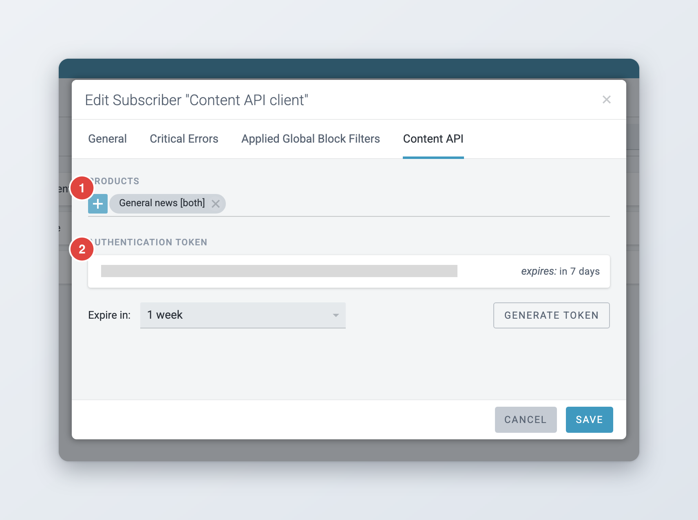
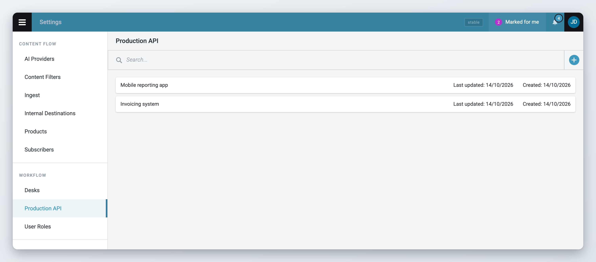
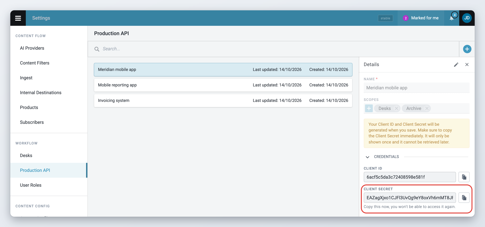

# Superdesk API

Superdesk has two APIs that other applications can use to read content:

* The **Content API** gives access to content that has been **published**. Websites, apps and partners use it to fetch the stories you publish to them.
* The **Production API** gives access to content that is **still in production**, before it is published, and to newsroom data such as desks, users, planning and availability. Internal tools use it, for example a mobile reporting app, an invoicing system or a custom delivery service.

Applications can only read through these APIs. They cannot change anything in Superdesk.

This page explains what each API is for and how administrators give an application access. It does not describe the endpoints. Developers will find the technical reference in the [developer documentation](#developer-documentation).


Both APIs run as separate services next to Superdesk. Whether they are running, and at which address, depends on your installation. Ask your administrator or your technical team.


## Content API

The Content API holds a copy of everything that Superdesk publishes to it. It keeps that copy in its own database, apart from the newsroom's working content. An application reads from the Content API with a token that belongs to a subscriber.

Content reaches the Content API through a subscriber, the same way it reaches any other destination. See [Products and Subscribers](../administration/defining-publishing-in-superdesk/products-and-subscribers.md).

### Giving an application access to the Content API

This is done by an administrator with the **Subscribers** privilege.



### Open the subscriber

Open the Main menu (also called the hamburger menu) and go to **Settings** > **Subscribers**. Open the subscriber that stands for the application, or create a new one. A subscriber that only uses the Content API does not need a destination.



### Choose the products

Open the **Content API** tab of the subscriber. Under **Products**, pick the products this application may read. Only products whose product type is **API** or **Both** are listed.



### Generate a token

Under **Authentication Token**, choose how long the token stays valid in **Expire in**: from one week to ten years, or **Never expire**. Click **Generate token**. The subscriber must be saved first, otherwise the button is disabled.



### Hand over the token

Click the copy icon next to the token and give it to the application's developers. The list shows when each token expires.



<figure><figcaption>
Products and tokens on the Content API tab of a subscriber
</figcaption></figure>

The tab lets you add up to five tokens per subscriber. To cut off an application, click the bin icon (**Revoke**) next to its token. The application can no longer read from the Content API with that token.

### Checking what is in the Content API

Users with the **Content API Search** privilege see **Content API Search** in the Main menu. It searches the content that has been published to the Content API, so you can check what an application can see.

## Production API

The Production API reads the same content and data that Superdesk works with, so applications see items while they are still being written and edited. It is versioned: an application built for it keeps working when Superdesk is upgraded.

What an application can read depends on the scopes of its key:

| Scope | What the application can read |
| --- | --- |
| **Archive** | Content items, including items that are not published yet, and their pictures and files |
| **Desks** | Desks and their stages |
| **Users** | Users, their availability and their publishing counts |
| **Contacts** | Contacts |
| **Planning** | Planning items |
| **Events** | Events |
| **Assignments** | Assignments |
| **Content lists** | Content lists and the items in them (since 3.7) |

Planning, Events and Assignments need the [Planning component](../superdesk-planning-component/README.md).

### What uses the Production API

Two parts of Superdesk are built to be read through the Production API:

* **Content lists.** Websites and apps read your content lists with a key that has the **Content lists** scope (since 3.7). See [Content lists](content-lists.md).
* **Availability.** An external system, such as an invoicing system, can read each user's daily availability and working hours, and how many items each user published (since 2.10). It needs a key with the **Users** scope. Only active users who have availability turned on are included. See [Availability Management](../availability-management/README.md) for how availability is recorded.

## Managing Production API keys

*Available since Superdesk 3.2.*

Each application that uses the Production API gets its own key, also called a client. A key has a name, a list of scopes, a **Client ID** and a **Client Secret**. The application uses the Client ID and the Client Secret to get an access token, then uses the token to read data.

To manage keys you need the **Auth Server Clients** privilege. Open the Main menu and go to **Settings** > **Production API**. The page lists the keys with the date each one was created and last updated.

<figure><figcaption>
Production API keys in Settings
</figcaption></figure>

### Creating a key



### Start a new key

Click the **+** button in the top-right corner of the page. A form opens on the right.



### Name the key and choose its scopes

Type a **Name** that says which application uses the key, for example "Mobile reporting app". Each name can only be used once. Under **Scopes**, pick what the application needs to read, and nothing more. You must pick at least one scope.



### Save

Click **Save**. Superdesk creates the **Client ID** and the **Client Secret** and shows them under **Credentials**.



### Copy the Client Secret now

Click the copy icon next to **Client Secret** and store the secret somewhere safe, or give it straight to the application's developers. Copy the **Client ID** as well.




Superdesk shows the Client Secret only once, right after you save a new key. It cannot show it again later. If you close the panel while the secret is on screen, Superdesk asks you to confirm with **Close anyway**. Click **Go back** if you still need to copy it.


<figure><figcaption>
A new key right after saving: copy the Client Secret now
</figcaption></figure>

### Changing or deleting a key

To change the name or the scopes of a key, hover over it in the list and click the pencil icon (**Edit**). Change the fields and click **Save**.

To delete a key, click the bin icon (**Delete**) and confirm with **Delete**. The application can no longer get new access tokens with that key.

If a Client Secret is lost, you cannot recover or reset it on this page. Create a new key with the same scopes, give it to the application, then delete the old key.

Changes to the scopes, and deleting a key, apply when the application next asks for an access token. An access token the application already has keeps working until it expires, after one day unless your installation sets another value.

## Developer documentation

The technical documentation for both APIs is written for developers:

* [Production API](https://superdesk.readthedocs.io/en/latest/production_api.html): endpoints and query examples.
* [Production API specification](https://github.com/superdesk/superdesk-core/blob/develop/specs/productionapi.yaml): the OpenAPI description of the Production API endpoints.
* [Authentication server](https://superdesk.readthedocs.io/en/latest/auth_server.html): how an application gets an access token with its Client ID and Client Secret.
* [Content API](https://superdesk.readthedocs.io/en/latest/contentapi.html): how the Content API is set up and run.
* [Content API reference](https://superdeskcontentapi.docs.apiary.io/): the Content API endpoints.
* [Superdesk ninjs schema](https://github.com/superdesk/superdesk-core/blob/develop/docs/superdesk-ninjs-schema.json): the JSON format of the items the Content API returns. The Production API returns items in the Superdesk item format instead.

## For administrators

* The Production API and the Content API are separate services. Your technical team decides whether to run them and at which address. The Production API only accepts access tokens when `AUTH_SERVER_SHARED_SECRET` has the same value in Superdesk and in the Production API.
* Access tokens for the Production API last one day by default. Change this with the `AUTH_SERVER_EXPIRATION_TIME` environment variable, in seconds.
* Production API keys can also be created from the command line with `auth_server:register_client`. See the [authentication server documentation](https://superdesk.readthedocs.io/en/latest/auth_server.html).
* The privileges involved are **Auth Server Clients** (Production API keys), **Subscribers** (Content API products and tokens) and **Content API Search**. Set them in **Settings** > **User Roles**. See [User Management and User Roles](../administration/user-management-and-user-roles.md).
