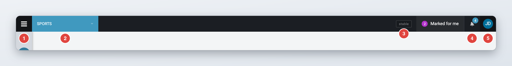
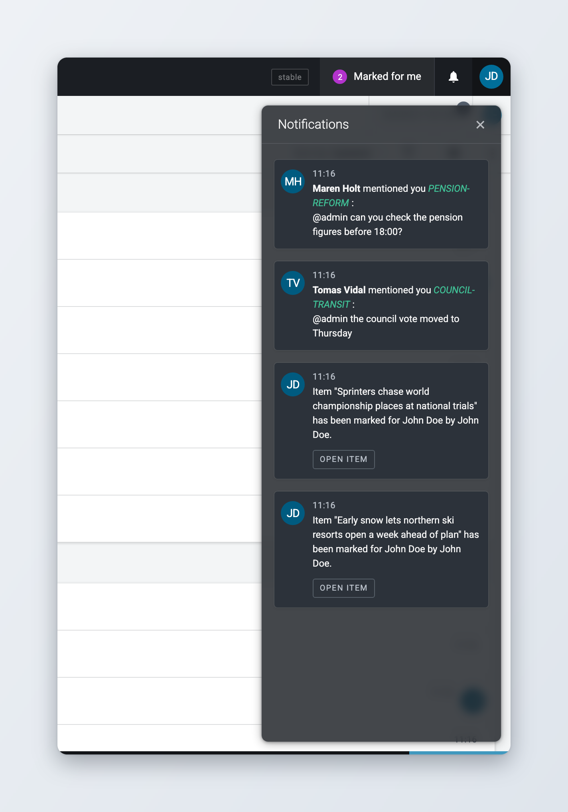
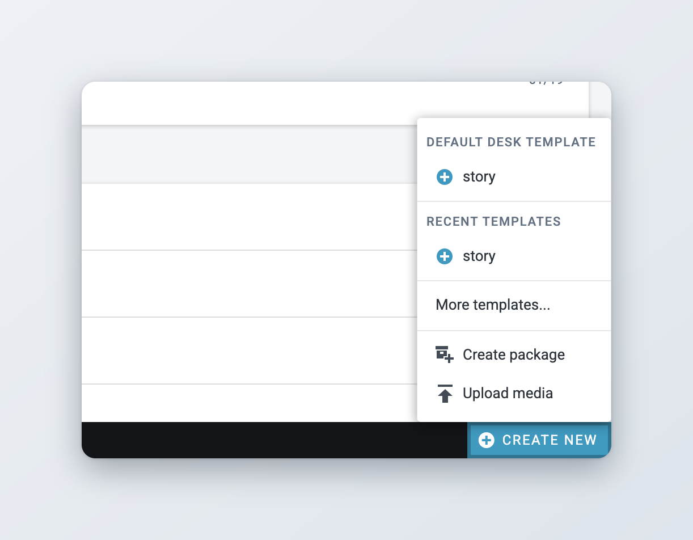
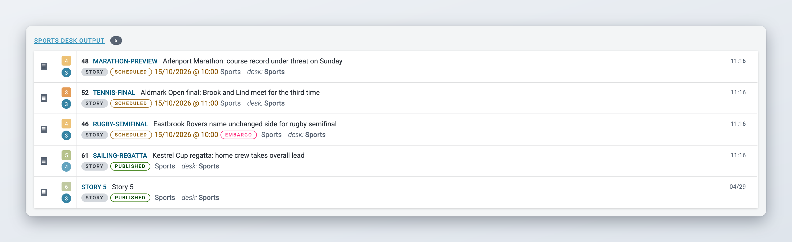
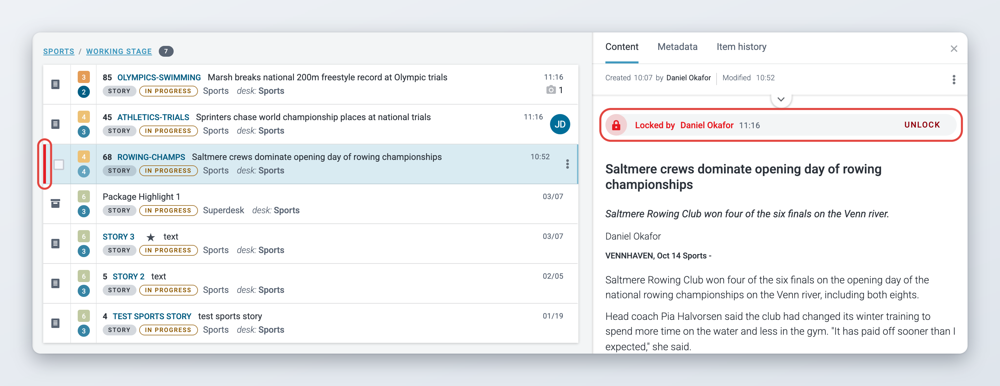
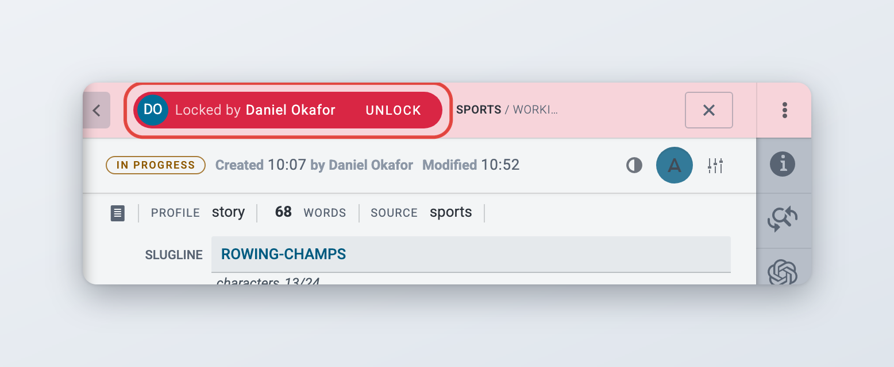
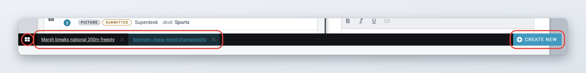

# Icons and User Experience

This page explains the controls you meet on almost every screen of Superdesk: the top bar, the **Create new** button, menus and panels, the labels that show an item's state, locked items and the bar at the bottom of the screen. To find your way between views, see [Navigation](navigation.md).

## The top bar

*Available since Superdesk 2.6.*

The top bar runs across the top of the screen. Your notifications are under a bell icon, and your profile and **Sign out** are under your avatar.

<figure><figcaption>
The top bar
</figcaption></figure>

1. **Main menu button** (three lines). Opens the Main menu. See [Navigation](navigation.md#the-main-menu).
2. **Desks menu** or **page name**. In the views that work per desk, such as Monitoring, this is the Desks menu. Elsewhere it shows the name of the page, for example **Settings**.
3. **Feature preview switch**. Only shown if your role allows it. It shows **stable** while you use the normal features, and **feature preview** when you have turned on features that are still being tested. See [Your profile and preferences](your-profile-and-preferences.md#feature-preview).
4. **Notifications bell**. Opens the notifications panel. A number on the bell shows how many notifications you have not read. See [Notifications](#notifications).
5. **Avatar**. Opens the user menu with **Manage profile** and **Sign out**. See [Your profile and preferences](your-profile-and-preferences.md#the-user-menu).

Depending on your installation and the desk you are on, the top bar can show more:

* **Routing to:** or **Routed from:** next to the desk name, when the selected desk is closed or receives content from a closed desk. See [Desks and Custom Workspaces](../workspace-and-search/desks-and-custom-workspaces.md#closed-desks).
* Buttons added by optional modules, to the left of the bell. For example, **Marked for me** lists the items colleagues marked for you, grouped by desk. It pulses when there is something new. See [Collaboration tools](../content-management/creating-and-editing-content-items/collaboration-tools.md).
* A different colour and a name across the bar on test and training installations, so you do not confuse them with your live Superdesk.

### Notifications

*Available since Superdesk 2.6.*

Click the bell to open the **Notifications** panel on the right. Click the bell again, or the cross in the panel, to close it.

<figure><figcaption>
The Notifications panel
</figcaption></figure>

The panel shows your most recent notifications, newest first, each with the avatar of the person who caused it and the time. Typical notifications are:

* a colleague **mentioned you** in a comment, with a link to the item,
* a colleague **commented on** an item,
* an original item was changed and you should update its translation,
* notifications from optional modules, for example an item was marked for you, with a link to open it.

Notifications you have not read are highlighted. They count as read once they have been on screen in the open panel for a moment, and the number on the bell goes down. When there is nothing to show, the panel says "All good so far".

You can also get notifications by email or as desktop notifications from your browser. You choose which ones in your preferences. See [Your profile and preferences](your-profile-and-preferences.md#notifications).

Messages for everyone, such as planned maintenance, are shown as a banner. Administrators create them. See [System messages](../administration/system-messages.md).

## Creating content: the Create new button

You create new items with the **Create new** button at the right end of the bar at the bottom of the screen. It is there in every view, as long as your role can create content. In the Monitoring toolbar, the plus button (**Create new item**) opens the same menu.

<figure><figcaption>
The Create new menu
</figcaption></figure>

The menu has these parts:

* **Default desk template**: creates an item from the default template of the selected desk. This is the quickest way to start a story.
* **Recent templates**: the templates you used last. Templates that are not shared with others have a **Private** label.
* **More templates...**: opens the list of all templates you can use.
* **Create package**: creates an empty package. Not shown in your personal space.
* **Upload media**: uploads pictures, video or audio from your computer.

You can also drag files from your computer onto the button to upload them.

Where an item is created, and which templates you see, depends on the desk selected in the Desks menu. See [Creating and Editing Content Items](../content-management/creating-and-editing-content-items/README.md) and [Packages](../content-management/packages.md).

On other pages, a round button with a plus sign at the top right adds something new to that page. For example, on the Dashboard it adds a widget, and in **User Management** it adds a user.

## Common controls

### Action menus

A button with three vertical dots opens a menu of actions. In lists, the button appears at the right of a row when you hover over it and is called **Item actions**. In the editor's top bar, the Monitoring toolbar and on many Settings pages the same button is called **More actions**.

The menu only lists the actions you can use for that item in its current state, with your role. If an action you expect is missing, the item may be locked, published, or your role may not allow it. The actions for items are described in [Monitoring Tab](../workspace-and-search/monitoring-tab.md#item-actions).

### View switchers

In Monitoring and Search, the view switcher changes how a list is shown: **List View**, **Compact View**, **Swimlane View** or **Photo Grid View**. Your installation decides which of these are offered. See [Monitoring Tab](../workspace-and-search/monitoring-tab.md#choosing-a-list-view).

### Side panels

Some information opens in a panel next to the list, for example the preview of an item, the **Filters** panel in Monitoring or a user's activity in Master Desk. A panel stays open while you work in the list. Click the cross at the top of the panel to close it.

### Dialogs

When Superdesk needs a decision from you, it opens a dialog in the middle of the screen and the rest of the screen is greyed out. Read the question, then click one of the buttons. **Cancel** always leaves things as they were.

For example, when you close an item from the bar at the bottom of the screen and it has changes you have not saved, the **Save changes?** dialog asks what to do:

* **Go-To** opens the item, so you can save it.
* **Ignore** closes the item and drops your changes.
* **Cancel** keeps the item open as it is.

### Tooltips

Most icons have no text. Hover over an icon to see its name.

## Item states

Every item has a state that shows where it is in the workflow. In lists and in the preview, a small coloured label shows the state.

<figure><figcaption>
State labels in a Monitoring list
</figcaption></figure>

| Label | Colour | What it means |
| --- | --- | --- |
| **Draft** | grey outline | A new item that has not been saved yet. It is only autosaved. |
| **Ingested** | blue outline | The item arrived from an ingest source and is not in production yet. |
| **Routed** | blue outline | Ingest routing put the item on a desk automatically. |
| **Fetched** | blue outline | Someone fetched the item from ingest to a desk. |
| **Submitted** | orange outline | The item was sent to a desk and has not been changed there yet. |
| **In Progress** | orange outline | The item has been saved and is being worked on. |
| **Scheduled** | orange outline | The item will be published at a set time. |
| **Published** | green outline | The item has been published. |
| **Corrected** | green outline | A correction of the item has been published. |
| **Correction** | pink, filled | A correction that is being prepared. Only with the corrections workflow. |
| **Being Corrected** | pink outline | The published original of an item that is being corrected. Only with the corrections workflow. Click the label to open the item. |
| **Spiked** | red outline | The item was removed from the workflow. It can be unspiked until it expires. |
| **Unpublished** | red outline | The item was unpublished. It can be edited and published again. |
| **Killed** | red outline | The item was killed. No more actions are possible. |
| **Recalled** | red outline | The item was taken down. No more actions are possible. |

An item with an embargo also has a pink **embargo** label. See [Sending, scheduling and publishing items](../content-management/sending-scheduling-and-publishing.md) and [Updates, corrections, kills and takedowns](../content-management/updates-corrections-kills-and-takedowns/README.md) for how items move between these states.

## Locked items

When you open an item for editing, Superdesk locks it for you. Other users can still see and preview the item, but they cannot edit it until the lock is released. This stops two people from overwriting each other's changes.

### How to recognise a locked item

* **In lists**, a locked item has a red bar on its left edge.
* **In the preview**, a notice at the top says **Locked by** and the name of the user, with the time the item was locked. If you have the item open yourself in another browser or tab, it says **Locked by you in another browser**.
* **When you open a locked item**, it opens read-only. The editor's top bar shows the avatar of the user who has the lock and **Locked by** with their name. The **Save** button is not there.

<figure><figcaption>
A locked item in the list and in the preview
</figcaption></figure>

<figure><figcaption>
A locked item opened read-only
</figcaption></figure>

### Releasing and unlocking

A lock ends when the user who has it closes the item, signs out or their session expires. Items that stay open in the bar at the bottom of the screen stay locked. If you need an item that someone else has locked, ask them to close it, or hover over the **Locked by** notice in the preview and click **Unlock** if your role allows it. See [Creating and Editing Content Items](../content-management/creating-and-editing-content-items/README.md#locks).

To see which items a user has locked, use the **User Activity** widget on the Dashboard or the **Users** tab of [Master Desk](../workspace-and-search/master-desk.md). See [Dashboards and Widgets](../workspace-and-search/dashboards-and-widgets.md#user-activity-widget).

## The bar at the bottom of the screen

The bar at the bottom of the screen lists the items you have open. An item stays open, and locked for others, until you close it, also when you switch to another view or desk.

<figure><figcaption>
The bar at the bottom of the screen
</figcaption></figure>

From left to right, the bar has:

* **All opened items** (a grid of squares). Opens the **Currently working on** view, with a card for each open item.
* One tab per open item, with its headline or slugline, or **Untitled**. The item you are editing is highlighted. Click a tab to switch to that item. Click the cross on a tab to close the item. If it has unsaved changes, the **Save changes?** dialog opens.
* **Multiedit**, while you are editing several items side by side. See [Monitoring Tab](../workspace-and-search/monitoring-tab.md#selecting-several-items).
* **Create new**, at the right end. See [Creating content: the Create new button](#creating-content-the-create-new-button).

See [Desks and Custom Workspaces](../workspace-and-search/desks-and-custom-workspaces.md#open-items) for more on the **Currently working on** view.

## Themes and dark mode

*Available since Superdesk 2.6.*

Superdesk has a light and a dark theme. You choose the theme in your personal preferences, and it applies to the whole application. The Main menu and the notifications panel always use dark colours. See [Your profile and preferences](your-profile-and-preferences.md#theme-and-dark-mode).

## For administrators

* **Feature preview switch.** Users only see it with the **Feature Preview** privilege.
* **Unlocking.** The **Unlock content** privilege lets a role unlock items that other users have open. Users also need the **Create content** privilege. See [User Management and User Roles](../administration/user-management-and-user-roles.md).
* **Test installations.** In the client configuration, `isTestEnvironment: true` changes the colour of the top bar and `environmentName` sets the text shown across it.
* **Top bar buttons from modules.** Optional modules add their own buttons to the top bar. For example, the Mark for user extension adds **Marked for me**, and the Planning component can add an assignments list (`assignmentsTopBarWidget` in the planning extension configuration).
