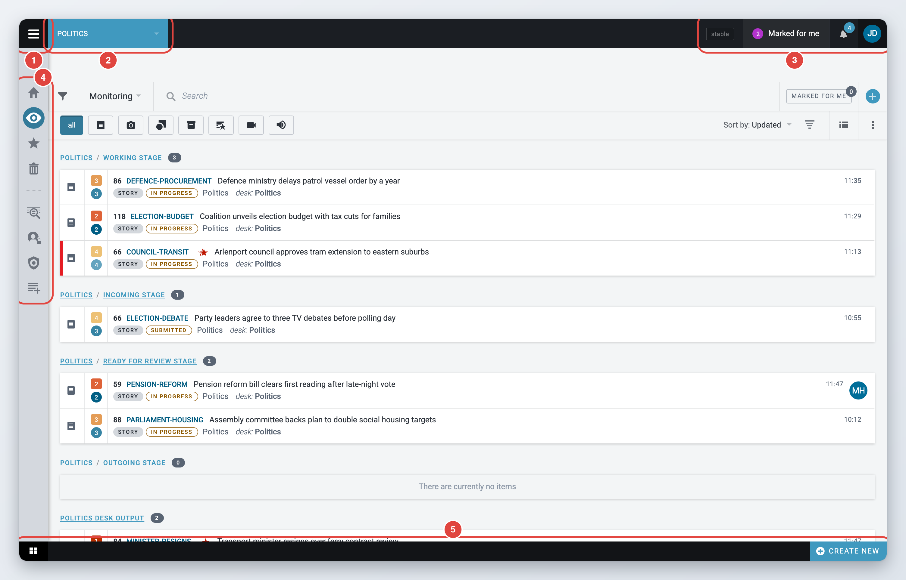
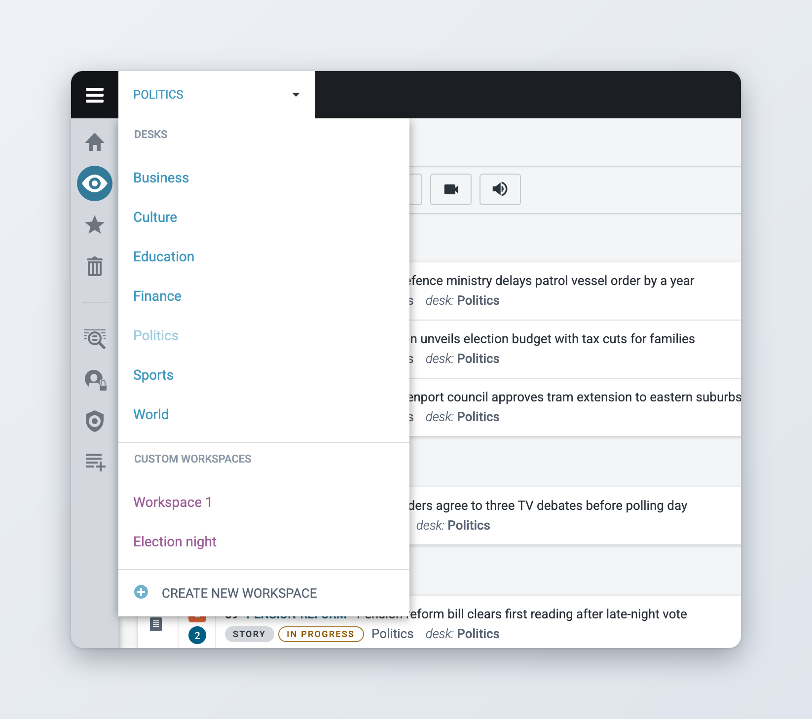
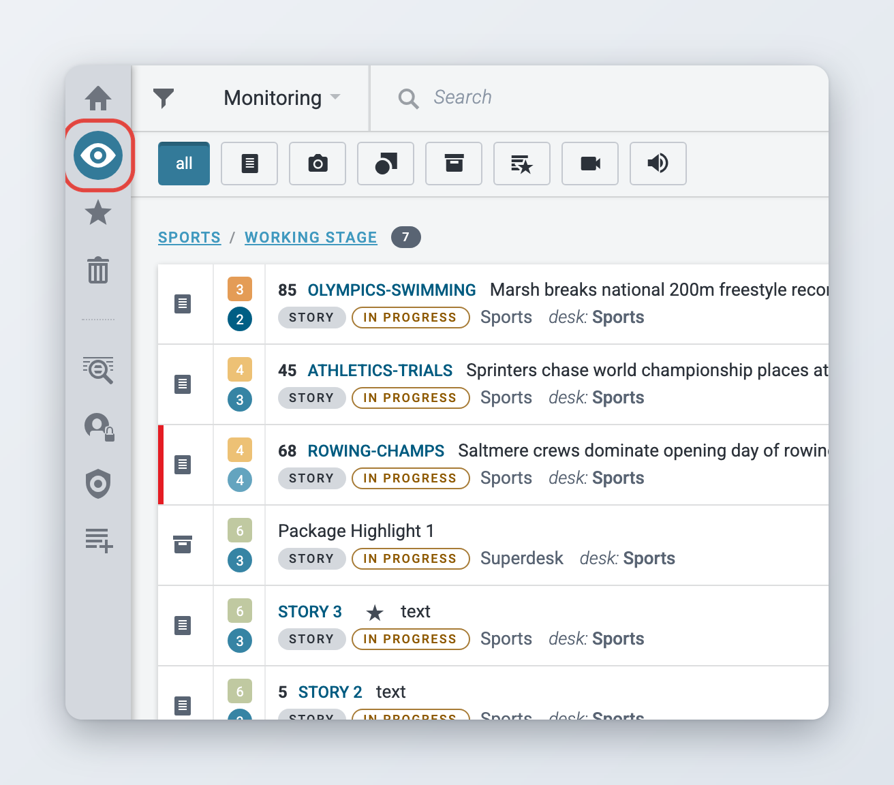
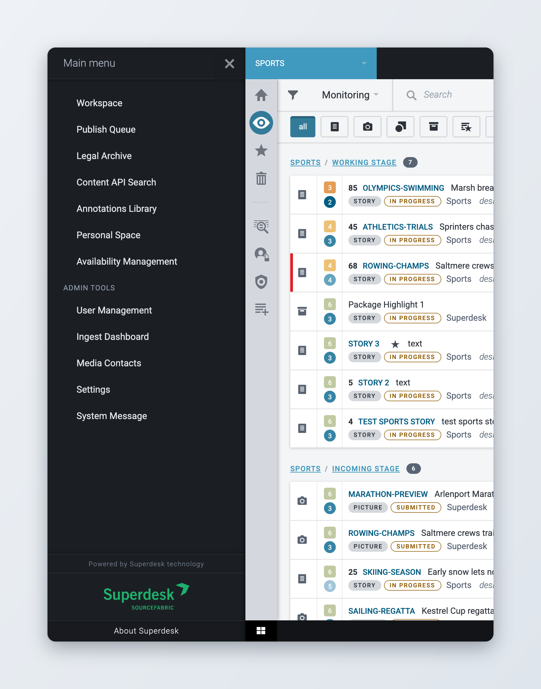
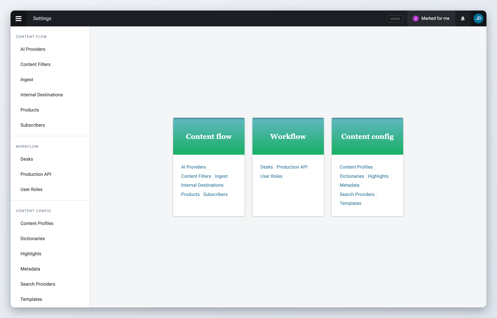
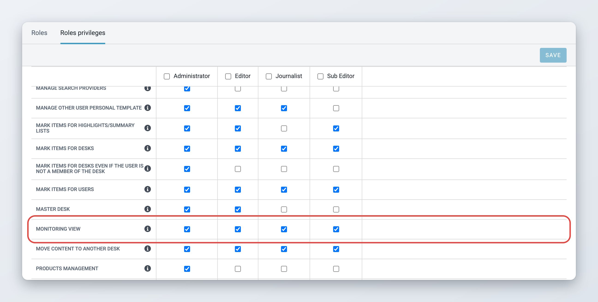

# Navigation

This page shows you how to move around Superdesk: the menus at the top of the screen, the Workspace Panel on the left, the Main menu and the Settings pages. The icons, labels and controls you meet on the way are described in [Icons and User Experience](icons-and-user-experience.md).

What you see depends on your role and on the modules your Superdesk uses. If an icon or menu entry described here is missing, your role may not have the privilege for it, or the module is not installed. Ask your administrator.

## The main parts of the screen

<figure><figcaption>
The main parts of the Superdesk screen
</figcaption></figure>

1. **Main menu button** (three lines, also called the hamburger menu), top left. It opens the [Main menu](#the-main-menu).
2. **Desks menu**, next to it. It shows the desk or custom workspace you are working in. See [The Desks menu](#the-desks-menu).
3. **Top bar**, along the top. On the right it has the notifications bell and your avatar. See [Icons and User Experience](icons-and-user-experience.md#the-top-bar).
4. **Workspace Panel**, the column of icons on the left. It takes you to the main views, such as Monitoring and Search. See [The Workspace Panel](#the-workspace-panel).
5. **Bar at the bottom**, with the items you have open and the **Create new** button. See [Icons and User Experience](icons-and-user-experience.md#the-bar-at-the-bottom-of-the-screen).

## The Desks menu

Desks are how teams are organised in Superdesk, for example a sports desk or a foreign desk. The **Desks menu** is the drop-down at the top left of the screen. It shows the name of the desk or custom workspace you are working in. It appears in the views that work per desk, such as Monitoring and the Dashboard.

Click it to switch. The menu lists the desks you are a member of under **DESKS**, your own custom workspaces under **CUSTOM WORKSPACES**, and ends with **CREATE NEW WORKSPACE**. When a custom workspace is selected, the Desks menu has a purple tint.

<figure><figcaption>
Switching desks with the Desks menu
</figcaption></figure>

The desk you pick here applies to these views:

* the **Dashboard** shows the widgets of that desk or workspace,
* **Monitoring** shows its stages and saved searches,
* **Highlights** lists the highlights of that desk,
* **Spiked Items** shows the items spiked from that desk, or from the desks in your custom workspace.

**Search**, **Master Desk** and **Planning** do not depend on the selected desk.

Superdesk remembers the desk or workspace you selected last, also after you log out. If there is no earlier choice, it opens your default desk from your profile, or else the first of your desks. See [Your profile and preferences](your-profile-and-preferences.md#default-desk).

To learn how to create and manage custom workspaces, and what it means when a desk is shown as closed, see [Desks and Custom Workspaces](../workspace-and-search/desks-and-custom-workspaces.md).

## The Workspace Panel

The Workspace Panel is the column of icons on the left side of the screen. Each icon opens one view. Hover over an icon to see its name. The icon of the view you are in is highlighted. Thin lines split the icons into groups.

<figure><figcaption>
The Workspace Panel
</figcaption></figure>

The panel only shows the icons your role allows and the modules your Superdesk uses. A typical installation shows these, from top to bottom:

| Icon | What it opens | Shortcut |
| --- | --- | --- |
| **Dashboard** | The widgets of the selected desk or custom workspace. See [Dashboards and Widgets](../workspace-and-search/dashboards-and-widgets.md). | Ctrl+Alt+B |
| **Monitoring** | The main working view: the stages and saved searches of the selected desk, where you create, edit and move items. See [Monitoring Tab](../workspace-and-search/monitoring-tab.md). | Alt+M |
| **Assignments** | Your planning assignments. Only with the Planning component. A number on the icon shows how many assignments are waiting for you. See [Superdesk Planning Component](../superdesk-planning-component/README.md). | Ctrl+Alt+A |
| **Highlights** | The highlight lists of the selected desk. Hover over the icon to pick a list. See [Highlights](../workspace-and-search/highlights.md). | Ctrl+Alt+H |
| **Spiked Items** | Items removed from the workflow of the selected desk. You can unspike them until they expire. See [Spiked Items](../content-management/spiked-items.md). | Ctrl+Alt+K |
| **Search** | Search across Superdesk, independent of the selected desk. See [Searching Content in Superdesk](../workspace-and-search/searching-content-in-superdesk.md). | Ctrl+Alt+F |
| **Personal space** | Your private items. Nobody else sees them, and they do not show up in other users' searches, until you send them to a desk. See [Desks and Custom Workspaces](../workspace-and-search/desks-and-custom-workspaces.md#personal-space). | Alt+P |
| **Master Desk** | An overview of the work in progress on all desks, for newsroom managers (since 2.1). See [Master Desk](../workspace-and-search/master-desk.md). | Ctrl+Alt+D |
| **Broadcasting** | Shows, rundown templates and rundowns (since 2.7). See [Broadcasting: shows and rundowns](../broadcasting-shows-and-rundowns.md). | none |
| **SAMS** | The shared library of reusable files and images. Optional module (since 2.2). See [Asset management (SAMS)](../integrations-and-advanced-features/asset-management.md). | Ctrl+Alt+S |
| **Content lists** | Lists of articles for websites and apps. Optional module (since 3.7). See [Content lists](../integrations-and-advanced-features/content-lists.md). | none |
| **Availability Management** | Who is available on which day (since 2.10). Shown here only if your administrator has added it to the panel. Otherwise it is in the Main menu. See [Availability Management](../availability-management/README.md). | none |
| **Planning** | Events, planning items and coverages. Only with the Planning component. See [Superdesk Planning Component](../superdesk-planning-component/README.md). | Ctrl+Alt+P |


Some of these icons belong to optional modules. If you do not see one you expect, ask your administrator.


The icons only change the view. They do not close the items you have open. Your open items stay in the bar at the bottom of the screen.

### Giving the editor more room

When you edit an item, it opens next to the list. To hide the list and give the editor the whole screen, click the highlighted icon of the view you are in, for example **Monitoring**. Click it again to bring the list back. This does the same as the **Full width mode** button in the editor. See [Monitoring Tab](../workspace-and-search/monitoring-tab.md#full-width-mode).

### Searching other sources

If your Superdesk is connected to external search providers, hover over the **Search** icon to see them in a short menu. Click a provider to search it straight away. See [Searching Content in Superdesk](../workspace-and-search/searching-content-in-superdesk.md).

## The Main menu

Click the Main menu button (three lines) at the top left to open the **Main menu**. It slides in from the left. To close it, click the button again, or click an entry. Opening another view also closes it.

<figure><figcaption>
The Main menu
</figcaption></figure>

The top part of the menu has entries for everyday work. Which ones you see depends on your role and your installation:

* **Workspace**: your Dashboard, the same as the Dashboard icon.
* **Personal Space**: your personal space, the same as the Personal space icon.
* **Publish Queue**: the queue of items being sent to subscribers.
* **Legal Archive**: the legal archive of published content, when your installation uses it.
* **Content API Search**: a search in the content published to the Content API.
* **Analytics**: reports, when your installation uses Analytics. See [Analytics](../integrations-and-advanced-features/analytics.md).
* **Availability Management**: when it is not in the Workspace Panel. See [Availability Management](../availability-management/README.md).
* **Annotations Library**: the concepts used for annotations in the editor, when your installation uses it.

Under **Admin tools** you find the configuration entries:

* **Settings**: the configuration pages. See [Settings](#settings).
* **User Management**: users and their profiles. See [User Management and User Roles](../administration/user-management-and-user-roles.md).
* **Ingest Dashboard**: the status of your ingest sources. See [Ingesting News Items and Events](../integrations-and-advanced-features/ingesting-news-items-and-events.md).
* **System Message**: the banner shown to all users. See [System messages](../administration/system-messages.md).
* **Media Contacts**: the contacts directory, when your installation uses it.
* **Manage Locations**: the locations used in Planning, when your installation uses the Planning component.

Your installation may show other entries. At the bottom of the menu, **About Superdesk** shows the version of your installation. Some installations also add a **Feedback/Suggestions** link.

## Settings

To open the Settings pages, open the Main menu and click **Settings** under **Admin tools**.

The Settings start page shows the pages in groups. Once you open a page, the same groups are listed in a column on the left, so you can jump from one page to another.

<figure><figcaption>
The Settings start page
</figcaption></figure>

| Group | Pages |
| --- | --- |
| **Content flow** | **AI Providers** (since 3.7, see [AI features](../integrations-and-advanced-features/ai-features.md)), **Content Filters**, **Ingest**, **Internal Destinations**, **Products**, **Subscribers** |
| **Workflow** | **Desks** (see [Desk Creation and Desk Management](../administration/desk-creation-and-desk-management.md)), **Production API** (since 3.2, see [Superdesk API](../integrations-and-advanced-features/superdesk-api.md)), **User Roles** (see [User Management and User Roles](../administration/user-management-and-user-roles.md)) |
| **Content config** | **Content Profiles**, **Dictionaries**, **Highlights**, **Metadata**, **Search Providers**, **Templates** |

You only see the pages your role allows. Most of them need an administrator privilege. **Templates** has no privilege of its own, so most users see at least that page.

Content filters, products, subscribers and internal destinations are described in [Defining Publishing in Superdesk](../administration/defining-publishing-in-superdesk/README.md). Content profiles, metadata, dictionaries and templates are described in [Content Configuration](../administration/content-configuration/README.md). Ingest sources are described in [Ingesting News Items and Events](../integrations-and-advanced-features/ingesting-news-items-and-events.md).

## Moving around with the keyboard

Most views in the Workspace Panel have a keyboard shortcut, listed in the table above. Two more work everywhere:

* **Alt+K** shows all keyboard shortcuts in a window.
* **Ctrl+0** opens a small box where you type the unique name, ID or GUID of an item to open it directly.

See [Keyboard shortcuts](../reference/keyboard-shortcuts.md) for the full list.

## For administrators

### Choosing what each role sees in the Workspace Panel

Most icons in the Workspace Panel are tied to a privilege. Remove the privilege from a role and its users no longer see the icon. This keeps the screen simple for users who only need a few views, for example freelancers.

| Icon | Privilege |
| --- | --- |
| Dashboard | **Dashboard** |
| Monitoring | **Monitoring view** |
| Assignments | **Planning - Assignments** |
| Highlights | **Highlights - read** |
| Spiked Items | **Spike view** |
| Search | **Global searches** (see the note below) |
| Master Desk | **Master Desk** |
| Broadcasting | **Rundowns** |
| SAMS | **Sams** |
| Content lists | **Content Lists** |
| Availability Management | **Availability - view** |
| Planning | **Planning**, plus **Planning - Event Management** or **Planning - Planning Item Management** |

**Personal space** has no privilege of its own. It is always shown, and it is also in the Main menu.

Without **Global searches**, the Search icon stays in the panel but only lists the external search providers, if there are any. The user cannot open the Superdesk search from it.



### Open the role privileges

Open the Main menu, click **Settings**, then **User Roles**. Select the **Roles privileges** tab.



### Change the privileges

Each role has a column. Tick or untick the privileges from the table above for the roles you want to change.



### Save

Click **Save**. Users see the change after they reload Superdesk.



<figure><figcaption>
The Monitoring view privilege controls the Monitoring icon
</figcaption></figure>

You can also give a single user extra privileges on the **Privileges** tab of their profile. See [User Management and User Roles](../administration/user-management-and-user-roles.md).

### Optional entries

Some entries only appear when a module is installed and configured. They are set in the client configuration (`superdesk.config.js`) and in the list of client extensions, usually by the team that hosts your Superdesk:

* **Planning** and **Assignments** need the Planning component and the `workspace.planning` and `workspace.assignments` options.
* **Broadcasting**, **SAMS**, **Content lists** and **Availability Management** are client extensions. The default build includes Broadcasting and Availability Management. SAMS and Content lists must be added to the build and need their server modules.
* **Availability Management** is added to the Workspace Panel with the extension option `dashboard.addLinkToSideMenu`, which sets its icon and position. Without it, the entry is in the Main menu.
* Three older views can be added to the panel: `workspace.ingest` (**Ingest**, with the **Ingest** privilege), `workspace.content` (**Content**, with the **Create content** privilege) and `workspace.tasks` (**Tasks**, with the **Tasks Management** privilege). They are off by default.
* External search providers appear under the Search icon when `features.searchShortcut` is on.

See [How to set it up](../availability-management/how-to-set-it-up.md) for Availability Management, and [Content lists](../integrations-and-advanced-features/content-lists.md) and [Asset management (SAMS)](../integrations-and-advanced-features/asset-management.md) for the other modules.
