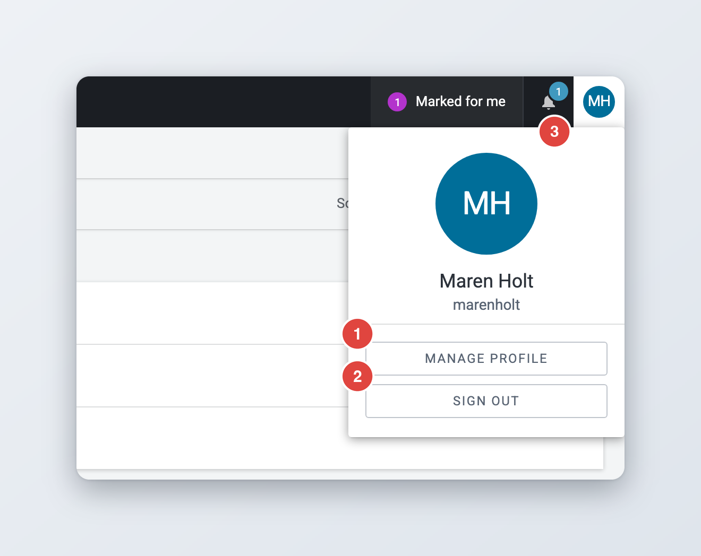
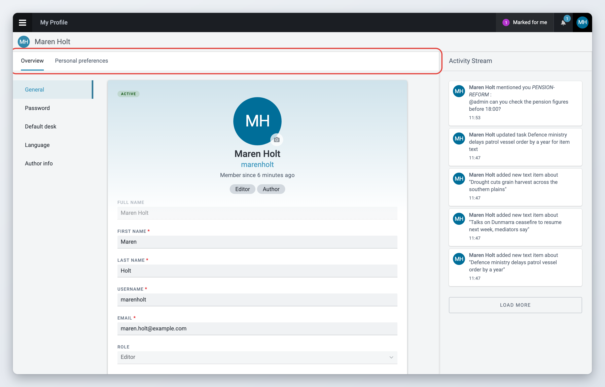
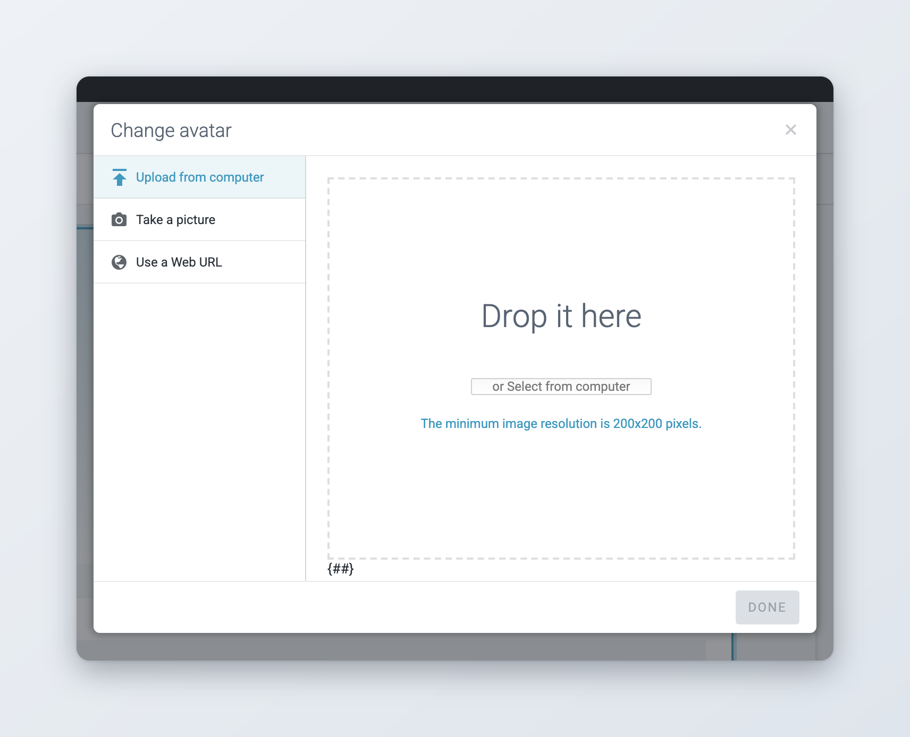
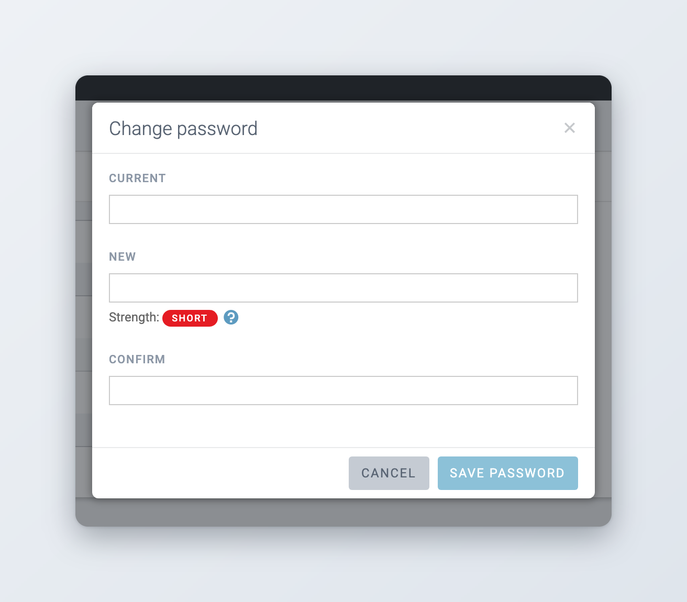
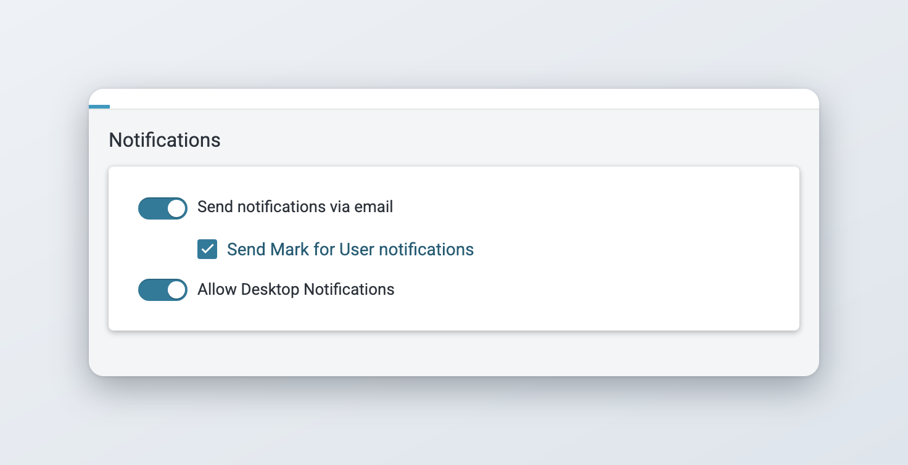
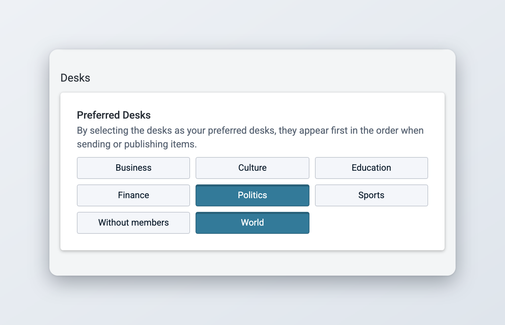
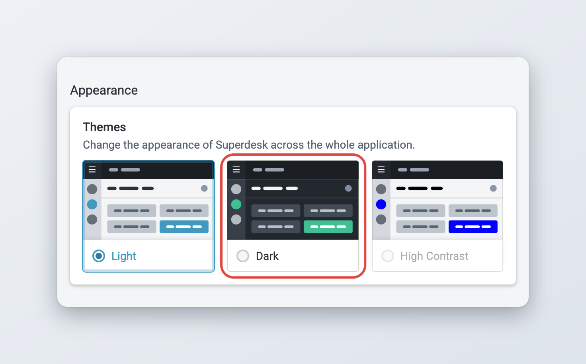
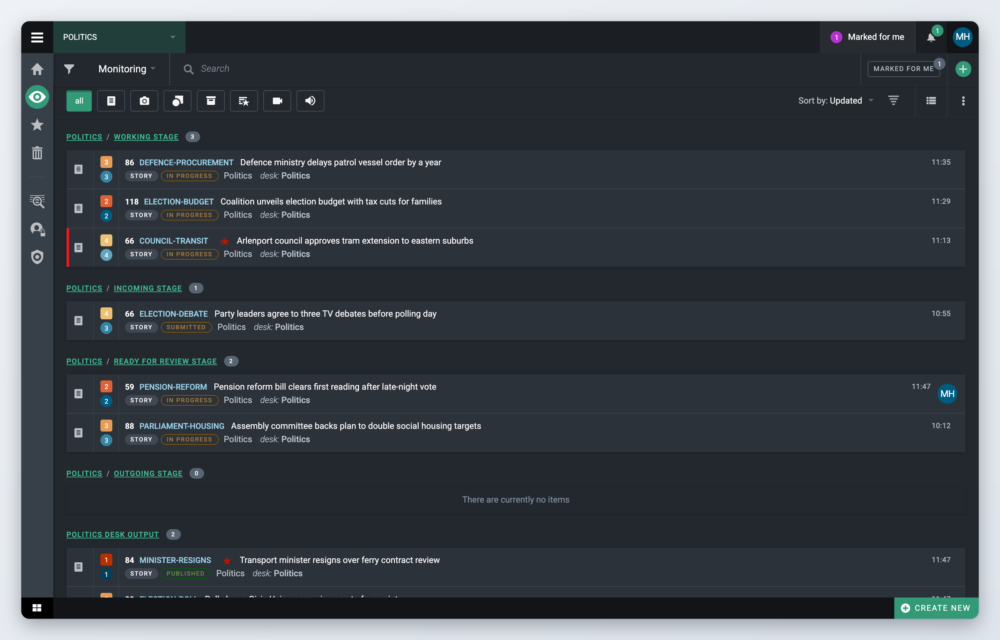

# Your profile and preferences

Your profile holds your name, contact details, password, default desk and interface language. Your personal preferences control how Superdesk looks and behaves for you: theme, notifications, default values for new items and the desks and categories you use most. Only you see and change your own preferences.

## The user menu

*Available since Superdesk 2.6.*

Your avatar sits in the top-right corner of the screen. It shows your picture, or your initials if you have not uploaded one. Click it to open the user menu. The menu shows your full name and your username, and two buttons:

* **Manage profile** opens your profile page.
* **Sign out** ends your session in this browser. See [Signing out and sessions](#signing-out-and-sessions).

The bell icon to the left of your avatar opens the **Notifications** panel. A number on the bell tells you how many notifications you have not read yet. See [Icons and User Experience](icons-and-user-experience.md) for the other parts of the top bar.

<figure><figcaption>
The user menu under your avatar
</figcaption></figure>

## Your profile page

Click **Manage profile** in the user menu. The **My Profile** page opens. It has these tabs:

* **Overview**: your name, contact details, password, default desk, language and, if you are an author, your author details.
* **Personal preferences**: theme, notifications and default values. Only you see this tab, also when an administrator opens your profile.
* **Privileges**: only shown if your role lets you manage users. See [User Management and User Roles](../administration/user-management-and-user-roles.md).
* **Availability**: only shown if your Superdesk uses Availability Management and your role lets you manage your own availability. See [View and edit Availability](../availability-management/view-and-edit-availability.md).

The **Activity Stream** on the right lists your recent actions in Superdesk, such as creating, moving and publishing items.

When you change something on the **Overview** or **Personal preferences** tab, a bar with **Cancel** and **Save** appears at the top. Your changes are only kept after you click **Save**.

<figure><figcaption>
The Overview tab of your profile
</figcaption></figure>

## Editing your details

The **Overview** tab has a menu on the left: **General**, **Password**, **Default desk**, **Language** and, for authors, **Author info**. Click an entry to jump to that section.

In **General** you can change:

* **First name** and **Last name** (both required). Your full name is built from them.
* **Email** (required). Superdesk sends password reset links and email notifications to this address. It must not be used by another user.
* **Phone number**.

Your **Username** cannot be changed. Your **Role** is shown but only an administrator can change it. The labels under your name show your role and whether you are an author or an administrator.


If your Superdesk checks logins against your organisation's user directory (LDAP), fields that come from the directory, such as your name or email, are read-only here. Change them in the directory instead.


### Changing your avatar



### Open the avatar window

Click the photo icon on your picture at the top of the **General** section. The **Change avatar** window opens.



### Choose an image

Choose **Upload from computer** and drop an image in the window or select a file. You can also choose **Use a Web URL** and paste the address of an image. The image must be at least 200 x 200 pixels.



### Crop it

Drag the crop area until the preview looks right, then click **Done**.



### Save your profile

Click **Save** at the top of the page.



To remove your picture, open the window again and click **No image**. Superdesk then shows your initials instead.

<figure><figcaption>
Uploading a new avatar
</figcaption></figure>

Some installations replace avatars with pictures from another system. In that case there is no photo icon and you cannot change your picture in Superdesk.

### Author info

If you are an author, the **Author info** section shows:

* **Sign-Off**: the short code added to items you work on. Letters and numbers only.
* **Byline**: Superdesk fills it in on new items you create.
* **Job Title**, **Biography**, **Facebook**, **Instagram** and **Twitter**: these can only be edited by a user who manages users.

Whether you are an author, and whether your author profile is private, is set by an administrator. See [User Management and User Roles](../administration/user-management-and-user-roles.md).

## Changing your password



### Open the password window

On the **Overview** tab, click **Password** in the left menu, then click **Change password**.



### Enter your passwords

Type your current password in **Current**. Type the new password in **New** and again in **Confirm**.



### Save

Click **Save password**. Superdesk shows "The password has been changed."



If your current password is wrong, the window says so and nothing changes. If you forgot your password, sign out and use **Forgot password?** on the login page. See [Logging in and single sign-on](../getting-started/logging-in-and-single-sign-on.md#forgot-your-password).

The **Change password** button is not there when your Superdesk checks passwords against your organisation's directory (LDAP). In that case, change your password the way your organisation tells you to.

<figure><figcaption>
Changing your password
</figcaption></figure>

## Default desk

Your default desk is the desk Superdesk opens when you log in. Pick it in **Default desk** on the **Overview** tab. The list only shows desks you are a member of. Choose the desk you work on most.

## Interface language

Pick the language of the Superdesk interface in **Language** on the **Overview** tab. Each language is listed by its own name, for example **Deutsch (German)**.



### Choose the language

Pick a language from the **Language** list.



### Save

Click **Save**. Superdesk asks whether you want to reload the page now.



### Reload

Click **Confirm**. The page reloads in the new language.



By default the list offers English, English (UK), Arabic, Danish, German, Greek, Spanish, French (Canada), Japanese, Norwegian Bokmål, Polish, Portuguese (Brazil), Russian, Serbian and Ukrainian. Your administrator can change this list. The language only changes labels and messages in the interface. It does not change the language of your content.

The login page uses the language of the last person who signed out in your browser. See [Logging in and single sign-on](../getting-started/logging-in-and-single-sign-on.md#login-page-language).

## Personal preferences

Click the **Personal preferences** tab. The menu on the left jumps to each section. Change what you need, then click **Save** at the top. Superdesk shows "User preferences saved". If you have no preferred categories yet, Superdesk first asks whether it may select a default set of categories for you; click **OK** to save.

### Notifications

Superdesk always shows notifications in the **Notifications** panel under the bell, for example when someone mentions you in a comment. In this section you choose which other channels you also want.

* **Send notifications via email**: turns all email notifications on or off.
* Under it, one checkbox per type of email, for example **Send Mark for User notifications** or **Send Assignment notifications**. Untick a type to stop only those emails. Which types you see depends on the modules your Superdesk uses.
* **Allow Desktop Notifications**: also shows notifications as pop-ups from your browser. After you save, your browser asks for permission. Allow it, or the pop-ups do not appear.

If your Superdesk is connected to Slack, there is also a switch for Slack notifications, and a **Slack Username** field on the **Overview** tab.

<figure><figcaption>
Choosing how you get notifications
</figcaption></figure>

### Email notifications per type

*Available since Superdesk 2.8.*

You can keep some email notifications and turn off others. For example, you can keep emails about your planning assignments but stop emails when someone marks an item for you. Turning off **Send notifications via email** unticks every type. Ticking any type turns the main switch back on.

### Article defaults

Values you set here are filled in when you create a new item:

* **Dateline / Located**: the place used in the dateline of new items. Start typing a city and pick it from the list. The preview under the field shows how the dateline will look.
* **Place**: the default value for the **Place** field.

Superdesk only fills in a field that is still empty. Items you fetch from ingest keep their own values. Your **Byline** from **Author info** is also added to new items.

### Categories

Tick the categories you work with under **Preferred Categories**. When you set the categories of an item, the menu only offers these categories, plus any categories the item already has. Use **all**, **none** or **default** to change many boxes at once. **default** ticks the categories your administrator has put in the **Default Categories** vocabulary, under **Settings** > **Metadata**.

If you save with no category ticked, Superdesk warns you and selects the default set of categories for you.

### Desks

Click the desks you send items to most under **Preferred Desks**; selected desks turn blue. They are listed first in the destination list when you send or publish items, so you find them without scrolling. See [Sending, scheduling and publishing items](../content-management/sending-scheduling-and-publishing.md).

<figure><figcaption>
Choosing your preferred desks
</figcaption></figure>

### Vocabulary values

Some vocabularies let you pick preferred values. Your administrator decides which ones: a vocabulary appears here when **Available in user/desk preferences** is ticked in its settings under **Settings** > **Metadata**, see [Preferred vocabulary values](../administration/desk-creation-and-desk-management.md#preferred-vocabulary-values). Pick the values you use most for each vocabulary listed here. When you open that field on an item, the list starts with a **User** group with your values. If your desk also has preferred values, a **Desk** group shows them. Click **All** to see every value.

If no vocabulary allows it, the section says "There are no vocabularies configured."

### Planning

This section only appears if your Superdesk uses the [Planning component](../superdesk-planning-component/README.md).

* **Default Calendar**: the calendar added to new events.
* **Default Agenda**: the agenda Planning shows when you open the planning list.
* **Default Events & Planning Filter**: the filter Planning applies when you open the combined events and planning list.

Each field only appears when there is at least one calendar, agenda or filter to choose from.


In Superdesk 3.6, **Clear filters** in the planning list does not clear the default agenda, and the default events and planning filter is not applied when the list opens. Pick the filter in the list instead.


### View formats

Here you pick the default layout of two lists, shown by their internal names: **archive** for content lists such as search results, and **contacts** for the contacts list. For each one, pick the grid layout (labelled **mgrid**) or **List View**. You can still switch the layout in each list. The view you choose in Monitoring is remembered on its own, see [Monitoring Tab](../workspace-and-search/monitoring-tab.md).


In Superdesk 3.6 the **archive** setting has no effect: search results always open in list view until you switch the layout in the list itself.


### Feature preview

**Enable Feature Preview** turns on features that are still in preview. Leave it off unless your administrator asks you to try something.

## Theme and dark mode

*Available since Superdesk 2.6.*

The **Appearance** section of **Personal preferences** sets the look of the whole application.



### Open Appearance

Click **Personal preferences**, then **Appearance** in the left menu.



### Pick a theme

Under **Themes**, click **Light** or **Dark**.



### Save

Click **Save**, and **OK** if Superdesk asks about default categories. Superdesk switches to the new theme straight away.



Your theme is stored with your profile, so it follows you to other browsers and stays after you log in again. **High Contrast** is shown but cannot be selected yet.

<figure><figcaption>
Choosing a theme
</figcaption></figure>

<figure><figcaption>
Monitoring in the dark theme
</figcaption></figure>

### Editor theme

*Available since Superdesk 2.7.*

The editor has its own theme settings for writing and proofreading, which you set from the editor. When you switch the application theme, the editor follows: if the editor uses its default colours, it turns dark or light with the rest of Superdesk. If you picked other colours for the editor, they stay as they are.

## Signing out and sessions

Each browser you log in from has its own session. To end it, click your avatar and then **Sign out**. The login page appears.

If an item you are editing has unsaved changes, Superdesk does not sign you out. It asks you to save them first.

When your session ends, items you had open for editing in that session are unlocked, so colleagues can work on them. Your session also ends on its own after a period without activity. See [Logging in and single sign-on](../getting-started/logging-in-and-single-sign-on.md#when-your-session-expires).

If you think you are still signed in somewhere you should not be, ask an administrator to clear your sessions. This signs you out everywhere.

## Your availability

If your Superdesk uses Availability Management, the **Availability** tab of your profile holds your default working week and your availability for single days. See [View and edit Availability](../availability-management/view-and-edit-availability.md).
