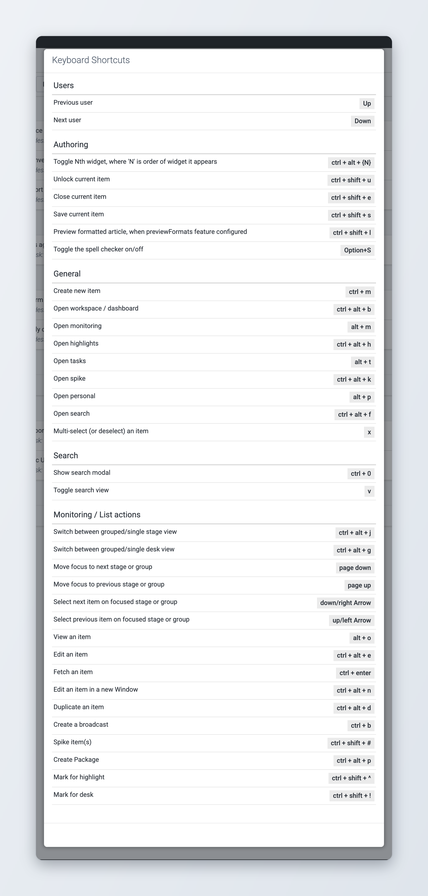
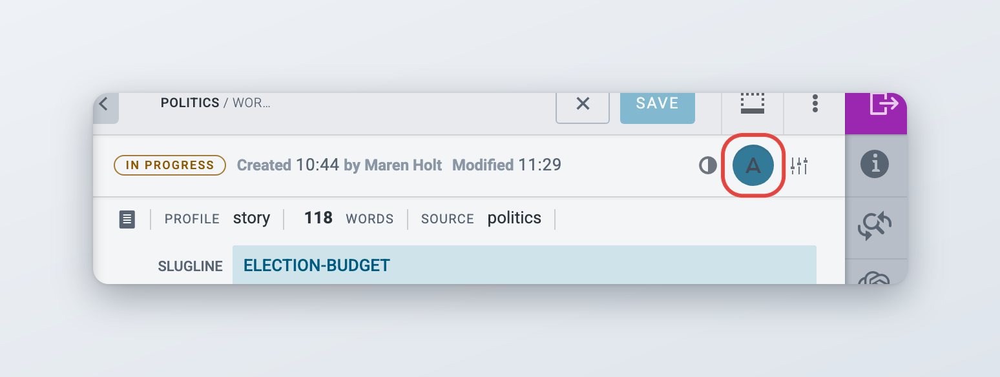

# Keyboard shortcuts

Superdesk has keyboard shortcuts for moving between views, working through lists of items, and editing. This page lists the shortcuts that work in a standard installation. Your installation may add more, mostly in the text editor.

Some shortcuts only work when you have the matching privilege or when a view is turned on. For example, **Ctrl+Alt+D** only opens Master Desk if you can see Master Desk.

## Showing the shortcuts in Superdesk

Press and hold **Alt+K** anywhere in Superdesk. The **Keyboard Shortcuts** window opens and lists the shortcuts by group: **General**, **Monitoring / List actions**, **Authoring**, **Search** and **Users**. The window closes when you let go of the keys. You can also close it with **Esc**.

<figure><figcaption>
Hold Alt+K to see the shortcuts
</figcaption></figure>

The window is a quick reference. It does not list every shortcut on this page, and it can list a shortcut for a view your installation does not have.

## How to read the key combinations

Press the keys together, in the order shown. **Ctrl+Shift+S** means: hold Ctrl and Shift, then press S.

A few shortcuts use a symbol such as **#** or **!**. Press the key that makes that symbol with Shift on your keyboard. On a US keyboard, **Ctrl+Shift+#** is Ctrl+Shift+3.


On a Mac, press Control where this page says **Ctrl**. In the text editor, press Command instead, for example **Command+B** for bold.

Shortcuts that use **Alt**, such as **Alt+K**, **Alt+M** or **Ctrl+Alt+F**, currently do not work with the Option key on a Mac: Option plus a letter types a special character (Option+K types ˚), and Superdesk does not recognise it. The spell checker shortcut and your installation's custom editor shortcuts are the exception and work with Option. This is a known issue.


## Moving around Superdesk

These shortcuts work from anywhere in Superdesk. Each one opens the same view as its icon in the Workspace Panel. See [Navigation](../navigating-superdesk/navigation.md) for the icons.

| Shortcut | What it does |
| --- | --- |
| **Ctrl+Alt+B** | Opens the Dashboard |
| **Alt+M** | Opens Monitoring |
| **Alt+P** | Opens your Personal space |
| **Ctrl+Alt+K** | Opens Spiked Items |
| **Ctrl+Alt+H** | Opens the Highlights menu in the Workspace Panel. Use the arrow keys to pick a highlight. |
| **Ctrl+Alt+F** | Opens Search |
| **Ctrl+Alt+D** | Opens [Master Desk](../workspace-and-search/master-desk.md). If an item is selected in a list, it is also duplicated, because the same keys trigger **Duplicate in place** |
| **Alt+I** | Opens Ingest, when your installation shows the Ingest view |
| **Alt+T** | Opens Tasks, when your installation shows the Tasks view |
| **Ctrl+Alt+P** | Opens Planning, when your installation has the Planning component. With an item selected in a list, the same keys also create a package |
| **Ctrl+Alt+A** | Opens Assignments, when your installation has the Planning component |
| **Ctrl+Alt+S** | Opens SAMS, when your installation has asset management |
| **Ctrl+M** | Creates a new item from your desk's default template. Works in Monitoring and Search. |
| **Ctrl+0** | Opens a small box where you type an item's unique name, ID or GUID. Click **Go** to open the item. |
| **Alt+K** | Shows the Keyboard Shortcuts window while you hold the keys |

## Working in lists

These shortcuts work in item lists: Monitoring, Search, Personal space, Spiked Items and Highlights. To start, click an item in a list. The list that holds it becomes the active group.

### Moving through a list

| Shortcut | What it does |
| --- | --- |
| **Down arrow** or **Right arrow** | Selects the next item in the active group |
| **Up arrow** or **Left arrow** | Selects the previous item in the active group |
| **Page Down** | Moves to the next stage or group |
| **Page Up** | Moves to the previous stage or group |
| **Enter** | Opens the selected item |
| **X** | Adds the selected item to the multi-selection, or removes it |
| **Ctrl+Alt+J** | Shows only the stage of the selected item. Press it again to go back to all groups. |
| **Ctrl+Alt+G** | Shows only the desk of the selected item. Press it again to go back to all groups. |
| **V** | In Search, switches between the list view and the grid view |

See [Monitoring Tab](../workspace-and-search/monitoring-tab.md) for the stages, groups and views these shortcuts move through.

### Acting on the selected item

These shortcuts run an action on the item you selected. They only work when the action is allowed for that item, which is the same rule as for the item actions menu. For example, you cannot spike an item that someone else is editing.

| Shortcut | Action |
| --- | --- |
| **Alt+O** | Open, read-only |
| **Ctrl+Alt+E** | Edit |
| **Ctrl+Alt+N** | Edit in new window. For an item you cannot edit, Open in new window. |
| **Ctrl+Alt+M** | Edit Media Metadata, for pictures, video and audio |
| **Ctrl+Alt+D** | Duplicate in place |
| **Ctrl+Alt+R** | Duplicate To |
| **Ctrl+Alt+P** | Create package |
| **Ctrl+Alt+L** | Set label in current package, when the item is in the package you have open |
| **Ctrl+B** | Create Broadcast |
| **Ctrl+Shift+#** | Spike. When several items are selected, spikes all of them. |
| **Ctrl+Shift+^** | Mark for highlight: opens the list of highlights |
| **Ctrl+Shift+!** | Mark for desk: opens the list of desks |
| **Ctrl+Enter** | Fetch, in the Ingest view: fetches the selected ingest item to your current desk |

## Editing an item

These shortcuts work while an item is open in the editor.

| Shortcut | What it does |
| --- | --- |
| **Ctrl+Shift+S** | Saves the item |
| **Ctrl+Shift+E** | Closes the item |
| **Ctrl+Shift+U** | Unlocks an item that another user is editing, if you are allowed to unlock it |
| **Ctrl+Shift+L** | Opens the formatted preview, when your installation has preview formats set up |
| **Ctrl+Alt+1** to **Ctrl+Alt+9** | Opens or closes the widget in that position in the right-hand widget bar. **Ctrl+Alt+0** is the tenth widget, and from the eleventh on the shortcuts are **Ctrl+Shift+1**, **Ctrl+Shift+2** and so on. |
| **Alt+S** | Turns the spell checker on or off. Your installation can use another key combination. See below. |

Some macros come with their own shortcut, Ctrl plus a key. These are set by whoever installed the macro, so ask your administrator which ones you have.

### Turning the spell checker on and off

*Available since Superdesk 3.5.*

The spell checker button in the status bar, under the authoring top bar, shows whether the spell checker is on. Click it, or press the shortcut, to turn it on or off. Hover over the button to see the shortcut your installation uses. The default is **Alt+S** (**Option+S** on a Mac). The same switch is in **More actions** > **Spell Checker** > **Run automatically**. See [Writing and formatting](../content-management/creating-and-editing-content-items/writing-and-formatting.md#turning-the-spell-checker-on-and-off).

The button and the shortcut only appear when a spell checker is available for the item's language. See [Templates, macros and dictionaries](../administration/content-configuration/templates-macros-and-dictionaries.md#dictionaries-and-spell-checking) for how spell checking is set up.

<figure><figcaption>
The spell checker button in the status bar
</figcaption></figure>

If your installation uses the Tansa proofing service, the spell checker button and switch are replaced by **More actions** > **Spell Checker** > **Check spelling**, with the shortcut **Ctrl+Shift+Y**. Ctrl+Shift+Y does nothing in installations without Tansa.

## Formatting text in the editor

These shortcuts work in rich text fields such as the body. A shortcut only works when the formatting is allowed in that field. For example, **Ctrl+B** does nothing in a field that does not allow bold.

| Shortcut | What it does |
| --- | --- |
| **Ctrl+B** | Bold |
| **Ctrl+I** | Italic |
| **Ctrl+U** | Underline |
| **Ctrl+K** | Adds a link to the selected text |
| **Ctrl+Z** | Undo |
| **Ctrl+Y** or **Ctrl+Shift+Z** | Redo |
| **Shift+Enter** | Starts a new line inside the same paragraph |

On a Mac, use Command instead of Ctrl, and **Command+Shift+Z** for redo. The editor toolbar shows the shortcut when you hover over a button.

### Custom tags and special characters

*Available since Superdesk 3.5.*

Your installation can add its own buttons to the editor toolbar, with their own shortcuts. There are two kinds:

* **tags**, which mark a piece of text, for example a person or a company name. Tagged text is underlined in colour.
* **character insertions**, which type a character that is hard to reach on a keyboard, for example an en dash or a thin space.

These buttons and shortcuts are different in every installation, and each field shows only the ones its content profile allows. Hover over a toolbar button to see its shortcut.

## For administrators

Two kinds of shortcut can be changed in the client configuration of your installation:

* the spell checker shortcut, with `spellchecking.shortcut`. The default is Alt+S.
* the custom tags and character insertions, with `authoring.customEditorFeatures`. Each tag (`inlineStyles`) and each character (`characterInsertions`) can have an optional `shortcut`.

A shortcut is written as a key and a list of modifiers, for example `{"key": "s", "modifiers": ["alt", "shift"]}`. The modifiers are `ctrl`, `alt`, `shift`, `cmd` and `primary`. `primary` means Command on a Mac and Ctrl everywhere else, so use it for shortcuts that should feel native on both. Superdesk logs a warning in the browser console when two custom shortcuts use the same keys.

After you add custom tags or characters, turn them on for each field in the content profile's formatting options. See [Content profiles](../administration/content-configuration/content-profiles.md#formatting-options).

The other shortcuts on this page are fixed and cannot be changed.
