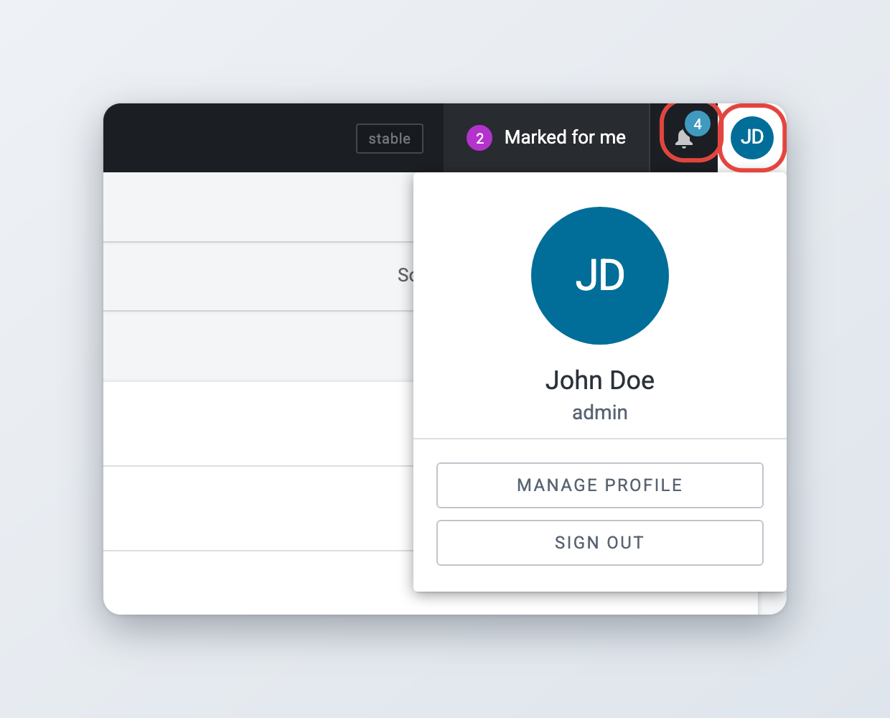

# Superdesk \\- Glossary and Terminology Guide

**Action menu** - The icon with three vertical dots that opens a menu of further actions. On a list row its tooltip is **Item actions**, in the editor top bar and the Monitoring toolbar it is **More actions**. The menu offers actions such as editing, spiking or fetching an item to a desk. Action menus appear on items in lists, in the preview and in the editor's top bar. See [Monitoring Tab](../workspace-and-search/monitoring-tab.md#item-actions).

**Activity Stream** - A Dashboard widget that shows what happens to items across all desks. You can set how many entries it shows. See [Dashboards and Widgets](../workspace-and-search/dashboards-and-widgets.md#activity-stream-widget-settings).

**Advanced Search icon** - The **Toggle filters** button, shaped like a funnel, at the left of the Search header. It opens the advanced search panel, where you set more parameters and filters for your search. See [Searching Content in Superdesk](../workspace-and-search/searching-content-in-superdesk.md#advanced-search).

**Agenda** - Agendas are part of the Superdesk Planning component. They group planning items, for example by desk, by topic or for a special occasion. Agendas are managed in Planning with **Actions** > **Manage Agendas**. See [Planning administration](../superdesk-planning-component/planning-administration.md#agendas).

**AI provider** - A connection to an external AI service that Superdesk uses for its AI features. Administrators add providers, with the service address, the API key and the models people may use, in **Settings** > **AI Providers** (since 3.7). See [AI features](../integrations-and-advanced-features/ai-features.md).

**Analytics** - The Analytics module adds reports on publishing, desk activity and user activity, and extra Dashboard widgets. See [Analytics](../integrations-and-advanced-features/analytics.md).

**Article / News Item / Content Item** - These are generic terms for any content in Superdesk including text articles, photos, videos, packages, used throughout this manual.

**Asset** - See **SAMS / Asset**.

**Availability** - Lets freelancers and correspondents enter the days and hours they can work, and lets editors see everyone's availability by day or by week on the Availability Management dashboard. See [Availability Management](../availability-management/README.md).

**Byline** - A metadata field on an article which usually contains the author’s name and the date of creation.

**Closed desk** - A desk that is closed for a while, for example overnight, with another desk set as the destination for its incoming content. The content stays on the closed desk: the **Desk Routing** incoming rule on its stages marks each new item for the destination desk, so the people there can find it. You close and reopen a desk with the **Desk Router** Dashboard widget: choose a desk under **Route incoming content to** and click **Start routing**, or click **Stop routing** to reopen it. The top bar then shows "Routing to:" on the closed desk and "Routed from:" on the destination desk. You need the **Desk routing** privilege. See [Dashboards and Widgets](../workspace-and-search/dashboards-and-widgets.md#desk-router) and [Desk Creation and Desk Management](../administration/desk-creation-and-desk-management.md#desk-routing).

**Content Filter** - Content Filters allow you to create a series of criteria through which Superdesk can narrow down the news items and create news item groupings. Content Filters allow you to build various Products for distribution. You can use any number of Filter Conditions, or Content Filters to automatically select the content for the Product. Content Filters are optional. If you choose not to use any Content Filters, every news item that you publish will be part of your Product. See [Content Filters and Internal Destinations](../administration/defining-publishing-in-superdesk/content-filters-and-internal-destinations.md).

**Content list** - An ordered list of articles that you curate by hand, for example the top stories for a home page. Your website or app reads the list from Superdesk and shows the articles in that order. Content lists are an optional module (since 3.7). See [Content lists](../integrations-and-advanced-features/content-lists.md).

**Content Profile** - The set of fields an item has, their order and which ones are required. Every template points to a content profile. Administrators manage profiles in **Settings** > **Content Profiles**. See [Content profiles](../administration/content-configuration/content-profiles.md).

**Corrections workflow** - An optional setting for corrections to published items. With it, a correction goes back into the normal editorial workflow, so it can be edited and reviewed like any other item before you send it. Without it, you correct the item in a separate editor and send the correction straight away. Your administrator decides which one your Superdesk uses. See [Corrections](../content-management/updates-corrections-kills-and-takedowns/corrections.md#the-corrections-workflow).

**Create icon** - On the Dashboard, the plus icon in the top-right corner lets you add widgets. To create a new item, a package or to upload media, use the **Create new** button on the right of the bar at the bottom of the screen, or the **+** button in the Monitoring header. The plus icon also appears in other places, such as the settings pages, where it creates a new entry of that kind. See [Creating and Editing Content Items](../content-management/creating-and-editing-content-items/README.md#creating-an-item).

**Custom block** - A reusable, preformatted block of content, such as a list or a pull quote, that you add to the body of an article with the **Custom block** button in the editor toolbar. Administrators define custom blocks in **Settings** > **Metadata** > **Custom blocks** and turn them on in the content profile. See [Writing and formatting](../content-management/creating-and-editing-content-items/writing-and-formatting.md#custom-blocks) and [Metadata and custom fields](../administration/content-configuration/metadata-and-custom-fields.md#custom-blocks).

**Custom Workspace** - A personal view that you create in the Desks menu. It combines stages and saved searches from several desks in one Monitoring view and has its own Dashboard. See [Desks and Custom Workspaces](../workspace-and-search/desks-and-custom-workspaces.md#creating-a-custom-workspace).

**Dashboard** - You open the Dashboard with the **Dashboard** icon in the Workspace Panel. It gives an overview of content and information with Widgets. Desk administrators set up the widgets on a desk's Dashboard. In a Custom Workspace, you choose your own widgets. See [Dashboards and Widgets](../workspace-and-search/dashboards-and-widgets.md).

**Desks** - Desks are the basic organisational unit within Superdesk. They are similar to topic desks, or news beats that would be found in a traditional newsroom; for example a sports desk, foreign news desk, entertainment desk, etc. The **Desks menu** is the drop-down menu to the right of the Main menu button. It always shows the name of the desk you are working on. Users can only view the desks to which they are assigned. A single user can work on multiple desks. See [Navigation](../navigating-superdesk/navigation.md#the-desks-menu) and [Desk Creation and Desk Management](../administration/desk-creation-and-desk-management.md).

**Destinations** - Destinations are the _where_ in the publishing process. You can have multiple destinations for a single Subscriber. See [Products and Subscribers](../administration/defining-publishing-in-superdesk/products-and-subscribers.md#destinations).

**Embargo** - A date and time before which subscribers must not use an item. An embargo does not hold the item back: Superdesk publishes the item straight away and marks it as embargoed until that date. If the item must not leave Superdesk before a certain time, use a **Publish schedule** instead, or both. See [Sending, scheduling and publishing items](../content-management/sending-scheduling-and-publishing.md#embargo-and-publish-schedule).

**Events** - Events are part of the Superdesk Planning component. Events can be created by hand, or ingested automatically from an external calendar or feed. See [Events](../superdesk-planning-component/events.md).

**Fetch** - The process of moving an article to a Desk. Usually specifically refers to moving an article from _Ingest_ to a Desk. See [Desks and Custom Workspaces](../workspace-and-search/desks-and-custom-workspaces.md#fetching-items-from-search).

**Flag** - A marker you set on an item in the **Info** widget, such as **Not For Publication** or **Legal**. Not to be confused with the item's state, such as published or killed, which appears as a coloured label in lists. See [Metadata and fields](../content-management/creating-and-editing-content-items/metadata-and-fields.md#the-info-widget) and [Icons and User Experience](../navigating-superdesk/icons-and-user-experience.md#item-states).

**Global Read** - A setting on a desk stage that lets users who are not members of the desk see the stage's items, in their own Monitoring views and in search. The matching setting for a saved search is **Make global**. See [Desk Creation and Desk Management](../administration/desk-creation-and-desk-management.md#stages-tab).

**Global Search** - A Search that encompasses all the articles in Superdesk, other than articles created in Personal Spaces. See [Searching Content in Superdesk](../workspace-and-search/searching-content-in-superdesk.md).

**Grid / list icon** - The view switcher at the right of the Search header. It switches the results between the list view and the photo grid view, which is best for pictures. See [Searching Content in Superdesk](../workspace-and-search/searching-content-in-superdesk.md#sorting-and-changing-the-view).

**GUID** - A unique global identifier for your item, shown in the **Info** widget. It cannot be changed. GUID identifiers can be used to test Content Filters. See [Metadata and fields](../content-management/creating-and-editing-content-items/metadata-and-fields.md#the-info-widget).

**Hamburger Menu** - See **Main menu**.

**Headline** - The main idea of a story, presented in a few words. It’s usually presented in a larger font above the body of the news item.

**Highlights** - Desk-specific curated lists of important articles. Commonly used for making top 10 lists, section features and other types of user-curated lists. Items are marked for a highlight by hand, and a highlights package can be created from the items marked within a time window. Highlight lists can be published or simply used for Superdesk-internal communication of important news items. See [Highlights](../workspace-and-search/highlights.md).

**Ingest** - As a verb, “Ingest” refers to the way in which articles from other news sources arrive or are imported into Superdesk. As a noun, the ingest refers to the list of articles that have arrived in Superdesk from external sources. See [Ingesting News Items and Events](../integrations-and-advanced-features/ingesting-news-items-and-events.md).

**Ingest feed** - A search containing only newly ingested articles and news items.

**Ingest Source / Source** - An Ingest Source is a feed from which Superdesk will bring in externally created news items. See [Ingesting News Items and Events](../integrations-and-advanced-features/ingesting-news-items-and-events.md#creating-new-ingest-sources).

**Kill** - The withdrawal of a news item that has been published, usually because of legally problematic material. Killing a news item tells everyone who received it that it must not be used, and why, and that it must be taken down if it has been published. The kill action removes the article content from everywhere except the Legal Archive, if your Superdesk has one. A takedown is a similar action with its own notice. See [Kills, takedowns and unpublishing](../content-management/updates-corrections-kills-and-takedowns/kills-takedowns-and-unpublishing.md#killing-an-item).

**Macro** - A specific set of rules and transformations that are applied to an article. You run macros from the **Macros** widget while editing an article. Macros are written by developers and installed on the server. See [Metadata and fields](../content-management/creating-and-editing-content-items/metadata-and-fields.md#macros) and [Templates, macros and dictionaries](../administration/content-configuration/templates-macros-and-dictionaries.md#macros).

**Main menu** - Opened with the button with three horizontal lines in the top-left corner of the Superdesk interface, also called the Hamburger Menu. The entries you see depend on your user role and privileges. It gives access to features such as Settings, User Management, Publish Queue and Admin tools. See [Navigation](../navigating-superdesk/navigation.md#the-main-menu).

**Mark for user** - Flags an item for a colleague's attention without sending it to them. The marked user finds the item under **Marked for me** in the top bar. See [Collaboration tools](../content-management/creating-and-editing-content-items/collaboration-tools.md#mark-for-user).

**Master Desk** - A read-only overview of the work in progress across all desks: how many items sit in each stage, who is working on what, and how planning assignments are progressing. Open it from the Workspace Panel. You need the Master Desk privilege. See [Master Desk](../workspace-and-search/master-desk.md).

**Metadata** - Metadata is information about news items and articles in Superdesk. This information, which is attached to all items, may include fields like:

* Slugline - a Superdesk-internal article description which appears adjacent to the headline.
* Priority - a news value rating between 1 and 6. A value of 1 means it has the highest value.
* Urgency - a rating between 1 and 6 on the relative significance of an article. 1 is the highest.
* Genre - a drop-down menu to select an article type, for example: interview, analysis, feature.
* Place - a drop-down menu for where the article is being written.
* Subject - a drop-down menu for selecting the topic, for example: politics, arts, sports, health.

The more complete your metadata is, the easier it will be to search for and update it. See [Metadata and fields](../content-management/creating-and-editing-content-items/metadata-and-fields.md).

**Monitoring** - The main working view, opened from the Workspace Panel. It shows the stages and saved searches of the selected desk. Desk administrators set up Monitoring for desks. In a Custom Workspace, you choose the desk stages and saved searches to monitor in one place. See [Monitoring Tab](../workspace-and-search/monitoring-tab.md).

**Monitoring Widget** - A Dashboard widget, called **Monitor** in the list of widgets, which can be adjusted to show desk Stages and Saved Searches. It can be used on desks, or custom workspace Dashboards. See [Dashboards and Widgets](../workspace-and-search/dashboards-and-widgets.md#monitoring-widget-settings).

**Multiedit** - A feature in Superdesk which allows you to have more than one article open at the same time, side by side. Choose **Multiedit** in the editor's **More actions** menu. See [Creating and Editing Content Items](../content-management/creating-and-editing-content-items/README.md#the-top-bar).

**Open Items** - The bar at the bottom of the screen lists the items you have open. Click **All opened items** at its left end to see them all. See [Icons and User Experience](../navigating-superdesk/icons-and-user-experience.md#the-bar-at-the-bottom-of-the-screen).

**Output** - Articles from a desk that are ready to be published. Output rules can be applied to these articles.

**Package** - A number of items (articles and/or images) that Superdesk users can group together. Packages can be published as a single item. Packages have their own metadata outside of the metadata attached to their individual components. See [Packages](../content-management/packages.md).

**Personal Items** - Articles or Items that have been created in your Personal Space. These articles are private until sent to a Desk. Items created in your Personal Space will not show up in Global Searches.

**Personal Space** - Each user has a Personal Space in which they can create Personal Items. You open it from the Main menu or with the **Personal space** icon in the Workspace Panel. The Personal Space is separate from Custom Workspaces. See [Desks and Custom Workspaces](../workspace-and-search/desks-and-custom-workspaces.md#personal-space).

**Planning Item** - Planning Items are part of the Superdesk Planning component. Planning items are used to assign coverage to specific desks or users. They can be generated from Events, or they can be created manually. Each Planning Item can contain several pieces of coverage, each assigned to a different user. Planning Items can be exported from the Planning list to generate articles on a desk. See [Planning items and coverages](../superdesk-planning-component/planning-items-and-coverages.md#planning-items).

**Production API key** - A client ID and secret that an external application uses to read content from the Production API. Each key has scopes that limit what the application can read, such as **Archive**, **Desks** or **Users**. Administrators create keys in **Settings** > **Production API**. See [Superdesk API](../integrations-and-advanced-features/superdesk-api.md#managing-production-api-keys).

**Products** - Products can be thought of as another layer of Content Filters. A typical Product might be the same as the application of Content Filter before an item gets published. However within the Products interface in Superdesk, you can further define the Product by adding territorial restrictions. A Product that has no Content Filters applied will contain every item that is published in your instance of Superdesk. See [Products and Subscribers](../administration/defining-publishing-in-superdesk/products-and-subscribers.md#creating-products).

**Publish** - The act of sending a completed item to your subscribers. News items can be published across multiple formats. See [Sending, scheduling and publishing items](../content-management/sending-scheduling-and-publishing.md#publishing-an-item).

**Publish schedule** - A date and time at which Superdesk publishes an item automatically. Until then the item is scheduled and nothing is sent to subscribers. Unlike an **Embargo**, a publish schedule keeps the item inside Superdesk until that time. See [Sending, scheduling and publishing items](../content-management/sending-scheduling-and-publishing.md#embargo-and-publish-schedule).

**Publishing queue** - The **Publish Queue** page in the Main menu lists what was sent to each subscriber and destination, and its status. If an item failed to publish, you see it here and can resend it. You need the **Publish Queue** privilege. See [Publish Queue, Legal Archive and Content Expiry](../administration/defining-publishing-in-superdesk/publish-queue-legal-archive-and-content-expiry.md#check-publish-queue).

**Pyramid icon** - The button next to the **Sort** control in Monitoring and Search. It switches the sort order between ascending and descending. See [Searching Content in Superdesk](../workspace-and-search/searching-content-in-superdesk.md#sorting-and-changing-the-view).

**Roles** - A role is your designated job within Superdesk. Your role comes with a set of privileges and permissions. Some examples of roles are: journalist, editor, manager, reporter, bureau-chief, copytaker, producer, etc. Permissions for each role are customisable from the Settings menu. See [User Management and User Roles](../administration/user-management-and-user-roles.md#user-roles).

**Rundown** - The running order of a radio or TV broadcast: a list of items with their planned durations, which can have subitems. A rundown belongs to a **Show** and is created from one of the show's rundown templates. See [Broadcasting: shows and rundowns](../broadcasting-shows-and-rundowns.md).

**SAMS / Asset** - SAMS is an optional shared library of files, such as PDFs, documents, images or audio. An asset is one file in that library, with its name, description and tags. You upload an asset once and attach it to as many stories as you need. Assets are grouped in sets. See [Asset management (SAMS)](../integrations-and-advanced-features/asset-management.md).

**Saved Search** - A Saved Search is a set of parameters which have been generated by a user in Superdesk to find articles. Saved Searches can be displayed in Monitoring Widgets and Monitoring tabs on desks if they are global. See [Searching Content in Superdesk](../workspace-and-search/searching-content-in-superdesk.md#saved-searches).

**Show** - A radio or TV programme in the Broadcasting module, such as a daily news bulletin. Each show has a name, a code and rundown templates, from which its **Rundowns** are created. See [Broadcasting: shows and rundowns](../broadcasting-shows-and-rundowns.md).

**Slugline** - While articles are in production, it is common practice for journalists to designate them with a short name or “slug” to describe the article story or subject. In the article editing window, users can enter this name in the slugline text box. Note that sluglines are Superdesk-internal and do not appear in the published version of an article. Sluglines can be used for grouping Related Items.

**Spike** - Spiking removes articles from the desk workflow. Spiked articles aren’t deleted, but are moved to the Spiked Items view of that desk. You can’t spike items that are locked or currently open. To view a desk's spiked items, click the **Spiked Items** icon in the Workspace Panel. See [Spiked Items](../content-management/spiked-items.md).

**Stage** - In Superdesk, content within desks are divided into Stages. Usually there’s an input area to which articles are fetched, an area for newly created items, an area for editing, an area for published items, etc. These areas are called Stages. Stage names (i.e. input, output, etc.) are defined by the desk administrator and can be unique to each Desk. See [Desk Creation and Desk Management](../administration/desk-creation-and-desk-management.md#stages-tab).

**Subscribers** - Subscribers are customers. Each Subscriber can receive a mixture of Products, to any number of Destinations. A Subscriber can also be another distribution system or systems. For a digital publisher, the Subscriber can be a website, mobile app or other asset. See [Products and Subscribers](../administration/defining-publishing-in-superdesk/products-and-subscribers.md#define-subscribers).

**System message** - A message that administrators show at the top of every Superdesk user's screen, for example to announce planned maintenance. Administrators set it up in the Main menu under **Admin tools** > **System Message**. See [System messages](../administration/system-messages.md).

**Takekey** - A metadata field, shown as **Take key**, that tells where an item sits in a sequence. When you create an update of a published item, Superdesk fills it in: "update" for the first update, then "2nd update", "3rd update" and so on. See [Updates](../content-management/updates-corrections-kills-and-takedowns/updates.md).

**User icon** - The round icon in the top-right corner of the Superdesk interface. It shows your picture or, if you have not added one, your initials. Click it to see your name and username and the **Manage profile** and **Sign out** buttons. Your notifications are under the bell icon to its left; a number on the bell shows how many you have not read yet. See [Your profile and preferences](../navigating-superdesk/your-profile-and-preferences.md#the-user-menu).

<figure><figcaption>
The notifications bell and the user menu
</figcaption></figure>

**Username** - Superdesk users log in using their username. Usernames are chosen at the time of profile creation. Comments directed towards a particular user can use @ _username_ to tag the user in a comment. Once the user profile is created, the username cannot be changed. See [User Management and User Roles](../administration/user-management-and-user-roles.md#adding-new-users).

**Widget** - Widgets are tools that you can place on your Superdesk Dashboard. They allow for a quick overview of information and content. The standard widgets are Monitor, Activity Stream, World Clock, Ingest Stats, User Activity and Desk Router. Other modules, such as Analytics, can add more. You can customise your personal Dashboard in your Custom Workspace. Shared desk Dashboards are usually configured with Widgets by the admin and each user on the Desk will see the same configuration of Widgets. See [Dashboards and Widgets](../workspace-and-search/dashboards-and-widgets.md).

**Widget bar** - The bar of widget icons on the right-hand side of the editor when an item is open. The widgets include Info, Find and Replace, Comments, Versions/History, Packages, Macros, Translations, Inline comments and Suggestions. Which widgets you see depends on the item and on your installation, and the content profile can turn some of them off. See [Metadata and fields](../content-management/creating-and-editing-content-items/metadata-and-fields.md#widgets).

**Workspace Panel** - The Workspace Panel is the column of icons along the left side of the Superdesk interface. The icons you see depend on your role and on the modules your Superdesk has. They include Dashboard, Monitoring, Highlights, Spiked Items, Personal space, Search and Master Desk. See [Navigation](../navigating-superdesk/navigation.md#the-workspace-panel).
