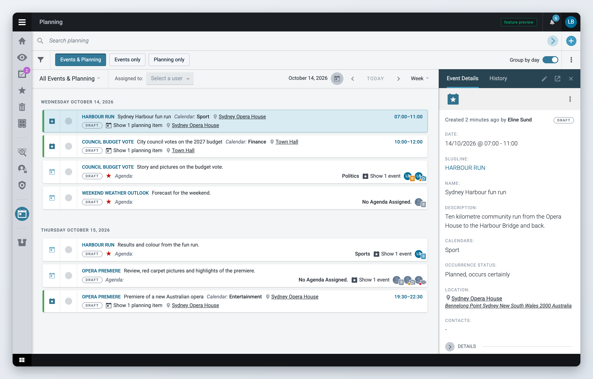
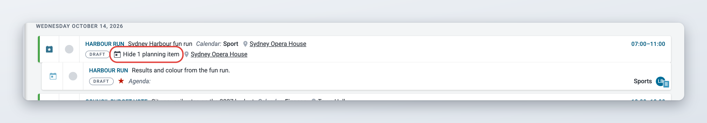
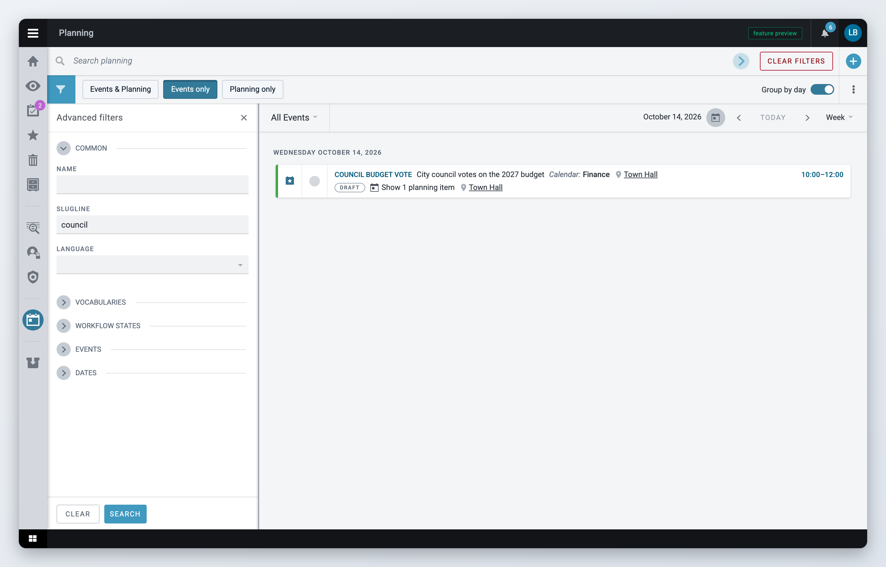

# Superdesk Planning Component

The Planning component lets your newsroom keep a calendar of upcoming events and plan how you will cover them. Editors plan coverage (a story, a photo, a video) and hand it to a desk or a person. That person gets an assignment, starts the article from it, and Superdesk tracks the work until the content is published.

This section is for the people who use Planning every day: planners, editors and journalists. How to set Planning up (profiles, agendas, templates, saved filters, privileges) is explained in [Planning administration](planning-administration.md).


This is an optional module. If you do not see it, ask your administrator.


## Key ideas

* An **event** is something that happens at a given time and place: a press conference, a match, a court hearing. Events can be created by hand or ingested from external calendars. Events are grouped in **calendars**, such as Sport or Finance.
* A **planning item** is your plan for covering something. It holds one or more coverages. A planning item can be linked to an event, or stand on its own. Planning items are grouped in **agendas**, for example by desk or by topic.
* A **coverage** is one piece of content you intend to produce for a planning item, for example a text story or a picture. Each coverage has a type, a due time and a status.
* An **assignment** is a coverage given to a desk, and optionally to a user. Assignments appear in the **Assignments** workspace of the people who have to do the work.

If your newsroom works in several languages, events and planning items can hold their text in each language. See [Multilingual events and planning items](events.md#multilingual-events-and-planning-items).

## In this section

* [Events](events.md)
* [Planning items and coverages](planning-items-and-coverages.md)
* [Assignments](assignments.md)
* [Planning administration](planning-administration.md)

## Opening Planning and Assignments

Planning adds two icons to the Workspace Panel on the left:

* **Planning** (calendar icon) opens the list of events and planning items. Shortcut: **Ctrl+Alt+P**.
* **Assignments** (tasks icon) opens your assignments. Shortcut: **Ctrl+Alt+A**. A number on the icon tells you how many assignments are waiting for you to start.

You only see these icons if your role allows it. If one is missing, ask your administrator.

## The Planning workspace

The Planning workspace has a toolbar at the top and the list of items below it. When you select an item, its preview opens on the right. When you edit an item, the editor opens next to the list.

<figure><figcaption>
The Planning workspace
</figcaption></figure>

The toolbar has two rows, and the list has its own header:

* The first toolbar row has the **Search planning** box and the plus icon to create new items.
* The second toolbar row has the filter icon (**Toggle advanced Filters**), the view switch, the **Group by day** switch and the three-dot **Actions** menu.
* The list header has the list filter menu, the **Assigned to** user filter, and either the date controls or the sort controls.

### Choosing what the list shows

Use the view switch in the second toolbar row:

* **Events & Planning** shows events and planning items together.
* **Events only** shows events.
* **Planning only** shows planning items.

The list filter menu in the list header narrows the list further. In **Events only** it lists your calendars and **No Calendar Assigned**. In **Planning only** it lists your agendas and **No Agenda Assigned**. Saved filters set up by your administrator appear under **Search Filters**.

In the planning views, **Assigned to** shows only planning items with a coverage assigned to the user you pick. Clear the field to see everyone's items again.

If the first entry in the filter menu reads **My Events & Planning**, **My Events** or **My Planning**, you only see items you created yourself. Seeing other people's items needs a privilege. Ask your administrator if you need it.

You can set a default agenda, calendar and filter for when you open Planning. See [Your profile and preferences](../navigating-superdesk/your-profile-and-preferences.md).

### Grouping and sorting the list

When **Group by day** is on, the list is split into one group per day. Use the date controls on the right of the list header to move through time: the arrows go back and forward, **Today** jumps to today, and the menu next to them switches between **Day**, **Week** and **Month** steps.

When **Group by day** is off, the list is one long list. Choose the order with **Sort by** (**Scheduled Date**, **Date Created** or **Date Updated**) and click the arrow next to it to switch between ascending and descending.

If your administrator has set up a compact row layout, a view menu next to **Group by day** lets you switch between **List** and **Compact list**.

### Reading a list row

Each row shows the item's main details. Your administrator decides which fields appear. Some markers are always there:

* A green **P** badge on the left means the item is posted. A light, empty badge means it is not posted yet.
* A red "no entry" icon in the same place means the planning item is marked **Not For Publication**.
* A coloured bar on the left edge means someone has the item open for editing. Nobody else can edit it until they close it.
* On planning items, one icon per coverage shows the coverage type. Its colour tells you how far the work has got. Hover over the icon for the type, desk and status.
* A state label such as **Scheduled**, **Cancelled**, **Postponed** or **Rescheduled** shows the item's workflow state.

### Events and their planning items in one list

*Available since Superdesk 2.9.*

In **Events & Planning**, planning items linked to an event are folded under that event. Click **Show 1 planning item** (or **Show 2 planning items**, and so on) on the event row to unfold them, and click it again to fold them. A linked planning item also appears as a row of its own on its planning date, with a **Show 1 event** link back to the event. Planning items that are not linked to any event are listed on their own.

Your administrator can make linked planning items unfold automatically.

<figure><figcaption>
A planning item unfolded under its event
</figcaption></figure>

### Previewing and editing items

* Click a row to open the item's preview on the right.
* Double-click a row, or choose **Edit** in its action menu, to open the item in the editor.
* Use **Edit in popup** in the row's action menu to edit in a larger window over the list.

The editor saves your changes as a draft in the background. If you close your browser by mistake, the changes are still there when you open the item again. When you close the editor with unsaved changes, Superdesk asks whether to **Save**, **Ignore** the changes or **Cancel** and go back.

To get an item out of the way without closing it, click **Minimise**. It moves to the bar of open items at the bottom of the screen. Click it there to continue.

Each row has an action menu (three dots) that appears when you hover over the row. The actions in it depend on the item's state and your privileges. They are described on the [Events](events.md), [Planning items and coverages](planning-items-and-coverages.md) and [Assignments](assignments.md) pages.

### Working with several items at once

In **Events only** and **Planning only**, hover over a row and tick its checkbox to select it. A bar at the top of the list shows how many items you selected, with **Select all** and **Deselect All**, and icon buttons for what you can do with all of them:

* events: **Export**, **Download**, **Create planning**, **Spike** or **Unspike**,
* planning items: **Add to workflow**, **Export**, **Spike** or **Unspike**.

Selecting several items is not available in **Events & Planning**.

## Searching and filtering

* **Search planning** in the toolbar searches the text of the items in the current view. Press Enter to search.
* The filter icon opens **Advanced filters** on the left. The fields depend on the view and on your setup. Typical ones are name, slugline, category, subject, state, **Only Posted**, **Include Spiked**, **Lock State**, **Source**, dates and creation date. Events have calendars, language and location. Planning items have agendas, urgency, **Featured**, **Ad Hoc Planning** (items without an event) and coverage assignment status. Click **Search** to apply them and **Clear** to empty the panel.
* While a search or filter is active, a red **Clear Filters** button appears in the toolbar. Click it to see the full list again.
* Saved filters appear in the list filter menu under **Search Filters**.

The **Language** filter is on for events by default. Your administrator can add it to the planning item and combined filters too.

<figure><figcaption>
Advanced filters for events
</figcaption></figure>

## Notifications

Planning keeps the people involved informed:

* When a coverage is added to the workflow, the assigned user, or every member of the assigned desk, gets a notification in Superdesk.
* Assignees are also notified when an assignment is reassigned, removed or cancelled, when its due time changes, and when the event behind it is cancelled, postponed or rescheduled.
* The planner is notified when work on an assignment starts and when it is completed.

Notifications appear under the bell icon in the top bar. Assigned users also get an email. You can turn off assignment emails while keeping others: see [Your profile and preferences](../navigating-superdesk/your-profile-and-preferences.md). If your Superdesk is connected to Slack, notifications can also go to Slack.

## For administrators

Everything about setting up Planning is on the [Planning administration](planning-administration.md) page: the **Actions** menu entries, agendas, calendars and coverage types, event, planning and coverage profiles (including multilingual fields), event templates, saved filters and scheduled exports, custom layouts, locations, privileges and server settings.

Behaviour described on this page that depends on your setup:

* who sees the Planning and Assignments icons, desk assignments and other people's items (privileges),
* whether coverages are added to the workflow automatically, and whether assigning a desk sets the status to **Planned**,
* whether linked planning items unfold automatically under their event,
* how many events a planning item can be linked to (`PLANNING_EVENT_LINK_METHOD`),
* the **Assignments** button in the top bar (planning extension option `assignmentsTopBarWidget`).
