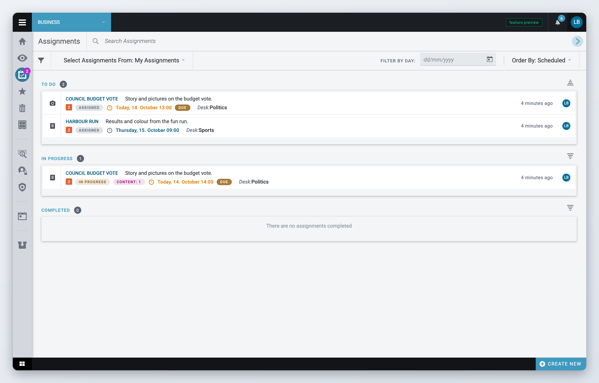
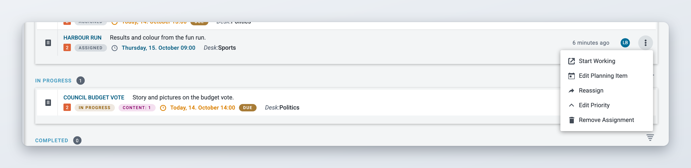

# Assignments

An assignment is a coverage given to a desk, and optionally to a user. Superdesk creates it when the coverage is added to the workflow; see [Planning items and coverages](planning-items-and-coverages.md#adding-a-coverage-to-the-workflow). This page explains how to find your assignments and work on them.

## The Assignments workspace

Click the **Assignments** icon in the Workspace Panel. Your assignments are listed in three groups:

* **To Do**: assignments that are waiting to be started, or that were submitted to another desk.
* **In Progress**: assignments someone is working on.
* **Completed**: assignments that are done or cancelled.

Click the title of a group to show only that group. Click **Back to group list view** to see all three again.

<figure><figcaption>
The Assignments workspace
</figcaption></figure>

The filter bar above the list has:

* **Select Assignments From:** a dropdown with **My Assignments** (the assignments given to you on any desk), each of your desks, and **All Desks** if your setup allows it.
* **Filter by day:** shows only assignments due on one day. The shortcuts **Today**, **Tomorrow** and **In 2 days** are at the top of the date picker (since 2.8).
* **Order By:** sorts by **Created**, **Updated**, **Priority** or **Scheduled**. Each group also has its own sort direction icon.
* **Search Assignments** in the toolbar, and the filter icon for advanced filters such as slugline, user, content type and priority.

Seeing the assignments of a desk needs a privilege. Users without it only see their own assignments (since 3.6).

Click an assignment to open its preview. It shows the coverage, the planning item and the event it belongs to, and a history of what happened to it.

## Working on an assignment



### Start working

In the Assignments workspace, open the assignment's action menu and choose **Start Working**. This is available for text assignments that are assigned to you or to your desk with no user.



### Pick a template

In the **Select template** window, pick a template under **Default Template**, **Desk Templates** or **My Templates**.



### Write the article

The new article opens in the editor, already linked to the assignment. Superdesk fills in the slugline, ed note, genre, category, urgency and headline from the coverage and planning item. The assignment moves to **In Progress**.



### Send and publish

Work on the article as usual; see [Creating and Editing Content Items](../content-management/creating-and-editing-content-items/README.md). If you send it to another desk, the assignment shows as submitted. When the article is published, the assignment is completed automatically.



If you need to close an assignment without publishing, use **Complete Assignment** in its action menu.

## Linking an existing article

Sometimes the content already exists: you wrote the story before the coverage was planned, or you started it from scratch. In Monitoring or in the editor, open the article's action menu and choose:

* **Link to Assignment** to attach the article to an existing assignment. Pick the assignment in the **Select an Assignment** window.
* **Add to Planning** to add the article as a new coverage of a planning item.
* **Unlink as Coverage** to remove the link again.

When an article is linked to an assignment, the **Planning Details** widget in the editor's right-hand panel shows the planning item and coverage. Its badge shows how many coverages the planning item has.

## Assignments for pictures, video and other content

Coverage types that are not written in the Superdesk editor, such as pictures, video or live blogs, cannot be started with **Start Working**. When the content is ready, choose **Confirm Availability** in the assignment's action menu. The assignment moves to **Completed**. If you confirmed it by mistake, use **Revert Availability**.

## Other assignment actions

The action menu of an assignment also has:

* **Reassign**: give the assignment to another desk or user. The previous assignee is notified.
* **Edit Priority**: change the assignment priority. The priority label in the list changes colour.
* **Remove Assignment**: delete the assignment. The coverage stays on the planning item without an assignee. Superdesk asks you to confirm first.
* **Edit Planning Item**: open the planning item in Planning.
* **Open Coverage**: open the article linked to the assignment.

<figure><figcaption>
Actions for an assignment
</figcaption></figure>

An **Accepted** label on an assignment means the assignee confirmed it through an external system connected to your Superdesk. The person who gave the assignment gets a notification. Superdesk itself has no button to accept an assignment.

## Assignments in the top bar

*Available since Superdesk 2.5.*

Your administrator can add an **Assignments** button to the top bar. It shows how many assignments you have that are assigned, submitted or in progress. Click it to see them grouped by desk, and click one to open it.
