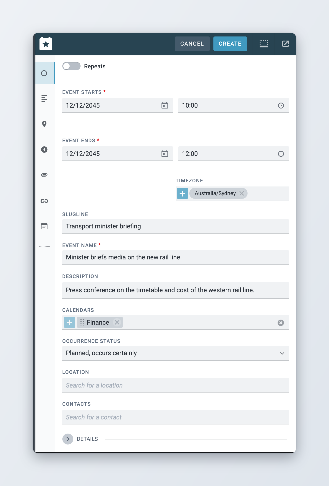
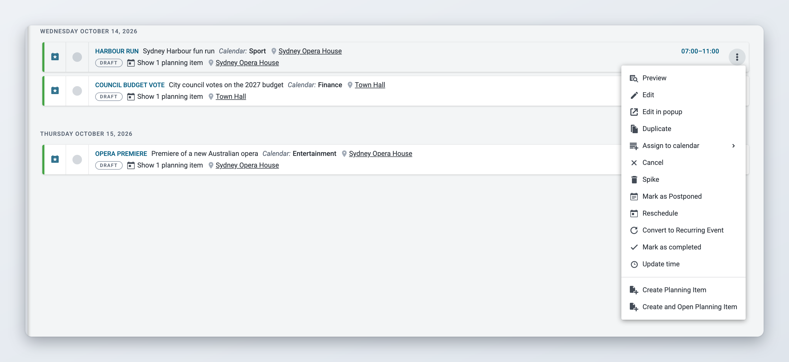
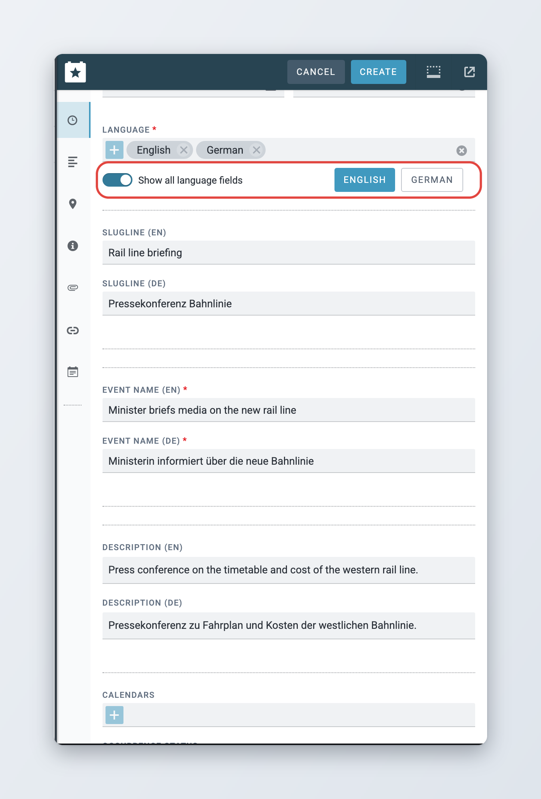

# Events

An event is something that happens at a given time and place, such as a press conference, a match or a court hearing. This page explains how to create and change events, how to post events and planning items, and how to export them as an article. For the Planning workspace, its views and filters, see [Superdesk Planning Component](README.md).

## Creating an event



### Open a new event

In Planning, click the plus icon at the right of the toolbar and choose **Event** under **Create new**. If your administrator has set up event templates, you can pick one under **From template** instead, and the form opens with the template's details filled in.



### Fill in the schedule

Enter the date in **Event Starts** and, if the event has a set time, the start time. Fill in **Event Ends** in the same way. See [Dates and times](#dates-and-times) below.



### Describe the event

Fill in at least the required fields, usually **Slugline** and **Event Name**. Add as much of the rest as you can: description, calendars, location, contacts.



### Create it

Click **Create**. The event appears in the list. To make it visible outside Superdesk, click **Post** after creating it. See [Posting events and planning items](#posting-events-and-planning-items).



<figure><figcaption>
Creating an event
</figcaption></figure>

The event form is split into sections. Use the icons on the left of the editor to jump to a section. The default form has these fields; your administrator can add, remove or rename them:

* **Schedule**: **Repeats**, **Event Starts**, **Event Ends** and **Timezone**.
* **Description**: **Slugline**, **Event Name**, **Description**, **Calendars** and **Occurrence Status** (how certain it is that the event takes place).
* **Location**: **Location** and **Contacts**.
* **Details**: **Category**, **Subject**, **Long Description**, **Internal Note** (only seen inside your newsroom) and **Ed Note**.
* **Attachments**, **Links** and **Related Plannings**.

## Dates and times

* Enter dates and times in the time zone of your browser. When you set a start time, a **Timezone** field appears. Set it to the time zone where the event takes place, for example Asia/Tokyo for an event in Japan.
* If the time is not known yet, open the time picker and choose **To Be Confirmed**. The event shows **Time TBC** until you set the time.
* An event that spans several days appears in the list on each of its days.

You set the dates when you create an event. After that, change them with the **Update time** or **Reschedule** actions, so that linked planning items and assignments are updated too. See [Changing an event](#changing-an-event).

## All-day events

*Available since Superdesk 3.1.*

To create an all-day event, fill in the date and leave the time empty. The list shows **All day** for it. For an all-day event over several days, fill in the end date without a time. To turn an event with times into an all-day event, open the time picker and clear the time.

## Recurring events

Use recurring events for things that happen on a regular schedule, such as a weekly council meeting.



### Turn on Repeats

In the **Schedule** section, turn on **Repeats**. The date fields change to **First Event Starts** and **First Event Ends**.



### Set the frequency

Under **Every**, choose how often: for example every 1 **Week(s)**. For weekly events, tick the days under **On Days**. For monthly events, choose the day under **Repeat On**.



### Set the end

Under **Ends**, choose **On** and pick the last date, or **After** and enter the number of events in **Repeats**.



### Create the series

Fill in the rest of the event and click **Create**. Superdesk creates one event per occurrence, and each one appears in the list on its own date.



When you edit, post, cancel or change the time of one event in a series, Superdesk asks which events the change applies to: **This event only**, **This and all future events** or **All Events**.

To change the rule of an existing series, use **Update Repetitions** in the action menu. To turn a single event into a series, use **Convert to Recurring Event**.

## Locations



### Search for the place

In the **Location** field, start typing the name of the place. Superdesk lists matching locations saved earlier under **Existing Locations**.



### Search the map if needed

If the place is not in the list, click **Search OpenStreetMap** to look it up on the map service.



### Or add it by hand

Click **Add a new location**. In the **Add New Event Location** window, fill in at least the name, address, city and country, and click **Create Location**. The location is saved for everyone to reuse.



## Contacts

Use **Contacts** to record who to talk to about the event, such as a press officer. Type a name in **Search for a contact** and pick the person from the list. To change a contact's details, click **Edit Contact** on it. If you have the right to manage contacts, you can also create a new one with **Add Contact**.

Contacts come from the Media Contacts list. See [Media Contacts](../administration/user-management-and-user-roles.md#media-contacts) for how contacts are managed.

## Attachments, links and related articles

* **Attachments**: upload files that help the journalists covering the event, such as an invitation or a programme.
* **Links**: add web addresses with background information. Click **Add link** for each one.
* **Related Articles**: if your administrator has added this field, search for existing articles about the event and link them.

## Changing an event

The action menu of an event lists what you can do with it. Which actions appear depends on the event's state and your privileges.

| Action | What it does |
| --- | --- |
| **Preview** | Open the event in the preview panel. |
| **Edit**, **Edit in popup** | Open the event in the editor. |
| **Create Planning Item**, **Create and Open Planning Item** | Create a planning item linked to this event, with the event's details copied in. See [Creating a planning item](planning-items-and-coverages.md#creating-a-planning-item). |
| **Duplicate** | Open a copy of the event as a new event. |
| **Update time** | Change the start and end time. |
| **Reschedule** | Move the event to new dates. You give a reason, and linked planning items are marked as rescheduled. |
| **Mark as Postponed** | Mark the event as postponed, with a reason. Linked planning items are postponed too. |
| **Cancel** | Cancel the event, with a reason. Depending on your setup, linked planning items are cancelled too. |
| **Convert to Recurring Event**, **Update Repetitions** | Turn the event into a series, or change the series rule. |
| **Assign to calendar** | Add the event to a calendar. |
| **Save event as a template** | Save the event's details as a template for similar events. Only shown if event templates are enabled. See [Planning administration](planning-administration.md#event-templates). |
| **Mark as completed** | Mark an event that is taking place today as completed. |
| **Spike**, **Unspike** | Move an unposted draft event out of the list, or bring it back. |

<figure><figcaption>
Actions for an event
</figcaption></figure>

## Ingested events

*Available since Superdesk 2.8.*

Events can arrive automatically from external calendars through ingest. Your administrator sets these feeds up; see [Ingesting News Items and Events](../integrations-and-advanced-features/ingesting-news-items-and-events.md).

You can edit an ingested event like any other. When the source later sends an update, Superdesk keeps your changes to the name, description, long description, links, ed note, subject, category, location and contacts, and updates the other fields from the source. Whoever installs Superdesk can change this list of fields (`EVENT_INGEST_CONTENT_FIELDS`).

## Posting events and planning items

Posting makes an event or planning item visible outside Superdesk, for example to your customers in Newshub. Where posted items go depends on how your Superdesk is set up.

* To post, open the item and click **Post**. If you have unsaved changes, the button reads **Save & Post**.
* A posted item gets the green **P** badge in the list and the **Scheduled** state.
* To change a posted item, edit it and click **Update**. Superdesk saves the changes and posts the new version. This includes adding coverages: you can add coverage to a posted planning item at any time, without unposting it first.
* To withdraw an item, click **Unpost** (**Save & Unpost** with unsaved changes). The item is marked as **Killed**.


Unposting a planning item deletes the assignments of its coverages and puts the coverages back to draft. Anyone working on those assignments loses them.


When you post an event that has linked planning items, Superdesk can post the planning items too, depending on your setup. When you post or unpost one event of a recurring series, Superdesk asks whether to apply it to all events in the series or just this one.

Posting and unposting need their own privileges. If you do not see the buttons, ask your administrator.


Newshub can hide coverage details from some customers. If a company in Newshub has **Restrict Coverage Info** turned on, its users only see the type, number and due date of coverages, not their names or status. This is set in Newshub, not in Superdesk.


## Exporting items as an article

You can turn a set of events or planning items into an article, for example a daily advisory for your customers.



### Select the items

Switch to **Events only** or **Planning only** and tick the items you want.



### Click Export

Click the **Export** icon in the selection bar. The **Export as article** window opens.



### Choose where and how

Pick the **Desk** where the article is created, an **Article Template** and a **Custom Layout** for the text. Drag the items into the order you want. Locked items are left out unless you click **Include all locked items**.



### Export

Click **Export**. The article is created on the chosen desk, where you can edit and publish it like any other.



For events, **Download** in the selection bar does the same but saves the result as a file instead of creating an article. Planning items marked **Not For Publication** cannot be exported. Your administrator can also set up exports that run automatically; see [Planning administration](planning-administration.md#event-and-planning-filters).

## Multilingual events and planning items

*Available since Superdesk 2.7.*

If your newsroom works in several languages, your administrator can make some fields of events and planning items multilingual, for example the slugline, name and description. See [Planning administration](planning-administration.md#multilingual-events-and-planning-items).

When this is on:

* Pick the languages of the item in the **Language** field. Each multilingual field then shows one input per language.
* Use the language buttons under **Language** to choose the main language. Lists of values, such as categories, are shown in that language.
* Turn off **Show all language fields** to see only the fields of the main language.

Coverages can have their own language too. When you assign a desk that has a default language, the coverage takes that language unless you chose one yourself.

<figure><figcaption>
An event with fields in two languages
</figcaption></figure>
