# Planning administration

This page is for administrators. It explains how to set up the Planning component for your newsroom: agendas, calendars and other lists, the forms journalists fill in, templates, saved filters with automatic exports, locations, contacts and who can do what.

To learn how to create events, planning items, coverages and assignments, see [Superdesk Planning Component](README.md).


Planning is an optional module. If you do not see the Planning icon in the Workspace Panel, ask your administrator. Most settings on this page need a specific privilege. If a menu entry described here is missing, check your role first (see [Privileges](#privileges)).


## Where the planning settings are

Planning has no page of its own under **Settings**. Its settings are spread over a few places:

* **The Actions menu in Planning.** Open Planning from the Workspace Panel and click the three-dot **Actions** icon at the right of the toolbar. This is where you manage agendas, content profiles, event templates, saved filters, custom layouts and featured stories.
* **The Main menu.** **Manage Locations** and **Media Contacts** open their own pages.
* **Settings > Metadata.** The vocabularies that Planning uses (event calendars, coverage types, coverage statuses and more) are managed here like any other vocabulary.
* **Settings > User Roles.** Planning privileges are listed with the other privileges.
* **Server and client configuration.** Some behaviour, such as the fields shown in list rows, is set in configuration files by whoever installs Superdesk. See [Settings that need a configuration change](#settings-that-need-a-configuration-change).

<figure>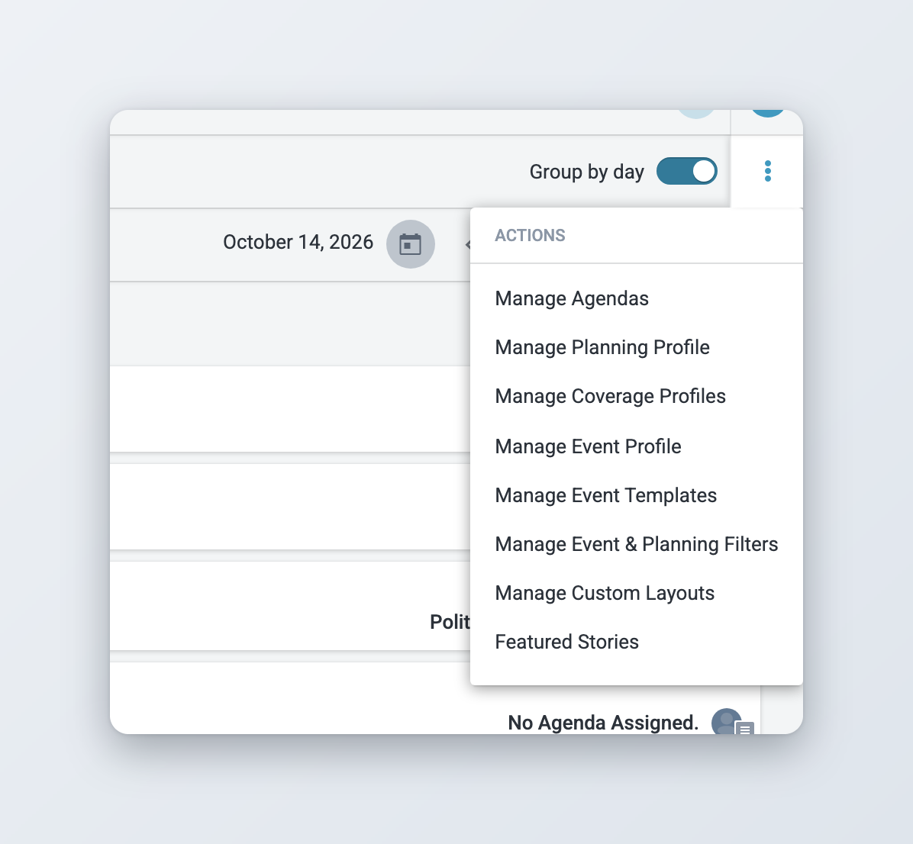<figcaption>
The Actions menu in Planning
</figcaption></figure>

Each entry in the Actions menu only appears if your role has the matching privilege:

| Menu entry | What it manages | Privilege |
|---|---|---|
| Manage Agendas | Agendas for planning items | Planning - Agenda Management |
| Manage Planning Profile | Fields of the planning item form | Planning - Manage Content Profiles |
| Manage Coverage Profiles | Fields of the coverage form, per coverage type | Planning - Manage Content Profiles |
| Manage Event Profile | Fields of the event form | Planning - Manage Content Profiles |
| Manage Event Templates | Saved event templates | Planning - Event Templates |
| Manage Event & Planning Filters | Saved filters and scheduled exports | Planning - Events & Planning View Filters Management |
| Manage Custom Layouts | Layouts used to export items as an article or a file | Planning - Manage Export Templates |
| Featured Stories | The daily list of featured planning items | Planning - Featured Stories |

**Manage Event Templates** also needs event templates to be switched on for your Superdesk. They are on in the default installation.

## Agendas

Agendas group planning items, for example by desk, by topic or for a special occasion such as an election. Journalists pick one or more agendas in the planning item form, and anyone can filter the planning list by agenda.



### Open the agenda list

In Planning, click **Actions** > **Manage Agendas**. The **Manage Agendas** window lists every agenda, with enabled agendas first.



### Add or edit an agenda

Click the plus button to add an agenda, or hover over an agenda and click the pencil icon to edit it. Fill in the **Name** and leave **Enabled** on. Click **Save**.



### Disable or delete an agenda

To retire an agenda, edit it and turn **Enabled** off. To delete it, hover over it and click the trash icon.



A disabled agenda is no longer offered in the planning item form. It still appears in the agenda filter of the planning list, under **Disabled Agendas**, with a lock icon. Items that already use it keep it.

You cannot delete an agenda that is used by a planning item. Disable it instead.

Deleting agendas is part of the **Planning - Agenda Management** privilege. The separate **Planning - Delete Agendas** privilege in User Roles has no effect.

<figure>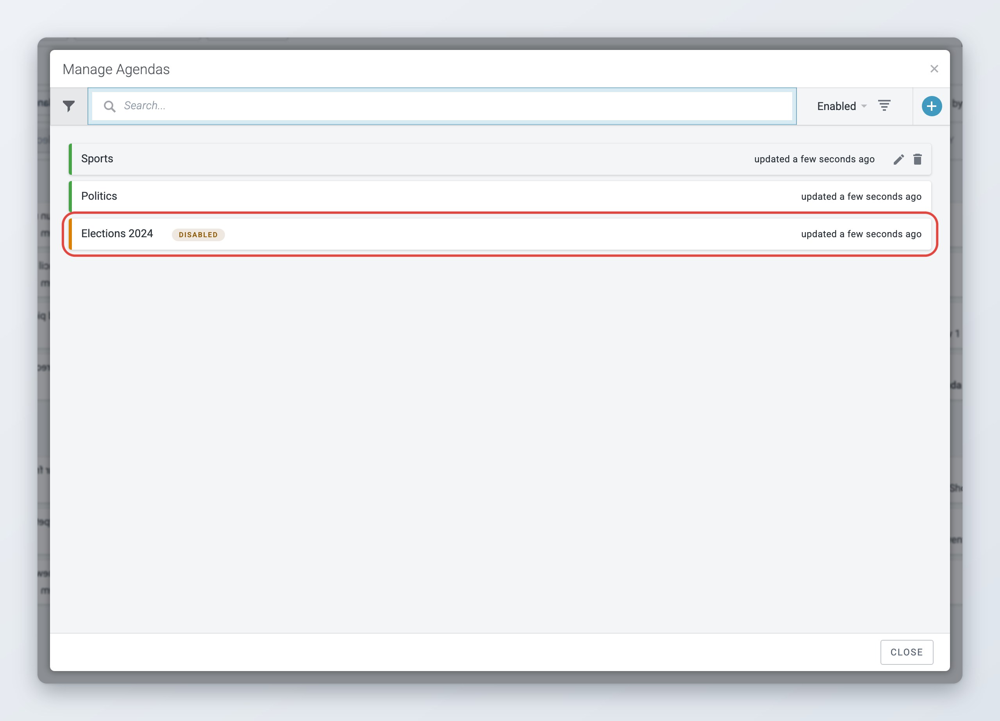<figcaption>
Managing agendas
</figcaption></figure>

## Calendars and other planning vocabularies

Event calendars, coverage types and the other lists used in Planning are vocabularies. You manage them in **Settings** > **Metadata** on the **Vocabularies** tab, like any other vocabulary. See [Metadata and custom fields](../administration/content-configuration/metadata-and-custom-fields.md) for how to edit a vocabulary.

| Vocabulary | Used for |
|---|---|
| Event Calendars | Grouping events, for example Sport, Finance or Entertainment. Users can filter the event list by calendar. |
| Coverage content types | The coverage types users can add to a planning item (Text, Picture, Video and so on). There is one coverage profile per type. |
| News Coverage Status | The status of a coverage, for example coverage intended or not intended. |
| Event Occurence Status | How likely an event is to happen. |
| Assignment Priority | The priority of an assignment. |
| Languages | The languages offered in the Language field and for multilingual events and planning items. |

When you deactivate a calendar, users can no longer pick it. It still appears in the calendar filter under **Disabled Calendars**.

You can also add your own vocabularies and use them as fields in the planning forms. Every vocabulary you create on the **Vocabularies** tab of Settings > Metadata is offered in the event, planning and coverage profile editors, marked **(custom vocabulary)**. Vocabularies that Planning already uses for its own fields, such as categories, genre and coverage statuses, are not offered again.

### Coverage providers

A coverage can be given to an outside provider, such as a stringer or a freelancer, instead of a staff member. The coverage assignment form then shows a **Coverage Provider** field. Its options come from a vocabulary with the ID `coverage_providers`. This vocabulary is not part of the default data, so it has to be added to your Superdesk before the field has any options.

A provider can be linked to a contact type. If that contact type is marked as assignable, users can pick a specific contact from Media Contacts as the **Assigned Provider**.

The link to a contact type is a column of the vocabulary that a vocabulary created in Settings > Metadata does not have. Ask whoever installs Superdesk to load the `coverage_providers` vocabulary with that column (the Planning module ships an example with Stringer and Freelancer). After that, you can edit its values in Settings > Metadata.

## Content profiles

*Available since Superdesk 2.4.*

Content profiles control the forms in Planning: which fields an event, a planning item or a coverage has, in which order and group, and which fields are required. There is one profile for events, one for planning items and one per coverage type.


Profiles apply to everyone. A field you remove disappears from the form for all users, and a field you make required blocks saving until it is filled in.


### Opening a profile

In Planning, click **Actions**, then **Manage Event Profile** or **Manage Planning Profile**. The window has two tabs:

* **Groups** lists the sections of the form.
* **Event Fields** or **Planning Fields** lists the fields, grouped by section.

When you are done, click **Save All** at the bottom of the window. **Discard All** throws away every change since you opened it.

### Groups

Groups are the sections of the form. For each group you set:

* **Name**, with optional **Name Translations** for other interface languages,
* **Icon**,
* **Use Togglebox**: the group is shown as a box that users can expand and collapse,
* **Show Bookmark**: the group gets a bookmark in the editor's side bar, so users can jump to it.

Drag a group to change its position. Use **Add group before** or **Add group after** to insert a group, and the remove icon to delete it.

### Fields

On the fields tab, every field sits in a group. To change the form:

* Drag a field to move it within its group.
* Click **Add field before** or **Add field after** to add one of the fields that are not used yet.
* Click the remove icon to take a field out of the form. Fields that the system needs cannot be removed.

Click a field to open its details on the right. Change the options, then click **Apply**. The options depend on the field:

| Option | What it does |
|---|---|
| Required | The item cannot be saved while this field is empty. |
| Min, Max | Minimum and maximum number of characters. |
| Input Type | For text fields: **Single Line**, **Multi Line** or **Editor 3** (formatted text). |
| Expandable | For multi-line fields: the box grows as users type. |
| Formatting Options | For Editor 3 fields: the formatting buttons users get. |
| Show in embedded form | The field is also shown when users create a planning item or a coverage from inside the event form. |
| All Day Toggle, Default Duration | For the event **Dates** field. |
| Default Value | For **Priority**: the value a new item starts with. |
| Read Only, Post planning items with Event, Cancel planning items with Event | For the event **Related Plannings** field: whether users can edit linked planning items from the event, and whether posting or cancelling the event does the same to its planning items. |
| Multilingual | See [Multilingual events and planning items](#multilingual-events-and-planning-items). |

Some fields are required by the system and always stay required: **Dates** for events, **Planning Date** and **Coverages** for planning items, and **Content Type** and **Scheduled** for coverages. Their details show "This field is required by the system".

<figure>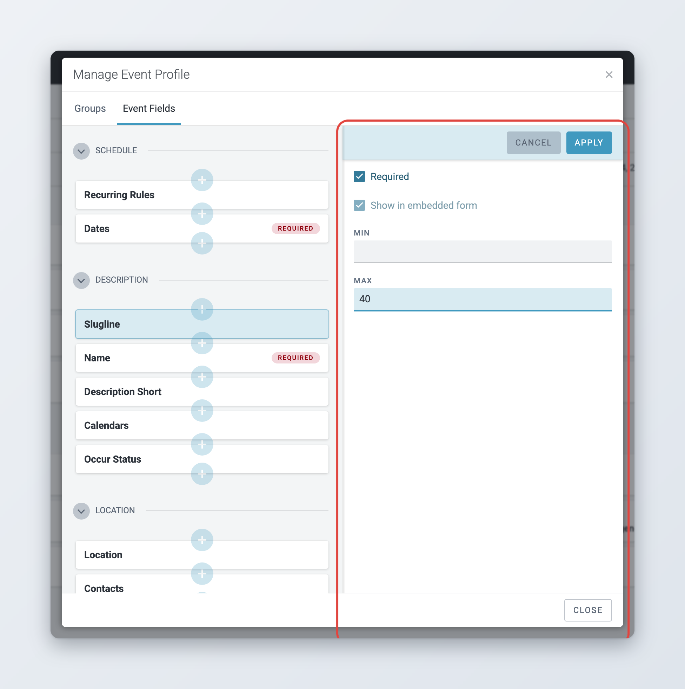<figcaption>
Editing a field in the event profile
</figcaption></figure>

### Multilingual events and planning items

*Available since Superdesk 2.7.*

Text fields such as the name, slugline or description can be filled in several languages in one event or planning item. Users can also filter the planning lists by language. To switch this on for events (do the same in the planning profile for planning items):



### Add the Language field

Open **Manage Event Profile** and go to the **Event Fields** tab. If the **Language** field is not in the form yet, add it.



### Make the Language field multilingual

Click **Language** and tick **Multilingual**. Pick the **Languages** users can work in (at least two) and the **Default language**. Click **Apply**.



### Choose the multilingual text fields

Click each text field that should be filled in per language, tick **Multilingual** and click **Apply**. The option only appears on text fields once the Language field is multilingual.



### Save the profile

Click **Save All**. In the event form, each multilingual field now has one input per selected language.



The languages come from the **Languages** vocabulary in Settings > Metadata. Coverage profiles do not have a multilingual option.

<figure>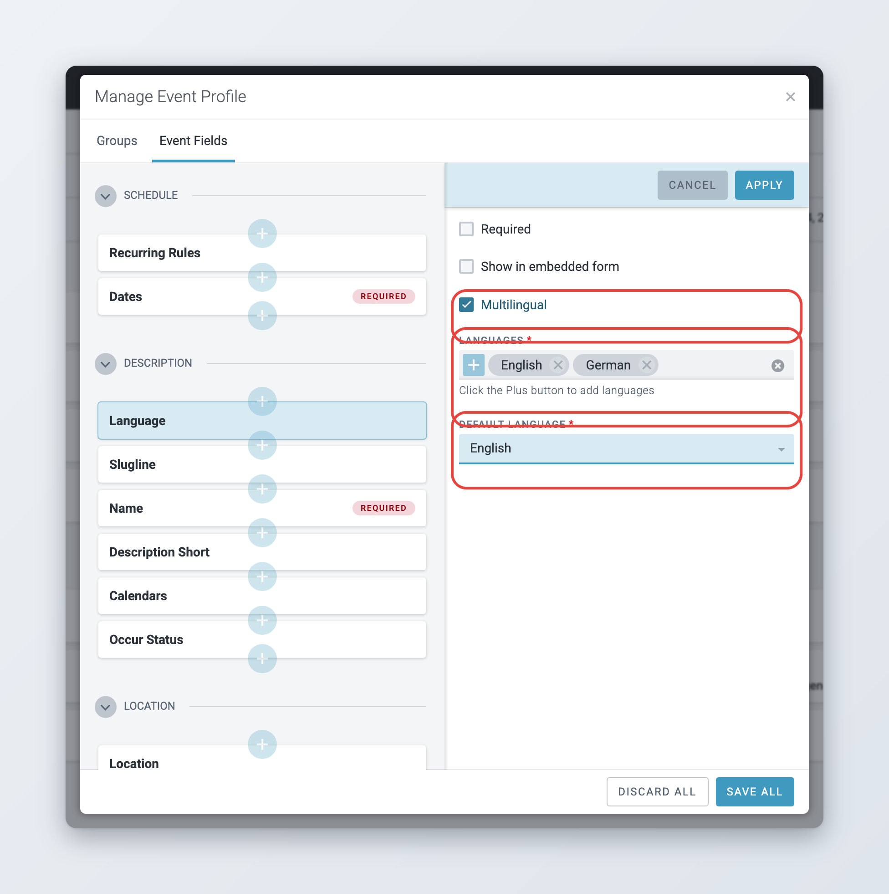<figcaption>
Setting up languages on the Language field
</figcaption></figure>

### Coverage profiles

*Available since Superdesk 3.1.*

Each coverage type has its own profile, so a picture coverage can ask for different details than a text coverage. Click **Actions** > **Manage Coverage Profiles**. Pick a coverage type on the left, then add, order and set up its fields as described above. Coverage profiles can also use custom text fields from Settings > Metadata, marked **(custom text field)**.

The coverage types on the left come from the **Coverage content types** vocabulary.

<figure>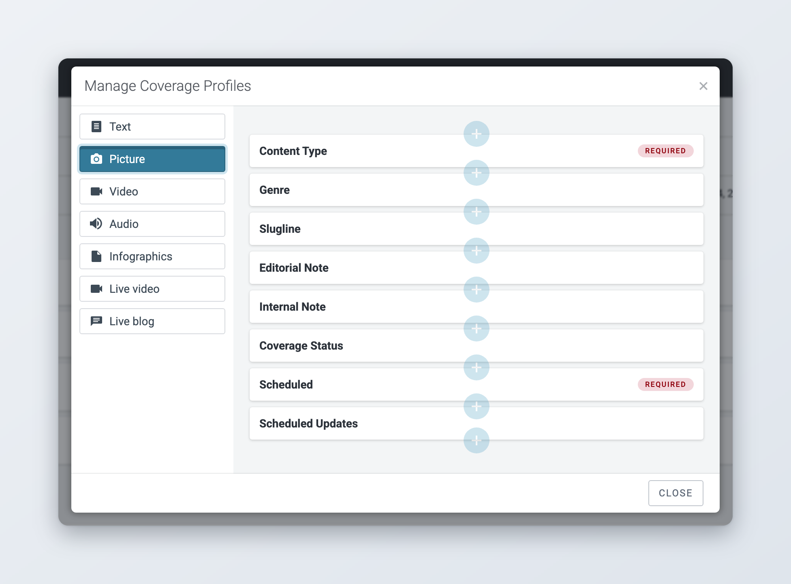<figcaption>
One profile per coverage type
</figcaption></figure>

### How profiles shape the preview

*Available since Superdesk 3.6.*

The preview panel of events, planning items, coverages and assignments follows the profile too. Fields appear in the same order and groups as in the form, and groups that use a togglebox are collapsible in the preview. A few details are useful to know:

* A field that is enabled but not placed in any group is not shown in the preview.
* An enabled field with no value is shown with a dash.
* Long texts are cut after about 500 characters, with a **Show all** link.

So when you reorder or regroup fields, check the preview as well as the form.

<figure>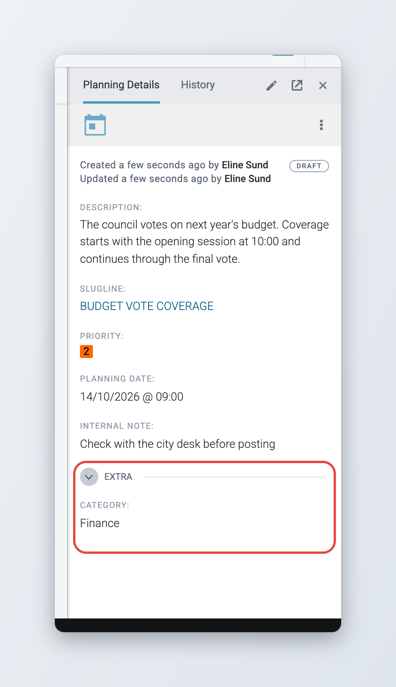<figcaption>
The preview follows the planning profile
</figcaption></figure>

## Event templates

An event template stores the details of an event (everything except the dates) so users can create similar events quickly. Users with the **Planning - Event Templates** privilege create them:

1. Find an existing event in the list, or open it in the editor.
2. Open its action menu and click **Save event as a template**.
3. Type a name and click **Submit**.

Templates then appear in the Planning create menu (the plus icon) under **From template**. The menu shows recently used templates. **More templates...** opens the **Planning templates** window, where users can search all event templates and filter them by calendar.

To rename or delete templates, click **Actions** > **Manage Event Templates**. You cannot change a template's content there. To change it, create a new template from an updated event and delete the old one.

Only events have templates. Planning items do not.

<figure>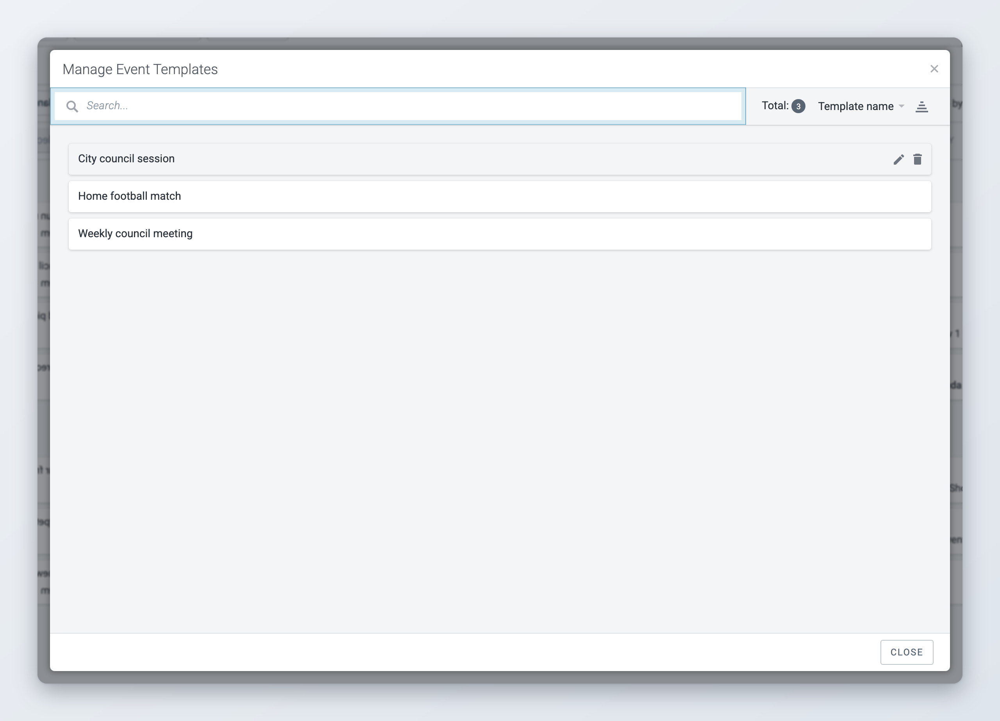<figcaption>
Renaming and deleting event templates
</figcaption></figure>

## Event and planning filters

Saved filters are searches that you set up once and share with your team. Users pick them from the filter menu in the Planning toolbar, under **Search Filters**. A filter can also export its results automatically on a schedule.


Users only see saved filters, and only see items created by other people, if their role has the **Planning - Global Filters** privilege. Without it, the list menu says **My Events & Planning** and shows only the user's own items.


### Creating a filter



### Open the filter manager

Click **Actions** > **Manage Event & Planning Filters**, then **Add New Filter**.



### Name the filter and pick the item type

Type a **Filter Name**. Under **Item Type**, choose **Events**, **Planning** or **Combined**. A filter only shows up in the matching list view.



### Set the search criteria

Fill in the criteria, for example calendars, agendas, categories or dates. Click **Create**.



Click a filter in the list to see its details. To change or remove it, use **Edit Filter** or **Delete** in the filter's menu.

### Scheduled exports

*Available since Superdesk 2.1.*

A scheduled export runs a filter at set times and turns the results into an article on a desk. Use it for daily or weekly advisories, such as tomorrow's events or this week's coverage plan.



### Open the schedule

Click the filter, then **Create Scheduled Export**.



### Choose when it runs

Pick a **Frequency**: **Hourly**, **Weekly** or **Monthly**. For weekly exports pick the **Week Days**. For monthly exports pick the **Day of the Month**. For weekly and monthly exports, click **Add Time** to set one or more times.



### Choose where the article goes

Under **Destination**, pick the **Desk**, the **Article Template** used to create the article, and the **Custom Layout** that formats the list of items. Click **Save**.



Times use the server's default time zone. If the filter finds no items, no article is created. To change or remove a schedule, use **Edit Scheduled Export** or **Delete Scheduled Export** in the filter's menu.

<figure>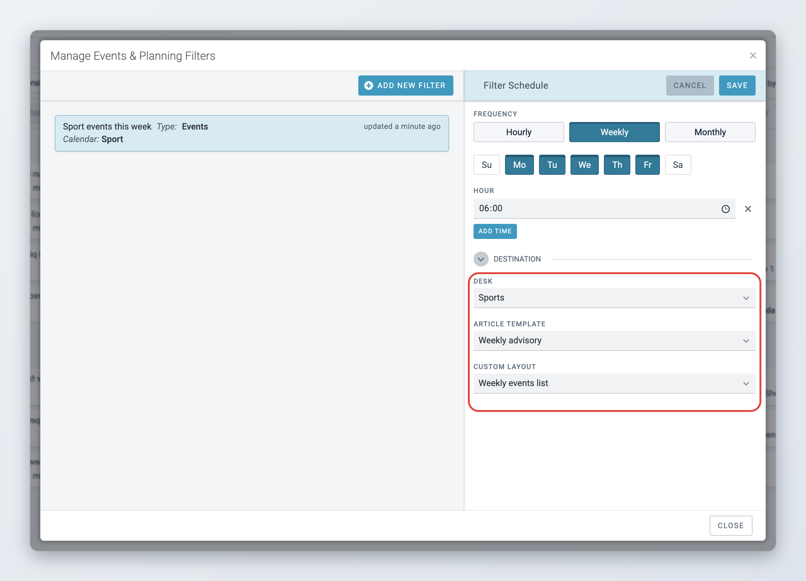<figcaption>
Setting up a scheduled export
</figcaption></figure>

## Custom layouts

*Available since Superdesk 3.1.*

Custom layouts decide how a list of events or planning items is written out when users export them as an article, download them, or when a scheduled export runs. Click **Actions** > **Manage Custom Layouts**.

Each layout has:

* **Name**: a unique internal name,
* **Type**: **Event**, **Planning** or **Combined**,
* **Template Content**: the HTML template that renders the items,
* **Label**: the name users see when they pick a layout,
* **Download**: when ticked, the layout is offered when users download events. When not ticked, it is offered in **Export as article**.

If users do not pick a layout, Superdesk uses a built-in default layout.


Downloads do not use **Template Content**. A download layout points to a template file on the server, which only whoever installs Superdesk can add. A layout you create here with **Download** ticked has no such file, and downloading with it fails. To change how downloads look, ask whoever maintains your Superdesk.



Template Content uses the Jinja template language, with the exported items available as `items`. If you need help writing one, ask whoever maintains your Superdesk.


The **Custom Layout** field of a scheduled export lists the layouts whose type matches the filter's item type.

<figure>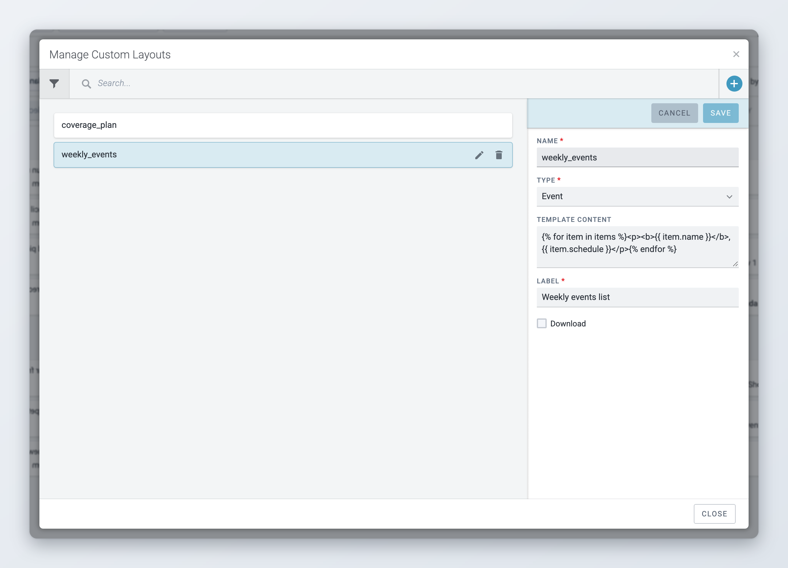<figcaption>
Editing a custom layout
</figcaption></figure>

## Locations

Superdesk keeps a shared list of locations for events. Users can add locations from the event form. To review, correct or remove them, open the Main menu and click **Manage Locations**. You need the **Planning - Manage locations** privilege.

* Use **Search** to find a location by name, or **Browse** to go through the list.
* Click **Create a new location** (the plus icon) to add one. Fill in the **Name** and address fields, and optionally **Latitude**, **Longitude** and **Notes**.
* Click a location to edit it, or click the trash icon to delete it.

<figure>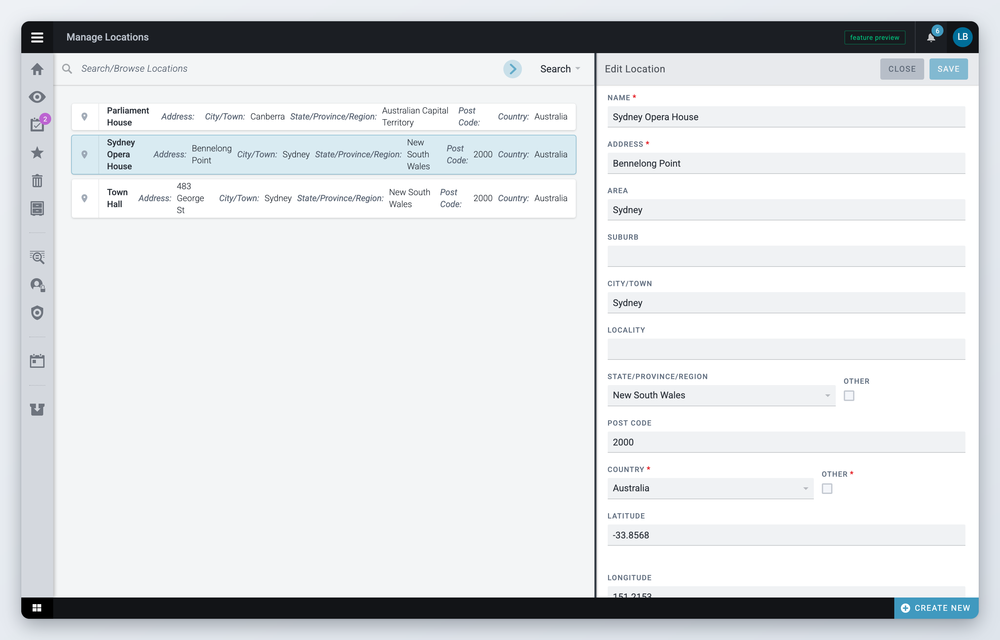<figcaption>
Managing the shared locations
</figcaption></figure>

## Media contacts

Events can list contacts from Superdesk's Media Contacts. You manage contacts from the Main menu > **Media Contacts**. See [Media Contacts](../administration/user-management-and-user-roles.md#media-contacts) for details. To see contacts, a role needs **Contacts View Rights**. To add and edit them, it needs **Contacts Management**.

## Privileges

Set planning privileges in **Settings** > **User Roles** on the **Roles privileges** tab, or per user. See [User Management and User Roles](../administration/user-management-and-user-roles.md).

| Privilege | Allows the user to |
|---|---|
| Planning | Open Planning and work with events, planning items and coverages. Users also need Event Management or Planning Item Management to see the Planning icon. |
| Planning - Event Management | Create and edit events. |
| Planning - Planning Item Management | Create and edit planning items. |
| Planning - Post Event Items, Unpost Event Items | Post and unpost events. |
| Planning - Post Planning Items, Unpost Planning Items | Post and unpost planning items. |
| Planning - Spike Event Items, Unspike Event Items | Spike and unspike events. |
| Planning - Spike Planning Items, Unspike Planning Items | Spike and unspike planning items. |
| Planning - Global Filters | See items created by other users and use saved filters. |
| Planning - Create Event/Planning in the past | Create items with a date in the past. |
| Planning - Edit Expired Items | Edit expired events and planning items. |
| Planning - Featured Stories | Manage the featured stories list. |
| Planning - Assignments | Open Assignments and see their own assignments. |
| Planning - Assignments desk | See the assignments of their desks, not only their own. |
| Planning - Agenda Management | Create, edit and delete agendas. |
| Planning - Delete Agendas | Nothing. Deleting agendas is covered by Agenda Management. |
| Planning - Manage Content Profiles | Edit the event, planning and coverage profiles. |
| Planning - Event Templates | Save events as templates and manage templates. |
| Planning - Events & Planning View Filters Management | Create, edit and delete saved filters and their schedules. |
| Planning - Manage Export Templates | Manage custom layouts. |
| Planning - Manage locations | Create, edit and delete locations. |

<figure>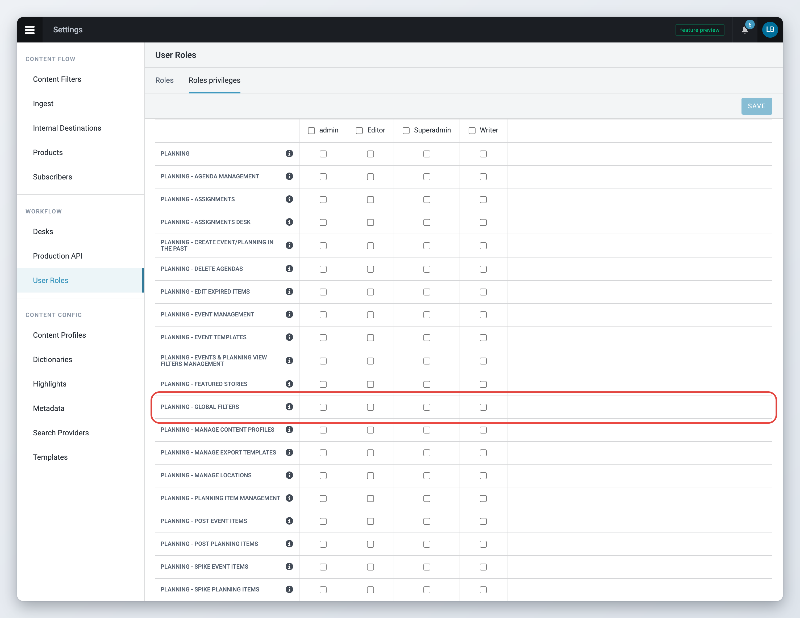<figcaption>
Planning privileges in User Roles
</figcaption></figure>

## Assignment notifications

When a coverage is assigned, Superdesk notifies the assigned user, or every member of the assigned desk, inside Superdesk. The assigned user also gets an email, unless they turned off assignment emails in their preferences. By default, users are not notified about assignments they give to themselves.

Superdesk can also post assignment notifications to Slack. This needs a configuration change by whoever installs Superdesk. Once it is on:

* set a **Slack Channel Name** for each desk in the desk settings (see [Desk email and Slack channel](../administration/desk-creation-and-desk-management.md#desk-email-and-slack-channel)),
* set a **Slack Username** in each user's profile.

## User preferences

Each user sets their own planning defaults. There is no admin setting that applies them to everyone.

* **Default Calendar**, **Default Agenda** and **Default Events & Planning Filter** are set in the user's profile. See [Your profile and preferences](../navigating-superdesk/your-profile-and-preferences.md).
* The default desk for each coverage type is set from Planning: Superdesk remembers the desk a user last picked in **Coverage Assignment Details** for that coverage type.
* Whether the advanced mode opens when adding coverages is set with **make this mode the default** in the **Add Coverages (advanced mode)** window.

## Settings that need a configuration change

Some planning behaviour cannot be changed from the interface. It is set in the client configuration or in the server settings by whoever installs and maintains your Superdesk. Ask them if you need one of these changes.

### List rows

*Available since Superdesk 3.1.*

The fields shown in each row of the event, planning and assignment lists are configurable, for example to show the calendar or the coverage icons. An optional compact row adds a **Compact list** option to the list's view menu.

### Preview cards

*Available since Superdesk 3.6.*

When a planning item is linked to an event, or the other way round, the preview shows the linked item as a small card. The card can have its own, shorter set of fields. Without that setting, the card uses the same fields as the list row.

### Search and filter fields

*Available since Superdesk 2.1.*

The fields offered in the advanced search panels and in the saved filter editor are configurable per list: events, planning, combined and assignments (the assignments list since 3.1). Fields can be hidden or reordered, and custom vocabularies can be added as filters.

### Server settings

| Setting | Effect |
|---|---|
| `PLANNING_EVENT_TEMPLATES_ENABLED` | Switches event templates on. On in the default installation. |
| `PLANNING_AUTO_ASSIGN_TO_WORKFLOW` | Adds new coverages to the workflow automatically. |
| `PLANNING_MANUAL_NEWS_COVERAGE_STATUS` | Stops Superdesk from setting a coverage to Planned when a desk is assigned. |
| `PLANNING_EXPAND_RELATED_PLANNINGS` | Expands related planning items under their event in the combined list. |
| `SYNC_EVENT_FIELDS_TO_PLANNING` | Keeps chosen fields of planning items in sync with their event. |
| `PLANNING_ALLOWED_COVERAGE_LINK_TYPES` | Limits which content types can be linked to a coverage. |
| `PLANNING_SEND_NOTIFICATION_FOR_SELF_ASSIGNMENT` | Notifies users about assignments they give to themselves. |
| `ASSIGNMENT_MANUAL_REASSIGNMENT_ONLY` | Turns off automatic user assignment for coverages. |
| `PLANNING_EVENT_LINK_METHOD` | How many events a planning item can be linked to: `one_primary` (one event, the default), `many_secondary` or `one_primary_many_secondary`. |
| `MAX_RECURRENT_EVENTS` | The maximum number of events in a recurring series (200 by default). |
| `PLANNING_EXPIRY_MINUTES`, `PLANNING_DELETE_SPIKED_MINUTES` | When old items expire and when spiked items are deleted. Off by default. |

The full list is in the [superdesk-planning README](https://github.com/superdesk/superdesk-planning#config).

## Ingesting events and planning items

Events and planning items can be ingested from external sources. You set up these feeds in **Settings** > **Ingest**. See [Ingesting News Items and Events](../integrations-and-advanced-features/ingesting-news-items-and-events.md).
