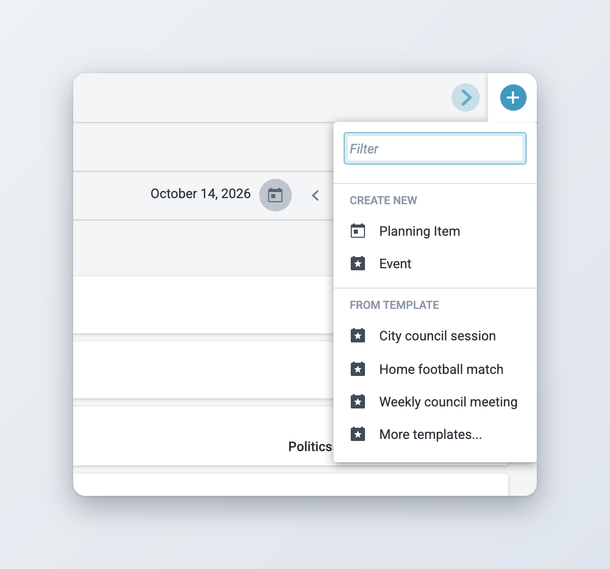
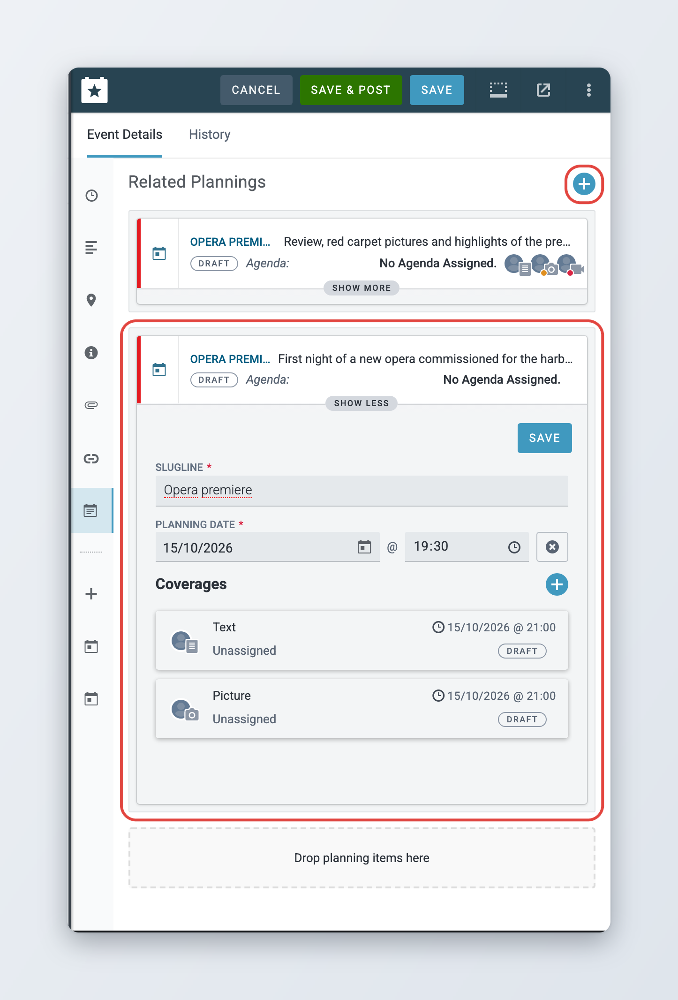
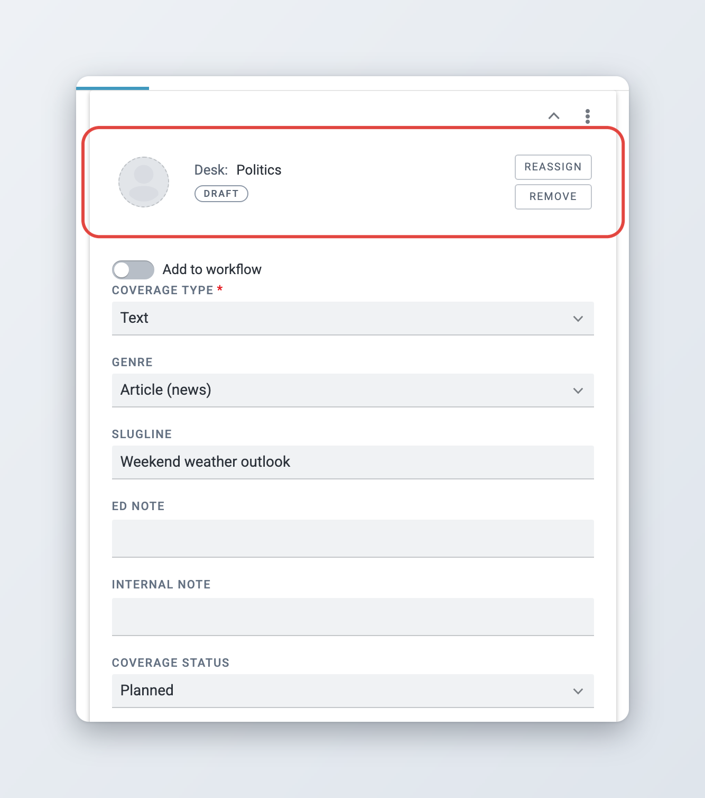
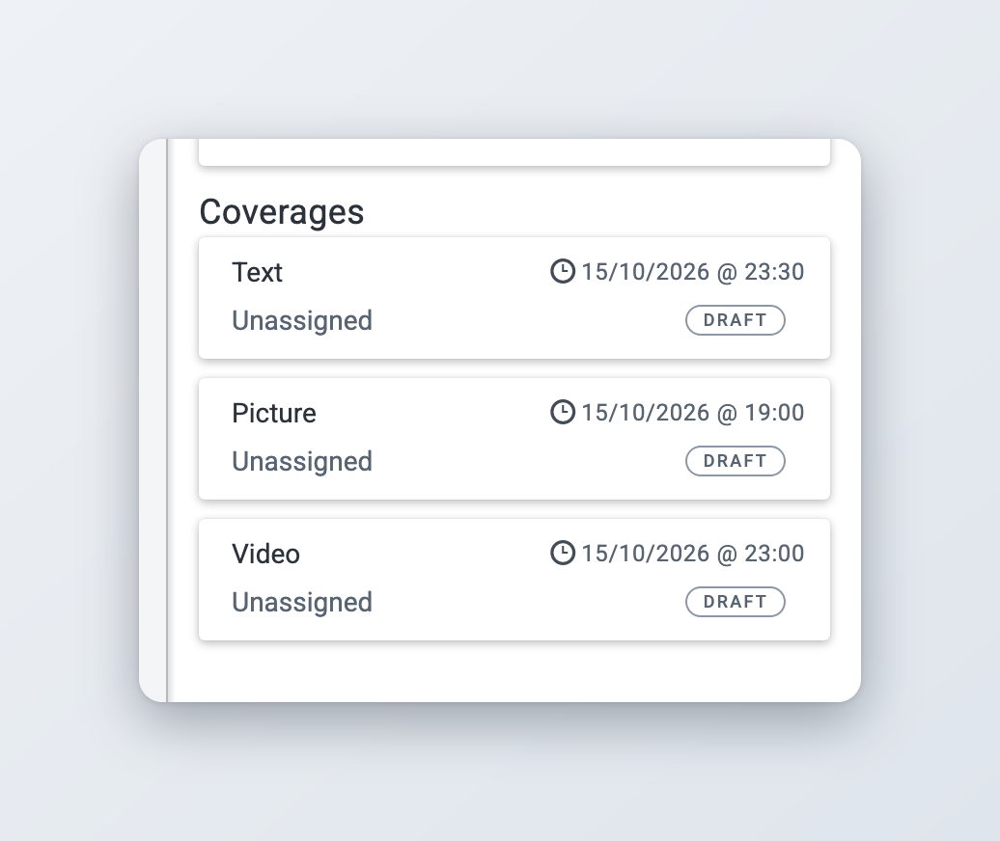
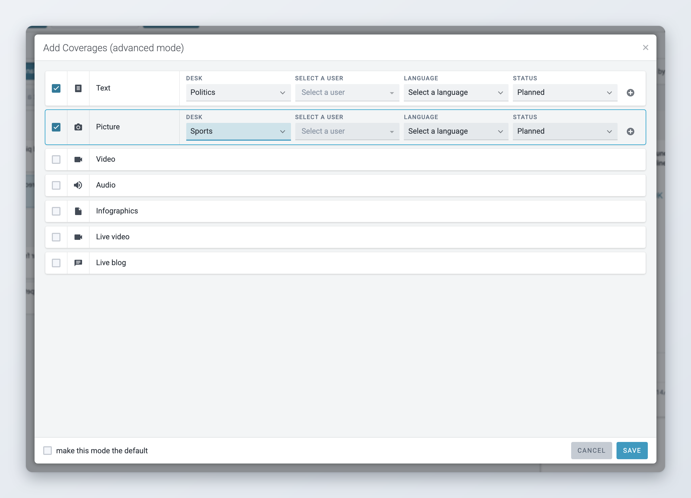
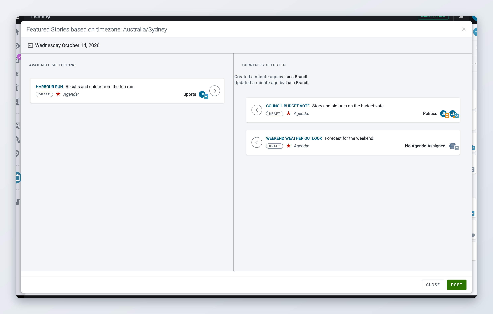

# Planning items and coverages

A planning item describes what your newsroom plans to produce. It holds the coverages, and through them, the assignments.

To make planning items visible outside Superdesk, see [Posting events and planning items](events.md#posting-events-and-planning-items). For the work that follows from a coverage, see [Assignments](assignments.md).

## Planning items

### Creating a planning item

There are several ways to create a planning item:

* **From scratch.** Click the plus icon in the toolbar and choose **Planning Item**. Fill in at least the **Slugline** and the **Planning Date**, add coverages and click **Create**.
* **From an event in the list.** Open the event's action menu and choose **Create Planning Item**. The new planning item is linked to the event and gets its slugline, description, category and other details. **Create and Open Planning Item** does the same and opens the new item in the editor.
* **From the event editor.** See [Adding planning items from the event form](#adding-planning-items-from-the-event-form).
* **From an article.** In Monitoring or in the editor, choose **Add to Planning** in the item's action menu. Pick an existing planning item and choose **Add to planning**, or create a new one with the plus icon. The article becomes a coverage of that planning item.

<figure><figcaption>
Creating a new item
</figcaption></figure>

The default planning item form has these fields:

* **Slugline** and **Planning Date** (required). The planning date is the day and time the plan is for. It is set to now when you create the item.
* **Description**: what the planning item is about. It is shown in the list next to the slugline.
* **Internal Note**: a note for your colleagues. It is shown to the person working on an assignment, but never published.
* **Agendas**: the agendas the item belongs to.
* **Ed Note**, **Category**, **Subject** and **Urgency**.
* **Not For Publication**: turn this on for items that must never leave Superdesk. The **Post** button disappears. You can only set it before the item is posted for the first time.
* **Forward Planning**: only shown when your Superdesk adds coverages to the workflow automatically. Turn it on to keep this item's coverages out of the workflow for now. See [Adding a coverage to the workflow](#adding-a-coverage-to-the-workflow).
* **Related Events** and **Coverages**.

### Adding planning items from the event form

*Available since Superdesk 2.3.*

You can plan coverage without leaving the event. Save the event first, then click the **Add Planning Item** icon in the editor's left bar, or the plus button next to **Related Plannings**. A planning item card opens inside the event with the event's details already filled in. Planning items already linked to the event are listed there too. Use **Show more** and **Show less** to expand or collapse a card, and the card's own **Save** button to save it.

Add coverages to the card with the **Coverages** plus button, which lists the coverage types and an **Advanced mode** for the full coverage form. Each coverage shows as a card with its assignment and workflow state, for example **Unassigned** and **Draft**; open it to choose the desk and user. When you save the card, the planning item is saved and linked to the event.

<figure><figcaption>
Planning coverage from inside the event
</figcaption></figure>

### Creating an event from a planning item

If you planned coverage first and it turns out to be tied to an event, open the planning item's action menu and choose **Add As Event**. An event form opens with the planning item's details filled in. When you create the event, the planning item is linked to it.

### Working with events inside the planning item

*Available since Superdesk 3.1.*

Once a planning item is created, its **Related Events** section shows each linked event as a card. Click **Show more** on a card to see and edit the event's details without leaving the planning item, then save.

To create a new event for the planning item, click the plus button next to **Related Events**. A new event is added with the planning item's details filled in. Complete its dates and save the planning item to create the event.

### Linking events and planning items

*Available since Superdesk 3.1.*

You can link an existing event and an existing planning item by dragging one onto the other:

* Open a planning item in the editor and drag an event from the list onto its **Related Events** section ("Drop events here").
* Open an event in the editor and drag a planning item from the list onto its **Related Plannings** section ("Drop planning items here").

You can also select items in **Events only** or **Planning only** and use the link icon in the selection bar to add them to the item open in the editor. To remove a link, use **Unlink related event** or **Unlink related planning** in the editor.

By default, a planning item can be linked to one event. Your administrator can allow a planning item to cover several events, for example a round-up of a day's matches.

### Agendas

To put a planning item on an agenda, pick the agenda in its **Agendas** field, or use **Assign to agenda** in its action menu. To see the items of one agenda, switch to **Planning only** and pick the agenda in the list filter menu. Agendas themselves are managed by your administrator; see [Planning administration](planning-administration.md#agendas).

## Coverages

### Adding coverages



### Open the planning item

Open the planning item in the editor and go to the **Coverages** section.



### Pick the coverage type

Click the plus button and pick the type, for example **Text**, **Picture** or **Video**. The coverage types are set by your administrator, and can include types that are produced outside Superdesk, such as live blogs or infographics.



### Fill in the coverage

Fill in the coverage fields: **Genre**, **Slugline**, **Ed Note**, **Internal Note**, the coverage **Status** and the **Due** date and time. A new coverage takes its slugline, notes and due date from the planning item, or its due time from the linked event.



### Save

Click **Create** for a new planning item, or **Save** (**Update** if the item is posted) for an existing one.



To add many coverages at once, click **Advanced mode** in the coverage type menu. The **Add Coverages (advanced mode)** window lists every coverage type in one table. Tick **Coverage enabled** on each type you need, and pick the desk, user, language and status per row. Use the duplicate icon on a row to add a second coverage of the same type. Tick **make this mode the default** if you want this window every time you add coverages. Superdesk saves this choice for you, and you can untick it the same way.

From the coverage's own action menu you can **Duplicate** it, **Duplicate As** another type, **Cancel coverage** or **Remove coverage**. Removing is only possible while the coverage is a draft or cancelled.

For text coverages, **Schedule an update** plans follow-up versions of the story with their own due times.

<figure><figcaption>
A coverage assigned to a desk
</figcaption></figure>

### Assigning a coverage

Every coverage that someone has to work on needs a desk.



### Open the assignment window

In the coverage, click **Assign**. The **Coverage Assignment Details** window opens.



### Choose the desk and the person

Pick the **Desk** (required). Then pick a user from that desk, or leave the user empty to give the work to the whole desk. If your newsroom works with stringers or freelancers, you can pick a **Coverage Provider** and an **Assigned Provider** from your media contacts instead of a user.



### Set the priority

Choose the **Assignment Priority** if it matters, then click **OK** and save the planning item.



When you assign a desk, Superdesk sets the coverage status to **Planned**, unless your administrator turned this off. While the coverage is still a draft, you can change the desk and user with **Reassign**, or clear them with **Remove**.

Superdesk remembers the desk you pick for each coverage type. The next coverage of that type you add starts with the same desk.

### Adding a coverage to the workflow

An assigned coverage is still a draft until you add it to the workflow. Only then does Superdesk create the assignment, show it in the Assignments workspace and notify the desk or user. This lets a planner organise the work first and release it to the team when ready.

To add a coverage to the workflow, save the planning item, then turn on **Add to workflow** in the coverage and save again. The coverage label changes from **Draft** to **Assigned**. To add the coverages of several planning items at once, select them in **Planning only** and click **Add to workflow** in the selection bar.

Once a coverage is in the workflow, change its desk or user from the assignment, not from the coverage. See [Other assignment actions](assignments.md#other-assignment-actions).

Your administrator can set Superdesk to add every assigned coverage to the workflow automatically. In that case you do not see the **Add to workflow** switch, and the **Forward Planning** switch on the planning item keeps its coverages out of the workflow until you turn it off.

### Coverage statuses and colours

*Available since Superdesk 2.8.*

A coverage has two kinds of status.

The **coverage status** says whether you intend to cover it. The default values are:

* **Planned**: you will cover it.
* **On merit**: you will cover it if it turns out to be worth it. The coverage icon gets an orange dot.
* **Not planned**: you will not cover it. The coverage icon gets a red dot.
* **On request**: you will cover it if someone asks for it.

The **workflow label** on each coverage card in the preview says where the work stands, for example **Draft**, **Assigned**, **In Progress**, **Completed** or **Cancelled**. A coverage you added to the workflow by hand shows **Added to workflow**. Each card shows a single label.

The colour of the coverage icon in the list follows the assignment: unassigned, assigned to a desk, in the workflow, in progress, completed or cancelled. Hover over the icon to see the type, the desk and the status in words.

<figure><figcaption>
Coverage cards in the planning item preview
</figcaption></figure>

### Editing coverages from the list

*Available since Superdesk 2.11 and 3.6.*

You can change the coverages of a planning item without opening the editor. Choose **Edit Coverages** in the item's action menu. The **Add Coverages (advanced mode)** window opens with the existing coverages. Change the desk, user, language or status, enable more coverage types, and click **Save**.

To add a single coverage quickly, use **Add coverage** in the same menu and pick the type.

<figure><figcaption>
Editing coverages from the list
</figcaption></figure>

### Cancelling coverage and planning items

* **Cancel coverage** in a coverage's action menu stops one coverage. Its assignment is cancelled.
* **Cancel all Coverage(s)** in a planning item's action menu stops all its coverages but keeps the planning item.
* **Cancel Planning** cancels the planning item and all its coverages.

Each of these asks you for a reason, which is shown to the people involved.

## Featured stories

Featured stories are a daily, ordered list of the most important planning items, for example to show your customers the top stories you are covering today. Each list is for one day in your newsroom's time zone. You need the Featured Stories privilege to manage the list.



### Flag the planning items

For each planning item you want in the list, open its action menu and choose **Add to featured stories**. Flagged items are marked as featured in the list.



### Open the list

In Planning, click the three-dot **Actions** menu in the toolbar and choose **Featured Stories**. The window title shows the time zone the lists are based on. Click the date in the window to pick another day.



### Choose and order the stories

**Available selections** lists the flagged planning items with a coverage due on that day. Click the right arrow on an item (**Add to Feature Stories**) to move it to **Currently Selected**, or the left arrow (**Remove from Feature Stories**) to move it back. Drag the items in **Currently Selected** into order of importance.



### Save or post

Click **Post** to send the list to your subscribers. Once posted, use **Update** to send changes. **Save** appears once you have changed the list and keeps it in Superdesk without posting.



A list can only be posted when every item in **Currently Selected** is posted. If you unpost a planning item or choose **Remove from featured stories** on it, it moves to **Selections automatically removed** and leaves the list the next time you save or update it.

Only one person can edit the list at a time. If someone else has it open, you see **Featured Stories Locked**.

<figure><figcaption>
Managing the featured stories for one day
</figcaption></figure>
