# Dashboards and Widgets

Every desk and every custom workspace has a Dashboard. The Dashboard gives a quick overview of the information that matters to the people working there, through small panels called widgets.

The Dashboard of a desk is shared: every member of the desk sees the same widgets. It is set up by administrators or other users with the Desk Management privilege, such as bureau chiefs or desk heads. The Dashboard of a custom workspace belongs to you. Only you see it, and you can set it up the way you like, for example to monitor several desks in one place.

To open the Dashboard, click the **Dashboard** icon in the Workspace Panel on the left, or press **Ctrl+Alt+B**. The Dashboard shows the desk or custom workspace that is selected in the Desks menu at the top left of the screen. Click the desk name to switch to another desk or workspace. See [Desks and Custom Workspaces](desks-and-custom-workspaces.md).

<figure>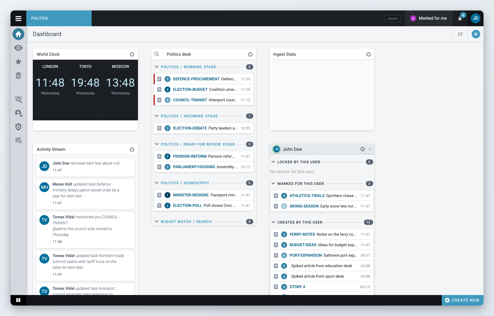<figcaption>
The Dashboard of a desk
</figcaption></figure>

You can only view the Dashboards of desks you are a member of. The standard widgets are explained on this page. Your Superdesk might also have custom widgets.

## Manage Dashboard Widgets

Changes made to the Dashboard of a desk are visible to all members of that desk. Widgets on the Dashboard of your custom workspace are visible only to you.

If you can change the Dashboard, you see an **Add widget** button (a plus sign) at the top right of the Dashboard. An empty Dashboard says "Dashboard is empty" and asks you to click that button.



### Open the widget list

Click **Add widget** at the top right of the Dashboard. The **Add new widget** window opens with a tile for each widget.



### Choose a widget

Click a tile to see a short description of the widget.



### Add it

Click **Add This Widget**. The widget is placed on the Dashboard and saved straight away, and the window goes back to the list of widgets. Add another widget, or click **Done** to close the window.



<figure>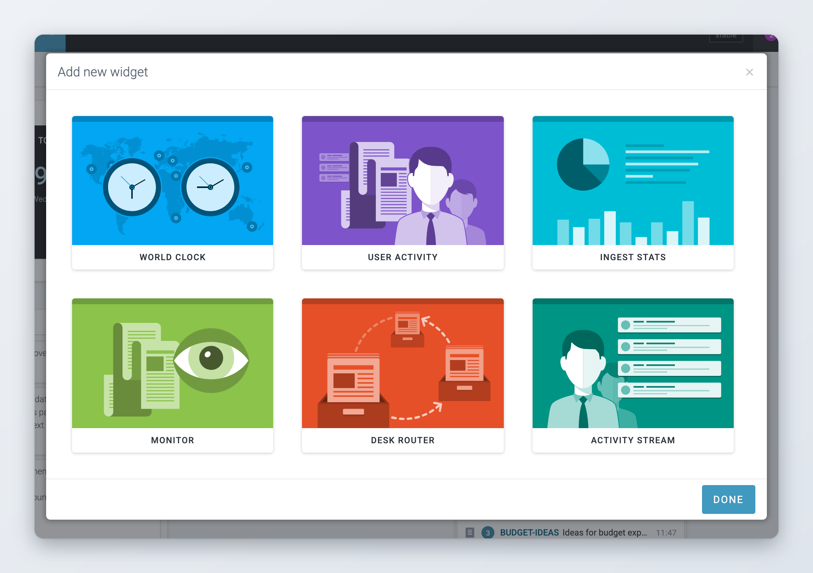<figcaption>
The Add new widget window
</figcaption></figure>

You can add the same type of widget several times, for example one Monitor widget per desk.

These widgets are available in a standard Superdesk:

| Widget | What it shows |
| --- | --- |
| **Monitor** | Stages, desk outputs and saved searches, like a small Monitoring view. |
| **World Clock** | Clocks for the time zones you choose. |
| **Ingest Stats** | A chart of the items ingested into Superdesk. |
| **Activity Stream** | What users across Superdesk have done recently. |
| **User Activity** | The items one user has locked, created, moved or has marked for them. |
| **Desk Router** | Closes a desk and routes its incoming content to another desk. |
| **Publishing Actions** | A chart of the publishing actions on the desk. Part of the optional Analytics module. |

## Arrange Widgets

You can arrange the widgets on your Dashboard in any configuration you like.



### Switch to rearranging

Click the **Rearrange widgets** button at the top right of the Dashboard, next to **Add widget**.



### Move, resize or remove widgets

Drag the body of a widget to move it to a different spot. The widgets fill the space as efficiently as possible: if there is a gap above a widget, it moves up to fill it. Click the arrows at the edges of a widget to make it wider, narrower, taller or shorter. Click the **x** in the top-right corner of a widget to remove it.



### Keep the changes

Click the blue checkmark (**Accept**) at the top right of the Dashboard.



<figure>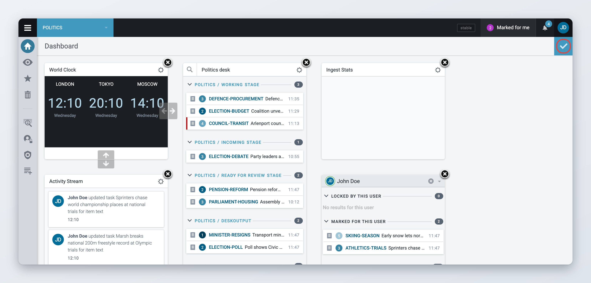<figcaption>
Rearranging widgets
</figcaption></figure>

Each widget can also have settings. If you can change the Dashboard, a gear icon (**Widget settings**) appears in the top-right corner of widgets that have settings. Click it to adjust the settings for that widget.

## Widgets

### World Clock Widget Settings

The World Clock widget shows clocks for any time zones you choose. To add one, click **Add widget**, select **World Clock** and click **Add This Widget**.

<figure>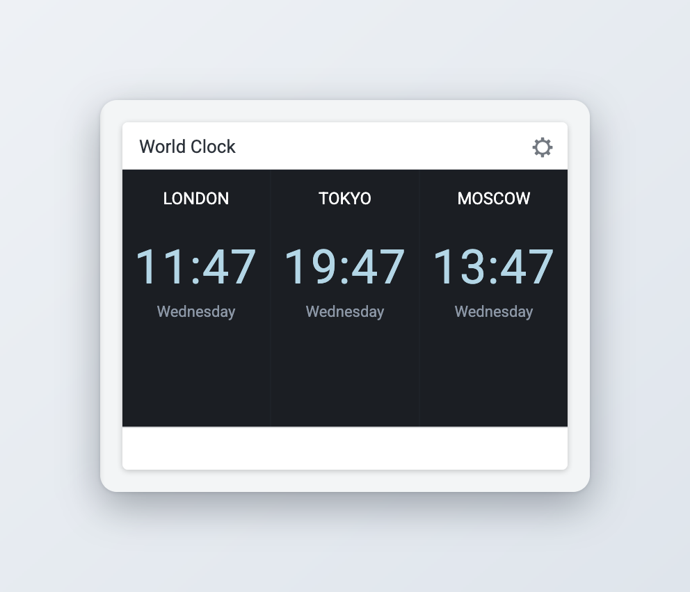<figcaption>
The World Clock widget
</figcaption></figure>

Click the gear icon in the top-right corner of the widget to open the **World Clock Configuration** window.

* The **Your clock** tab lists the clocks the widget shows. Choose **Analog** or **Digital** under **Clock type**. To remove a clock, click the trash icon next to it.
* The **Available clocks** tab lists all time zones. Type in **Search for clock** to filter the list, then click a time zone to add it to **Your clock**.

If you set more than three clocks, you may have to make the widget wider to see them all at the same time. When you are happy with the clocks you have chosen, click **Save**.

<figure>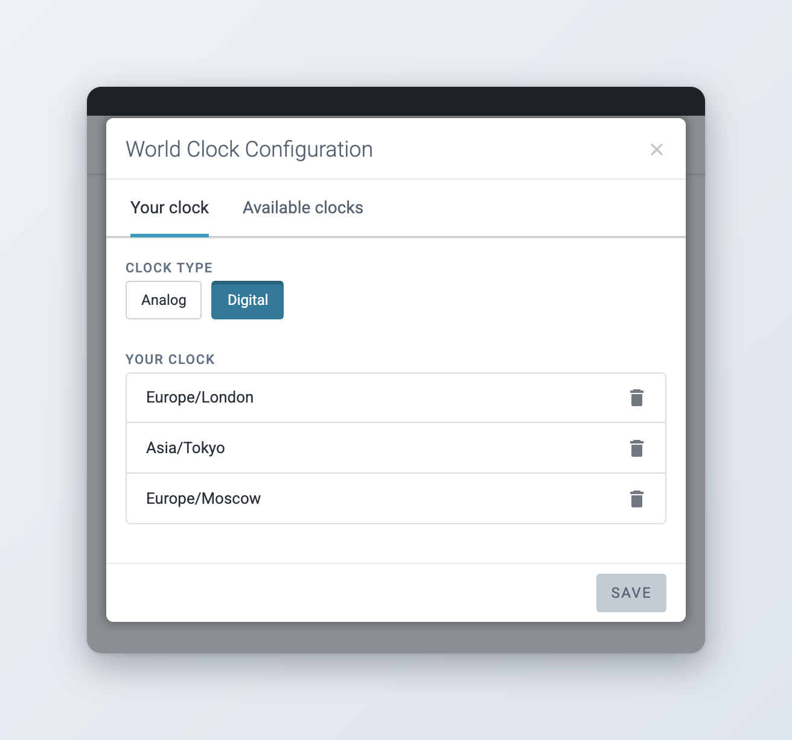<figcaption>
World Clock Configuration
</figcaption></figure>

### Monitoring Widget Settings

The Monitor widget gives an overview of desks and their stages. Stages are the way in which content items are sorted and tracked within a desk. For example, the stages of a desk might include an incoming stage (destination for articles created in or fetched to a desk), a working stage (articles in progress), an editing stage, or an output stage (items ready to be published). Monitor widgets can also show desk outputs, your personal items and saved searches. The stages of a desk are created and edited by users with the appropriate privileges in **Main menu** > **Settings** > **Desks**.

To add a Monitor widget, click **Add widget**, select **Monitor** and click **Add This Widget**. Click the magnifier icon in the widget header to search the items in the widget.

To change what the widget shows, click the gear icon in the top-right corner of the widget. The **Monitoring settings** window opens with four tabs. Use **Next** and **Previous** to move between them, and click **Done** when you are finished.

**Desks.** Because you can have several Monitor widgets on the same Dashboard, the first field, **View name**, lets you give this widget its own name. Below it, turn on the switch next to a desk to see its stages, then select the stages you want. You can also select the desk's output groups (**Output/Scheduled**, **Output/Published** and **Output/Sent**) and, at the end of the list, your **Personal** items. Stages that are marked as not visible outside their desk (Global Read off, set by an administrator in **Main menu** > **Settings** > **Desks**) are only listed for desks you are a member of. If a stage is empty, the widget does not show it.

<figure>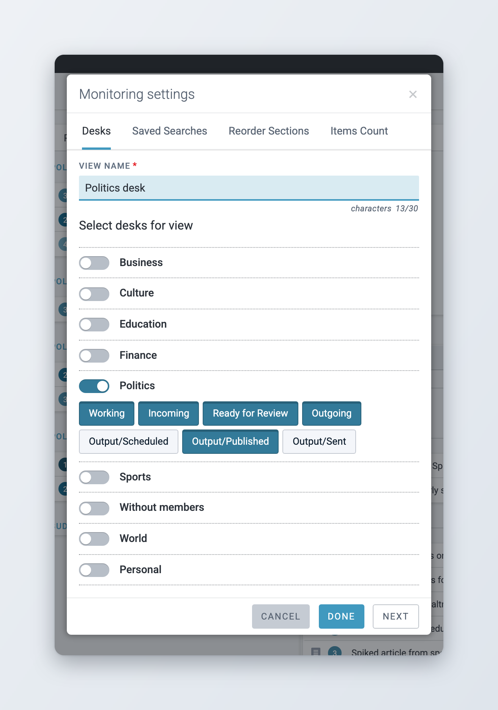<figcaption>
Choosing desks and stages
</figcaption></figure>

**Saved Searches.** Turn on the switch next to each saved search you want to show. On a desk Dashboard, only global saved searches are listed, because the widget is shared with the whole desk. On the Dashboard of a custom workspace, your private saved searches are listed too. Searches are saved from the Search view. To use a search on a desk Dashboard, turn on **Make global** when you save it.

<figure>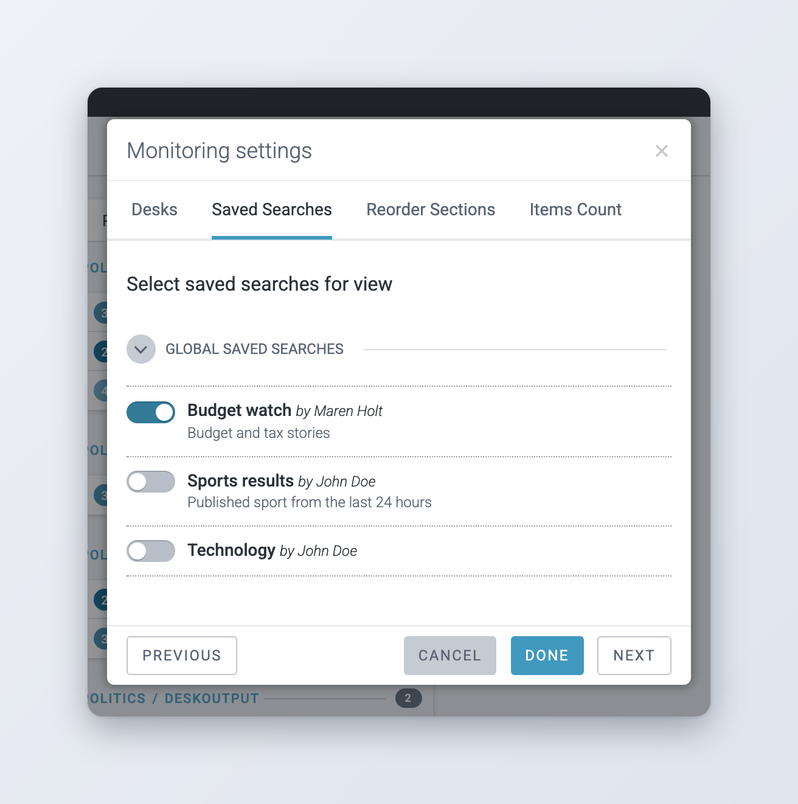<figcaption>
Choosing saved searches
</figcaption></figure>

**Reorder Sections.** Drag and drop the stages and saved searches into the order that suits your needs. This order is your personal preference. The default order for everyone on the desk is set on the desk's settings page.

<figure>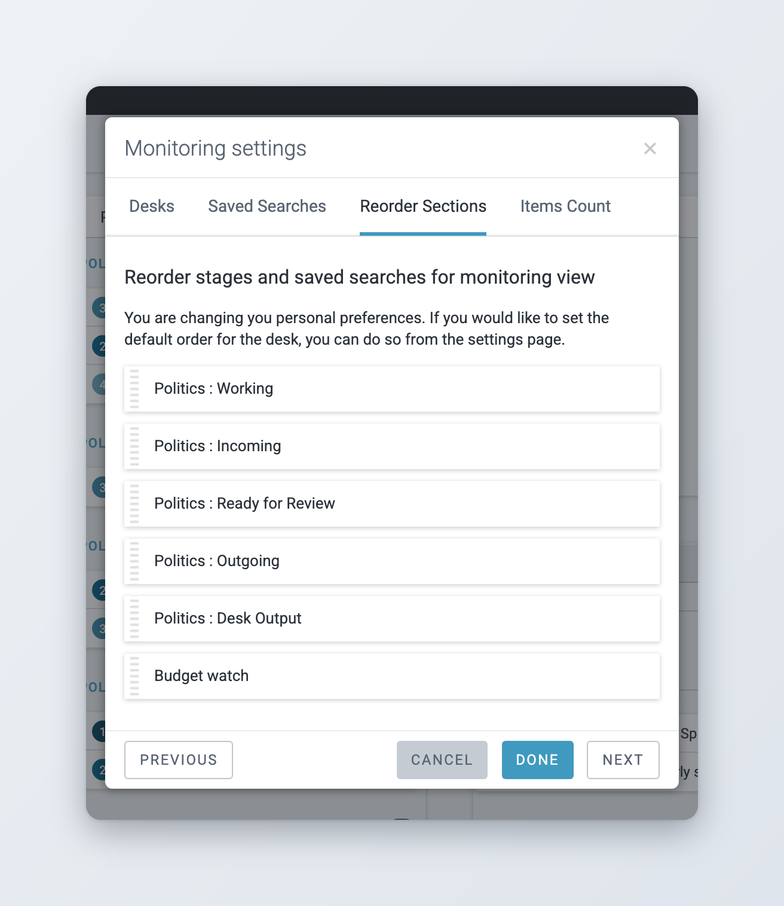<figcaption>
Reordering sections
</figcaption></figure>

**Items Count.** Set how many items appear in each section of the widget. Type the number into the box, or use the up and down arrows that appear when you hover over it.

<figure>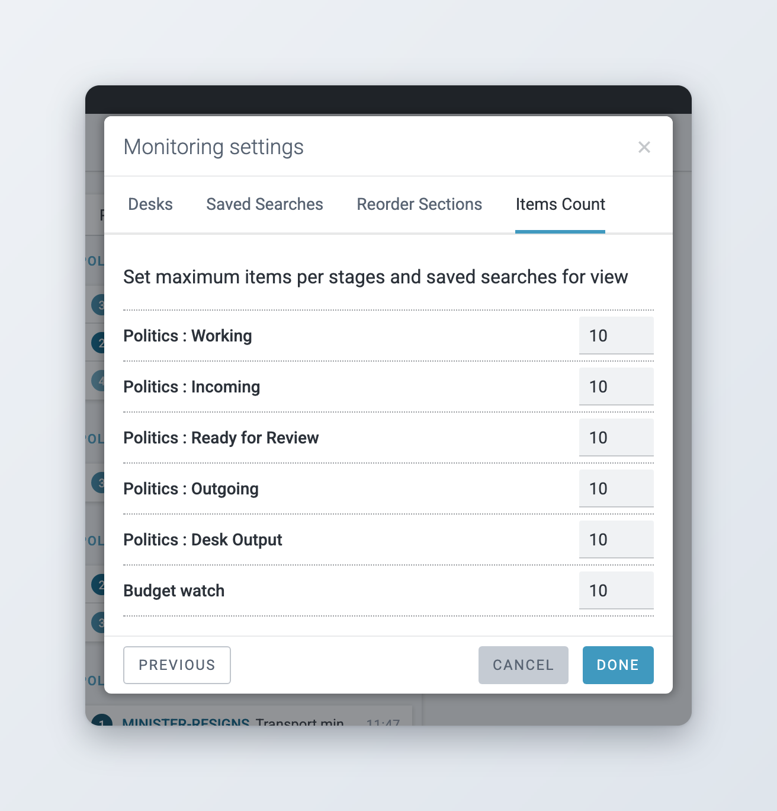<figcaption>
Setting the number of items per section
</figcaption></figure>

### Ingest Stats Widget Settings

The Ingest Stats widget shows information about the items that are being ingested into Superdesk, as a chart. It refreshes every five minutes.

To add one, click **Add widget**, select **Ingest Stats** and click **Add This Widget**.

Click the gear icon in the top-right corner of the widget to open the **Ingest Stats Configuration** window. Under **Select source**, choose what the chart shows:

* **Source stats**: how the ingested items are distributed among their sources.
* **Urgency stats**: how the ingested items are distributed among urgency levels.
* **Item type stats**: how the ingested items are distributed among item types (text, picture and so on).

Under **Select color**, choose a colour scheme for the chart. The choice of colour is purely cosmetic. Click **Save** to apply your settings.

<figure>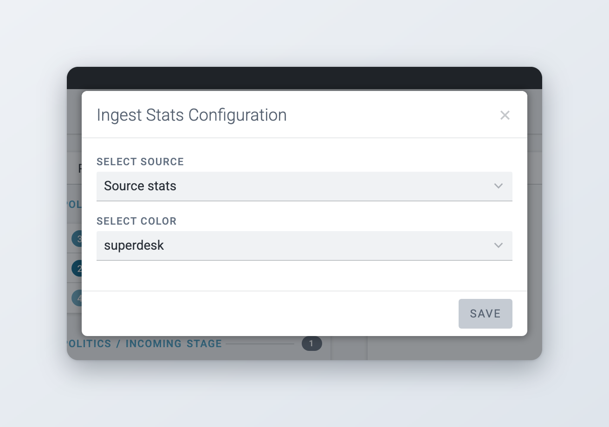<figcaption>
Ingest Stats Configuration
</figcaption></figure>

Each colour in the chart stands for one source, urgency or item type. If all of the items are from the same source, urgency or item type, you only see one colour.

### Activity Stream Widget Settings

The Activity Stream widget keeps you up to date on what users across Superdesk are doing, for example who created or updated which item. The Activity Stream is the same whichever desk the widget is on.

To add one, click **Add widget**, select **Activity Stream** and click **Add This Widget**.

<figure>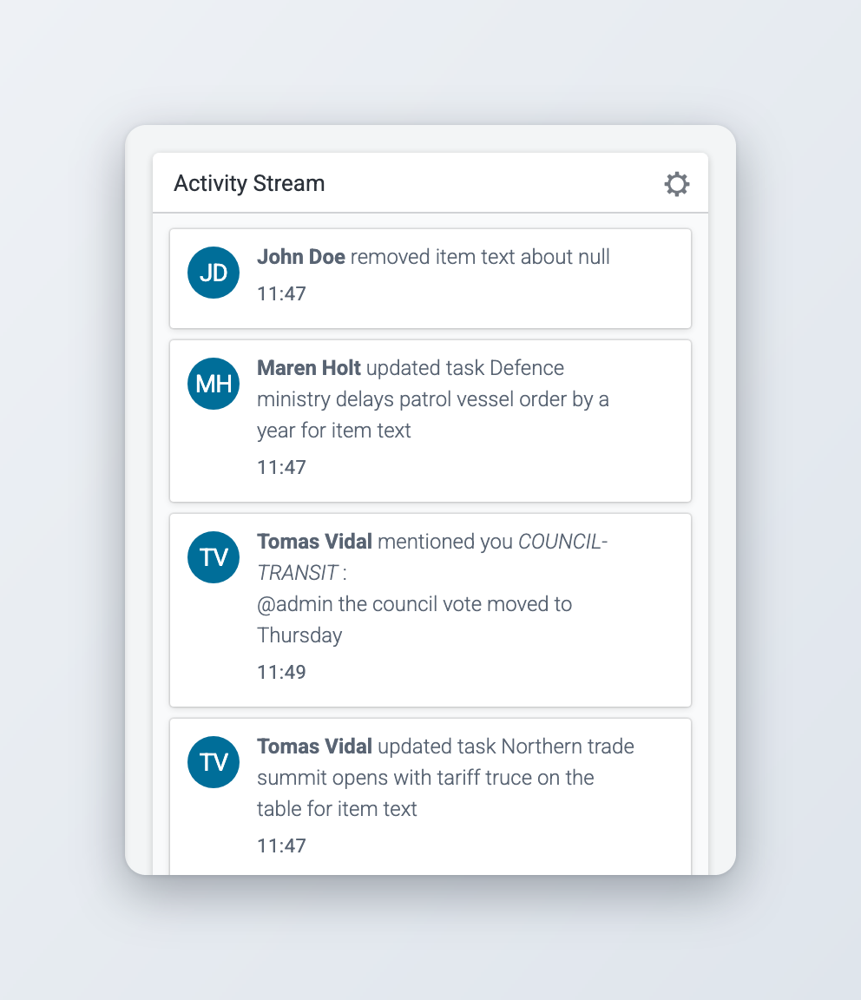<figcaption>
The Activity Stream widget
</figcaption></figure>

To change how many entries the widget shows, click the gear icon in its top-right corner, choose 5, 10, 25 or 50 under **Number of items** and click **Save**.

### User Activity Widget

The User Activity widget shows what one user is working on. It lists the user's items in four groups:

* **Locked by this user**: items the user has open for editing.
* **Marked for this user**: items marked for the user. This group only appears if your Superdesk uses Mark for user.
* **Created by this user**: items the user created, except items that are still on an incoming stage.
* **Moved to a working stage by this user**: items the user moved to a working stage.

To add one, click **Add widget**, select **User Activity** and click **Add This Widget**.

The widget starts with your own activity. To follow someone else, clear the user field at the top of the widget, which shows your own name, and pick another user. You can type part of a name to find them. All users are listed, not only the members of the desk.

<figure>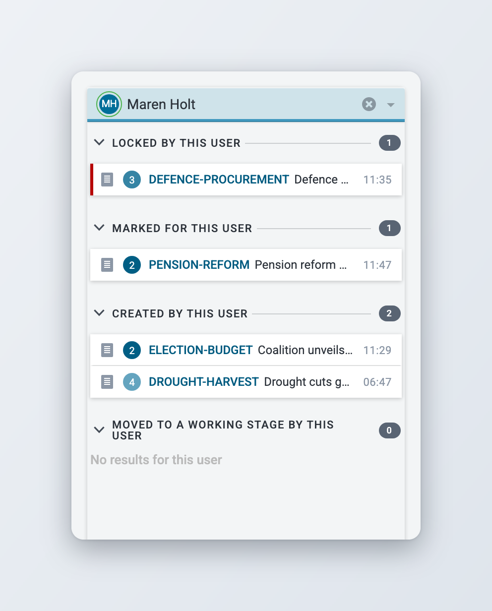<figcaption>
The User Activity widget
</figcaption></figure>

### Desk Router

The Desk Router widget closes a desk and routes its incoming content to another desk, for example overnight. While the desk is closed, new items still arrive on it, but they are marked for the other desk so the people working there see them. The widget only works on the Dashboard of a desk.

* **Routed from** lists the desks that route their content to this desk, if there are any.
* **Route incoming content to** is the desk that receives this desk's content while it is closed.
* **Start routing** closes the desk. **Stop routing** reopens it and removes the marks that routing added. Marks that users set by hand stay.

You need the Desk routing privilege to change the destination or to start and stop routing. Other users see the widget but cannot change it.

<figure>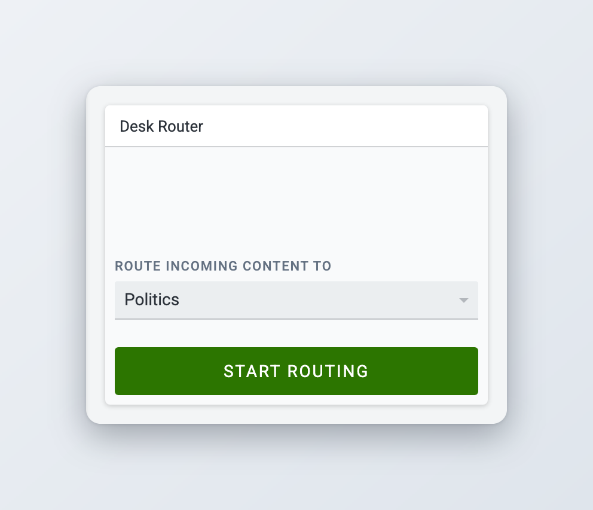<figcaption>
The Desk Router widget
</figcaption></figure>

Routing only works after an administrator has set it up for the desk's stages. See [Desk Creation and Desk Management](../administration/desk-creation-and-desk-management.md#desk-routing). How a closed desk looks in the Desks menu is described in [Desks and Custom Workspaces](desks-and-custom-workspaces.md#closed-desks).

### Publishing Actions


This is an optional module. If you do not see it, ask your administrator.


The Publishing Actions widget is part of the Analytics module. It shows a pie chart of the publishing actions on the current desk: items published, killed, corrected, updated and taken down. By default it counts today's actions.

Click the gear icon in the top-right corner of the widget to change the chart title, the sort order, the period and the colour used for each action, then click **Save**. Choose the period in the **Date Filter** list, for example **Today**, **Yesterday**, **Last Week** or **Range**. Which periods the list offers depends on how the Publishing Performance report is configured. See [Analytics](../integrations-and-advanced-features/analytics.md) for the full reports.

### Other widgets

Your Superdesk instance may contain widgets other than those described on this page, added by your organisation. For information about them, consult the documentation for your specific Superdesk instance.

## For administrators

* **Dashboard access.** Users need the **Dashboard** privilege to see the Dashboard icon.
* **Desk Dashboards.** Users need the **Desk Management** privilege to add, move, resize, remove and configure widgets on a desk Dashboard. Anyone can change the Dashboards of their own custom workspaces.
* **Desk Router.** Starting and stopping routing needs the **Desk routing** privilege. A user with it does not need Desk Management. Routing also needs the Desk Routing macro on the desk's stages. See [Desk Creation and Desk Management](../administration/desk-creation-and-desk-management.md#desk-routing).
* **Publishing Actions.** The widget comes with the Analytics module. Its data needs the **Analytics - Publishing Performance Reports** privilege.

Privileges are granted per role in **Main menu** > **Settings** > **User Roles**. See [User Management and User Roles](../administration/user-management-and-user-roles.md).
