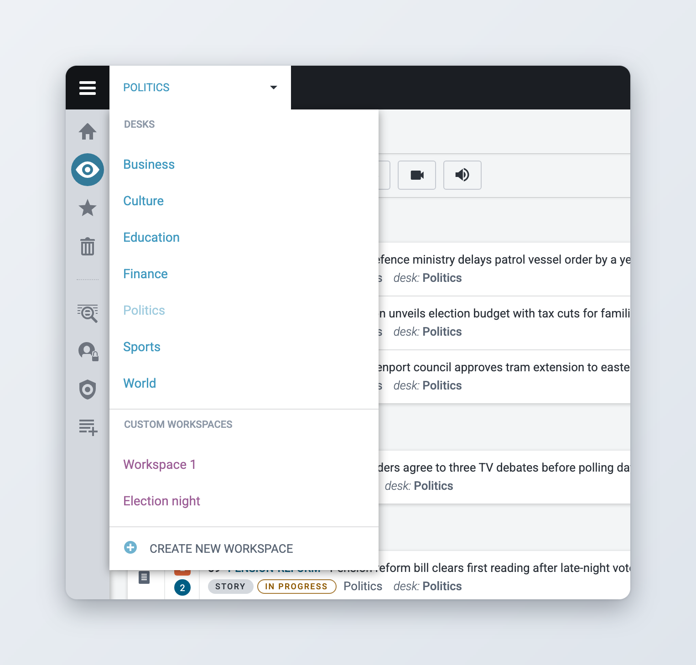
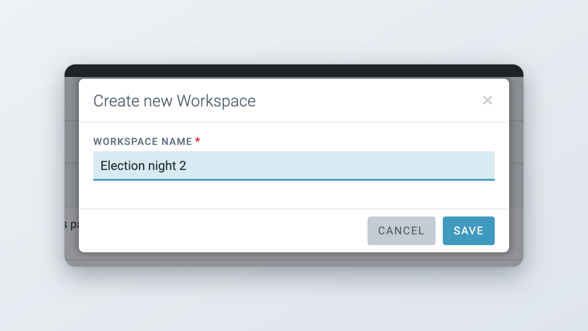
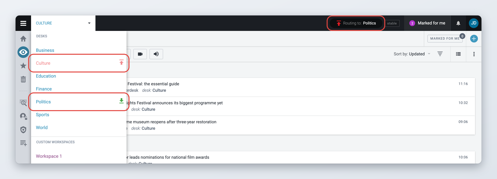
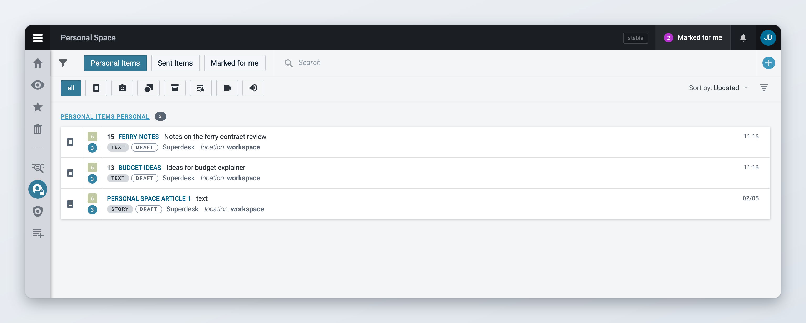
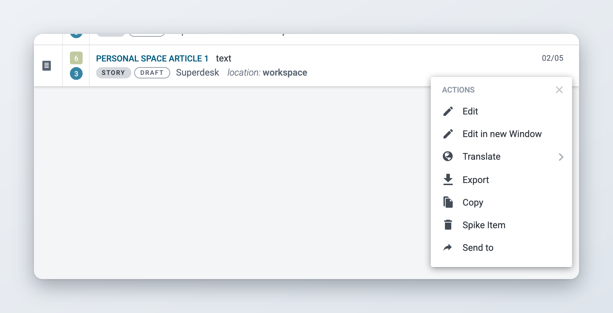
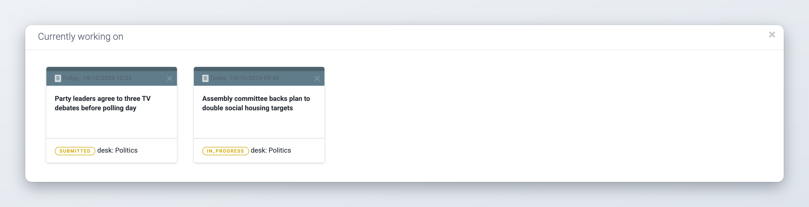

# Desks and Custom Workspaces

Desks are the basic organisational units in Superdesk. Desks are like the departments that you might find in a traditional newsroom. Desks could be separated by topic, function, media type or seniority, etc. Desks are configurable and customizable to suit the needs of your organization.

All users are assigned to a Desk, and some users are assigned to several. Your current desk is the one you have selected in the Desks menu, out of the desks you are assigned to. News items that users create, fetch, edit, spike or publish become associated with their current Desk.

<figure><figcaption>
The Desks menu
</figcaption></figure>

## Desks menu

The Desks menu is beside the Main menu button (also called the hamburger menu) in the top-left corner of the Superdesk interface. It always displays the name of the desk or workspace that you’re currently working on.

Click the Desks menu to see the desks you belong to, under **DESKS**, and your custom workspaces, under **CUSTOM WORKSPACES**. Desks are displayed in blue and custom workspaces in purple. Click a desk or a workspace to switch to it. The Monitoring view, the Dashboard and the Spiked Items view all show the desk or workspace you select here.

A custom workspace is your own view. It can combine stages and saved searches from several desks, so it is especially useful if you work on more than one desk or project at the same time. You can have as many custom workspaces as you like, and nobody else sees them.

### Creating a custom workspace



### Open the Desks menu

Click the Desks menu at the top left of the screen.



### Create the workspace

Click **CREATE NEW WORKSPACE** at the bottom of the list.



### Name it

In the **Create new Workspace** window, type a **Workspace name** and click **Save**. The name must be unique. The new workspace is selected straight away.



### Choose what it shows

Open the **Monitoring** view and click the gear icon (**Monitoring settings**) in the toolbar. Pick the desks, stages and saved searches you want to see. See [Monitoring Tab](monitoring-tab.md) for the details.



<figure><figcaption>
Creating a custom workspace
</figcaption></figure>

To rename or delete a custom workspace, select it in the Desks menu, then open the menu with three vertical dots in the Monitoring toolbar or on the Dashboard and choose **Rename workspace** or **Delete workspace**. Deleting a workspace only removes the view. The items it showed stay on their desks.

### Closed desks

A desk can be closed for a while, for example overnight. While a desk is closed, new items still arrive on it, but Superdesk marks them for another desk so the people working there see them. When the desk is reopened, those marks are removed again.

You can tell that desk routing is active:

* In the Desks menu, a closed desk is shown in red with an icon next to its name. A desk that receives content from a closed desk has a green icon.
* When you select a closed desk, the top bar shows **Routing to:** and the name of the desk that receives its content. When you select the receiving desk, the top bar shows **Routed from:** and the names of the closed desks. Some installations only show **Routed from other desks**.

<figure><figcaption>
A closed desk in the Desks menu and the routing label in the top bar
</figcaption></figure>

Desks are closed and reopened with the Desk Router widget on the desk's Dashboard. See [Dashboards and Widgets](dashboards-and-widgets.md#desk-router). Your administrator sets up routing for a desk. See [Desk Creation and Desk Management](../administration/desk-creation-and-desk-management.md#desk-routing).

## Fetching items from Search

Some news items arrive at a desk after they have been selected by a user from an external source in the Search tab. Many of the news items in the Search tab may have been authored by outside sources (such as news agencies). The process of moving an article from the Search tab to a desk is called **fetching**.

* You can only fetch items to a desk, not to your Personal space or to a custom workspace.
* **Fetch** copies the item to the desk that is selected in the Desks menu. When a custom workspace is selected, **Fetch** is not offered. Use **Fetch To** and pick the desk and stage instead, or select a desk first.
* Items from external search providers can only be fetched while a desk is selected.
* The same news item can be fetched to several desks.

## Dashboards

Users working on the same desk see the same widgets on their desk Dashboard. Only users whose role has the Desk Management privilege can add or change widgets on a desk Dashboard.

Custom workspaces also have Dashboards. If you would like your own widgets, set them up on the Dashboard of one of your custom workspaces. Only you see them.

To open the Dashboard, click the **Dashboard** icon in the Workspace Panel on the left, or press **Ctrl+Alt+B**. See [Dashboards and Widgets](dashboards-and-widgets.md) for the widgets you can use.

## Personal Space

Personal space is a place where you can create items in full privacy. Items that you create in your Personal space are not visible to anyone but you, and do not show up in other users' searches. Nobody else sees them until you send them to a desk.

To open it, click the **Personal space** icon in the Workspace Panel on the left, or press **Alt+P**. It is also in the Main menu.

The buttons at the top of Personal space switch between:

* **Personal Items**: the items that are in your Personal space now.
* **Sent Items**: items you created that are now on a desk.
* **Marked for me**: items a colleague marked for you, if your Superdesk uses Mark for user.

You cannot publish an item straight from your Personal space unless your administrator has allowed it. Send the item to a desk first.

<figure><figcaption>
Personal space
</figcaption></figure>

## Action menus

When you hover over an item in your Personal space or on a desk, an **Item actions** icon (three vertical dots) appears on the right of the row. Click it to open the **Actions** menu, with actions such as editing, copying and spiking. The menu only lists the actions that are allowed for the item and for your role.

You will find Action menus in various locations throughout the Superdesk interface. The actions for items on a desk are described in [Monitoring Tab](monitoring-tab.md#item-actions).

<figure><figcaption>
The Actions menu of an item in Personal space
</figcaption></figure>

## Spiking items

Spiking an item from a desk moves it to the Spiked Items view of that desk, where you can unspike it until it expires. Spiking an item from your Personal space deletes it for good. See [Spiked Items](../content-management/spiked-items.md).

## Sending items from Personal Space to a Desk

To move an item from your Personal space to a desk, send it with the **Send to** tab of the Send to and Publish panel. See [Sending, scheduling and publishing items](../content-management/sending-scheduling-and-publishing.md#sending-an-item-to-a-desk-or-stage).

You can send items to desks that you are not a member of. After that you can still open them read-only, but you cannot edit, send or spike them.

Depending on your setup, the Actions menu of an item on a desk can also have **Send to Personal Space** or **Duplicate to personal**, to bring a copy of a desk item into your Personal space.

## Open items

Items you open for editing stay open, and locked for other users, until you close them. They are listed in the bar at the bottom of the screen. See [The bar at the bottom of the screen](../navigating-superdesk/icons-and-user-experience.md#the-bar-at-the-bottom-of-the-screen) and [Locked items](../navigating-superdesk/icons-and-user-experience.md#locked-items).

To see all of them at once, click the **All opened items** icon (a grid of squares) at the left end of the bar. A full-screen view called **Currently working on** opens, with a card for each open item. Click a card to go back to the workspace and open that item. Click the **X** on a card to close the item. To leave the view, click the **X** in the top right corner.

<figure><figcaption>
The Currently working on view
</figcaption></figure>
