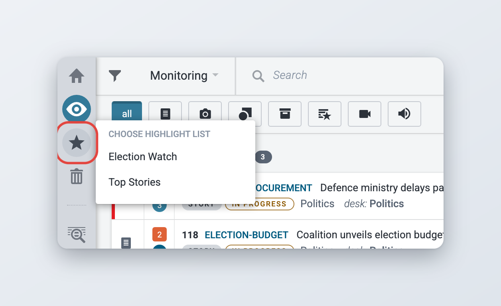
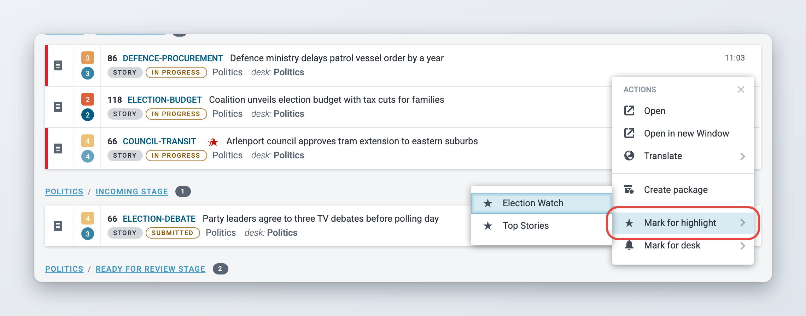
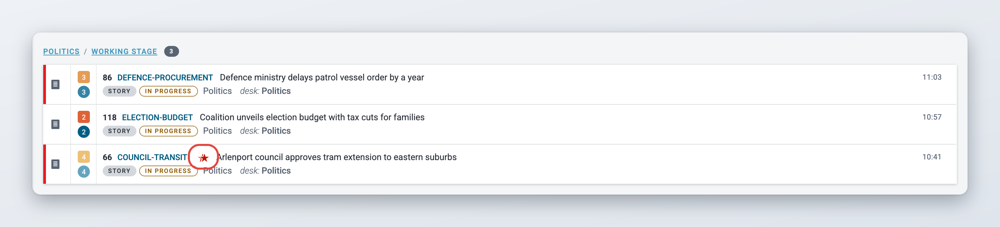
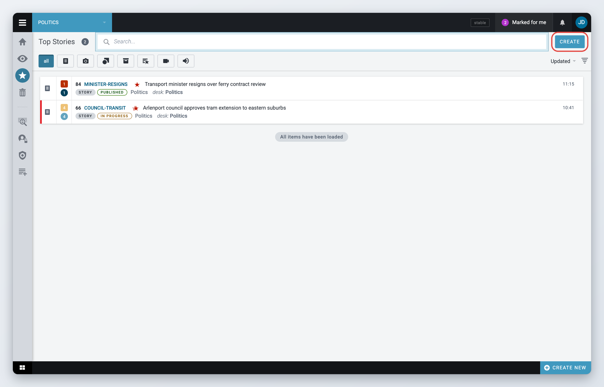
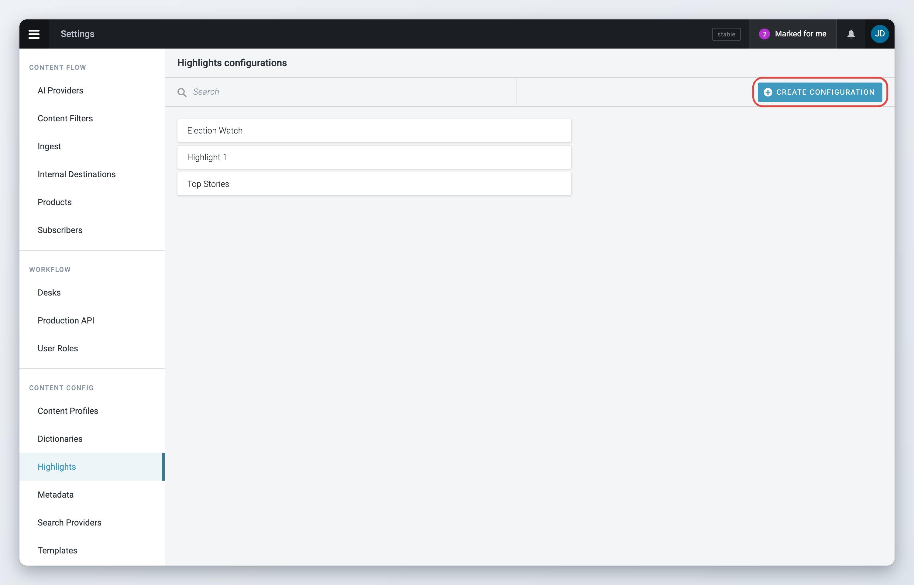
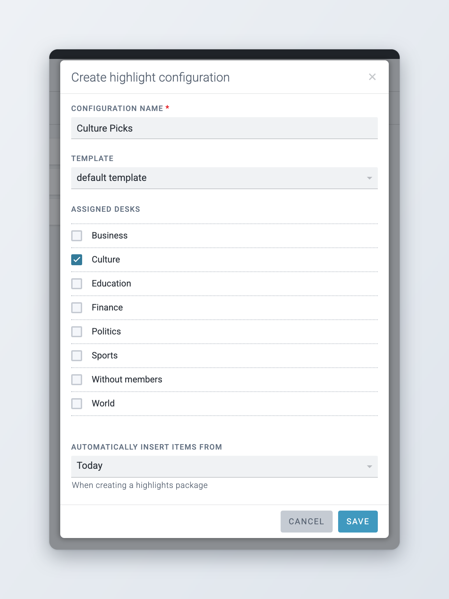

# Highlights

Highlights are lists of news items collected on a desk. They are most commonly used for content indexes, top-10 lists, section features and other user-curated lists. You add items to a highlight by hand. You can then turn the highlight into a highlights package and publish it as a unit.

If you are unable to add articles to a highlight, or create a new one, ask your administrator to check that your role has the right privileges. New highlights can only be created in **Settings**. See [Creating a highlight configuration](#creating-a-highlight-configuration).

## Viewing highlights

Hover over or click the star-shaped **Highlights** icon in the Workspace Panel, or press **Ctrl+Alt+H**. Under **Choose highlight list** you see the highlights that are available on your current desk. Click one to open it. If there are none, the list says **No available highlights**.

<figure><figcaption>
Choosing a highlight list
</figcaption></figure>

You can have several highlights at a time, organised by priority, topic or interest. Articles can be added to highlights from various stages, such as published articles, drafts or items that have just been fetched to a desk. Newly ingested articles must first be fetched to a desk before they can be added to a highlight.

## Adding articles to a highlight

To add a news item to a highlight, find it in the Monitoring view, in a custom workspace or in Search.



### Open the Actions menu

Hover over the item and click the **Item actions** icon (three vertical dots) at the right of the row.



### Choose the highlight

Hover over **Mark for highlight** and click the highlight you want to add the item to. Superdesk confirms with "Item marked".



<figure><figcaption>
Adding an article to a highlight
</figcaption></figure>

You can only add text items that are on a desk you are a member of. Items in your Personal space, and spiked, killed or scheduled items, cannot be added. To add several items at once, select them and click **Add to highlight** in the bulk actions bar. See [Selecting several items](monitoring-tab.md#selecting-several-items).

A single article can be part of several highlights. A star appears next to the article title once it is in a highlight. If it is in more than one highlight, you see a double star. The star is red while the item is within the time window of the highlight (see [Creating a highlight configuration](#creating-a-highlight-configuration)). A black star means the item is older than the window: it stays marked, but **Create** does not add it to the package.

Click the star to see which highlights the item belongs to. Click **REMOVE** next to a highlight to take the item out of it.

<figure><figcaption>
The star shows that an article is in a highlight
</figcaption></figure>

## Working with the items in a highlight

The highlight view lists the items of the highlight, like a Monitoring group. Click an item to preview it. The **Item actions** menu of each item and the bulk actions bar work the same way as in the Monitoring view, within the limits of your role. See [Item actions](monitoring-tab.md#item-actions) and [Selecting several items](monitoring-tab.md#selecting-several-items).

<figure><figcaption>
The items of a highlight
</figcaption></figure>

### Creating a highlights package

Click **Create** in the highlight view to create a highlights package. The package is named after the highlight and already holds the items of the highlight that are within its time window, whether they are published yet or not. It opens for editing, and from there you edit, send and publish it like any other package. Publishing the package also publishes the items in it that are not published yet. See [Packages](../content-management/packages.md).

To turn the package into a single article, click **Export** in the top bar of the package. Superdesk creates a text item from the package, formatted with the highlight's template, and opens it. Export only works when every item in the package is published and nobody has one of them open for editing. Otherwise Superdesk refuses with "Locked or not published items in highlight list".

You need the privilege to mark items for highlights to see the **Create** button.

## Creating a highlight configuration

Highlights are set up in **Settings**. Not all users can do this.



### Open the highlight settings

Open the Main menu (also called the hamburger menu), go to **Settings** and click **Highlights** under **Content config**. The **Highlights configurations** page lists the existing highlights.



### Create a configuration

Click **Create configuration** at the top right of the page. The **Create highlight configuration** window opens.



### Fill in the settings

* **Configuration name**: the name of the highlight. It must be unique and can have up to 40 characters.
* **Template**: the template used when you export a highlights package to a single article. Leave **default template** or pick a highlights template. See [Highlights templates](../administration/content-configuration/templates-macros-and-dictionaries.md#highlights-templates).
* **Assigned desks**: tick the desks on which the highlight is available.
* **Automatically insert items from**: **Today**, **This week** or the last few hours. This is the time window of the highlight. When you create a highlights package, only the marked items that changed within this window are added to it.



### Save

Click **Save**. The new highlight appears in the list.



<figure><figcaption>
The Highlights configurations page
</figcaption></figure>

<figure><figcaption>
Creating a highlight configuration
</figcaption></figure>

To change or remove a highlight, hover over it in the list and click the pencil icon (**Edit configuration**) or the bin icon (**Remove configuration**).

## For administrators

Highlights use three privileges, set per role in **Settings** > **User Roles**:

* **Highlights - read** shows the **Highlights** icon in the Workspace Panel and lets users open highlights.
* **Mark items for Highlights/Summary Lists** lets users add items to highlights and create highlights packages.
* **Highlights/Summary List Management** gives access to **Settings** > **Highlights**.
