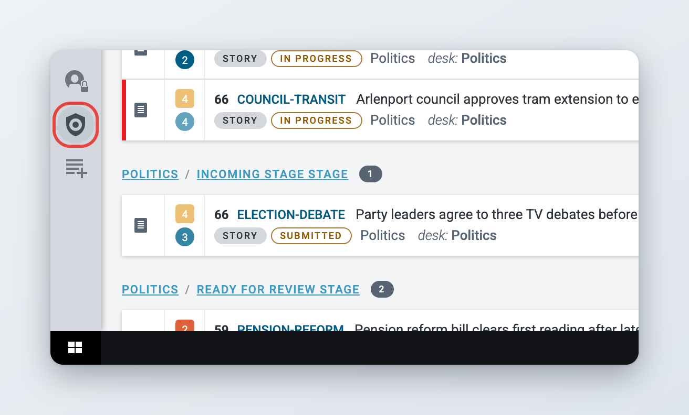
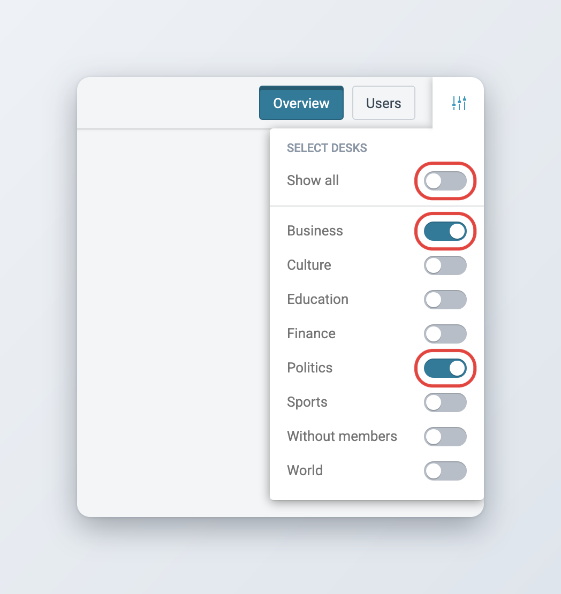
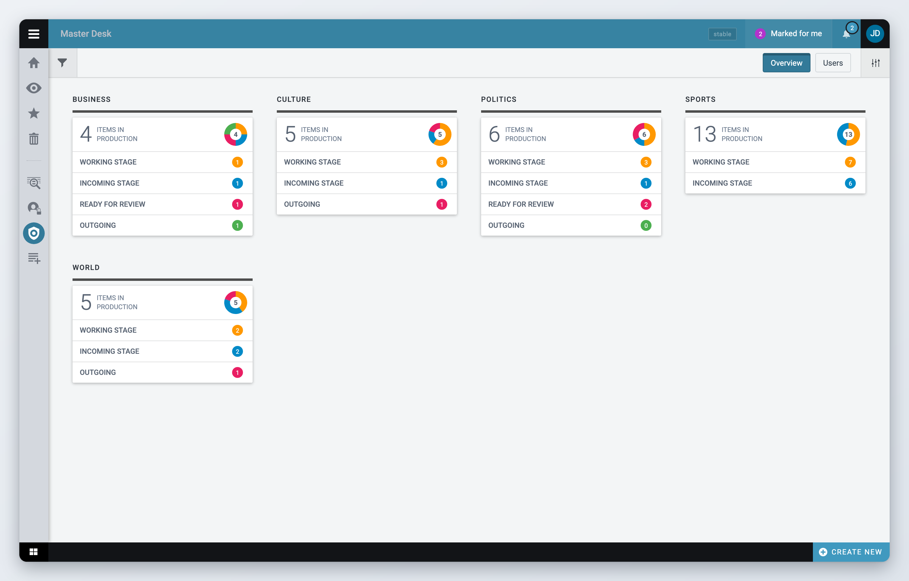
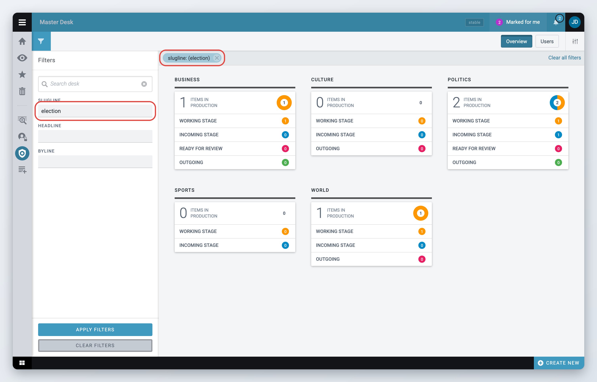
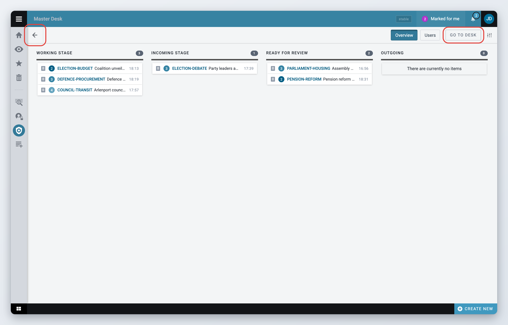
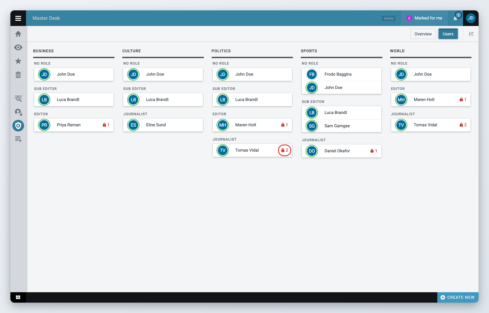
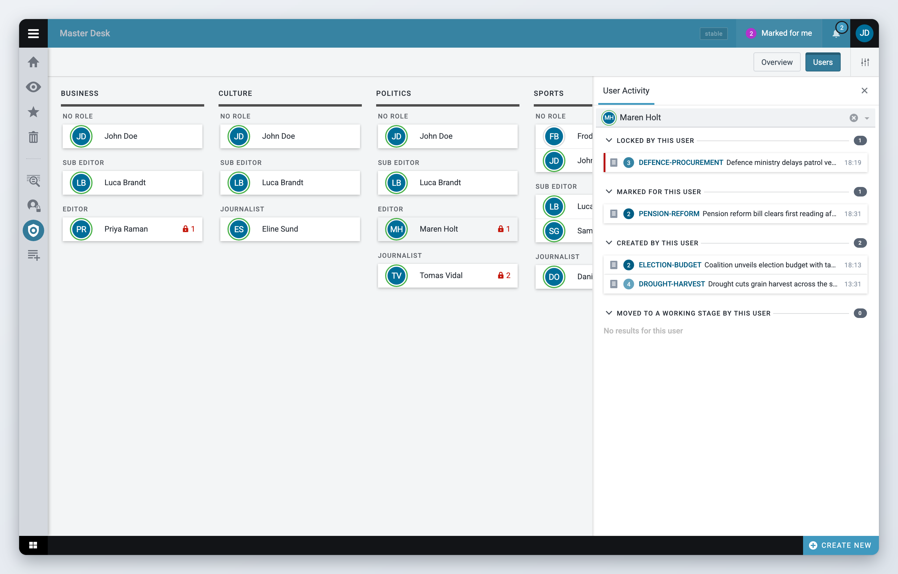

# Master Desk

*Available since Superdesk 2.1.*

Master Desk gives newsroom managers one view of the work in progress across all desks. You can see how many items sit in each stage of every desk, follow a story by its slugline, check who is working on what, and see how planning assignments are progressing.

Master Desk is read-only. You cannot open, edit or move items from it. To work on an item, go to the desk's [Monitoring view](monitoring-tab.md).


You only see Master Desk if your role has the Master Desk privilege. If you need it, ask your administrator.


## Opening Master Desk

Click the **Master Desk** icon in the Workspace Panel on the left of the screen. You can also press **Ctrl+Alt+D** from anywhere in Superdesk. See [Navigation](../navigating-superdesk/navigation.md) for the other icons in the Workspace Panel.

<figure><figcaption>
The Master Desk icon in the Workspace Panel
</figcaption></figure>

Master Desk opens on the **Overview** tab. The tabs on the right of the header switch between **Overview**, **Users** and **Assignments**.

## Choosing which desks to show

By default Master Desk shows every desk in the system. To focus on a few desks:



### Open the desk list

Click the desk selection icon at the far right of the header. The **Select desks** list opens.



### Turn on the desks you want

Turn on the switch next to each desk you want to see. **Show all** turns off as soon as you pick a desk.



### Go back to all desks

To see every desk again, turn **Show all** back on.



Your choice applies to all three tabs. Superdesk saves it in your user preferences, so it is still there the next time you log in.

<figure><figcaption>
Choosing which desks Master Desk shows
</figcaption></figure>

## Overview tab

The Overview tab shows one card per desk. Each card has:

* the desk name,
* the number of **items in production** on the desk, with a donut chart that splits them by stage,
* the list of the desk's stages, each with its own item count.

"Items in production" means items that are still being worked on. Published, corrected, killed, recalled, scheduled and spiked items are not counted. New items that have never been saved are not counted either. The numbers update by themselves as items are created and move between stages.

<figure><figcaption>
The Overview tab: one card per desk, with item counts per stage
</figcaption></figure>

### Filtering the overview

Use the filters to find a desk quickly or to follow a story by its slugline across all desks. Filters are only available on the Overview tab.



### Open the Filters panel

Click the filter icon on the left of the header. The **Filters** panel opens on the left.



### Find a desk

Type part of a desk name in **Search desk**. Only the matching desk cards stay on screen. This filter applies as you type.



### Filter the items

Type text in **Slugline**, **Headline** or **Byline**, then click **Apply Filters**. The counts on every card now include only the items that match.



If you fill in more than one field, an item is counted when it matches any of them, not all of them. To follow one story, fill in **Slugline** only.

Active filters appear in a bar above the cards, for example `slugline: (election)`. Click the cross on a filter to remove it, or click **Clear all filters**. You can also click **Clear Filters** in the panel. Filters are cleared when you switch to another tab.

<figure><figcaption>
Following a story by slugline with the Filters panel
</figcaption></figure>

### Single desk view

*Available since Superdesk 2.3.*

Click a desk name on its card to open that desk on its own. The single desk view shows one column per stage, with the item count at the top. Each item shows its type, urgency, slugline, headline and the time it was last changed. Any slugline, headline or byline filters you applied still apply here.

A stage column shows at most 100 items. The count at the top of the column is always the full number.

If you are a member of the desk, a **Go To Desk** button appears in the header. Click it to switch to that desk and open its Monitoring view, where you can work on the items.

To go back to all desks, click the back arrow on the left of the header. To look at another desk, go back and click its name.

<figure><figcaption>
The single desk view shows the items in each stage of one desk
</figcaption></figure>

## Users tab

The Users tab shows who is working on what. There is one column per desk. Inside each column, the desk members are grouped by their user role. Members without a role are listed under **No role**. A desk with no members shows "There are no users assigned to this desk".

Next to a user's name you may see two numbers:

* the lock icon shows how many items the user has locked, that is, has open for editing,
* the assignment icon shows how many planning assignments the user has, in any status. This number only appears if your Superdesk uses the [Planning component](../superdesk-planning-component.md).

<figure><figcaption>
The Users tab: desk members grouped by role, with locked items and assignments
</figcaption></figure>

### Seeing a user's activity

Click a user to open the **User Activity** panel on the right. It lists the user's items in groups:

* **Locked by this user**
* **Marked for this user**
* **Created by this user**
* **Moved to a working stage by this user**

**Marked for this user** only appears when the Mark for user feature is enabled. To look at another person, pick them in the user field at the top of the panel. Click the cross to close the panel. This is the same view as the User Activity widget described in [Dashboards and Widgets](dashboards-and-widgets.md).

<figure><figcaption>
The User Activity panel for one desk member
</figcaption></figure>

## Assignments tab

The Assignments tab is only there if your Superdesk uses the [Planning component](../superdesk-planning-component.md). It shows one card per desk with the number of **items in total**: the planning assignments given to that desk. A donut chart and three counts split them by status:

* **To Do**: assignments that are assigned or submitted and not yet started,
* **In Progress**: assignments someone is working on,
* **Completed**: assignments that are completed or cancelled.

The counts update by themselves as assignments change. The cards on this tab do not open a single desk view.

## For administrators

Access to Master Desk is controlled by the **Master Desk** privilege ("User can access master desk"). Users without it do not see the icon in the Workspace Panel.



### Open the role privileges

Open the Hamburger Menu, go to **Settings** > **User Roles** and select the **Roles privileges** tab.



### Grant the privilege

Tick **Master Desk** for each role that should see it, for example your newsroom managers. Users may need to log out and log back in before the change applies.



The Overview and Assignments tabs load their counts through the desk management part of the system. Give the same roles the **Desk Management** privilege as well, otherwise those two tabs stay empty while the Users tab still works.

There is no other configuration. The Assignments tab and the assignment counts on the Users tab appear automatically when the Planning component is installed. See [User Management and User Roles](../administration/user-management-and-user-roles.md) for more on roles and privileges.
