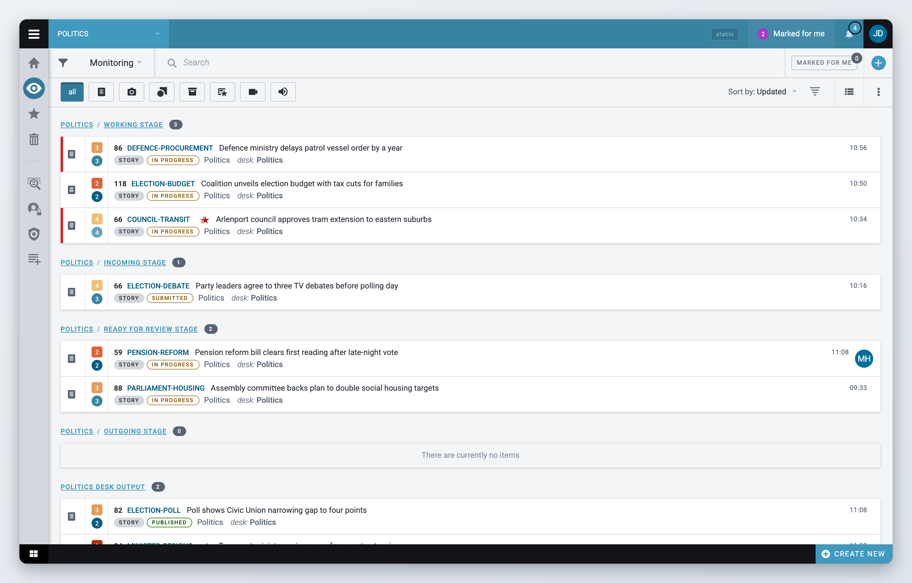
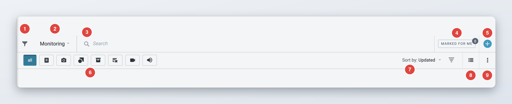
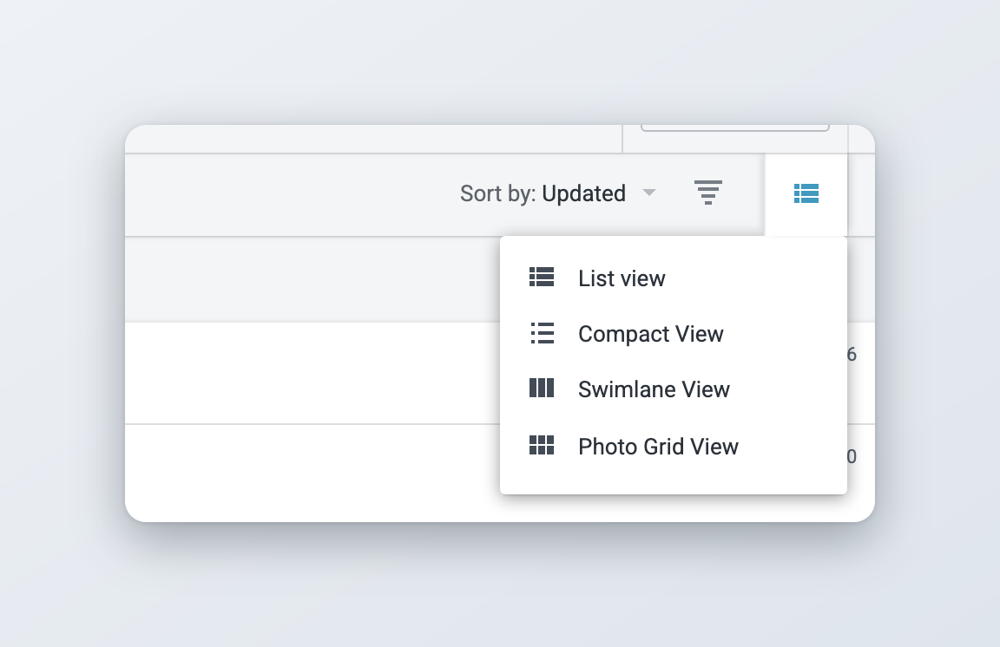
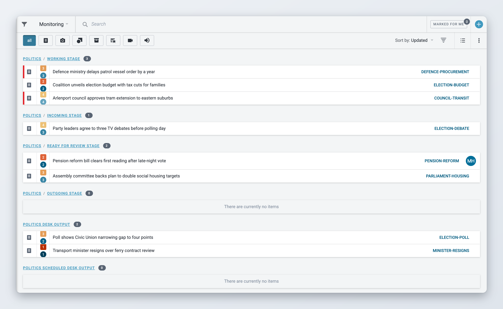
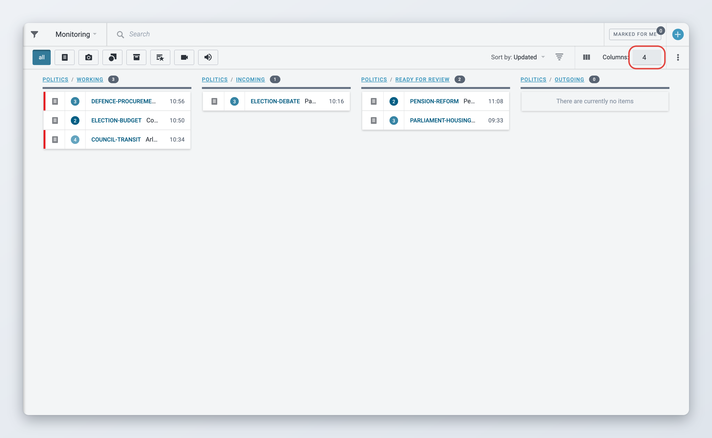
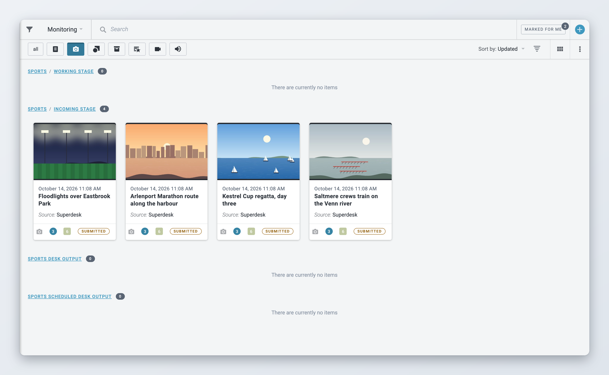
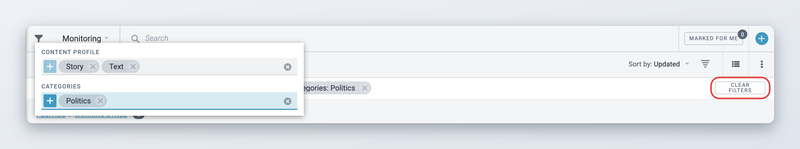
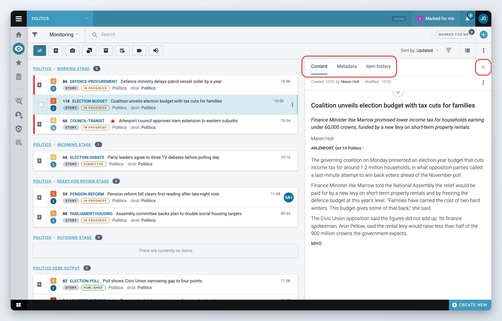
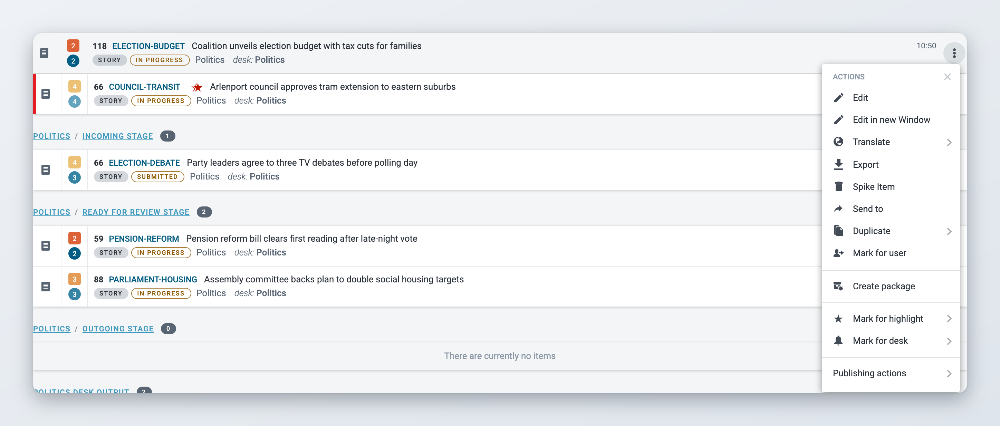
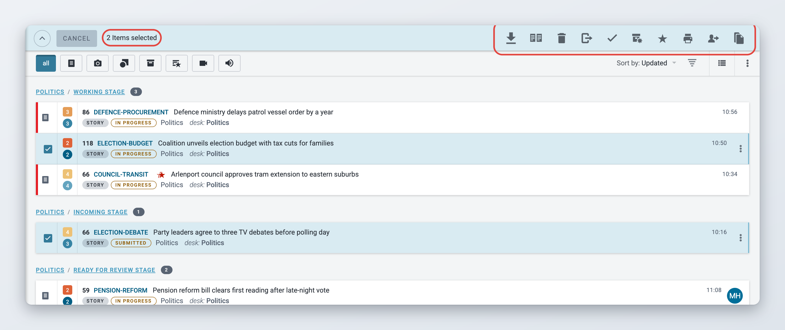

# Monitoring Tab

The Monitoring view is the main workspace for production journalists and editors. It shows the content of a desk's workflow, one group per stage, so you can see what is waiting, what is being worked on and what has gone out. You open it with the **Monitoring** icon in the Workspace Panel on the left, or with **Alt+M**.

Monitoring always shows the desk or custom workspace that is selected in the **Desks menu** at the top left of the screen. The menu lists your **DESKS** first, then your **CUSTOM WORKSPACES**, and ends with **CREATE NEW WORKSPACE**.

* **Desk.** When you select a desk, Monitoring shows the groups that were configured for that desk. Every member of the desk sees the same groups.
* **Custom workspace.** A custom workspace is your own view. It can combine stages from any desk you have access to, desk output groups, your personal items and saved searches, including saved searches on ingest. Use it when your work covers more than one desk and you do not want to switch between them. See [Desks and Custom Workspaces](desks-and-custom-workspaces.md) for how to create one.

<figure><figcaption>
The Monitoring view of a desk
</figcaption></figure>

## Groups in the Monitoring view

Each group has a header with its name and the number of items it contains. A group can be:

* a **stage** of a desk, for example *Sports / Working Stage*,
* a **desk output** group, such as the published, scheduled or sent items of a desk,
* a **saved search**, which lists every item that matches the search,
* your **personal** items.

Stages are set up by an administrator in the desk settings, so they can differ from desk to desk. See [Desk Creation and Desk Management](../administration/desk-creation-and-desk-management.md).

To work with one group only, click its name in the group header. Click the desk name to see all of that desk's items in one list, or the stage name to see that stage alone. The **Monitoring** dropdown in the toolbar also lists all groups, so you can jump straight to one. To go back, click the arrow at the left of the toolbar (**Back to original view**).

The number after a group name is the number of items in that group. The incoming stage of a desk can show a second, separate badge next to it: it appears when someone mentions the desk in a comment and counts the unread mentions. Click that badge to open the **Notification list**. From there you can open the item or click **Acknowledge**.

### Changing the order of groups

Open the **More actions** menu (three vertical dots) at the right of the second toolbar row and choose **Rearrange Groups**. Drag the groups into the order you want and click **Done**. The new order is saved as your personal preference for that desk or custom workspace and stays after you log out. It does not change the order other desk members see.

In a custom workspace, the same menu also has **Rename workspace** and **Delete workspace**. The gear icon (**Monitoring settings**) in the toolbar opens the workspace setup, with the steps **Desks**, **Saved Searches**, **Reorder Sections** and **Items Count**.

## The toolbar

<figure><figcaption>
The Monitoring toolbar
</figcaption></figure>

The first row, from left to right:

* the **Filters** icon (a funnel), see [Filters](#filters),
* the **Monitoring** dropdown, which lists the groups,
* the **Search** box,
* the **Marked for me** button, when your installation uses Mark for user,
* the **Create new item** button (plus icon), to create an article from a template, create a package or upload media. See [Creating and Editing Content Items](../content-management/creating-and-editing-content-items/README.md).

The second row, from left to right:

* the file type buttons,
* the sort control,
* the view switcher, see [Choosing a list view](#choosing-a-list-view),
* the **More actions** menu.

## Choosing a list view

You can display the Monitoring lists in several ways. Click the view switcher icon in the second toolbar row and choose a view.

<figure><figcaption>
The view switcher
</figcaption></figure>

The dropdown only lists the views your installation supports.

### List view

The default view. Groups are stacked one below the other, and each item takes two lines with its headline and the most important metadata.

### Compact View

*Available since Superdesk 3.1.*

Compact View shows more items per screen. Each row has fewer fields, so you can scan long lists quickly. Your administrator decides which fields appear in a compact row.

<figure><figcaption>
Compact View
</figcaption></figure>

### Swimlane View

Swimlane View shows the groups side by side as columns, like a board. It is useful when you want to follow items as they move from stage to stage.

Use the **Columns:** field next to the view switcher to choose how many groups are shown at once. Swimlane View is only offered while you see all groups. It is not available after you open a single group.

<figure><figcaption>
Swimlane View
</figcaption></figure>

### Photo Grid View

*Available since Superdesk 3.1.*

Photo Grid View shows items as tiles with a large thumbnail. It works best for pictures and other media. It replaces the older media grid.

<figure><figcaption>
Photo Grid View
</figcaption></figure>

### How your view is remembered

*Available since Superdesk 3.1.*

Superdesk saves the view you choose in your user preferences. The next time you open Monitoring, even after logging out or on another computer, it opens in the same view.

There is one exception. An administrator can set a default monitoring view for a desk. When you select that desk, its default view is used instead of your own choice.

## Searching and filtering

### Searching the lists

Type a word or phrase in the **Search** box and press Enter. All groups are narrowed to the items that match. To clear the search, click the cross in the box.

To search all of Superdesk, use [Search](searching-content-in-superdesk.md) instead.

### File type buttons

The buttons at the start of the second toolbar row filter the lists by item type. **all** is selected by default. The other buttons, from left to right, are text, picture, graphic, package, highlights package, video and audio. You can select more than one type. Hover over a button to see its name.

If a content profile has an icon, it also appears here as a button. Click it to show only items created with that profile. On narrow screens the file type buttons are collapsed into a menu.

### Filters

*Available since Superdesk 3.1.*

Click the **Filters** icon (funnel) at the start of the toolbar to open the filter panel. By default it has two fields:

* **Content Profile**, which lists the content profiles that are currently enabled,
* **Categories**.

Your installation can replace these with other filter fields.

<figure><figcaption>
The Filters panel and active filters
</figcaption></figure>

You can pick several values in each field. Values in the same field are combined with OR, and different fields are combined with AND. For example, Content Profile *Story* and *Brief* with Category *Sport* shows stories and briefs about sport.

Active filters appear as tags under the toolbar after **Filters:**, for example *content profile: Story*. Click a tag to remove that value, or click **Clear filters** to remove them all.

Your filters and file type selection are remembered in your browser. They stay active when you reload the page or switch to another desk or workspace. They are not shared with other users, and they do not follow you to another browser or computer.


If Monitoring looks emptier than you expect, check the tags under the toolbar. A filter you set earlier may still be active.


### Marked for me

When a desk is selected and your installation uses Mark for user, the toolbar shows a **Marked for me** button with a count. Click it to show only items on this desk that are marked for you. Click it again to show everything. See [Collaboration tools](../content-management/creating-and-editing-content-items/collaboration-tools.md).

## Previewing an item

Click an item once to open it in the preview pane on the right. Previewing does not lock the item, so other users can keep working on it.

<figure><figcaption>
The preview pane
</figcaption></figure>

The preview pane has these tabs:

* **Content**: the item as it reads.
* **Metadata**: the item's metadata, such as slugline, word count and categories.
* **Item history**: who did what to the item, and when.
* **Duplicates**: shown when the item has duplicates.
* **Used**: shown for media that are used in other items, with the number of uses.
* **Assignment**: shown when the item is linked to a Planning assignment.

The pane also has a **More actions** menu with the same actions as the list. Click **Close preview** (the cross) to close it. On narrow screens the preview opens on top of the list.

## Opening an item

Double-click an item to open it:

* An item that is not published opens for editing.
* A published item opens read-only. To change it, use the actions described in [Updates, corrections, kills and takedowns](../content-management/updates-corrections-kills-and-takedowns/README.md).
* An ingest item is first fetched to your desk, then opened for editing.

Spiked items do not open on double-click. See [Spiked Items](../content-management/spiked-items.md).

## Item actions

Hover over an item and click the **Item actions** icon (three vertical dots) at the right of the row. The **Actions** menu lists only the actions that are allowed for the item in its current state and that your role permits. If none are allowed, the menu says "You don't have the privileges to perform any action".

<figure><figcaption>
The Actions menu of an item
</figcaption></figure>

The most common actions are:

| Action | What it does |
| --- | --- |
| **Edit** | Opens the item for editing next to the list. |
| **Edit in new Window** | Opens the item for editing in a separate browser window. |
| **Open** / **Open in new Window** | Opens a published item read-only. |
| **Send to** | Sends the item to another desk and stage. See [Sending, scheduling and publishing items](../content-management/sending-scheduling-and-publishing.md). |
| **Duplicate** | **Duplicate in place**, **Duplicate To** another desk, or **Duplicate to personal**. |
| **Translate** | Creates a translation of the item. |
| **Spike Item** | Moves the item to Spiked Items, after a confirmation. |
| **Mark for desk** / **Mark for highlight** | Flags the item for another desk or adds it to a highlight. See [Highlights](highlights.md). |
| **Mark for user** | Marks the item for a colleague, when your installation uses Mark for user. |
| **Create package** / **Add to current** / **Combine with current** | Package actions. See [Packages](../content-management/packages.md). |
| **Export** | Exports the item in a format your installation supports. |
| **Publishing actions** | Actions on published content: **Update**, **Correct item**, **Kill item**, **Takedown item**, **Unpublish**, **Resend item**. Which ones appear depends on the item's state. |
| **Fetch** / **Fetch To** | For ingest items: copies the item to your desk, or to a desk and stage you choose. |

Your installation may add more actions, for example Planning actions.

Many actions also have keyboard shortcuts. See [Keyboard shortcuts](../reference/keyboard-shortcuts.md).

## Selecting several items

You can select several items and act on all of them at once.



### Select the first item

Hover over the item type icon at the start of a row. It turns into a checkbox. Click the checkbox.



### Add more items

Click the checkboxes of other items. To select a range, click an item to preview it, then hold Shift and click the checkbox of another item. Everything in between is selected.



### Choose an action

A bar appears at the top of the list with the number of selected items, for example "3 Items selected", and the actions you can use. Click an action. Click **cancel** to clear the selection.



<figure><figcaption>
The bulk actions bar
</figcaption></figure>

The actions in the bar depend on what you selected. If an action is missing, at least one of the selected items does not allow it. For example, an item locked by another user cannot be spiked.

| Action | Available when | What you see |
| --- | --- | --- |
| **Fetch**, **Fetch to**, **Remove** | All items are ingest items. | **Fetch to** asks for a desk and stage. |
| **Edit metadata** | All items are pictures, videos or audio, and none is locked. | A form to edit the metadata of all items together. See [Edit Media Items](../content-management/creating-and-editing-content-items/edit-media-items.md). |
| **Multi-edit** | All items can be edited. | The items open together in the multi-edit view. If some cannot be edited, a dialog lists them. |
| **Export** | No item is locked by another user. | The export dialog. |
| **Spike** | No item is published or locked by another user. | A confirmation: "Are you sure you want to spike the items?" In your personal space: "Do you want to delete the items permanently?" |
| **Unspike** | All items are spiked (in Spiked Items). | A panel to choose where the items go. |
| **Send to** | No item is locked or published. | The Send to panel. |
| **Publish** | No item is locked or published, and all can be published. | A **Publishing** dialog, for example "Do you want to publish 3 articles?", with **Publish** and **Cancel**. When it is done: "All items were published successfully." Items that fail are reported one by one as "Error on item: ..." |
| **Duplicate To**, **Duplicate In Place** | No item is locked. | **Duplicate In Place** confirms with "Item Duplicated" for each item. |
| **Create Package**, **Add to Current Package** | No item is locked, spiked, killed, unpublished or a draft. | **Add to Current Package** is shown only while a package is open. |
| **Add to highlight** | Same as for packages, and a desk is selected. | A **Set highlights** dialog. |
| **Mark for user** | Your installation uses Mark for user. | A dialog to pick the user. If the items are marked for different users, the dialog says so. |
| **Print** | All items can be previewed for printing. | A print preview of all items. |
| **Deschedule** | At least one item is scheduled. | A confirmation: "Do you want to deschedule articles?" When it is done, for example: "3 articles have been descheduled". |

## Loading and refreshing

*Available since Superdesk 2.4.*

While a group loads its items, it shows grey placeholder rows. A group with no items shows "There are currently no items". More items load as you scroll down a group.

In most installations, the lists update by themselves when items are added, moved or removed. Your administrator can switch automatic refresh off, for example for newsrooms on slow connections. Then Superdesk does not reload a list every time someone else changes it:

* Your own changes still appear straight away.
* Items that are already in the list are updated in place.
* When other users add items to a group, a round blue **Refresh** button appears in that group's header. In a single group and in Swimlane View it appears at the right of the toolbar. Click it to load the new items.


With automatic refresh off, a list can be out of date until you click **Refresh**. In return, the list does not jump around while you read it, and Superdesk uses less bandwidth.


## Full width mode

*Available since Superdesk 2.8.*

When you edit an item, it opens next to the Monitoring lists. To give the editor the whole screen, click the arrow button in the authoring top bar (**Full width mode**). Click it again (**Leave full width mode**) to bring the lists back.

While you are in full width mode, the Monitoring lists are hidden and stop updating. This keeps the editor fast on slow connections. When you leave full width mode, the lists load again with the latest content.

The same applies when you use **Edit in new Window** or **Open in new Window**: the new window shows only the item, without Monitoring.

## While a correction, kill or takedown is sent

*Available since Superdesk 3.1.*

When you send a correction, kill or takedown, the **Send Correction**, **Send Kill** or **Send Takedown** button and the **Cancel** button disappear until Superdesk has processed the request. This prevents a second click while the item is being published.

## For administrators

* **Desk groups.** The groups of a desk are set in **Settings** > **Desks**. Open the desk's actions menu and choose **Monitoring settings**. The setup has the same steps as for custom workspaces: **Desks**, **Saved Searches**, **Reorder Sections** and **Items Count**.
* **Default monitoring view of a desk.** In the desk settings, **Default monitoring view** overrides each user's own view for that desk. Select **None** to let users decide.
* **Access.** Users need the **Monitoring view** privilege to see the Monitoring icon.
* **Client configuration** (in `superdesk.config.js`):
  * `list.compactView` turns on **Compact View** and sets its fields (`firstLine`, `secondLine`).
  * `features.swimlane` turns on **Swimlane View**. `features.swimlane.defaultNumberOfColumns` sets the initial number of columns.
  * `features.autorefreshContent`: `true` makes the lists refresh by themselves. When it is missing or `false`, users get the manual **Refresh** button described in [Loading and refreshing](#loading-and-refreshing).
  * `list.singleLineView` together with `list.singleLine` (the fields to show) puts each item on a single line in all lists. Users cannot switch this themselves.
  * `confirm_spike: false` skips the spike confirmation.
  * `monitoring.stage.sort`, `monitoring.output.sort` and `monitoring.scheduled.sort` add a **Sorting:** control to the headers of stage, output and scheduled groups. Each takes `allowed_fields_to_sort` and an optional `default` with `field` and `order`.
