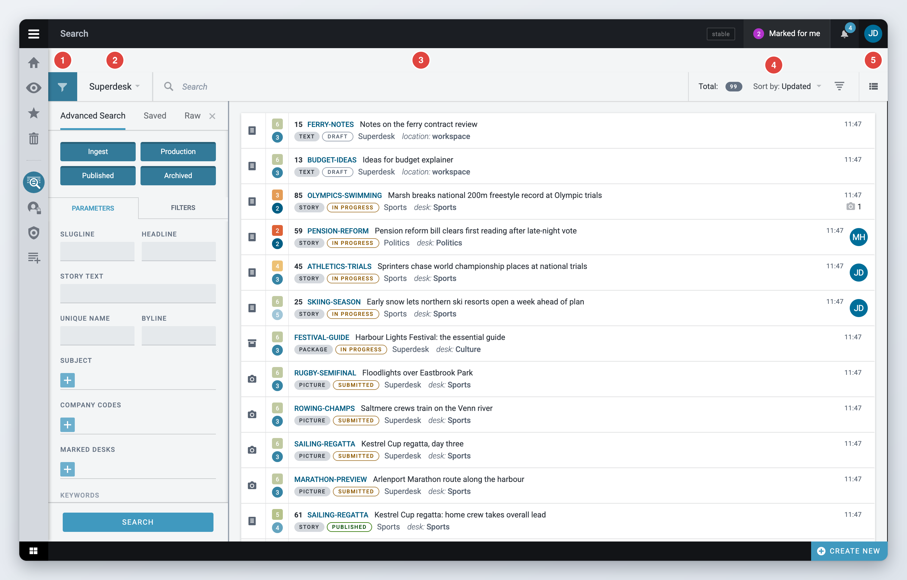
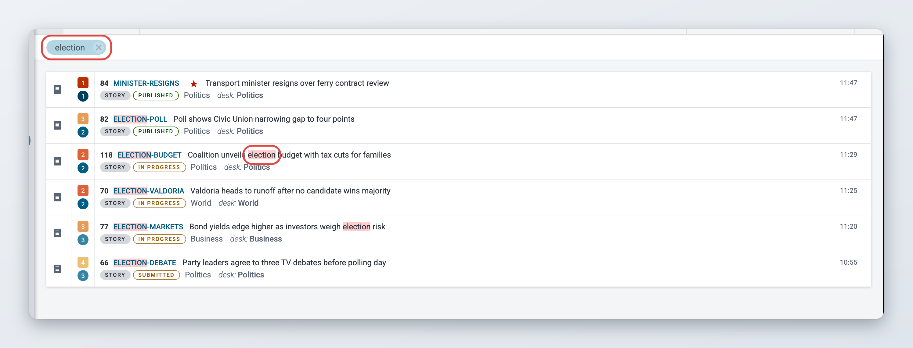
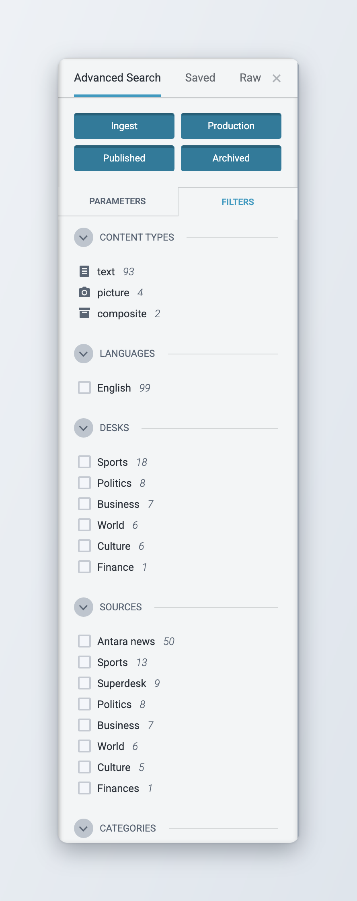
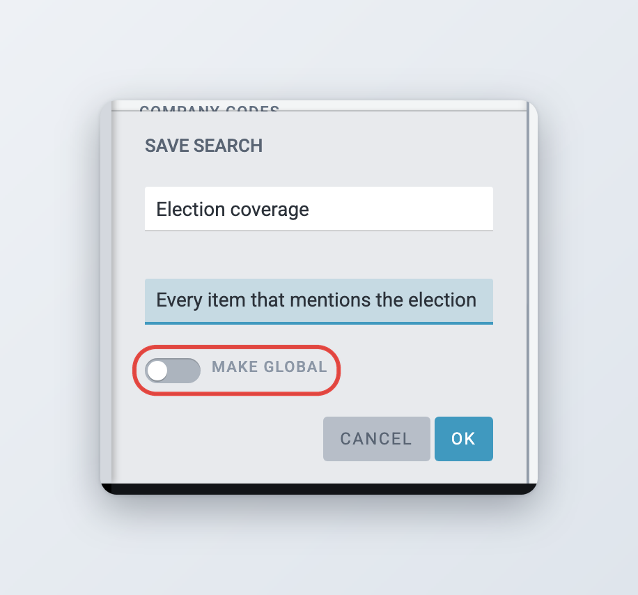
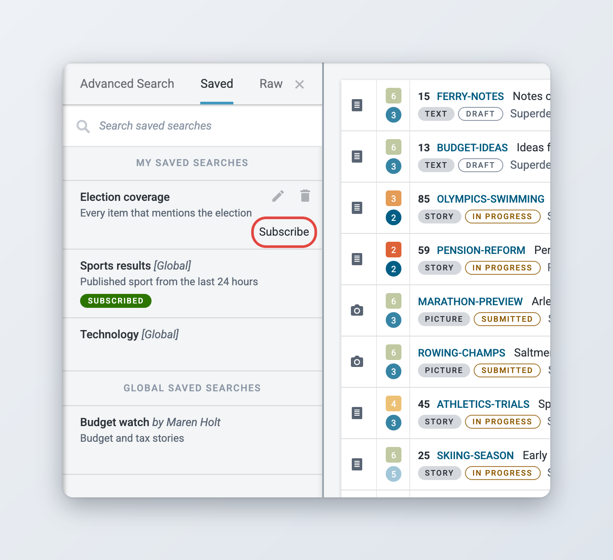
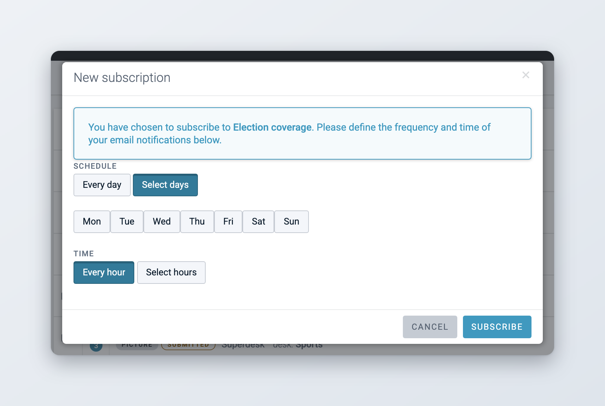

# Searching Content in Superdesk

Superdesk has a built-in search for finding news items. Search covers newly ingested content, items in production, published items and archived items: articles, pictures, videos, audio and packages. Each desk also has its own search box in the Monitoring view. To search the whole of Superdesk, use the **Search** icon in the Workspace Panel.

## Opening Search

Click the **Search** icon in the Workspace Panel, or press **Ctrl+Alt+F** anywhere in Superdesk. When you hover over the icon, a menu may list other places you can search, such as external search providers and search shortcuts. See [Search shortcuts](#search-shortcuts).

<figure><figcaption>
The Search page
</figcaption></figure>

The header of the Search page has, from left to right:

* the **Toggle filters** button (a funnel), which opens and closes the advanced search panel,
* the source dropdown, which shows **Superdesk** or the search provider you are using,
* the search box,
* the total number of results and the sort control,
* the view switcher.

What you find depends on your role. If your role does not have the **Global searches** privilege, Search only shows content from the desks you are a member of. Items in stages that a desk hides from non-members are only shown to members of that desk.

## Searching by keyword

Type one or more words in the search box and press Enter. Superdesk finds the items that contain all of the words you typed. To find words that appear next to each other, put them in double quotes, for example `"election budget"`.

### How your words are matched

*Available since Superdesk 2.5.*

Your words do not have to be in the same field. A search for `giraffe zoo` also finds an item with *giraffe* in the headline and *zoo* in the body.

The search box also finds items by the name of their author, as it appears in the item's author field.

### Highlighted search terms

If your Superdesk has search highlighting turned on, the words you searched for are highlighted in the results. Highlights show in the headline, slugline, abstract and body of ingested, production and published items, both in the results list and in the preview. The same applies when you search in the Monitoring view (since 2.4).

<figure><figcaption>
Search terms highlighted in the results
</figcaption></figure>

## Advanced search

Click **Toggle filters** (the funnel at the left of the header) to open the advanced search panel. The panel has up to three tabs:

* **Advanced Search**, with parameters and filters,
* **Saved**, with your saved searches and the global ones. You see it if your role can manage saved searches.
* **Raw**, a free query box for administrators. See [Raw search](#raw-search).

### Choosing where to search

At the top of the **Advanced Search** tab, four buttons choose which content is searched: **Ingest**, **Production**, **Published** and **Archived**. A highlighted button is included in the search. Click a button to include or exclude that content. For example, to search only newly ingested content, leave only **Ingest** highlighted.

Below these buttons are two tabs, **Parameters** and **Filters**.



Fill in one or more fields and click **Search** at the bottom of the panel. You can also press Enter in any text field.

* **Slugline**: searches only the slugline.
* **Headline**: searches only the headline. You can enter the full headline or some of its words.
* **Story Text**: searches the body of the item.
* **Unique Name**: finds the item with this unique name. Enter it exactly as it appears in the item's metadata. By default the unique name is a number, but it can be edited.
* **Byline**: searches the byline field. You can enter the full byline or part of it.
* **Subject** and other controlled vocabularies: click the field and pick values from the list. Which vocabularies appear here depends on your installation.
* **Marked Desks**: finds items that were marked for one or more desks with **Mark for desk**. Items marked for a desk show a bell icon in lists. Save this search to follow everything marked for your desk.
* **Keywords**: finds items with the keywords you pick.
* **From Desk**: the desk the item came from.
* **To Desk**: the desk the item was sent to.
* **Creator**: the user who created the item. This field only appears when **Production** is selected.
* **Spiked Content**: **Exclude spiked content** (the default), **Include spiked content** or **Spiked only content**.
* **Provider**: the ingest source the item came from.
* **Feature Media**: turn this on to find only items that have a feature image or other feature media.

Your administrator can add a **Sign-off** field or hide fields you do not use, so your list can differ.



Filters narrow the current results. Each filter group lists the values found in the results, with the number of matching items next to each value. Click a value to include it. Click the ban icon next to a value (**Negate**) to exclude it instead.

The filter groups are:

* **Content types**: text, picture, composite (packages), video, audio and other types,
* **Languages**,
* **Desks**,
* **Sources**,
* **Credits**,
* **Category**, **Genre**, **Urgency** and **Priority** (the names follow your vocabularies),
* **Flags**: **Legal** and **Sms**,
* **Date created**, **Date modified** and **Date published**: click **Last 24 Hours**, **Last 7 Days** or **Last 30 Days**, or set a range with the from and to date pickers,
* **Date scheduled**, for scheduled items.

A group only appears when the current results have values for it.

<figure><figcaption>
The Filters tab
</figcaption></figure>



### Search tags

Every keyword, parameter and filter you use appears as a tag above the results. Click the cross on a tag to remove it and widen the search. To remove everything at once, click **Clear filters** at the bottom of the advanced search panel.

## Sorting and changing the view

The header shows the total number of results. Click **Sort by** to sort the results by **Updated**, **Created**, **Urgency**, category, **Slugline**, **Priority** or **Genre**. Click the arrow next to it to switch between ascending and descending order.

Results are shown in **List View** by default. Use the view switcher at the right of the header to change to **Photo Grid View**, which is best for pictures and other media, or to **Compact View** if your installation offers it. You can also press **V** to switch views. See [Monitoring Tab](monitoring-tab.md#choosing-a-list-view) for what each view looks like.

## Finding translations

Translations are linked to the item they were translated from. In the results list:

* A translated item shows a **Translation** label. Click it to see the **Original Article**.
* An item that has been translated shows the number of its translations, for example **(2) Translations**. Click it to see each translation with its language code.

Click a headline in that list to preview the item. To narrow the results to one language, use the **Languages** filter on the **Filters** tab.

Whether the translation labels appear in your lists depends on how your administrator has set up the list fields. To translate an item and move between an original and its translations, see [Translating content](../content-management/translating-content.md#finding-translations-in-search).

## Saved searches

If you run the same search often, save it. A saved search keeps the keywords, parameters and filters you used. You can run it again from the **Saved** tab, show it as a group in Monitoring, and subscribe to it by email.

### Saving a search



### Run the search

Enter your keywords, parameters and filters. When a search is active, **Clear filters** and **Save Search** appear at the bottom of the advanced search panel.



### Click Save Search

The **Save search** form opens.



### Name it

Enter a **Name** (required) and, if you like, a **Description**. Turn on **Make global** to share the search with everyone. If your installation uses search shortcuts, a global search can also be made a **Search shortcut**.



### Click Ok

The search is saved and appears on the **Saved** tab.



<figure><figcaption>
Saving a search
</figcaption></figure>

### Private and global saved searches

* A **private** saved search is only visible to you.
* A **global** saved search is visible to all users. Only global saved searches can be added to a desk's Monitoring view. See [Saved searches in Monitoring](#saved-searches-in-monitoring).

### Using, editing and deleting saved searches

Open the advanced search panel and click the **Saved** tab. **My Saved Searches** lists the searches you created. Your global ones are marked **[Global]**. **Global Saved Searches** lists the global searches of other users, with the name of the user who created each one. Use the **Search saved searches** box to find one by name.

<figure><figcaption>
The Saved tab
</figcaption></figure>

* **Run** a saved search by clicking its name.
* **Edit** it with the pencil icon (**Edit search**). Change the parameters or filters, then click **Save Changes**, or **Save As** to keep the original and save a copy. Click **Back / Cancel** to leave without saving.
* **Delete** it with the bin icon (**Delete search**) and confirm.

You can edit and delete your own saved searches. Editing or deleting another user's global saved search needs the **Manage Global Saved Searches** privilege.

### Search shortcuts

If your installation uses search shortcuts, a global saved search can be marked as a **Search shortcut**. Shortcuts appear in the menu that opens when you hover over the **Search** icon, and in the source dropdown in the Search header, next to the search providers. Click one to run it.

### Subscribing to a saved search

You can get a regular email with the items that match a saved search.



### Find the saved search

On the **Saved** tab, hover over the search and click **Subscribe**, which appears under it.



### Choose when you get the email

In the **New subscription** window, under **Schedule**, choose **Every day** or **Select days**. Under **Time**, choose **Every hour** or **Select hours**.



### Click Subscribe

The search now shows a **Subscribed** label. Superdesk emails you a **Saved searches report** at the times you chose.



<figure><figcaption>
Subscribing to a saved search
</figcaption></figure>

To change or stop a subscription, click **Manage subscription** under the search. The window shows when the last report was sent. Click **Update subscription** to save changes, or **Unsubscribe** to stop the emails.

Users with the **Manage Saved Searches Subscriptions For Other Users** privilege can also subscribe other users and whole desks. Edit the saved search and click **Manage** next to the number of subscriptions. In the **Manage** window, click **Add new**, search for a user or a desk, and set the schedule. When a desk is subscribed, every member of the desk gets the email.

### Saved searches in Monitoring

A saved search can be shown as a group in the Monitoring view, next to the stages. The group lists every item that matches the search and updates like any other group. See [Monitoring Tab](monitoring-tab.md#groups-in-the-monitoring-view).

* In a **custom workspace**, open the workspace setup with the gear icon and go to the **Saved Searches** step. You can add both global and your private saved searches.
* In a **desk's** Monitoring view, an administrator adds saved searches in the desk's monitoring settings. Only global saved searches can be used there, because every member of the desk sees the same groups.

Saved searches can also be shown in a Monitoring widget on your dashboard. See [Dashboards and Widgets](dashboards-and-widgets.md).

If you want an overview of the work on every desk rather than a list of items, use [Master Desk](master-desk.md).

## Raw search

The **Raw** tab is only available to administrators. It has a **Query Text** box for queries in the Elasticsearch query string syntax. Use it for searches the parameters and filters cannot express. Type the query and press Enter. Some examples:

* `urgency:<=2` finds items with urgency 1 or 2.
* `type:text OR type:picture` finds only text and picture items.
* `_exists_:slugline` finds items that have a slugline.
* `firstpublished:{now-24h TO now}` finds items first published in the last 24 hours.
* `authors.sub_label:Holt` finds items with an author called Holt.

A raw search can be saved like any other search. The saved search then has a **Query** field with the raw query.

## Searching on your desk

To search only the items in your desk's workflow, use the search box at the top of the Monitoring view. It narrows all groups to the items that match. The Spiked Items view has its own search box for the items spiked from your desk. See [Monitoring Tab](monitoring-tab.md#searching-and-filtering) and [Spiked Items](../content-management/spiked-items.md).

## For administrators

* **Privileges** (in **Settings** > **User Roles**):
  * **Global searches** lets users search Superdesk content on all desks. Without it, searches only return content from the user's own desks, and the **Search** icon only lists external search providers.
  * **Manage Saved Searches** shows the **Saved** tab and lets users save searches.
  * **Manage Global Saved Searches** lets users edit and delete other users' global saved searches.
  * **Manage Saved Searches Subscriptions** lets users subscribe to saved searches.
  * **Manage Saved Searches Subscriptions For Other Users** lets users subscribe other users and desks.
* **Client configuration** (in `superdesk.config.js`):
  * `search` lists the parameters shown on the **Parameters** tab, for example `{slugline: 1, headline: 1, sign_off: 1}`. Leave a parameter out to hide it.
  * `search_cvs` lists the controlled vocabularies shown as parameters. The default is **Subject** and **Company Codes**.
  * `defaultSearch` sets which of ingest, production, published and archived content is searched by default. Set a repository to `false` to leave it out.
  * `features.elasticHighlight: true` turns on highlighted search terms.
  * `features.searchShortcut: true` lists search providers and search shortcuts in the Search menu and the source dropdown, and adds the **Search shortcut** option to global saved searches.
  * `search.useDefaultTimezone: true` interprets dates in the date filters in the server's time zone instead of the user's.
* **Server configuration**: `ELASTIC_QUERY_STRING_TYPE` (default `cross_fields`) controls how words are matched across fields.
* **Search providers** are set up in **Settings** > **Search Providers**. See [Content Configuration](../administration/content-configuration/README.md#search-providers).
* **Saved search reports** are sent by email, so Superdesk needs a working email configuration.
